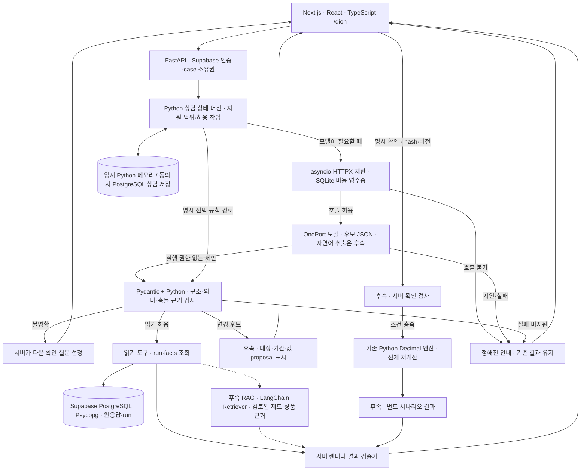
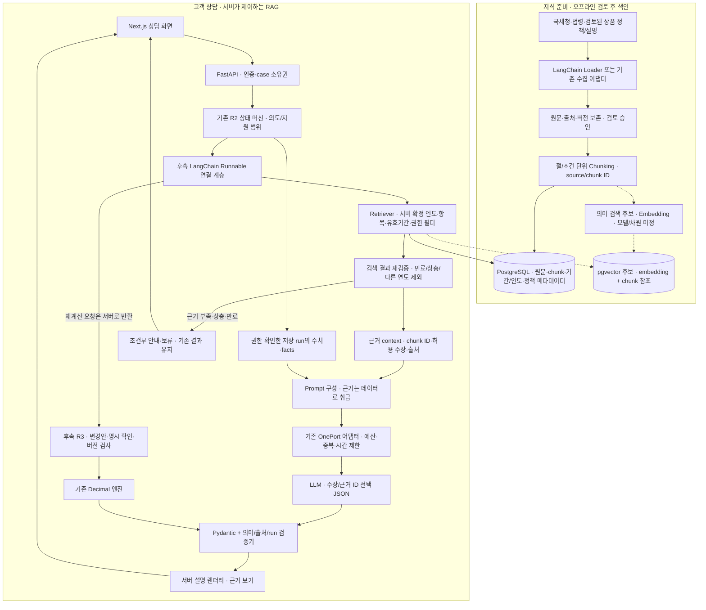
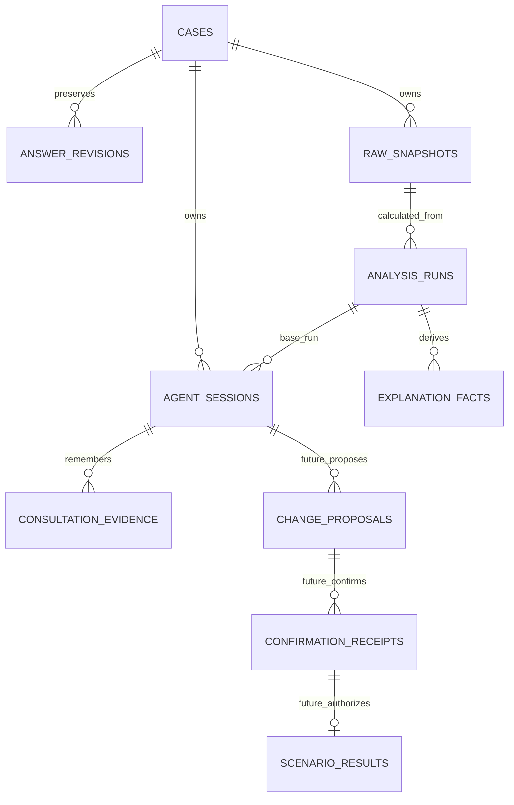
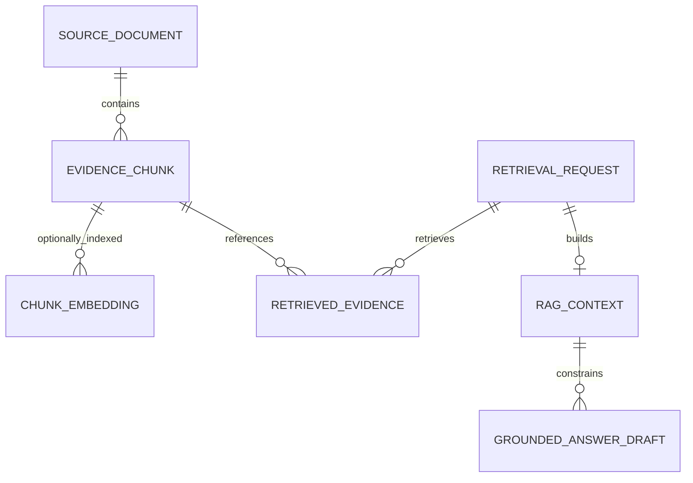
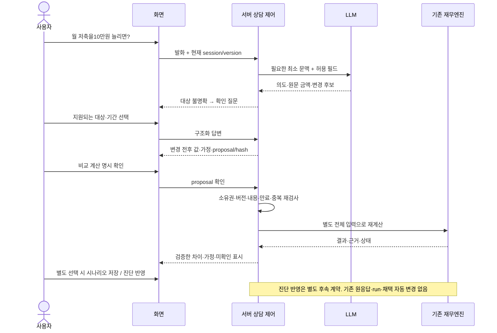

# 고객용 AI 개발 방향·구조 스키마

현재 구현에는 기존 R2 흐름의 합성 mock·OnePort 후보 어댑터와, 확인 후 월평균 세후소득 또는 월 지출 총액을 한 항목씩 비교하는 R3가 포함된다. 지출은 생활비/전체 출금액 기준과 포함 상환·저축 이체액을 보존한다. 아래의 설계 시점 상태와 실제 모델·운영 적용 여부를 구분한다. [현재 R3 범위·실행 검증](integration/2026-11-13-r3-expense-expansion.md) · [첫 구현·제공자 설정](integration/2026-11-12-model-proposal-r3.md)

R2-b의 등록 자료 검색과 LangChain 검증은 별도 `scheme-evidence` API에 구현했다. 기본 등록 자료는 비어 있으며 실제 자료 등록과 운영 연결은 별도 단계다. [등록 근거 계약과 설정](integration/2026-11-13-rag-registered-evidence.md)

기준일: 2026-11-12. 설계 버전: `DION-AGENT-ARCHITECTURE-0.2`.

상태: 사용자와 검토한 개발 방향을 기록한 **후속 개발 설계**. 이번 변경은 문서와 문서용 JSON Schema뿐이며 API·DB·모델·엔진에 적용하지 않았다. 현재 R1/R2 계약을 대체하거나 모델의 실행 권한을 확대하지 않는다.

작업본은 `C:\Users\LG\Projects\DION-ai-r1-20261112`, 브랜치 `codex/result-explanation-r1`, 확인한 HEAD는 `678c3486ff8f6eb5a7bcb77a0c8ba626fc02e159`다. 시작 당시 운영 준비 검사·OnePort 설정·브라우저 재개 수정이 미커밋 상태로 존재했다. 이 문서는 그 변경을 보존하며 운영 배포 여부를 추정하지 않는다.

## 1. 결정한 개발 방향

**서버가 관리하는 상담 흐름에 하나의 논리적 AI 역할과 제한된 도구를 연결한다. LLM은 후보를 제안하고, 서버가 권한·지원 범위·확인 여부를 검사해 실행을 결정한다.**

하나의 논리적 AI 역할이 매 요청 한 번의 모델 호출을 뜻하지는 않는다. 버튼/구조화 입력은 기존 규칙으로 처리하며, 자연어 해석과 설명 선택이 필요할 때만 모델을 사용한다. 첫 확장은 기존 승인 모델 한 종류로 검증한다. **0.2에서는 사용자 요청으로 LangChain 연결 계층과 RAG를 목표 구조에 포함했다. 현재 설치/적용은 하지 않았다.** 소형/상위 모델 분리, 멀티 에이전트, LangGraph는 현재 도입하지 않는다. 모델/도구 개수나 검증하지 않은 비용 배수를 근거로 구조를 확정하지 않는다.

| 책임 | LLM | 서버·엔진 |
| --- | --- | --- |
| 요청 해석 | 의도·모호함·원문에서 추출한 변경 후보 제안 | 지원 의도 확인, 복수/불명확 요청이면 사용자에게 확인 |
| 다음 질문 | 서버가 정한 질문을 설명하거나 허용된 표현 선택 | 결과 의존성·기존 사실·거절/보류·지원 범위로 질문 선정 |
| 근거·상품 사유 | 조회된 허용 주장 중 설명할 항목 선택 | 사유·판정·출처·유효기간 생성과 검증, 생략 금지 제한 강제 |
| 변경 요청 | 대상 필드·원값·단위·증감 여부 후보 추출 | 정확한 단위 정규화, 대상/기간 확인, proposal 발급·명시 확인 |
| 계산 | 계산 결과를 이용한 설명 후보 | Decimal 엔진이 금액·차이·세액·달성률 산출 |
| 기억 | 필요한 구조화 사실을 문맥으로 사용 | 원응답·확인 이력·가정·미확인을 분리해 저장/재개 |
| 실행 | 제한된 작업의 호출 후보 제안 | 허용 목록·인증·버전·예산·확인 조건을 만족할 때만 실행 |

사용자 원문에서 ‘10만원’을 추출하는 것은 **입력 후보** 생성이다. 계산된 금액이나 확인된 사실로 바로 취급하지 않는다. 숫자·상품명은 검증된 결과/카탈로그의 값만 표시하며 모델이 새 금융 사실을 만드는 것을 허용하지 않는다.

## 2. 전체 구조도

아래는 목표 구조다. ‘후속’ 상자는 현재 구현됐다는 의미가 아니다.



LLM에서 DB/엔진/도구로 직접 연결되는 경로는 없다. 검색 문서와 자유 발화도 데이터로만 읽는다. 외부 호출은 서버의 허용 모델·예산·시간·크기 제한과 영속 중복 정책을 통과해야 한다. R3 별도 시나리오 결과는 기존 진단 run이나 고객 채택을 덮어쓰지 않는다.

### 2.1 구성요소별 기술과 선택 이유

버전은 2026-11-12 이 작업본의 설치 패키지와 고정 의존성 파일을 대조한 값이다. 최신 버전 권고가 아니며 운영 서버의 설치 버전까지 확인한 것은 아니다. 적용 표시는 로컬 코드 기준이다.

| 구조 요소 | 사용 기술 | 기능·선택 이유 | 현재 적용 범위/근거 |
| --- | --- | --- | --- |
| 고객 화면 | Next.js16.4.3, React19.3.1, TypeScript6.0.3 | 기존 질문·결과·상담 UI와 타입을 재사용 | 적용. [package.json](../frontend/package.json), [planner.tsx](../frontend/src/components/dion/planner.tsx) |
| FE→BE 요청 | Next.js rewrite, Fetch API, AbortController | 같은 origin의 `/api/*` 전달, 오래된 요청 취소·응답 폐기 | 적용. [next.config.ts](../frontend/next.config.ts), [상담 UI](../frontend/src/components/dion/agent-consultation.tsx) |
| HTTP 서버 | Python3.12.4, FastAPI0.162.0, Uvicorn0.54.0 | 기존 API·인증 dependency·오류 계약을 유지 | 적용. [be_server.py](../backend/app/be_server.py). Python은 로컬 실행 버전 |
| 요청·응답 계약 | Pydantic2.14.1, JSON, JSON Schema | enum·길이·추가 필드·정확한 자료형 검사 | 기존 R1/R2와 opt-in 합성 ModelProposal 검증에 적용 |
| 상담 제어 | 일반 Python 함수·명시 상태 전이·등록 필드 정책 | 모델 호출 없이도 의도 선택·질문·충돌·확인·재개 처리 | 적용. [policy.py](../backend/app/consultation/policy.py), [service.py](../backend/app/consultation/service.py). 별도 agent 프레임워크 없음 |
| 로그인·권한 | Supabase Auth, Bearer 토큰, 서버의 case 소유권 검사 | 인증한 actor와 저장 데이터 소유자를 서버에서 연결 | 적용 코드 있음. [auth.py](../backend/app/be/auth.py), [postgres.py](../backend/app/be/postgres.py). 매 요청 원격 확인, JWT 로컬 검증/인증 캐시는 미적용 |
| 진단·저장 상담 | Supabase PostgreSQL, Psycopg3.3.8, 직접 SQL | 기존 원응답/snapshot/run을 보존하고 transaction으로 상태 저장 | 적용 코드 있음. 원격R2 schema·실계정 확인 상태는 운영 기록 참조. 서버 PostgreSQL 버전은 이번 미확인 |
| 동시성·중복 방지 | DB transaction·row lock, session/input version, request_key·fingerprint | 충돌·중복 실행·확인 후 내용 변경 차단 | 기존 저장/R2 적용. SQLite 검사와 원격 운영 검증을 구분 |
| 임시 기억·로컬 저장 검사 | Python dict/RLock, 표준 sqlite3 | 동의 전 비영속 상담, 네트워크 없는 합성 저장 검사 | 적용. 임시 기억은 프로세스 한정, SQLite를 운영DB 장애의 대체 저장소로 사용하지 않음 |
| 금융 계산 | Python Decimal, 원 단위 십진문자열, 기존 planning 엔진 | 금융값의 float 변환을 피하고 기존 고정 정답 재사용 | 적용. [금액 유틸리티](../backend/app/planning/common.py). R3 비교 계산과 미지원 세법 산식은 후속 |
| LLM 연결 | OnePort HTTP 어댑터, HTTPX0.28.1, asyncio, 구조화 JSON | 기존 제공자 계약·timeout·검증기 재사용 | R1 적용 코드. [oneport.py](../backend/app/explanation/oneport.py). 지정 모델 gpt-6.1-terra는 서버 설정이며 자연어 상담 추출은 미연결 |
| 호출 비용·영수증 | SQLite transaction, 영속 파일, 서버 예산/중복 검사 | 같은 호스트 내 호출 예약·중복·불명확 정산 기록 | R1 적용. [oneport_ledger.py](../backend/app/explanation/oneport_ledger.py). 중앙 PostgreSQL 원장 전환은 후속 설계 |
| 구조·문서 검증 | JSON Schema Draft-07, Ajv6.15.0, Mermaid | 후보 payload 구조·문서 예시 검사, 구조/관계/순서 설명 | Ajv는 설치된 전이 의존성을 문서 검사에만 재사용. 제품의 FE 금융 검증기로 추가한 것이 아님 |
| 회귀 검증 | pytest9.1.1, Playwright1.64.1, Ruff0.17.3, TypeScript/ESLint | 서버 경계·브라우저 재개·타입·정적 검사 | 기존 도구 재사용. 이번 기술 표 추가로 앱 테스트를 다시 실행하지 않음 |

BE 고정 버전은 [requirements.txt](../backend/requirements.txt)와 [requirements-be.txt](../backend/requirements-be.txt)를 함께 읽는다. 공통 파일의 `httpx2`와 BE 파일의 `httpx==0.28.1`은 별도 배포 패키지다. 현재 어댑터는 `import httpx`를 사용하며 기술 표는 그 배포 패키지 버전을 적었다. FE·BE 의존성/lockfile은 이번에 변경하지 않았다.

### 2.2 후속 기능에서 사용할 기술의 범위

- **자연어 후보 추출:** 기존 OnePort 어댑터를 재사용할 계획이다. 문서용 JSON Schema를 서버 Pydantic 계약과 의미 검사로 연결하는 구현·모델별 구조화 출력 검증이 선행한다. 모델이 금융 결과를 직접 생성하도록 바꾸지 않는다.
- **근거 검색:** 목표는2.3절의 LangChain 연결 계층 + RAG다. 첫 검색은 Python/SQL의 항목/과세연도/기간/검토 상태 필터와 등록 source ID 조회를 재사용한다. 의미 검색 경로에는 embedding + pgvector를 후보로 넣으며 모델·차원·비용·DB 확장 지원은 미확정이다. embedding 없이도 검토 자료 조회→근거 기반 설명 흐름을 만들 수 있다. 외부 자유 웹검색은 포함하지 않는다.
- **R3 시나리오:** 기존 Python Decimal 엔진의 전체 실행과 서버 proposal/확인 계약을 연결한다. 새 계산 프레임워크·부분 재계산 최적화를 선행 도입하지 않는다.
- **상태 프레임워크:** Python 상태 관리와 PostgreSQL transaction을 유지한다. LangChain의 Runnable/검색·프롬프트 연결을 후속 설계에 포함하되 실행/저장 권한은 서버에 둔다. LangGraph는 장기 도구 실행·중단 복구가 필요할 때 검토하는 선택 항목이다. Redis/Celery 등은 별도 도입 결정 없이 설치하지 않는다.
- **관측·운영:** 현재 구조화 로그·소요시간/사용량·오류 코드·준비 상태 검사를 재사용한다. 전용 tracing 제품이나 dashboard가 운영 중이라고 표시하지 않는다. 유료 호출·배포·원격 migration은 이번 문서 수정 범위 밖이다.

### 2.3 RAG·LangChain을 포함한 AI 에이전트 확장 스키마

아래 그림은 확장 설계다. 현행 R2-b는 서버의 등록 자료 정확 조회, context 구성, 선택·검증·렌더를 구현했다. 저장 방식과 검색 확장은 [현행 등록 근거 계약](integration/2026-11-13-rag-registered-evidence.md)의 범위를 따른다. RAG는 검색한 근거를 모델 문맥에 넣는 방식이며 LangChain은 이 흐름을 연결하는 라이브러리다. [공식 검색/RAG 설명](https://docs.langchain.com/oss/python/deepagents/retrieval)



| 기술/구성 | DION에서 맡을 역할 | 도입 상태·제약 |
| --- | --- | --- |
| LangChain `langchain-core` Runnable 계층 | 조회→context 구성→기존 모델 어댑터→검증의 연결 | 1.7.7 고정, 합성 MockTransport로 검증 |
| Document Loader·Text Splitter | 검토 자료 수집과 절/조건 단위 분할 | 선택 모듈. 기존 수집기가 있으면 재사용하고 문맥/예외 조항을 분할로 잃지 않음 |
| RAG Retriever | 허용된 항목·과세연도·효력·검토 상태에 맞는 근거 조회 | 등록 파일에서 서버가 정확 조회하며 모델 호출 전에 검색 범위 확정 |
| Embedding | 검토 chunk와 비식별 검색어의 의미 검색 벡터 생성 | 선택 경로·모델/차원 미정. 사용자 원응답/상담 전체를 공용 지식베이스에 넣지 않음 |
| PostgreSQL + pgvector | 기존 DB 계열에서 chunk 참조와 벡터 검색 연결 | 목표 저장 후보. 운영 확장 지원·권한·migration·용량/검색 품질 미검증 |
| OnePort + 기존 어댑터 | R2-b context의 허용 주장·인용 ID 선택 | 기존 전송·예산·중복·시간 제한 재사용. R1은 동일 run의 저장 facts를 별도로 사용 |
| Pydantic·서버 의미 검증 | 응답 구조와 근거 ID·주장 범위·등록 원문 대조 | R2-b context·출처 검증 적용 |
| LangGraph | 장기 작업·복수 확인·실패 후 중단점 복구 | 조건부 후보. RAG/LangChain 추가만으로 필요하다고 판단하지 않음 |

LangChain은 Runnable을 연결할 수 있고, 모델은 자율 agent 루프 밖에서도 호출할 수 있다. DION에서는 기존 OnePort 서비스 호출을 감싼 작은 Runnable/어댑터를 우선 설계한다. 새 ChatModel을 OnePort에 직접 연결해 기존 예산·idempotency·타임아웃 검사를 우회하지 않는다. 라이브러리의 자동 재시도·모델 교체·추가 요약/재질문 호출도 허용한 호출 수에 포함해야 한다. [Runnable 공식 API](https://reference.langchain.com/python/langchain-core/runnables), [모델 직접 사용](https://docs.langchain.com/oss/python/langchain/models)

pgvector는 PostgreSQL의 벡터 유사도 검색 확장이다. SQL에 범위/연도/유효 상태 조건을 넣고, 반환 결과의 메타데이터도 서버가 재검사한다. 근사 검색에서 필터 결과 수가 부족할 수 있으므로 제한된 추가 탐색/정확 조회 또는 보류 경로를 검증한다. 결과를 늘리려고 고객 범위·기간 필터를 제거하지 않는다. 벡터 유사도는 법적 적용 가능성이나 금융상품 적합성 점수가 아니다. [pgvector 공식 설명·필터](https://github.com/pgvector/pgvector#filtering)

**R1 수치 해설에는 외부 자료 검색을 강제하지 않는다.** 같은 run의 facts만으로 설명되는 결과는 기존 경로를 유지하고, RAG는 제도 설명·요건·상품 정책 같은 외부 근거가 필요한 요청에 연결한다. RAG 원문의 세율·한도는 검토된 연도별 정책 fact로 등록/검증한 값만 서버가 인용하며, 검색된 수치를 바로 개인 세액 산식이나 엔진 입력으로 사용하지 않는다.

## 3. 현재 구현과 후속 설계

| 영역 | 현재 기준 | 후속 작업 |
| --- | --- | --- |
| 결과 해설 R1 | OUT-03/05, 허용 claim/fact/relation ID 선택과 서버 렌더링 | 기존 계약 유지, 다른 결과는 새 근거/검증 계약을 만든 후 확대 |
| 공통 상담 R2-a | 규칙 기반 의도·11개 단일 필드·충돌·명시 확인·기억 | 자연어 후보 추출을 기존 서버 흐름 앞에 연결 |
| 세션 기억 | 기존 agent_sessions와 구조화 evidence, 기본 임시/명시 저장 | 대화 요약은 보조 자료로만 추가 검토 |
| R3 | 비교 계산·진단 반영 미구현 | 확인한 patch로 기존 엔진 전체 실행, 별도 결과/반영 선택 |
| 제도 근거 상담 R2-b | 등록 자료 조회·연도 확인·LangChain 선택·근거 검증 | 실제 자료 등록, 상담 화면 연결, 개인 요건과 지원 계산 검토 |
| 상품 설명 | AI 작업본에 상품 원장/정책 통합 미확인 | 기준 소스/OUT-06·상품 판정 계약을 확인한 뒤 사유 설명 |
| 운영 준비 후속 | 별도 미커밋 구현/검증 기록 존재 | 원격 schema·실계정·worker/디스크·비용 원장 검증 |

현재 API는 [R1 계약](result-explanation-r1.md)과 [R2 계약](consultation-r2.md)을 따른다. [운영 후속 기록](integration/2026-11-12-operational-followup.md)에는 브라우저 재개 누락 단계 보완 후 통과가 기록돼 있다. 기존 R2 문서의 미통과 기록은 당시 이력이며, 이번 문서 작업에서 테스트를 재실행한 것은 아니다. 실계정·원격 migration 완료로 확대 해석하지 않는다.

클로드 검토의 상품 원장78개·후보6개·정책 만료일은 해당 기준 소스의 관측이다. 이번 문서에서는 다시 검증하지 않았으며 AI 작업본의 활성 정책으로 복사하지 않는다. 검토기한 만료와 법적 유효기간 종료를 구분하고, 오래된 판정의 신규 제시와 과거 결과 열람을 각각 정의해야 한다.

## 4. 도구 계약과 실행 경계

아래 이름은 **논리적 작업 이름**이다. 새 HTTP endpoint나 이미 등록된 LLM 도구 이름이 아니다.

| 논리 작업 | 단계 | 서버 입력·검사 | 출력/변경 |
| --- | --- | --- | --- |
| READ_SAVED_RUN | R1/R2 재사용 | actor를 인증에서 결정, case/run 소유권·무결성 | 저장 당시 결과·어댑터·hash, 변경 없음 |
| SELECT_NEXT_QUESTION | R2 재사용 | 대상·기간·정의, 결과 의존성·기존 답변/거절 | 등록 질문0~1개, 없으면 보류/기존 입력 화면 안내 |
| RECORD_EVIDENCE | R2 재사용 | 등록 필드·출처·원값·상태·충돌, 명시 확인 | 상담 revision만, application_status=NOT_APPLIED |
| LOOKUP_APPROVED_EVIDENCE | R2-b 후속 | 항목·연도·시행기간·검토 상태·범위 | 출처 ID·허용 설명·미확인 조건, 개인 세액 없음 |
| READ_PRODUCT_DECISION | 상품 후속 | 해당 고객 run·정책/카탈로그 버전·판정 유효성 | 포함/보류/제외 사유, 원장 밖은 판정 없음 |
| CALCULATE_SCENARIO | R3 후속 | 서버 proposal·확인 receipt·원본 hash·전체 입력 검증 | 별도 시나리오 결과, 기존 입력/run/채택 미변경 |
| CALCULATE_TAX | 법정 산식 후속 | 지원 제도/과세연도·검증된 산식·필요 정보 | 지원할 때만 계산된 세액과 근거 |

임의 필드·URL·DB query·모델 이름·actor를 모델 도구 인자로 받지 않는다. 검색 실패, 미지원 산식, 만료 정책은 질문을 무한히 늘리는 대신 이유와 다음 행동을 반환한다. 제도 일반 안내·요건 확인·개인 절세액 계산은 서로 다른 capability다. 계산 미지원이어도 검토된 일반 안내는 가능하지만 개인 적용 확정·예상 세액은 생성하지 않는다.

## 5. 데이터 구조 스키마

### 5.1 관계도 — 논리 구조

`CASES`, `ANSWER_REVISIONS`, `RAW_SNAPSHOTS`, `ANALYSIS_RUNS`, `AGENT_SESSIONS`는 기존 저장 구조를 가리킨다. 나머지는 논리 레코드이며 신규 테이블 DDL이 아니다. 상담의 run/evidence 연결은 현재 state_json 안의 참조이며 모두 DB FK로 구현됐다는 의미가 아니다.



EXPLANATION_FACTS의 fact_id와 상담 evidence_id는 별도 식별자이며 자동으로 같은 것으로 취급하지 않는다.

### 5.2 기준 데이터형

| 레코드 | 주요 필드 | 확정 주체 |
| --- | --- | --- |
| ExecutionContext | actor(서버 내부만), case_id, session_id/version, base_run_id, input_version/hash, raw_snapshot_id, scope/subject, period, adapter/engine/policy versions | 인증·저장 run·서버 설정. 모델 응답으로 변경 불가 |
| ModelProposal(신규 설계) | schema_version, intent, candidates, clarification_code | LLM 후보. 확인 사실이나 실행 명령으로 바로 사용하지 않음 |
| ConsultationEvidence | evidence_id/revision, question/field/definition_version, subject/scope/entity, period, raw_value/unit/state/basis, source, confirmation/supersedes | 기존 R2. 저장 답변 또는 명시 확인 |
| ChangeProposal(R3 신규 설계) | proposal_id/hash, context fingerprint, expires_at, normalized patch, before/after, affected outputs, assumptions | 서버 발급, 사용자 내용 확인 |
| ConfirmationReceipt | proposal/hash, decision, session/input version, confirmed_at, operation scope | 서버. 기억 확인과 재계산 확인의 권한 범위를 구분 |
| ScenarioResult(R3 신규 설계) | scenario_id, base_run_id, input/patch hash, engine/adapter/policy versions, assumptions, result, differences, saved/applied status | 기존 엔진과 비교·검증 계층 |
| ServerDecision(신규 설계) | status, allowed_actions, next_question, evidence/proposal/result refs, reason_codes | 서버. LLM 후보를 검증해 결정 |

### 5.3 LLM 후보 JSON 계약

문서용 [JSON Schema](schemas/customer-agent-proposal-0.1.schema.json)를 추가한다. 버전은 `DION-AGENT-PROPOSAL-0.1`이며 **현재 API가 받는 계약이 아니다**. 설치된 Ajv 검증기가 지원하는 Draft-07의 단순 제약을 사용한다. 기존 `DION-EXPLANATION-DRAFT-1.0`은 변경하지 않고, 새 schema는 후속 자연어 의도/입력 후보에만 사용한다. 특정 모델의 구조화 출력 지원 여부는 구현 때 별도 확인한다.

합성 예시: ‘월 저축을10만원 늘리면?’은 저축 필드가 이 레지스트리에 없으므로 대상 필드를 임의 선택하지 않는다.

```json
{
  "schema_version": "DION-AGENT-PROPOSAL-0.1",
  "intent": "PROPOSE_CHANGE",
  "candidates": [
    {
      "field_ref": null,
      "operation": "INCREASE_BY",
      "source_text": "월 저축을10만원 늘리면?",
      "value": {
        "kind": "MONEY",
        "state": "KNOWN",
        "raw_value": "10",
        "unit": "KRW_10000"
      }
    }
  ],
  "clarification_code": "TARGET_NOT_RESOLVED"
}
```

서버는 원문 일치·등록 필드/정의·연산 가능 자료형·단위·대상·기간·실제/가정 구분을 다시 확인한다. field_ref=null이면 실행할 수 없다. 대상 확인에 필요한 기존 질문/화면을 안내하며, 대응 정의가 없으면 FIELD_NOT_SUPPORTED로 보류한다. 추출한 증액10만원은 변경 후 총액이 아니며 원문에 없는 수치를 채우지 않는다. 서술문은 증거로만 사용하고 렌더러/도구 명령으로 실행하지 않는다.

새 schema에는 모델이 정할 수 없는 actor/case/run, 정책 버전, 확인 완료 상태, 임의 tool_name, 계산 결과 필드를 넣지 않는다. 모델 오류/시간 초과 때는 서버의 명시 선택·규칙 경로로 복구하며 실행을 추정하지 않는다.

### 5.4 서버 결정과 R3 patch 설계

| 항목 | 계약 |
| --- | --- |
| status | CLARIFY, NEEDS_INPUT, WAITING_CONFIRMATION, COMPLETED, UNSUPPORTED, FAILED 중 서버 결정. R2 기존 progress와 별도이며 그 enum을 변경하지 않음 |
| context | case/session/base_run/input/policy 기준을 서버가 부여. 조회 때도 권한 재검사 |
| next_question | 서버가 선정한 등록 field_ref·대상·기간·정의·질문 이유. 필요한 경우 null |
| patch | field_ref/definition, subject/scope/entity, period, operation, original raw/unit, exact normalized delta/value, before/after, basis=SCENARIO |
| proposal | patch+가정+run/input/policy/세션 버전 fingerprint에 묶인 hash·만료·허용 operation |
| confirmation | 실제 표시한 proposal을 사용자 확인. CONSULTATION_ONLY와 CALCULATE_SCENARIO를 별도 범위로 구분 |
| result_refs | 계산 성공 시 서버가 부여한 시나리오/근거 참조. 다른 run의 fact나 상품 판정 혼입 금지 |
| application_status | 기본 NOT_APPLIED. 저장·재개·계산·현재 진단 반영·고객 채택을 구분 |

등록 레지스트리에는 연산 허용 목록도 필요하다. 금액 증감만 산술이 가능하고 BOOLEAN/TEXT/DATE에 증감 연산은 거부한다. 값이 미확인이면 before를0으로 채우지 않는다. basis/정의/기간 불일치도 임의 환산하지 않는다.

### 5.5 데이터 스키마와 기술의 연결

| 데이터 스키마 | 구현에 연결할 기술 | 보장 범위·경계 |
| --- | --- | --- |
| ExecutionContext | FastAPI dependency·Supabase Auth·Psycopg 조회 | actor·case/run/version을 서버에서 결정. 프론트/모델의 임의 actor를 신뢰하지 않음 |
| ModelProposal | JSON Schema Draft-07·문서 검사용 Ajv, 서버 Pydantic·의미 검사 | 합성 mock을 기존 R2 확인 흐름에 연결했다. [지원 문장과 R2 매핑](consultation-r2.md). 실제 모델 출력 지원 확인은 후속 |
| ConsultationEvidence | 기존 Pydantic EvidenceInput, Python 비교 정책, agent_sessions의 state_json | 요청 검사·충돌·확인과 저장 상태를 분리. 원응답은 별도 immutable revision에서 재사용 |
| ChangeProposal | 후속 Pydantic 계약·정규화 JSON·hashlib SHA-256·서버 시각/만료 | hash는 내용 일치 확인용이며 인증 서명이나 사용자 승인 자체가 아님. 소유권·버전·확인 범위 검사를 별도로 수행 |
| ConfirmationReceipt | 기존 확인 API 패턴·transaction·expected_session_version·request_key | 제안 내용과 명시 확인을 연결. CONSULTATION_ONLY receipt를 R3 실행 승인으로 재사용하지 않음 |
| ScenarioResult | 기존 Decimal 엔진·정확한 십진문자열·버전/hash·서버 검증기 | 계산과 전후 차이는 엔진/서버 책임. 저장 구조·endpoint는 R3 별도 계약으로 결정 |
| ServerDecision | 후속 Pydantic 응답 계약·등록 enum·기존 TypeScript 표시 타입 | 서버가 허용 동작·질문·이유를 확정. 현재는 Python/TypeScript 타입을 수동 유지하며 타입 자동 생성은 미도입 |

이 표의 ‘후속’ 기술 연결은 문서용 schema 파일의 필드를 운영 API에 추가했다는 뜻이 아니다. JSON Schema에 기술 이름·비밀키·모델 주소를 고객 데이터 필드로 넣지 않고, 기술 구성은 이 설계 문서와 서버 설정에서 관리한다.

### 5.6 RAG 근거 데이터 스키마 — 논리 레코드

아래는 목표 논리 데이터형이다. 현행 Pydantic 계약과 API에는 출처·chunk·인용 구간·조회 요청·검색 결과·context·허용 주장·답변 draft를 적용했다. 실제 필드와 등록 절차는 [현행 계약](integration/2026-11-13-rag-registered-evidence.md)을 따른다. 계산 run/fact/evidence 식별자와 검색 출처 식별자는 구분한다.

| 레코드 | 핵심 필드 | 역할·기술 |
| --- | --- | --- |
| SourceDocument | source_id/version, official_url, title, issuer, jurisdiction, content_sha256, collected_at, effective_from/to, applicable_tax_years, reviewed_at/review_through, review_status | 공식 원문·수집/검토·법적 효력의 구분. Loader→검토→PostgreSQL 저장 |
| EvidenceChunk | chunk_id, source_id/version, section_ref, text, chunk_sha256, inherited_metadata, corpus_version | 조항·예외의 연결을 보존. Text Splitter/기존 파서 + 원문 위치 |
| ChunkEmbedding | chunk_id/hash, embedding_model/version, dimension, vector, index_version, embedded_at | 선택 pgvector 인덱스. 모델/차원/분할 변경 시 새 인덱스 버전으로 재색인 |
| RetrievalRequest | retrieval_id, session/base_run_ref, item/condition IDs, tax_year, evaluation_on, jurisdiction, server_access_scope, corpus/retrieval_policy_version, query, result_limit | 서버가 검색 범위를 확정. client/LLM이 권한·연도·검토 필터를 해제할 수 없음 |
| RetrievedEvidence | retrieval_id, chunk/source refs·hashes, metadata_snapshot, retrieval_method, score(검색 신호), eligibility_check, allowed_claim_refs | 검색 후보와 근거로 사용할 수 있는 항목 구분. 유사도만으로 승인하지 않음 |
| RagContext | context_id/hash, retrieval_id, base_run/fact_set_ref, evidence_refs, allowed_claim_refs, context_status, reason_codes, context/prompt/policy versions | OnePort에 넘길 최소 근거 context. 상태는 USABLE/INSUFFICIENT/CONFLICTING/EXPIRED/FAILED 구분 |
| GroundedAnswerDraft | schema_version, context_ref/hash, base_run/fact_set_ref, blocks의 claim_id·evidence_refs·wording_id, next_check_ids | 모델의 선택 결과. 후속 별도 Pydantic 계약으로 정의하고 기존 R1 draft를 조용히 변경하지 않음 |

검색용 score는 비금융 검색 신호이며 원 단위 금액과 다른 자료형이다. 그것을 자격·추천 신뢰도나 성공 확률로 표시하지 않는다. retrieved metadata의 기준 기간과 policy의 검토기한은 별개로 검증한다. 공식 자료 사이에 적용 시점이 다른 내용이 있으면 유사도 순위만으로 하나를 확정하지 않는다.

과세연도가 필요한 요청에서 연도가 확인되지 않았으면 질문하거나 연도와 무관한 일반 안내로 제한한다. 모델이나 서버가 현재 연도를 임의로 대입해 개인 적용을 판단하지 않는다.



첫 지식베이스는 검토한 공용 공식 자료·서비스 정책에 한정한다. 고객 원응답·계좌·상담 기억은 공용 chunk/vector에 넣지 않는다. 개인 사실은 기존 소유권 검사 후 별도 문맥으로 필요한 부분만 결합한다. 비식별 query라도 embedding 제공자·요금·전송 범위 승인 전 외부 호출하지 않는다. 기존 생성 모델 승인 금액을 embedding/재색인 예산으로 자동 사용하지 않는다.

근거 부족·만료·상충이면 개인 적용 결론과 계산값을 생성하지 않는다. source URL은 모델이 새로 만들지 않고 서버가 검증한 source_id에서 삽입한다. 응답 검증은 JSON 구조 외에 evidence가 현재 context에 존재하는지, 인용한 주장이 실제 조항/검토 정책에서 허용되는지, 연도·조건·예외·같은 run의 숫자가 맞는지까지 포함한다. 자동 확인이 어려운 해석은 검토된 주장으로 제한하거나 보류한다. LangChain의 구조화 출력만으로 이러한 의미 검증이 완료되지는 않는다. [공식 구조화 출력 설명](https://docs.langchain.com/oss/python/langchain/structured-output)

캐시의 추가 키는 corpus/index/embedding/retrieval/context 버전과 항목·연도·범위다. 자료 철회·만료 시 응답/검색 캐시도 무효화한다. 토큰 절약용 요약이 원문 예외·적용 기간을 제거하면 근거로 사용하지 않는다.

## 6. 조건 변경의 순서



첫 R3는 지원하는 단일 필드에서 시작하고 기존 엔진 전체 실행을 기본으로 한다. 의존성표는 영향 설명에 먼저 사용한다. 부분 재계산은 전체 실행과 값·상태·근거·게이트가 같다는 독립 검증과 실제 성능 필요가 확인된 뒤 검토한다. 시나리오 재계산/저장/진단 반영 API와 저장 형식은 구현 전 별도 R3 계약으로 정하며 현재 endpoint를 만든 것으로 표시하지 않는다.

## 7. 기억·캐시·운영

- 금융 사실의 기준은 구조화 evidence와 원응답 revision이다. 요약은 검색/대화 연결 보조이며 확인 사실·금융 입력을 대체하지 않는다. 요약이 facts와 다르면 facts를 우선하고 요약을 폐기한다.
- LLM에는 필요한 facts·불명확 상태·근거 ID만 전달한다. 원자료 전체 대신 요약만 보내면 대상/기간/단위가 빠질 수 있으므로 필요한 메타데이터도 유지한다. 인증 토큰·키·불필요한 식별정보는 제외한다.
- 결과 설명 캐시는 실행 중복 방지 receipt와 다르다. 후속 캐시 키는 actor/case 범위, run/fact-set hash, 결과/전략 ID, 설명 길이/언어, 설명/validator/prompt/정책·근거 버전을 포함한다. 캐시 hit에도 권한·만료·현재 표시 기준을 검사한다. 단순 run_id 캐시는 채택하지 않는다.
- 프로세스 임시 상담, 중앙DB 저장 상담, OnePort 비용 원장을 각각 관리한다. single worker는 임시 기억 접근 조건일 뿐 디스크/재시작/다중 호스트 문제의 해결책이 아니다. 중앙 OnePort 원장 전환은 별도 구조 변경 설계·migration·검증 작업이다.
- DB 설정/연결 오류의503은 유지한다. 자동 SQLite 대체 저장을 넣지 않는다. 인증 캐시는 지연과 허용 취소 지연을 측정한 뒤 별도로 결정한다.
- 모델은 우선 한 종류를 사용한다. 모델별 정확도·지연·비용이 확보된 뒤 라우팅을 검토하며 임의 모델 자동 교체는 하지 않는다. LangGraph는 장기 외부 도구 실행·중단 복구·복수 확인 분기가 실제로 필요할 때 재검토한다.

## 8. 개발 순서·완료 조건

기존0.2 설계의 R2-b→R3 순서를 이번 논의에 따라 아래의 작은 구현 순서로 보완한다. 단계 이름은 유지하며 각 기능 계약의 범위는 자동 확대하지 않는다.

| 순서 | 개발 묶음 | 완료 조건 |
| --- | --- | --- |
| 1 | R1/R2 운영·재개 기반 | 기존 해설/상담 회귀와 브라우저 재개, 원격 schema·실계정·타사용자 차단을 실제/모의로 구분해 확인. 배포/DB 적용은 별도 승인 |
| 2 | R2 자연어 후보 추출 | 명시 입력은 모델 없이 동작, 모호한 요청은 확인, 잘못된 필드·숫자·도구는 거부. R2 사실/버전/확인 정책 재사용 |
| 3 | R3 첫 비교 계산 | 지원 단일 필드, 확인 후 전체 엔진 실행, 전후 차이·가정, 중복/낡은 proposal 차단, 현재 진단 자동 변경0 |
| 4 | R2-b LangChain·RAG 근거 상담 | 검토 원문/source/chunk 계약→등록 자료 검색→LangChain 연결→선택 embedding/pgvector 순으로 검증. 일반 안내·요건·계산 capability 구분 |
| 5 | 상품 사유·기타 확장 | 상품 판정/OUT-06 계약·정책 유효성·데이터 출처 확인 후 포함/보류/제외 설명. 점수화·외부상품API·목표역산/실적은 별도 계약 |

제도/상품 기준 소스 대조와 자료 검토는 순서3 이전에도 가능하다. 여러 단계의 실행을 한 번에 구현하는 지시가 아니다. 모델 도구 호출이 추가돼도 저장/재개·권한·숫자 검증을 재작성하지 않는다.

자료 준비는 [2026-11-12 근거자료 점검·보완 조사 기록](integration/2026-11-12-rag-source-audit.md)을 따른다. 공유 조사표의 기존 3개 탭은 유지하고 보완 과제·근거 관리·답변/질문 연결·검증 사례·개발 준비 탭을 추가했다. 조사 준비 행과 실제 검토된 source/chunk를 구분하며, 첫 제도의 검토된 작은 근거 묶음으로 연결을 시작할 수 있다.

RAG 추가 완료 기준: 고정 질의별 필수 조항 회수·올바른 연도/기간 필터·출처 철회/갱신·상충/근거 없음·문서 내 프롬프트 인젝션·개인 정보 비색인·다른 사용자/다른 run 차단·인용과 주장 일치·중복/비용/시간 제한을 검사한다. 검색 품질과 금융 산식 회귀는 별도 검증이며 근거 검색 성공을 세무 계산 지원으로 승격하지 않는다. 최초 임베딩 모델/차원/예산·pgvector 확장 가능 여부·채택 패키지 버전은 구현 전 확정할 항목이다.

필수 검증 사례: 동일/모호 의도, 이미 답한 질문·거절 반복 방지, 같은 값의 단위 재사용, 다른 대상/기간/정의·가상 혼입, 월세후/연세전 혼동, 확인 전 변경 차단, 낡은 proposal, 중복 요청, 다른 run 참조, 출처/정책 만료, API 지연·실패, 부분 정보의0 치환 방지, 기존 결과 유지. FE/BE 계약은 기존 validator를 기준으로 공유 예제의 수락/거부를 검사하며 타입 생성 도구 도입은 별도 필요성 검토 후 결정한다.

## 9. 이번 문서 검증과 인계

0.1 작성 때 실행한 문서 검사: 상대 링크 누락0, 설치된 Ajv의 Draft-07 schema 검증·내부 참조 컴파일·본문 JSON 예시1건 검증 통과, 신규 파일 공백과 `git diff --check` 통과. 새 검증 의존성은 설치하지 않았다. 당시 Mermaid 구조도3개는 별도 이미지 렌더러 검사를 수행하지 않았다. 런타임·금융 계산·DB·모델·배포 검증은 재실행하지 않았다. 실행 기록은 [개발 로그](development-log.md), 현황은 [프로젝트 상태](project-status.md)에 남긴다.

기술 표 추가 확인: frontend의 실제 설치 package.json과 backend 가상환경의 배포 패키지 metadata를 고정 의존성 파일과 대조했다. 문서 상대 링크·공백을 검사했으며 외부 API 호출·운영 DB 조회·설치/업데이트·앱 재검사는 하지 않았다. 위 JSON Schema 검증은 앞선 schema 작성 때 실행한 기록으로 이번 기술 표 추가 시 다시 실행한 검사가 아니다.

0.2 문서 범위: 공식 LangChain 검색·Runnable·모델/구조화 출력 문서와 pgvector 자료를 확인해 확장 구조도·RAG 관계도·레코드/검증 기준을 추가했다. 문서 상대 링크24개와 공백/`git diff --check`를 확인했다. 전체 Mermaid 정의는5개이며 별도 이미지 렌더링은 미실행이다. 라이브러리/DB 확장 설치, embedding·모델 유료 호출, 자료 색인, API 연결, 원격 migration·배포는 수행하지 않았다. 문서용 기존 ModelProposal JSON Schema0.1은 변경하지 않았다.

관련 근거: [기존 고객용 AI 설계](customer-ai-agent-design.md), [R1 계약](result-explanation-r1.md), [R2 계약](consultation-r2.md), [운영 후속 기록](integration/2026-11-12-operational-followup.md), [공식 워크플로/에이전트 구분](https://docs.langchain.com/oss/python/langgraph/workflows-agents). 공식 문서의 구분을 참고했고 DION에 서버 제어 흐름이 적합하다는 판단은 이번 설계 결정이다. 해당 프레임워크를 설치한 것은 아니다.
