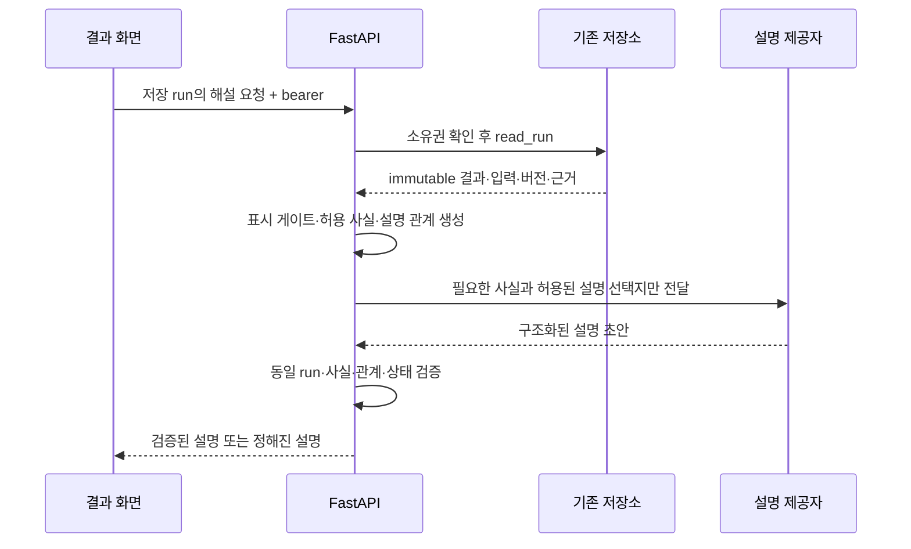

# DION 고객용 AI 에이전트 설계·검토안

**2026-11-12 구현 인계:** 이 문서의0.2 원문은 ZIP 원본 폴더에서 현재 `DION-ai-r1-20261112`로 가져온 설계 이력이다. 아래 ‘미구현’·배포 상태는 당시 기록이다. 현재 구현은 [R1 해설 계약](result-explanation-r1.md), [R1-c 실제/모의 검증](integration/2026-11-12-oneport-r1c.md), [R2-a 공통 상담 계약·검증](consultation-r2.md)을 우선한다. R2-a는11개 단일 필드부터 연결했고 브라우저 재개 전체 경로가 미완료다. 아래 R2-b/R3·검색·세무·commit 제안을 구현 완료로 읽지 않는다.

이관 차이: 원본이 참조한 `tax_guidance` 패키지·절세 UI/명세와 일부 과거 검증 문서8개 경로는 현재 Git 작업본에 없다. 아래 해당 링크는 ‘원본 묶음’ 경로 표기로 보존했다. 특히 절세8개 UI/서비스 재사용 주장은 원본 작업 폴더 당시 관측이며 이 checkout의 구현 상태가 아니다. R2-b 시작 전 코드/계약 이관 여부를 먼저 대조해야 한다.

기준일: 2026-11-12, Asia/Seoul. 문서 버전: `DION-CUSTOMER-AGENT-DESIGN-0.2`.
상태: **0단계 개발 계약·순서 정리 완료 / 후속 기능 미구현**. 사용자 요청에 따라 기존 설계와 추가 기능을 이 문서에 통합했다. 단계별 입력·출력·책임·API·저장 상태·검증 기준의 설계 기준이며, AI API·상담 저장·재계산·새 금융정책의 구현이나 배포 승인을 뜻하지 않는다.

읽는 순서: 1절 범위 → 7절 단계별 계약 → 10절 책임 → 11절 기능 → 12절 API·상태 → 8절 검증 → 13절 미결정·인계. 3~6절은 결과 해설·절세 8개·재계산·원포트의 상세 계약이다. 신규 API·스키마·상태는 모두 **설계안**이며 현행 구현으로 표시하지 않는다.

P0 후속 확인(2026-11-12): 배포 소스·정의 충돌·저장 run 독립 검증 (원본 묶음: `integration/2026-11-12-ai-p0-verification.md`)을 추가했다. 실제 DB 정의를 읽기 전용으로 대조했고, 임시 복사본에 진행 중인 호환 후보를 적용한 BE 검사는 126 passed / 7 skipped였다. 인증 제공자 응답은 mock이며 실제 계정·최종 배포 검증은 다른 작업창에서 진행 중이다. 현재 통합본 런타임에 후보를 중복 반영하지 않았고 **P0 전체 완료·R1 구현 시작으로 판정하지 않는다**.

## 1. 검토 결론과 첫 개발 범위

제안한 순서인 **결과 해설 → 절세 요건 상담 → 확인 후 조건 변경·재계산**이 적절하다. 이미 있는 원응답 저장·계산·절세 안내를 재사용하면 된다. 첫 기능은 모델을 자유롭게 실행시키는 에이전트보다, 접근권한이 확인된 계산 기록을 읽고 검증 가능한 설명을 만드는 작은 서버 서비스가 적합하다.

개발 전에 보완할 핵심은 다음과 같다.

1. **저장과 배포 버전부터 맞춘다.** 로그인 성공과 전체 답변 저장 성공은 다르다. 최신 결과 복구 기록에도 DB 정의 버전 충돌이 미해결로 남아 있다. 절세 안내의 배포 누락은 0.1 작성 시점의 관측이며, P0에서 정확한 배포 소스와 계약을 다시 확인한다.
2. **미리보기와 저장 결과의 경로를 분리한다.** 공개 preview에는 영속 `run_id`가 없다. 첫 AI 호출은 로그인 사용자가 소유한 저장 run에만 허용한다. 미리보기는 기존 설명을 즉시 보여주고, 고객이 선택하면 기존 저장·계산 흐름으로 연결한다. 이 연결을 검토 도구 안에만 두면 첫 기능을 찾기 어렵다.
3. **숫자 일치만으로 해설을 승인하지 않는다.** 같은 90만원을 ‘월 잔여’ 대신 ‘투자 권장액’이라고 설명하는 오류도 차단해야 한다. 수치·단위·귀속·기간·근거·표시 게이트·후보/추천 상태를 함께 대조한다.
4. **절세 요건과 계산 지원을 분리한다.** 현재 8개 안내의 개인 절세액은 모두 null이다. 상담으로 요건이 확인돼도 법정 계산 지원이 생기는 것은 아니다. 계산 지원 여부를 먼저 알리고 불필요한 상세정보 수집을 피한다.
5. **작은 출시 단계와 확장 단계를 구분한다.** 첫 구현에서는 OUT-03 월 현황과 OUT-05 두 월 후보의 해설을 우선한다. 다른 결과는 기존 정적 안내와 미지원 설명을 유지한다. 14개 결과를 모두 개인화 설명 가능으로 표시하지 않는다.

첫 기능 완료 의미는 ‘검증된 결과 해설을 제공하거나 안전하게 정해진 설명으로 대체한다’이다. 금융정책의 타당성, 투자 적합성, 세금 신고, 고객 채택·거래의 완료를 의미하지 않는다.

0단계에서 고정한 순서는 **P0 저장 기반 → R1-a/b 정적·mock 해설 → R1-c 실제 제공자 → R2-a 의도·질문·충돌·기억 → R2-b 절세 근거 상담 → R3 확인 후 재계산**이다. 목표 역산(X1)과 실적 재검토(X2)는 후속 확장으로 분리한다. 기존 R4는 법정 산식·상품/적합성 정책의 별도 개발 범위이며 X1/X2와 같은 뜻이 아니다. 첫 구현은 P0만, 첫 사용자 해설은 R1이며 자유 상담·검색·조건 변경은 R1에 넣지 않는다.

## 2. 기준과 실제 확인 상태

### 2.1 적용 순서

- [루트 지침](../AGENTS.md), [시작 문서](../README.md), [현황](project-status.md), [업데이트 규칙](update-guide.md).
- [질문 계약 1.2/1.2.1](questions/v1.2/README.md), [실행 바인딩 1.3-engine](questions/v1.3-engine/bindings.json). 설계 질문 55개, 결과 게이트 OUT-01~14, 빠른 기본 11개와 해당자 조건부 상세 0~2개, 정밀 직접 진입을 유지한다. 현재 UI는 기본 11개 계약을 8개 고객 화면에 묶는다. 질문 수·입력칸 수·결과 게이트 수·결과 5뷰는 서로 다른 수다. 여섯 생애단계는 질문 순서와 관련 보기를 조정하며 목표·위험등급·투자비중을 자동 생성하는 근거로 쓰지 않는다.
- [엔진 범위·배정정책 1.0](financial-engine-spec.md), [실행 계약](planning-engine-v1/contract.md), [질문 어댑터 계약](planning-engine-v1.1/adapter-contract.md), [엔진 1.1 인계](planning-engine-v1.1/README.md).
- [FIN-DATA-1.0/FIN-MAP-1.0 원문 19·20절](dion/07_REFERENCE_SNAPSHOTS/engine/DION_Data_and_Design_Handoff_v1_0.md), [빠른5/정밀5 결과 명세](dion/07_REFERENCE_SNAPSHOTS/frontend/DION_Portfolio_Frontend_Implementation_Spec_v1_0.md). 과거 37질문·개념 결과 45개를 현행 55/14로 바꿔 읽지 않는다.
- 절세 안내 공용 계약 (원본 묶음: `tax-guidance.md`), 실제 `backend/app/be/` API와 `frontend/src/components/dion/` 코드.
- [11월 2일 아키텍처 초안](https://docs.google.com/document/d/1gCtVAjml2ndTn5ECvV54U2yEke5XKgiL_b2m2H3_y80/edit?tab=t.0)은 비교 대상이다. 2026-11-12 Google Docs 본문을 직접 읽었다.

이 문서는 AI 계층의 신규 제안만 정한다. 원질문·계산 산식·영속ID·기존 고정 정답을 변경하지 않는다. 원응답의 `namespace/design_id/definition_version/definition_text/option_labels`, 단위·누락상태·귀속·기간·revision을 유지한다. 1.2.1 적용 질문과 1.2 질문의 혼합 정의도 정상이며 일괄 버전 치환하지 않는다.

### 2.2 코드·실행·배포 증거

아래 ‘0.1 작성 당시’ 행과 8.3절은 최초 설계 때의 실행 이력이다. 0.2에서는 로컬 코드·문서만 다시 대조했고, 운영 로그인·DB 쓰기·HTTP·브라우저·AI 호출을 재실행하지 않았다. 최신 결과 복구 기록 (원본 묶음: `integration/2026-11-12-diagnosis-results.md`)은 별도 배포 작업본 `C:/Users/LG/Projects/DION-result-fix-20261112`, 커밋 `9af8193`, 실제 주소 E2E 12건 통과와 저장 충돌 미해결을 기록한다. 이 통과 기록을 현재 통합 폴더 또는 AI 기능의 검증으로 옮기지 않는다.

| 영역 | 확인한 구현과 재사용 대상 | 이번 확인 범위와 제한 |
| --- | --- | --- |
| 작업본 | 현재 폴더는 ZIP 통합본. Git 최상위는 상위 `C:/Users/LG/Projects`, 이 dion 폴더는 untracked | 독립 checkout/HEAD가 아니다. 상위 저장소의 무관한 변경을 stage/commit하지 않음. 배포 커밋과 같다고 주장할 수 없음 |
| 서버 진입점 | [be_server.py](../backend/app/be_server.py)가 기존 main의 앱에 BE·질문·인증 라우터를 등록 | 새 라우터도 이 진입점에 등록. `app.main:app`만 실행하면 DION API를 제공하지 않음 |
| 프록시·질문 UI | [next.config.ts](../frontend/next.config.ts)의 `/api/*` rewrite, [planner.tsx](../frontend/src/components/dion/planner.tsx)의 preview·저장·run 조회 | 새 BFF 전체를 만들 필요 없음. 기존 토큰 전달과 늦은 응답 배제 패턴 재사용 |
| 인증·권한 | [auth.py](../backend/app/be/auth.py)의 Supabase bearer 검증, [postgres.py](../backend/app/be/postgres.py)의 case 소유자 확인 | 임의 actor ID를 요청 본문에서 받지 않음. 로그인된 case 소유자가 현재 권한 단위이며 가족 간 별도 공유권한 기능은 아님 |
| 저장·버전 | [raw_store.py](../backend/app/be/raw_store.py), [store.py](../backend/app/be/store.py)의 immutable 원응답·snapshot·analysis_runs, expected_version/request_key | `run_id`, `raw_snapshot_id`, `input_version`, `input_hash`, `is_current`, adapter 원본/정규화 해시 존재. `profile_version`은 별도 개념 |
| 계산·표시 | [question_bridge.py](../backend/app/be/question_bridge.py), [results.tsx](../frontend/src/components/dion/results.tsx) | 엔진 결과, presentation_gates, 보류 이유, 두 후보, 정책·상태 축 재사용 |
| 절세 | tax_guidance 패키지 (원본 묶음: `../backend/app/tax_guidance/contract.py`), tax-guidance.tsx (원본 묶음: `../frontend/src/components/dion/tax-guidance.tsx`) | 로컬에 8개 안내·요건·공식 출처·UI 존재. 법정 절세액 계산과 AI 상담은 없음 |
| 도움말 | [companions.tsx](../frontend/src/components/dion/companions.tsx) | FAQ 창이다. AI 연결 완료로 재명명하지 않음 |
| AI | backend/app와 frontend/src에서 모델 호출·해설 서비스·`fact_id` 구현을 찾지 못함 | 이번에 제안할 신규 범위 |
| 이전 로컬 검증 | 11/11 기록 (원본 묶음: `integration/2026-11-11-input-output.md`): Core 428 passed/7 skipped, Build 통과, E2E 34 passed/2 skipped | 이전 기록이다. PostgreSQL 선택 검사 skip 및 저장 브라우저 2건 미실행을 통과로 바꾸지 않음 |
| 이전 실제 배포 | 11/11 배포 기록 (원본 묶음: `deployments/2026-11-11-team-review.md`): FE·BE 배포, 로그인200, case생성201, LIFE-01 저장200 | F03 저장409 `DEFINITION_VERSION_CONFLICT`; 전체 저장·복원 미통과. 당시 커밋 `6d8e805a88f25fe4538969d079461cb741d51a2e` |
| 0.1 작성 당시 공개 배포 점검 | FE `/dion` 200, BE `/health` 200, 공개 OpenAPI 200. FE 경유 synthetic preview 200, 월 잔여 `900000`, NOT_SAVED | 당시 실제 로그인·DB 쓰기와 배포 커밋 식별은 미실행. 위 최신 기록과 구분 |
| 0.1 작성 당시 배포 차이 | preview에 `tax_guidance` 없음, `/api/fe/v1/tax-guidance/contract` 404. 공개 OpenAPI에도 해당 GET 없음 | P0에서 재확인할 차이. 로컬과 배포의 동일 버전 또는 현재 절세 배포 완료를 주장하지 않음 |

공개 확인 주소는 [FE](https://dion-review.vercel.app/dion), [BE health](https://dion-api-review.onrender.com/health), [OpenAPI](https://dion-api-review.onrender.com/openapi.json)다. 현재 응답 확인과 전체 배포 검증을 구별한다.

### 2.3 충돌·보완 목록

| 위치 | 차이·영향 | 설계 처리 |
| --- | --- | --- |
| 11/2 초안 1·2·4·5·8절 | 재무계획 3안, 신규 `/api/v1/*`, DB·인증은 제안 단계 | 안정 `STABILITY_FIRST`·확대 `INVESTMENT_CAPACITY` 2안을 사용. 이미 있는 `/api/be/v1`·`/api/fe/v1`·저장/인증을 재사용 |
| 초안 3절 | 해설에서 계산 도구를 호출하는 흐름 | R1은 저장 결과 읽기만. 해설 클릭이 새 계산·원응답 수정·채택을 일으키지 않음 |
| 초안 4절 `calc_facts` | 별도 테이블 제안이지만 실제 구현 없음 | R1은 저장 run에서 결정론적으로 fact 목록을 생성. 별도 금융 사실 DB는 불필요 |
| [model.ts 69행](../frontend/src/lib/dion/model.ts), [raw_store.py의 _bind_definition](../backend/app/be/raw_store.py) | UI 문구 버전을 기존 question_ref.option_labels에 추가하면서 동일 정의 버전의 hash가 달라짐. 배포 저장 충돌 원인과 같은 코드가 로컬에도 있음 | 선행 호환 수정. UI 표시 버전을 금융 질문 정의 밖으로 분리하고 과거 정의/원응답을 보존. DB 정의 덮어쓰기·일괄 버전 상승으로 회피하지 않음. 현재 운영 DB 재현은 별도 |
| [statuses.py 45행](../backend/app/planning/statuses.py) | 실제 연결 후에도 `api_ui_integration=NOT_CONNECTED` 고정 | 엔진 원문은 유지하고 실제 bridge/배포 증거와 구분. 이 필드를 LLM에 서비스 연결 실패 사실로 전달하지 않음. 별도 정합성 개선 후보 |
| results.tsx의 visible(), question_bridge.py | 계산값이 존재해도 부동산/보증금 presentation gate로 표시를 보류할 수 있음 | AI도 같은 게이트 적용. `partial_result`·숨겨진 후보를 확정 결과로 노출 금지 |
| service.py의 적용기간 검사 | 저장 시 evaluation_on과 검토기한을 비교. 과거 저장 run을 훗날 다시 읽는 시점의 유효성은 별개 | 원결과는 보존하고 해설 시 `explained_at` 기준 출처 만료를 추가 검사. 오래된 절세 안내를 현재 자격판정으로 재사용하지 않음 |
| 일부 README·현황·11/10 엔진 인계 | API/DB/UI 미연결 등의 과거 문구가 남음 | 최신 코드·배포 기록과 함께 읽고 역사 기록은 덮어쓰지 않음 |
| 11/12 결과 복구 기록 (원본 묶음: `integration/2026-11-12-diagnosis-results.md`) | 별도 배포 소스의 복구·최종 검사가 추가됐으나 저장 정의 충돌은 남음. 0.1의 ‘최종 기록 미기입’ 관측은 대체됨 | P0는 배포 기준 소스부터 확인. preview 120초와 AI 전용 timeout을 분리하고, 결과표시 복구를 저장/AI 완료로 확대하지 않음 |
| 사용자 검토 중인 화면안 | 현행 4번은 상품정보와 절세가 함께 있음 | 3번 투자구성·상품, 4번 절세·상담은 권고안으로만 기록. R1과 동시에 전체 탭 재편을 강제하지 않음 |
| [질문 README](questions/v1.2/README.md), [어댑터 계약](planning-engine-v1.1/adapter-contract.md) | 55질문/14결과와 엔진 22묶음은 범위가 다름. 제출된 질문 내부의 UNKNOWN은 next_question_ids만으로 발견할 수 없음 | R2 질문 선택은 결과 missing/adapter issues/표시 gate까지 확인. 보존 전용·미지원 필드는 상세 수집 전에 안내 |
| [어댑터의 상태 매핑](planning-engine-v1.1/adapter-contract.md) | 엔진 UNKNOWN에는 원응답의 미입력·나중에·응답거절이 합쳐질 수 있음 | 재질문 여부는 원응답 상태와 omission_reason으로 판단. 엔진 UNKNOWN만 보고 거절한 질문을 반복하지 않음 |
| tax_guidance/service.py의 optional_checks (원본 묶음: `../backend/app/tax_guidance/service.py`) | checked_on이 tax_year와 같은 연도이고 evaluation_on 이하여야 함. 이후 연도에 과거 과세연도를 재확인하는 상담과 충돌 가능 | R2-b에서 과세연도·자료발생일·확인일을 분리. 현행 검사를 우회하지 않고 지원 불가로 보류; 확대는 새 체크 계약·독립 반례 필요 |
| tax_guidance/contract.py의 CheckSet (원본 묶음: `../backend/app/tax_guidance/contract.py`), service.py의 apply_check | boolean 체크와 같은 조건의 충돌 검사는 존재. 날짜·연간금액 원문, 상담 확인, 임의 의미변환은 지원하지 않음 | 체크 판정은 재사용하고 상담 원문은 별도 스키마. 모델 추출값을 met=true 또는 공식 증빙 검증으로 승격 금지 |
| [엔진 계약 5·6절](planning-engine-v1/contract.md) | 목표 적립액 계산은 있으나 변경변수 탐색·역산 최적화 API는 없음. 보호/목표 부족, B1 감액 권한, 가정 확인은 기존 제약 | X1은 기존 계산을 제한된 후보에 반복 적용하는 새 계층. 자동 목표 연기·보호자금 사용·감액·수익률 가정을 추가하지 않음 |
| [store.py의 case_plan_links](../backend/app/be/store.py), [api.py](../backend/app/be/api.py) | adopted_plan_ref 보존 구조는 있으나 현재 BE API에 채택·월실적 저장/조회 기능은 없음 | X2는 실제 plan_id/version·기록 계약이 선행. run/draft_id를 채택 계획이나 실적으로 대체하지 않음 |
| AGENTS.md의 ‘AI 설명은 추후 별도 계층’ | 현행 런타임과 후속 AI 설계를 구분하는 지침 | 이번 승인은 문서 정비만. 후속 단계의 명시 구현 지시에 따라 별도 계층을 추가하며 엔진 계약은 유지 |

### 2.4 결과 14개의 해설 연결 범위

아래는 [실제 engine.py](../backend/app/planning/engine.py)의 결과 목록이다. 모듈 함수의 존재, 질문 어댑터 지원, 실제 입력 충족과 UI 노출은 별개이므로 매 run의 상태를 읽는다. OUT-10의 미지원과 별도 tax_guidance의 요건 안내는 모순이 아니다.

| 결과 | 현재 의미·제한 | 첫 해설 처리 |
| --- | --- | --- |
| OUT-01 | 첫 현황, 부분 요약 | 기존 표시 유지, R1 모델 설명 대상 밖 |
| OUT-02 | 전체 순자산, 자산 범위/평가일/표시 게이트 필요 | 기존 표시 유지. 보증금·비현금을 가용투자로 설명 금지 |
| OUT-03 | 월 가용흐름, 납입 후 잔여와 투자여력 구분 | R1 우선 대상 |
| OUT-04 | 목표 준비·필요적립 | R1 OUT-05의 확인된 근거로만 참조, 별도 자유 해설은 후속 |
| OUT-05 | 두 재무안의 명시 월별 시나리오 | R1 우선 대상. 성공 월과 보류 월 분리 |
| OUT-06 | 개인화 투자 검토 NOT_SUPPORTED | 미지원 정적 안내. 상품·비중 생성 금지 |
| OUT-07 | 교육·가족지원 목표 달력 | 기존 목표 결과의 지원 범위만 표시, 후속 |
| OUT-08 | 연금 현황 | 절세 상담에서 필요 시 같은 run의 계산 연결 참조 |
| OUT-09 | 확인한 세후 예상액 기반 은퇴 부족액 | 세후 최적 수령 비교와 구분, 후속 |
| OUT-10 | 공제·계좌 세후효과 NOT_SUPPORTED | 세액 산출 미지원 정적 안내 |
| OUT-11 | 확인 세액·납부현금 | 외부에서 확인한 금액의 현금사건, 새 법정 세액 산출 아님 |
| OUT-12 | 받을 상속 시나리오 | 미확정 수령은 현재 재원에서 제외, 후속 |
| OUT-13 | 명시 배분·확인 상속세 유동성 | 내부 엔진 지원과 질문 어댑터 지원을 별도 확인, 후속 |
| OUT-14 | 계산 검토·연결 체크리스트 REVIEW_ONLY | 다음 확인의 정적 근거. 채택·실적 완료로 승격 금지 |

## 3. 첫 기능: ‘이 결과 설명해 줘’

### 3.1 사용자 흐름과 서버 경계



1. 모든 결과뷰의 공통 헤더에 버튼을 둔다. 현재 탭/선택 후보의 맥락을 전달하되 질문 화면을 늘리지 않는다.
2. `view.runId` 없는 preview에서는 정적 해설을 즉시 열고 ‘로그인하고 계산 기록 저장’ 경로를 제공한다. 저장 의사를 확인하는 제품 동작이지 해설 버튼이 몰래 저장하는 동작이 아니다. 기존 가상 예시의 서버 저장 금지를 유지하며 시연은 별도 합성 테스트 case로 한다.
3. 저장된 결과는 기존 `get_actor` → `read_run(actor,case_id,run_id)`를 사용한다. 클라이언트가 보낸 금액·질문 원문·정책·권한 주장을 신뢰하지 않는다. 권한 확인 전에 캐시를 반환하지 않는다.
4. `is_current=false`인 과거 run도 소유자에게 설명할 수 있다. ‘이전 입력 기준’과 해당 기준일을 항상 표시한다. 원격 current version과 브라우저 미저장 편집 여부를 함께 표시하며 새 입력과 섞지 않는다.
5. 계산 실패 run은 같은 run의 오류/보완 안내만 반환한다. 부분 결과는 승인 가능한 개별 사실만 설명하고 보류 이유를 함께 표시한다.
6. 응답은 채팅풍 보조 패널에 표시한다. 기존 계산 표와 그래프를 덮어쓰지 않으며 ‘요약 → 왜 이런 값인가 → 가정·한계 → 다음 확인’ 순서로 읽을 수 있게 한다. 첫 단계의 문장은 짧게, 근거는 펼쳐볼 수 있게 한다.

### 3.2 제안 API

신규 제안: `POST /api/be/v1/cases/{case_id}/analyses/{run_id}/explanation`.
기존 prefix·bearer·`detail.code` 오류 계약을 유지한다. R1 요청은 자유 질의가 아니라 고정된 해설 요청이다.

```json
{
  "contract_version": "DION-EXPLANATION-1.0",
  "request_key": "client-generated-opaque-id",
  "expected_input_version": 13,
  "output_ids": ["OUT-03", "OUT-05"],
  "strategy_id": null,
  "detail_level": "SHORT",
  "locale": "ko-KR"
}
```

`expected_input_version`은 설명할 run의 버전이며 현재 case의 최신 버전과 다를 수 있다. output_ids는 그 run에 실제 존재하는 R1 허용 결과로 제한한다. strategy_id는 null 또는 기존 두 코드 중 하나다. 초과 필드·잘못된 타입·알 수 없는 결과/후보는 422, run 버전 불일치는 409다. 입력의 실제 값은 요청하지 않는다.

| 상황 | HTTP / 제품 처리 |
| --- | --- |
| 검증 성공 | 200, `status=EXPLAINED`, `source=AI_ASSISTED` |
| mock 제공자 검증 성공 | 200, `source=MOCK`; 개발 화면에서 모의 응답임을 표시 |
| 시간 초과·제공자 실패·형식/사실 검증 실패 | 200, `status=FALLBACK`, `source=DETERMINISTIC`, 안정된 reason_code. 실패한 초안은 보내지 않음 |
| 인증 없음/만료 | 401. 로그인 안내, 다른 사용자 결과를 fallback으로 조회하지 않음 |
| 권한 없음/없는 case·run | 기존처럼 404. 존재 여부를 구분해 누설하지 않음 |
| 인증 서버·DB 장애 | 기존 503. 브라우저가 이미 표시한 결과를 유지하고 새 서버 해설 성공으로 표시하지 않음 |
| 앱 사용한도 초과 | 429와 재시도 가능 시점. 기존 정적 설명은 계속 이용 가능 |

응답에는 `explanation_id`, contract/fact/prompt/validator/provider 버전, case_id/run_id/input_version/raw_snapshot_id, result_sha256/fact_set_sha256, is_current, explained_at, status/source/reason_code, blocks, next_checks, limitations를 둔다. `Cache-Control: no-store`. 모델명/공급자 추적값은 내부 감사정보이며 고객에게 기술 필드 전체를 노출하지 않는다.

### 3.3 run·fact·근거 계약

`run_id`는 그대로 재사용한다. `read_run`이 가진 원본 입력 해시와 엔진 정규화 해시는 서로 다른 해시다. 이름을 하나로 합치지 않는다. 새 `result_sha256`은 저장된 result JSON을 기존 canonical JSON 규칙으로 해시한 값이다. 허용 facts를 해시한 `fact_set_sha256`은 여기에 fact schema·presentation 정책 버전도 연결한다. 해시 자체는 권한 증명이 아니다.

R1의 `fact_id`는 서버가 생성하는 파생 참조다. 예: `sha256(run_id + fact_schema_version + canonical_locator)`의 전체값에 `fact_` 접두어를 붙인다. 기존 원응답 ID나 Q-ID를 대체하지 않는다. canonical_locator에는 결과 ID, 의미 있는 필드, 후보 strategy_id, 월 period, goal_id/taxpayer_ref/account_id 등 해당 행의 식별자를 넣는다. 배열 index는 조회용 pointer로만 쓰고 영속 의미로 사용하지 않는다. 중복/누락된 행 키는 추정하지 않고 해당 사실을 제외한다.

| 사실 필드 | 의미 |
| --- | --- |
| fact_id, run_id, output_id, locator, result_path | 어느 실행의 어떤 결과인지. result_path는 서버 allowlist에서만 선택 |
| value, unit, value_kind | 정수 원/정확한 비율 문자열/날짜/상태, 또는 null. 비율은 원 비율 정의·분모와 함께 저장 |
| person/scope_ref, period_start/end, evaluation_on | 개인/가구, 현재/미래, 월/연 기준을 구분 |
| calc_state, status_axes, displayable, blocked_by | 계산·정책·충당·적합성·채택과 presentation gate를 구분 |
| source_refs, input_evidence_refs | 동일 snapshot의 실제 revision·field provenance. 확인되지 않은 세부 출처는 임의로 좁히지 않음 |
| policy_refs, assumption_refs, relation_ids | 승인된 정책 버전, 명시 미래 가정, 설명 가능한 관계 |
| permitted_claims | 예: MONTHLY_REMAINDER, SCENARIO_ALLOCATION. INVESTMENT_RECOMMENDATION은 현재 허용하지 않음 |

예시 사실의 value는 저장 결과 `/results/OUT-03/after_existing_contributions_krw`의 `"900000"`, unit은 KRW, 의미는 ‘기존 납입 후·목표/보호 배정 전 월 잔여’다. `"900000"`이라는 숫자가 다른 run에도 있다는 이유로 그 사실을 재사용하지 않는다.

원응답 출처는 output의 source_refs와 adapter.field_provenance로 확인한다. 현재 source_refs는 주로 결과 단위이므로 모든 숫자에 완전한 산식 그래프가 구현돼 있다고 주장하지 않는다. R1은 OUT-03/05의 알려진 필드와 정책 경로만 명시 매핑하고, 불명확한 관계는 정해진 안내로 대체한다. 설명을 위해 새 재무 산식을 도입하지 않는다.

### 3.4 모델 입력·도구·반환 형태

모델에는 인증된 서버가 만든 작은 `ExplanationContext`만 보낸다. 허용 facts, 승인된 claim/relation 목록, 필요한 가정·미확인 사유·다음 확인 선택지, 한국어 표현 지침을 포함한다. 전체 원응답 JSON, 토큰, 이메일, 실명, 주민번호, 계좌번호, DB 주소는 제외한다. 사용자 입력의 이름·자유서술은 지시문으로 취급하지 않는다. 실행 식별자는 외부 전달용 불투명 참조로 치환할 수 있으며 실제 DB run 매핑은 서버에 둔다.

R1 모델 호출 도구는 **0개**다. 서버 내부의 `load_authorized_run`, `build_explanation_facts`, `get_allowed_explanation_blocks`는 읽기 전용 함수이고 LLM이 임의 인수로 DB를 조회하지 못한다. 기존 엔진 계산은 호출하지 않는다. 후속 도구는 selected item의 `get_missing_tax_conditions` 정도부터 허용하며, 임의 HTTP·SQL·파일·검색·save/adopt/transfer 도구는 주지 않는다.

처음부터 자유문장 속 모든 숫자를 정규식으로 검사하는 방식은 불충분하다. R1 모델은 설명의 선택·순서·상세도와 아래 구조만 반환하고, 금융 문장은 서버의 승인 템플릿에 사실을 끼워 렌더링한다. 첫 기능의 표현 범위를 제한하는 대신 의미 검증 가능성을 확보한다. 자유로운 금융 해설은 별도 평가셋에서 의미 오류를 제어할 수 있을 때 확장한다.

```json
{
  "schema_version": "DION-EXPLANATION-DRAFT-1.0",
  "run_ref": "opaque-run-ref",
  "fact_set_sha256": "server-issued-hash",
  "blocks": [
    {
      "claim_id": "MONTHLY_REMAINDER_AFTER_EXISTING",
      "fact_refs": ["server-issued-fact-id"],
      "relation_id": "server-issued-relation-id",
      "wording_id": "SHORT_REASON"
    }
  ],
  "next_check_ids": ["server-issued-check-id"]
}
```

스키마는 extra fields 금지, 최대 block 수·문자열 길이·중복 제한, 허용 enum을 사용한다. 위 ID 값은 형식 예시이며 실제 등록된 ID만 허용한다. 모델 반환에 금액·비중·세율·URL·자유 추천문을 쓰는 칸을 만들지 않는다. 서버 최종 block은 `text`, fact_refs, source_refs, assumption_refs를 포함하고, UI는 서버의 text/정확한 표시 문자열을 렌더링한다.

서버는 다음을 모두 검사한다.

1. run_ref/hash가 요청 때 읽은 run/fact 집합과 같고, 참조한 fact가 전부 그 집합에 있는가.
2. claim의 의미·후보·월·사람·단위가 fact와 일치하고 해당 relation이 이 조합을 허용하는가.
3. 각 value가 저장 결과 또는 확인된 입력의 명시 매핑과 정확히 같은가. 검증 산술이 필요하면 Decimal로 대사하고 원결과는 수정하지 않는가.
4. 숨김/partial_result/미지원 사실을 노출하지 않고, 후보를 추천으로 올리거나 월 예산을 지급일 충당 보장으로 바꾸지 않는가.
5. 조건부·미확인·가정 문구, 적합성/채택/거래 제한이 필수 블록에 포함되는가. 누락 시 서버가 필수 블록을 보충하거나 초안을 거부한다.
6. 최종 렌더링의 금액 토큰은 모두 승인 fact에서 왔는가. 원→만원은 정확한 표시 유틸리티만 사용하고 Number/float를 거치지 않는가.

서버가 검증한 결과라는 표시도 ‘저장 결과·설명 일치 확인’으로 한정한다. 법령·금융정책 검증 완료라는 배지를 만들지 않는다.

### 3.5 지연·실패·중복·관측

제안 초기값: 제공자 호출 전체 deadline 15초, AI 패널의 요청 대기 20초, 자동 생성 재시도 0회, 검증 전 토큰 스트리밍 없음. 실제 호스팅 cold start와 프록시 제한을 별도로 측정해 조정한다. 기존 계산 preview의 120초와 공유하지 않는다. 사용자는 기다리는 동안 같은 결과의 정적 설명을 읽을 수 있다.

원포트 전송 후 시간 초과는 ‘무료·미실행’으로 간주하지 않는다. 클릭 중복 방지, 서버 in-flight 중복 합치기, 앱 요청 ID와 provider Idempotency-Key를 연결한다. `request_key`가 같고 내용이 다르면 409. 자동으로 다른 모델이나 다른 키로 재전송하지 않는다. process-local 방어만으로 여러 worker의 중복 비용을 막았다고 주장하지 않는다. 실제 제공자 모드 출시 전 원포트 idempotency 동작을 검증하고, 필요하면 기존 PostgreSQL에 작은 `explanation_requests` receipt 테이블을 별도 migration으로 추가한다. 금융 원응답·analysis_runs는 변경하지 않는다.

캐시는 선택 사항이다. 쓴다면 사용자 권한 확인 후 run/result/fact/prompt/validator/provider/언어/상세도 버전 전체를 key로 하고, 사용자별로 분리한다. 현재 입력 여부와 출처 유효성은 캐시와 별도로 다시 검사한다. UI는 run 변경·로그아웃·새 질문 편집 시 이전 요청을 취소하고, 늦게 도착한 설명의 run이 현재 표시 run과 다르면 폐기한다.

감사 로그는 요청 ID, 불투명 사용자 참조, run, 버전/해시, 응답 상태, 검증 실패 코드, 지연, 제공자 모델/요청 ID, 보고된 usage만 남긴다. 실패한 원문·금융 입력·토큰·provider 오류 본문은 일반 로그에 남기지 않는다. usage가 없으면 비용 0이 아니라 미확인이다. 원응답을 외부 tracing 서비스에 보내지 않는다. 운영 보존기간·호출한도·비용상한은 배포 설정의 결정 항목이며 이번 문서가 사용자 데이터 보관정책을 승인하지 않는다.

## 4. 절세 카드와 선택한 제도의 상담

### 4.1 기존 응답을 그대로 연결한다

로컬 `result.tax_guidance.items`와 `GET /api/fe/v1/tax-guidance/contract`가 공용 정의다. item_id, taxpayer_ref, tax_year, guidance_year, policy_version, verified_on, relevance/eligibility 두 상태 축, reasons, confirmed_facts, input_evidence, unconfirmed_conditions, major_conditions, calculation_links, official_sources를 재사용한다. 프론트나 LLM에 별도 세무 판정 함수를 만들지 않는다.

‘조건부 추천’은 현재 relevance_label 원문이다. 카드 제목은 ‘검토할 절세 제도’로 하고 요건 상태를 함께 표시해 자격 확정으로 읽히지 않게 한다. 라벨 자체 변경은 공용 contract의 별도 버전 변경으로 처리한다. 관련성 높은 항목을 먼저 보여주고 나머지는 ‘다른 제도 알아보기’에 둔다. 미확인이라서 영원히 숨기거나, 세액이 큰 순으로 정렬하지 않는다. 명시 배제/보류는 납입 유도 대신 사유를 먼저 보여준다.

각 카드에 ‘제도 알아보기’와 ‘AI 상담’을 둔다. 전자는 서버에 버전 고정된 일반 설명·공식 링크이고 개인별 금액이 아니다. 후자는 `(run_id,item_id,taxpayer_ref,tax_year,policy_version)`로 시작한다. R1 출시 때 아직 상담이 없으면 준비 상태를 명확히 표시하고 작동하는 척하는 입력창을 붙이지 않는다.

### 4.2 8개 항목의 데이터 연결·추가 조건·연도·계산

아래는 현재 계약의 매핑과 다음 상담의 확인 범위다. 공식 본문은 2026-11-12 다시 조회했다. 세율·한도를 새 엔진 규칙으로 승인한 목록이 아니다. 정책의 안내 검토 연도는 2026이며 실제 고객 `tax_year=null`은 미확인으로 유지한다. 2024/2025의 제도 적용 가능성과 현재 코드가 그 연도를 판정할 수 있는지는 별개다.

| 제도 / 기존 item_id | 재사용할 기존 답변 | 선택 상담에서 부족할 때만 확인할 조건 | 적용 시점·공식 근거 | 현재 계산과 이후 개발 |
| --- | --- | --- | --- | --- |
| 연금저축·IRP 추가 납입 / `PENSION_ADDITIONAL` | F03 월 순소득은 관련성만, D01 직업, F06.accounts, D20-1, PEN-01, TAX-03.accounts.tax_details. TAX-01 개인/연도와 TAX-02 개인 연간 세무소득 | `resident/pension_income/pension_account/pension_capacity`: 본인 소득·계좌 종류·본인부담, 해당 연도 계좌별 납입/기공제/이월/ISA 이전. 금액 비교 단계에는 산출세액·다른 공제·유동성까지 필요 | 납입 귀속연도. [국세청 연금계좌 공제](https://j.nts.go.kr/nts/cm/cntnts/cntntsView.do?cntntsId=7875&mi=6439), 소득세법 제59조의3 확인 경로. 월 순소득×12로 총급여를 만들지 않음 | OUT-03/05의 예산 맥락만 연결. 절세액·최적 추가납입 null. 법정 계산·세액 여력·예산 검토가 갖춰진 뒤 별도 구현 |
| ISA 가입·유형 / `ISA_ENROLLMENT_TYPE` | F06 계좌·D20-1 보유, F01 나이는 참고, F11 목표기간, TAX-01/02 개인 자료 | `resident/isa_age/isa_financial_income/isa_account/isa_type`: 가입·연장일 나이와 자격, 직전연도 개인 소득·농어민 여부, 직전 3개 과세기간 금융소득종합과세, 기존 계좌와 유지기간 | 가입/연장일 및 직전 과세기간 기준. [조특법 제91조의18](https://law.go.kr/lsLinkCommonInfo.do?lsJoLnkSeq=1021859593), [제129조의2](https://www.law.go.kr/LSW/lsSideInfoP.do?docCls=jo&joBrNo=02&joNo=0129&lsiSeq=284389&urlMode=lsScJoRltInfoR). 2026 현행 본문 기준이며 미래 개정안 자동 적용 금지 | 가입·유형 확인 안내만. 비과세 한도는 고객 절세액이 아님. 실제 손익·계좌 과세자료 없이 혜택 금액 산출 불가 |
| ISA 만기자금 / `ISA_MATURITY` | F06.account_id와 TAX-03.account_id를 본인·계좌별로 조인. 같은 이름/배열 순서로 연결 금지 | `resident/isa_maturity/isa_transfer/isa_overlap/pension_capacity`: 실제 만기일·잔액, 이전일/금액·수취 연금계좌, 연도별 공제 사용·동일 금액 중복, 인출제약과 목표자금 | 만기와 이전의 실제 날짜, 연금계좌 납입 귀속연도. [국세청 연금 공제](https://j.nts.go.kr/nts/cm/cntnts/cntntsView.do?cntntsId=7875&mi=6439), [연금소득 안내의 60일 이전](https://nts.go.kr/nts/cm/cntnts/cntntsView.do?cntntsId=7885&mi=6605) | 만기 활용 관련성만. 추가 공제한도·이전액을 절세액으로 표시 금지. 연금 추가납입과 한도 중복 대사 필요 |
| 월세 / `RENT_CREDIT` | N02.housing_type, TAX-01 개인/연도, TAX-02.tax_contexts.income_details. F04 전체 생활비는 월세 지급 증빙이 아님 | `rent_income/rent_household/rent_contract/rent_paid/rent_overlap`: 개인 총급여·종합소득, 연말 무주택/세대 관계, 계약명·주소·규모/기준시가·부속토지, 지급내역·중복공제. 해당 시 별거 배우자·외국인·다자녀 조건 | 지급·임차 귀속연도. [조특법 제95조의2](https://www.law.go.kr/LSW/lsSideInfoP.do?docCls=jo&joBrNo=02&joNo=0095&lsiSeq=284389&urlMode=lsScJoRltInfoR), [시행령 제95조](https://www.law.go.kr/lsLinkCommonInfo.do?chrClsCd=010202&lspttninfSeq=197589). 과거 국세청 안내만으로 2026 특례 판단 금지 | 요건 안내와 명시된 소득배제만. 실제 세액·환급 null. 귀속기간 안분·배우자 합산·중복공제·세액 여력은 후속 산식 |
| 중소기업 취업자 / `SME_EMPLOYMENT_RELIEF` | D01.occupation_type_raw/employment_type_raw. 1.2.1 enum만 해당 의미로 해석 | `sme_worker/sme_employer/sme_period`: 취업 당시 대상자 범주·군복무/경력단절 등, 회사 중소기업·업종·특수관계 배제, 최초 감면 취업일/이직·복직 이력·남은 기간 | [조특법 제30조](https://www.law.go.kr/LSW/lsSideInfoP.do?docCls=jo&joBrNo=00&joNo=0030&lsiSeq=284389&urlMode=lsScJoRltInfoR), [국세청 안내](https://t.nts.go.kr/nts/cm/cntnts/cntntsView.do?cntntsId=239023&mi=40632). 2026년 말 취업기한과 개인별 감면 적용기간은 구분 | 일반 근로자라는 답변만으로 대상 확정 불가. 감면액 null. 기간·원천징수·소득 구분·한도/중복 검증 필요 |
| 혼인세액공제 / `MARRIAGE_CREDIT` | LIFE-01, F11 결혼 목표, NEW-05 예정지출은 관련성만 | `resident/marriage_period/marriage_once`: 실제 혼인신고일, 본인 공제 이력, 혼인무효 예외. 세액 산출에는 해당 개인의 세액 여력 별도 | 2024~2026 신고분, 신고 귀속연도·개인별 1회. [조특법 제92조](https://www.law.go.kr/LSW/lsSideInfoP.do?docCls=jo&joBrNo=00&joNo=0092&lsiSeq=284389&urlMode=lsScJoRltInfoR), [국세청 적용기간 안내](https://j.nts.go.kr/nts/cm/cntnts/cntntsView.do?cntntsId=7875&mi=6439). 코드 판정 범위는 현재 2026만 | 법정 공제액이 정액이어도 개인 환급을 확정하지 않음. 배우자분을 본인에게 합산 금지. 절세액 null |
| 혼인·출산 증여 / `MARRIAGE_CHILDBIRTH_GIFT` | LIFE-01, F11, NEW-05의 가족지원/출산 맥락. INH 답변을 실제 증여 사실로 대체하지 않음 | `resident/gift_relation/gift_period/gift_capacity/gift_property`: 수증자·증여자 관계, 실제 증여/혼인신고/출생·입양일, 재산 종류·가액, 기존 혼인·출산 공제 이력. 세액 비교에는 종전 증여·기본공제도 필요 | 실제 증여일의 법령과 관계일. 혼인 전후 2년·출생/입양 후 2년, 수증자별 혼인/출산 공용 한도. [상증법 제53조의2](https://www.law.go.kr/lsLinkCommonInfo.do?chrClsCd=010202&lsJoLnkSeq=1032166131). 현재 서비스 검토연도 외는 보류 | 증여재산공제는 세액공제와 다름. 한도 자체를 절세액으로 표시 금지. 혼인·출산 각각 별도 한도로 더하지 않음. 세액 null |
| 은퇴 후 연금 수령 / `PENSION_RECEIPT_COMPARISON` | PEN-01.pension_id ↔ PEN-02.pension_id, RET-01.retirement_goal, TAX-03. 기존 예상액의 출처/조회일/세전세후/기간 유지 | `pension_sources/pension_receipt/pension_comparison`: 공적연금·미공제/공제 원금·수익·퇴직재원, 수령 자격·나이/기간, 조기/정상/연기 또는 연금/일시금 대안의 같은 기준 자료 | 수령연도·개별 수령기간. [국세청 연금소득](https://nts.go.kr/nts/cm/cntnts/cntntsView.do?cntntsId=7885&mi=6605), [국민연금공단 안내](https://www.nps.or.kr/pnsinfo/ntpsklg/getOHAF0100M0.do). 이번 공단 개별 예상액 조회는 미실행 | OUT-08 현황·OUT-09 확인된 세후 예상액 기반 부족액만 가능. 법정 세후 비교·최적 수령·수명 추정은 미구현. 동일 기준의 확인 대안 비교는 별도 후속 계약 |

전체 8개의 `estimated_benefit_krw`, `suggested_contribution_krw`, 합계 예상절세액은 현재 null이다. 화면은 ‘아직 계산하지 않음’으로 표시한다. 향후 금액을 표시하려면 같은 run의 승인된 법정 계산 fact, 정확한 과세연도, 필수 입력·세액 여력, 적용/제외 공제, 반올림·지방세 포함 여부, source/rule version을 모두 갖춰야 한다. 계산된 0은 0원이며 미계산 null과 다르다. 이 조건이 없는 일반 한도·최대 혜택을 고객 예상절세액 칸에 넣지 않는다.

### 4.3 상담 질문과 저장

1. 선택한 제도·대상 개인·과세연도를 고정한다. 기존 답변에서 확인할 수 있으면 재질문하지 않고 기준을 보여준다. 가구 합계를 개인 세무소득으로 전환하지 않는다.
2. `unconfirmed_conditions`에서 필요한 조건만 고른다. 이미 답한 질문이라도 UNKNOWN이면 해당 세부항목만 묻는다. `next_question_ids`만 사용하면 이 경우를 놓친다. 미지원 계산은 상세 수집 전에 알린다.
3. 질문 순서는 대상/연도 → 명시 배제 가능 조건 → 확인자료 순으로 단순화한다. 각 질문에 ‘이 정보를 묻는 이유’, 모름·나중에·중단을 둔다. 전 제도의 질문을 한꺼번에 추가하지 않는다.
4. 구조화 입력의 조건/날짜/금액을 확인 카드에 보여주고 사용자가 확인한 값만 정규화한다. LLM이 자유문장을 보고 `met=true`나 증빙 인증 완료로 확정하지 않는다. 명시 false와 금액0은 다르다.
5. 현재 `DION-TAX-CHECKS-1.0`은 조건별 boolean/state/source_ref/checked_on 계약이며 날짜·연간금액을 모두 보관하는 상담 스키마가 아니다. 추가 원문·정규화값·개인·연도·증빙 참조·출처상태를 갖는 **신규 제안** `DION-TAX-CONSULTATION-1.0`을 별도 정의하고, 명시적인 체크 결과만 기존 TAX-01.fields.tax_guidance_checks로 연결한다. 55질문·영속60을 늘리거나 기존 eligibility 필드를 재해석하지 않는다.
6. 세션의 공통 상태·확인·저장 구분은 12.2~12.4절을 따른다. 새 답변이 기존 답변과 충돌하면 두 출처를 보여주고 확인된 상담 revision을 만든다. 기존 원응답 revision 생성은 별도 반영 동작에서만 수행한다.
7. ‘상담 이어서 저장’은 세션을 보관하는 동작이고, ‘확인한 답변을 진단에 반영’은 기존 expected_version을 검사해 원응답과 새 계산을 저장하는 별도 동작이다. 세법·지원상태가 바뀌면 기존 근거를 보존한 채 새 정책 버전과 조건의 재확인을 요구한다. 저장된 원결과를 소급 수정하지 않는다.

상담 결과는 ‘요건 미확인’, ‘입력 기준 요건 충족’, ‘대상 아님’, ‘판정 보류’ 그대로다. ‘입력 기준 요건 충족’도 공식 자격 인증·세액 계산 완료가 아니다. 공제 공유 그룹과 납입 예산 게이트를 유지해 같은 돈과 한도를 중복 사용하지 않는다.

### 4.4 결과 3·4번 연결 제안

빠른5/정밀5의 틀을 유지하면서 아래 구성이 이해하기 쉽다. **아직 확정·구현하지 않은 UI 제안**이다.

| 위치 | 현행 | 제안 |
| --- | --- | --- |
| 1 | 재무현황 / 자산·목표 | 유지. ‘이 결과 설명해 줘’는 공통 헤더에서 접근 |
| 2 | 생활 안정·투자 확대 / 두 방식의 자산 변화 | 유지. 두안 비교 해설에서 같은 월·가정·입력 기준을 강조 |
| 3 | 투자구성 / 투자선호·구성 | ‘투자구성·상품 알아보기’. 향후 구성 → 상품군 역할 → 검증된 상품 후보 순서. 현재는 적합성·상품 연결 미지원 표시 유지 |
| 4 | 상품 정보 / 상품·비중, 절세 안내 혼재 | ‘절세·AI 상담’. 기존 TaxGuidance 재사용, 선택 제도의 상담 패널을 같은 화면에서 열기 |
| 5 | 결과·이번 달 행동 / 요약·다음 확인 | 결과 요약·정보 확인·초안 저장. 채택·실제 납입으로 오인시키지 않음 |

R1은 기존 탭을 유지한 채 헤더 해설 패널부터 붙인다. 탭 재편은 다음 작은 변경으로 하고 원래 FE-Q3/Q4·FE-D3/D4 설계 ID를 삭제하지 않은 명시 화면 매핑을 남긴다. 현재 상품 후보 데이터/적합성 모듈이 없으므로 3번 공간을 채우기 위해 실제 상품·비중을 생성하지 않는다. 모바일에서 투자와 상품을 함께 담을 때 펼침 구역으로 분량을 줄인다.

## 5. 후속: 조건 변경과 재계산

‘월 저축을 10만원 늘리면?’은 무엇을 줄이거나 어떤 납입을 늘리는지 불명확하다. 소득을 자동으로 10만원 올리거나 투자 배정을 직접 수정하면 안 된다. 대상 납입·목적·시작월·재원과 총생활비 포함 관계를 확인한다.

진행상태는 `PROPOSED → USER_CONFIRMED → PREVIEWED → SAVED_AS_DRAFT`다. 저장 전에는 취소할 수 있고, 저장 후에는 기록을 보존하며 새 수정안으로 이어간다. 어느 경우도 기존 채택은 변경하지 않는다. 기존 코드에는 이 전체 시나리오 API가 없다. 확인 receipt와 원자적 저장 계약은 12절을 따른다.

- 모델은 허용 필드의 typed patch 후보만 만든다. 예: contribution_id, 변경 전 월액, 변경 후 월액, 단위 KRW, 적용기간, 재원 근거. 원래 의미·정의 버전을 표시하고 사용자 확인을 받는다.
- 서버가 base_run의 frozen input을 복제해 patch를 검증한다. 클라이언트가 결과액을 주입하거나 임의 JSON path를 수정하지 못한다. 소득·지출·기간 변경으로 기존 미래 가정의 fingerprint가 무효화되면 다시 확인하며 true를 자동 복사하지 않는다.
- 확인 후 **제안 API** `POST /api/be/v1/cases/{case_id}/analyses/{run_id}/scenario-previews`로 기존 `run_frontend_questions`를 호출한다. 이때 answer_heads와 채택을 바꾸지 않는다. 현재 question-analyses는 저장 답변을 사용하므로 이 미리보기 역할로 그대로 호출하면 안 된다.
- 응답은 base_run_id, scenario_id, changed_fields, assumptions_before/after, 비교 가능한 fact 쌍, 상태 변화, delta를 포함한다. 차액은 Python Decimal로 만들고 동일 개인·단위·기간·정책의 값끼리만 비교한다. 한쪽이 null/미지원이면 차액도 null이며 비교불가 사유를 표시한다. 차액의 식별자는 base fact와 scenario fact 둘 다 참조한다.
- 사용자는 ‘비교만 보기’와 ‘새 초안으로 저장’을 선택한다. 저장은 별도의 명시 동작이다. 기존 원응답 revision·expected_version·request_key를 재사용하며, 여러 답변과 새 분석의 원자적 저장은 12.4절의 신규 commits 계약으로 구현한다. 현재 개별 PUT 루프를 원자적 저장으로 간주하지 않는다.
- 저장 직전 base/current version 충돌은 409이며 현재값 확인 후 새 preview로 돌아간다. 저장 후 새 run·snapshot을 만들고 parent_run/scenario 관계를 남긴다. 저장용 ID 변화로 해시가 달라지는 것은 정상이나, 확인한 금융값·가정과 달라지면 재확인한다. 계획 채택·실제 거래는 이 기능의 범위 밖이다.

## 6. 원포트 API 연결 설계

2026-11-12 [원포트 공식 개요](https://oneport.kr/docs)에서 오피스오더 발급 경로와 `https://oneport.kr/v1`을 확인했다. [Chat Completions 문서](https://oneport.kr/docs/reference/chat)는 bearer 인증, model/messages, 구조화 출력 및 모델별 차이를 설명한다. [모델 조회 안내](https://oneport.kr/docs/models)의 실제 모델 ID와 키별 허용 목록을 이용한다. **발급 키·계정별 권한·실제 응답은 이번에 확인하지 않았다.** 문서상 호환과 실제 연결 성공을 구분한다.

| 서버 설정 제안 | 용도 |
| --- | --- |
| `DION_AI_PROVIDER=mock` | 키 없이 개발·검증. `disabled/mock/oneport`를 명시 선택하고 키 존재만으로 자동 전환하지 않음 |
| `DION_AI_BASE_URL` | 발급 안내와 확인한 공식 주소. 고정 HTTPS allowlist, 클라이언트 입력 금지 |
| `DION_AI_API_KEY` | Render 등 서버 secret. `.env`/로그/프론트 번들/내보내기에 포함 금지 |
| `DION_AI_MODEL`, `DION_AI_ALLOWED_MODELS` | 해당 키의 `/models`에서 확인한 정확한 ID. 별칭 자동 선택·무단 모델 변경 금지 |
| `DION_AI_API_STYLE=chat_completions` | 첫 후보. 실제 지원을 검사해 adapter의 요청 경로를 고정 |
| `DION_AI_TIMEOUT_SECONDS`, `DION_AI_MAX_OUTPUT_TOKENS` | 호출 예산. deadline·출력 토큰 상한은 앱 정책이며 공급자 상한과 구분 |
| `DION_AI_PROMPT_VERSION`, schema/validator 버전 | 재현·캐시·검증 연결. 비밀값 아님 |

기존 httpx로 작은 provider adapter를 만들 수 있다. 신규 LangChain SDK나 LangGraph는 R1에 필요하지 않다. `backend/env.be.example`에 이름과 비밀이 아닌 예시만 추가하며 프론트 `NEXT_PUBLIC_*`에 키를 두지 않는다.

최소 제공자 호출 후보는 `POST {base_url}/chat/completions`에 model, system/user messages, stream=false, 제한된 max_tokens, 검증된 모델의 response_format(json_schema)을 보내는 형태다. `choices[0].message.content`를 해설 초안 JSON으로 해석하고 finish_reason, refusal/빈 응답, 잘린 출력, tool_calls, usage를 검사한다. 실제 content 형태와 지원 파라미터는 발급 후 합성 입력 contract probe로 확인한다. 모르는 envelope는 관대하게 추측해 성공 처리하지 않는다.

공식 문서상 일부 모델에서는 json_object가 강제되지 않거나 요청 파라미터가 무시될 수 있다. 따라서 schema 지원과 ignored/mapped headers를 검사하고, 서버 검증은 항상 수행한다. temperature=0을 의미 오류 방지책으로 간주하지 않는다. 400/401/403/404 설정 문제, 402 잔액, 429 한도, 5xx/timeout/형식 오류를 분리하되 고객에게는 정해진 설명으로 복구한다. 전송 후 실행 불명 상태와 자동 재전송 금지는 [원포트 오류 안내](https://oneport.kr/docs/errors)와 실제 응답 헤더로 확인한다.

실키 전환 절차는 (1) 서버 설정/키 제한 확인, (2) 허용 모델·구조화 스키마 확인, (3) 개인정보 없는 fixture로 1회 호출, (4) 동일 검증기 통과/비용·지연 기록, (5) 제한된 사용자 요청 경로 활성화다. 비용 발생 실호출은 기존 AGENTS의 승인 범위를 따른다. 이번에는 유료 요청·키 발급·설정 변경을 하지 않았다.

mock은 검증기를 우회하지 않는다. 정상·잘못된 fact·다른 run·미지원 claim·누락된 제한·잘린 JSON·지연·API 실패 fixture를 같은 provider interface로 반환한다. live 장애 시 mock 성공으로 바꾸지 않고 `DETERMINISTIC` fallback을 사용한다.

LangGraph는 선택 제도의 장기 상담을 중단/재개하고, 여러 확인 분기·상태 복원·동시성·tool 결과 재시도가 단순 상태머신으로 관리하기 어려워졌을 때 검토한다. 그 전에도 세션 스키마와 상태 전이는 명시한다. 도입해도 금융 엔진·권한검사·검증기를 graph node 내부로 숨기거나 대체하지 않는다.

## 7. 구현 순서와 첫 변경 파일

### 7.1 사용자 지시 단계와 개발 계약

아래 표가 이번 개발 순서의 단일 기준이다. API는 12.1절, 상태는 12.2절, 검사는 8절에 연결한다. 다음 단계의 작업을 현재 단계에 자동 포함하지 않는다.

| 지시 단계 / 코드 | 입력 | 출력·기능 범위 | API·저장 영향 | 완료 기준 |
| --- | --- | --- | --- | --- |
| 0 / 설계 정비 | 현행 질문·엔진·BE·배포 기록, 추가 제안 | 이 문서0.2, 충돌·책임·단계·검사 기준 | 문서만 | 13.2절 검토 항목 충족. 기능 구현 통과를 뜻하지 않음 |
| 1 / P0 기반 | 실제 배포 소스·원응답 정의·로그인 case | 저장→계산→run 복원 정합성 | 기존 answers/question-analyses/read_run 재사용; 정의 보존 호환 | 소유자 전체 저장 왕복, 이전 정의 호환, 타인 접근 차단. 배포 소스와 검사 근거 식별 |
| 2 / R1-a·R1-b | 권한 있는 saved run, OUT-03/05, 표시 게이트 | R1-a facts·정적 해설, R1-b mock·근거·상세도·다음 확인 | 신규 explanation; 금융 입력/run 불변, 감사 메타데이터만 | 대표 사례·의미 불일치·권한·누락·지연·실패 통과. R1 공개 출시는 P0 통과 필요 |
| 3 / R1-c | R1 계약, 발급 모델·서버 키·호출 예산 | 실제 모델의 검증된 설명 또는 fallback | 같은 explanation, provider adapter·필요 시 요청 receipt | 실모델 계약 검사와 실패 복구, 중복 비용 통제. 실키/배포 검증 별도 기록 |
| 4 / R2-a 공통 상담 | base_run, 사용자 발화·선택, 질문 의존성 | 의도·허용 작업, 추가 질문1개, 충돌·확인·재개 | sessions/turns/confirmations/persistence; 진단 원응답은 미변경 | 동일 조건 재질문 방지, 모호한 의도 재확인, 가정/사실 분리, 저장 동의·버전 충돌 검사 |
| 5 / R2-b 절세 | 선택 item·개인·연도, 기존 원응답/확인 자료, 검토된 근거 | 8개 요건 상담·출처·미확인 사유. 개인 절세액 null 유지 | sources 조회, 상담 evidence, 선택 commits로 새 진단 | 8개 항목·시점·상충·중복조건·미지원 검사. 체크 자료의 적법한 기존 매핑만 반영 |
| 6 / R3 재계산 | 확인된 patch·재원·기간·base_run·확인 receipt | 엔진 비교·상태 변화·차액·선택 새 초안 | scenario-previews → 선택 commits; 이전 run/채택 보존 | 확인 전 계산0, 저장 전 원응답 변경0, 중간 실패 rollback, 동시성·중복 검사 |
| 7a / X1 목표 역산 | 목표 ID, 사용자 허용 변수·범위·가정·탐색 예산 | 검사한 후보·충족/보류 사유·탐색 범위 | 제안 goal-searches; 선택 후보는 R3로 인계 | 명시 범위만 계산, 전체 필요기간 검사, 탐색 미완료와 불가능 구분. 자동 채택 없음 |
| 7b / X2 실적 재검토 | 채택 plan_id/version, 실제 기록·완전성·기준월 | 비교 가능한 차이·재확인 사유·새 검토안 | 제안 performance-reviews; 기존 채택 불변 | 채택/월실적 API 선행, 실제0/누락·납입/평가손익 구분. 부분기록을 월전체로 판정하지 않음 |
| 별도 / R4 금융정책 확장 | 승인된 법정 산식·상품/적합성 계약·독립 정답 | 새 계산·추천 지원 범위 | 별도 엔진/정책 버전 | 금융정책 승인·독립 검산·회귀. R2·X1 구현으로 자동 승인되지 않음 |

P0에서 실제 저장이 막혀도 R1-a/b의 임시 DB·mock 구현은 병행 가능한 독립 작업이다. 다만 로그인 고객용 첫 기능의 완료·출시는 P0 통과 뒤다. 여기서 병행은 작업 의존성 설명이며 멀티 에이전트 도입 지시가 아니다.

첫 출시 범위는 P0+R1이다. R2-b는 R2-a와 절세 계약 배포 정합성에, R3는 R2-a의 확인·동시성 계약에 의존한다. X1은 R3와 해당 목표의 엔진 지원에 의존한다. X2는 별도 채택·실적 저장 계약이 선행이며 X1 완료로 대신할 수 없다.

### 7.2 첫 구현에서 수정할 파일

| 파일 | 첫 구현에서 할 일 |
| --- | --- |
| [frontend/src/lib/dion/model.ts](../frontend/src/lib/dion/model.ts) | P0: UI 문구 버전과 질문 정의 분리. 저장소가 이미 가진 정의를 기준으로 명시 호환 처리 |
| [backend/app/be/raw_store.py](../backend/app/be/raw_store.py) 및 기존 저장 검사 | immutable 정의 검사 재사용. 무조건 hash 검사 제거 금지. 필요한 호환 어댑터만 별도 검토 |
| 신규 `backend/app/explanation/{contract,facts,service,providers}.py`와 `__init__.py` | 작은 해설 계약·사실 추출·검증/템플릿·mock/oneport adapter. 현재 존재하는 파일로 보고하지 않음 |
| 신규 `backend/app/be/explanation_api.py`, 기존 [be_server.py](../backend/app/be_server.py) | 기존 get_actor/get_store/read_run/call 경계 재사용, 신규 POST 등록 |
| 기존 [store.py](../backend/app/be/store.py) | read_run 재사용. 기본 facts를 위해 schema 변경 불필요. 다중 worker receipt가 필요할 때만 별도 migration |
| [planner.tsx](../frontend/src/components/dion/planner.tsx), [results.tsx](../frontend/src/components/dion/results.tsx) | 버튼, run/소유 세션 전달, 저장 진입, 로딩·fallback·이전 run·늦은 응답 방지 |
| 신규 `frontend/src/components/dion/result-explanation.tsx` | 텍스트·근거·가정·다음 확인 패널. 실제 필요할 때만 planner.css 수정 |
| [backend/env.be.example](../backend/env.be.example) | 서버 설정 이름·mock 기본값 문서화. 실키 파일 변경은 별도 |
| 신규 `backend/tests/be/test_explanation.py`, `frontend/e2e/dion-explanation.spec.ts` | 실제 엔진·임시 저장·mock 제공자·권한/실패/상태 검사 |
| tax-guidance.tsx (원본 묶음: `../frontend/src/components/dion/tax-guidance.tsx`), [companions.tsx](../frontend/src/components/dion/companions.tsx) | R2에서 선택 제도 상담 연결. R1의 FAQ 전체 교체는 불필요 |

프론트 구현 전 설치된 Next.js 16.4.3의 `frontend/node_modules/next/dist/docs/`에서 해당 API 지침을 읽는다. 이번은 문서 작업이라 FE 코드를 변경하지 않았다. engine.py·배정정책·질문 원문·고정 정답·의존성 업데이트는 R1 대상이 아니다.

## 8. 대표 사례와 검증 계획

### 8.1 하나의 사례를 끝까지 추적한다

기존 [fictional-example.json](../frontend/src/lib/dion/fictional-example.json)의 `DION-FICTIONAL-300-210`을 사용한다. 기준일 2026-10-31, 명시 미래 시나리오 2026-11이다. FAST-DEMO-02/UI-INV-01/Iteration1 80만원 사례와 합치지 않는다. UI의 `loadExample()`은 LIFE-01·N01 부동산 없음·N02 거주형태를 별도 합성 응답으로 추가한다. 원 JSON만 실행하면 N01 누락으로 OUT-02/04/05 표시 게이트가 생기는 차이를 보존한다.

1. 원응답: F03 소득300, F04 전체출금210(상환30·기존납입20 포함), 확인된 목표 추가적립30만원. 실제0/누락·귀속·기간·정의 버전을 유지한다.
2. 기존 엔진: 생활비160 → 상환 후110 → 기존납입 후90만원. 보호570·운영190만원이 이미 확보된 가정 아래 목표30 반영 뒤 안정 투자30/현금30, 확대 투자48/현금12만원. 실제 권장액 null, 법정 규칙0, 수익률0 가정이다.
3. 저장: 일반 합성 테스트 경로로 답변 저장→question-analyses→read_run. 부동산 없음 같은 표시 근거도 같은 snapshot에 있어야 한다. 내장 예시의 UI 저장 금지는 우회하지 않는다.
4. 결과 UI: 기존 표와 같은 run의 월 잔여90만원과 두 후보 표시. 후보를 보류하는 gate가 있으면 먼저 확인 경로를 제시한다.
5. 해설의 기대 문장: ‘상환과 기존 납입을 반영한 월 잔여는 90만원입니다. 목표·보호자금 배정 전 금액입니다. 확인된 11월 가정에서 안정 후보의 신규 투자 배정은 30만원, 확대 후보는 48만원입니다. 실제 투자 권장액은 아직 정해지지 않았습니다.’ 각 금액·월·상태는 fact를 통해 서버 렌더링한다. 다음 확인은 미래소득 가정·목표 사용일·투자 적합성 등 해당 run의 근거가 있는 항목만 제시한다.
6. 부족 사례: F03의 금액 wrapper와 income_amount_status를 함께 UNKNOWN으로 바꾼다. OUT-03은 NEEDS_INPUT, 금액 null, 투자 후보 없음이어야 한다. 한 필드만 UNKNOWN이면 상태 불일치로 INVALID_INPUT이 되는 별도 반례다. 이미 답한 F03 때문에 next_question_ids가 빈 배열이어도 보완 안내를 놓치지 않아야 한다.

### 8.2 필수 검사표

| 검사 | 완료 기준 |
| --- | --- |
| 정상 연결 | 질문→실제 엔진→저장 run→UI→mock 해설의 동일 금액·버전·근거. 실제 LLM은 별도 live 체크 |
| 수치/의미 불일치 | 90→99만원, 원/만원·월/연 혼동, 다른 월/다른 후보/다른 개인, ‘잔여→추천’ 주입 모두 표시 전 차단 |
| 교차 run·권한 | 타인의 run/case, 존재하지 않는 run, 유효 fact_id의 다른 run 재사용, 캐시 교차사용: 정보 노출0·외부 호출0 |
| 부분·미지원 | UNKNOWN/NOT_ENTERED/NOT_ASKED/NOT_APPLICABLE/DEFERRED/DECLINED와 실제0 구분. partial_result·presentation gate 숫자 누출0 |
| 가정·정책 | 소득 편집 후 기존 미래 가정 무효화, 보호부족·목표부족·상품미지원·적합성미평가·채택미실행 유지 |
| 불변성 | 설명 전후 answer revision 수, input_version, run/result hash, adopted_plan_ref 동일 |
| 제공자 실패 | 키 없음, 401/402/429/5xx, timeout, HTML 응답, 잘린 JSON·refusal·tool_calls·빈 content → 설명 실패를 감춘 mock 성공 금지, 정적 안내로 복구 |
| UI 경합 | 두 번 클릭, 진행 중 run 변경·재계산·로그아웃·다른 case 이동, 늦은 응답·취소 → 현재 패널 오염0 |
| 절세 | 8개 매핑·개인/연도/계좌 조인, 확인된 조건 재질문0, 일반/조건부·배제/보류 구분, 미계산액을0으로 표시0 |
| 법령 시점 | 기준연도 불일치·만료된 policy·과거/미래 시행·개정안 → 판정 보류. 오래된 saved run도 현재 유효성 재확인 |
| 중복·재계산 | ISA/연금 공유 한도·혼인/출산 공용 한도 중복0. 확인 전 patch 실행0, 저장 전 원응답 변경0, 충돌409 |
| 프롬프트/출처 | 원응답의 지시문·URL 주입·지어낸 근거·허용 밖 claim을 거부. provider 로그에 비밀·원문 개인정보 없음 |
| 사용성 | 모바일 overflow 없음, 키보드 접근·패널 닫기/포커스 복원, aria 상태 안내. 오류 후 기존 결과와 입력 보존 |

평가 기준: 고정 검증셋에서 허용하지 않은 숫자/주장 노출0, 권한 누출0, fail-open0, 정상 사례의 필수 근거·제약 포함100%. 응답속도·fallback 비율·사용자 이해도는 별도로 측정한다. 이 검사는 설명의 일관성 평가이며 금융 가정 타당성 인증이 아니다. 사람 검토에서는 ‘90만원을 투자 권장액으로 오해하는가’, ‘다음 확인 행동을 알 수 있는가’를 확인한다.

구현 후 순서는 관련 단위/계약 검사 → `scripts/verify.ps1 -Mode Core` → 이미 실행 중인 앱에 `-Mode E2E -BrowserChannel msedge` → 같은 checkout의 서버가 없는 조건에서 `-Mode Build`다. 사용자 서버를 임의 종료하지 않는다. 배포 검증은 정확한 commit/deploy ID, FE/BE API 계약, 로그인·저장·해설·실패 복구의 별도 기록을 남긴다.

### 8.3 0.1 최초 설계에서 수행한 확인 이력

2026-11-12 최초 설계 문서 작성 중 다음을 실행했다. 0.2의 재실행 또는 전체 테스트·AI 완료 기록이 아니다.

- 로컬 `.venv/Scripts/python.exe`에서 기존 `run_frontend_questions`를 호출해 생활비160만원, 월 잔여90만원, 후보 투자30/48만원을 독립 상수로 단언했다. 원 JSON의 N01 표시 게이트도 확인했다. UI와 같은 ‘부동산 없음’의 명시 합성 응답을 추가한 별도 입력에서는 표시 게이트0과 같은 금액을 확인했다.
- F03 금액/상태를 함께 UNKNOWN으로 바꾸면 NEEDS_INPUT, 월 잔여 null, 후보 없음이었다. 금액만 UNKNOWN으로 바꾼 상태충돌 반례는 INVALID_INPUT이었다. 어떤 경우도 소득0으로 채우지 않았다.
- 임시 SQLite의 기존 BackendStore에 합성 원응답13개 저장→question-analyses→read_run: SUCCEEDED, input_version13, run_id 존재, 월 잔여900000, is_current=true. 타 actor 조회는 NO_ACCESS. 실제 인증·운영 DB 검사가 아니며 임시 DB는 종료 후 정리됐다.
- HTTPS 공개 GET: FE200/BE health200/OpenAPI200. FE 경유 비저장 합성 preview200, 월 잔여900000. 배포 절세 계약 GET404와 tax_guidance 부재 확인. 실제 계정·DB 쓰기·유료 AI 호출은 하지 않았다.
- 프론트 catalog의 질문55/빠른 기본11/결과 게이트14를 확인했다. code/doc의 출처·경로와 Git 상태를 대조했다.
- 새 문서/인덱스의 링크·공백 검사는 개발 로그에 기록한다. Core/Build/E2E 전체, 이번 브라우저 렌더링, AI 검증기·mock/live 해설 검사는 실행하지 않았다. AI 검증기·mock/live 해설은 아직 구현되지 않았다.

### 8.4 추가 기능의 고정 검증 시나리오

아래는 **후속 구현 시 작성·실행할 검사**다. 0단계에서 통과했다고 보고하지 않는다. 각 fixture는 입력 원문/정의·run·기간·정책·예상 상태·허용/금지 도구·저장 전후 효과를 함께 고정한다. 모델 자기평가는 참고이며 서버 단언의 대체물이 아니다.

| 검사 ID / 단계 | 입력·상황 | 기대 결과와 완료 기준 |
| --- | --- | --- |
| A-INTENT / R2-a | ‘왜 이런 결과인가’, ‘월세도 해당되나’, ‘저축을 늘리면’, 혼합/지원 밖 요청 | 허용 intent 또는 CLARIFY/UNSUPPORTED. 모호한 변경을 실행하지 않으며 등록되지 않은 도구 호출0 |
| A-NEXT / R2-a | F03 제출됐지만 금액 UNKNOWN, 빈 next_question_ids, 같은 기간의 확인된 F04 | F03의 해당 필드만 질문. 확인된 F04 재질문0. 필요정보가 같으면 고정 순서 재현 |
| A-DECLINE / R2-a | DEFERRED·DECLINED·NOT_APPLICABLE, 소비자 없는 질문, 미지원 결과 | 원상태 보존, 자동 반복질문0. 미지원 안내를 상세정보 수집보다 먼저 제공 |
| A-CONFLICT / R2-a | 월 세후소득과 연 세전소득, 같은 개인·월·정의의 서로 다른 두 금액 | 앞 사례는 기준 차이 확인, 뒤 사례는 충돌. 연간환산·최신값 자동승격·기존값 덮어쓰기0 |
| A-MEMORY / R2-a | 가상 저축액, 확인된 사실, 저장/저장 안 함, 로그아웃·동시 turn·세션 재개 | 가상을 사실로 사용0. 동의한 저장만 재개, 오래된 version409, 다른 actor404, 만료 후 원문 복구 없음 |
| A-SOURCE / R2-b | 같은 제도의 다른 과세연도·만료 자료·개정안·문서 속 지시문·없는 출처 ID | 승인된 해당 시점 근거만 조회. 근거 없으면 보류, URL/자격 생성0, 문서 지시 실행0 |
| A-TAX / R2-b | 8개 item 각각의 확인·누락·배제·상충, ISA/연금 공유조건, 다음 해의 과거연도 확인 | 개인/연도/계좌 범위 유지. 적법한 check만 기존 서비스로 전달, 지원 밖 날짜계약 보류, 세액 null 유지 |
| A-COMMIT / R2-b·R3 | 확인 receipt 변조/만료, 중복 request_key, 두 답변 중 두 번째 실패, 계산 저장 실패 | 확인 범위 밖 적용0. 동일 요청 replay, 다른 본문409. DB 원응답·snapshot·run·receipt 전체 rollback |
| A-SCENARIO / R3 | 대상·재원 없는 ‘10만원 추가’, 확인 후 적용기간 변경, 한쪽 결과 null, 소득 수정 후 낡은 가정 | 먼저 질문, 확인 무효화, null 차액·이유, 가정 재확인. 계산과 저장은 별도 동작 |
| A-GOAL / X1 | 탐색범위 내 후보 없음, 일부 후보 미실행, 중간 월 실패, 보호자금 사용 제안 | ‘검사 범위에서 찾지 못함’/미완료/보류 구분. 전체 목표 불가능·최적해 단정0, 보호 제약 위반 후보 채택0 |
| A-PERFORMANCE / X2 | 채택 없는 run, 기록 누락, 중간기록, 실제0, 월중 계획 변경, 평가손익만 발생 | 선행 계약 없으면 미지원. 같은 계획/기간만 비교, 실제0 보존, 평가손익을 미납으로 해석0, 자동 채택 변경0 |

모델·프롬프트·검색 자료를 바꿀 때 해당 단계의 고정셋을 재생한다. 금지 숫자/주장 노출, 권한 누출, 확인 없는 쓰기는 모두0을 요구한다. 질문 수·반복질문·정상 fallback·지연·비용은 별도로 측정하고, 수치 목표는 실측 후 정한다. ‘사용자가 다음 행동과 가정을 이해하는가’를 정적 설명과 비교한다. 피드백은 explanation/turn/run/version에 연결해 검토 후 익명 합성 회귀 사례로 만들며, 원응답을 외부 평가 서비스에 전송하거나 금융정책을 자동 학습·수정하지 않는다.

## 9. 개발 시작 시 결정할 사항

권고안은 저장된 run 중심 R1, 짧은 구조화 해설, 기존 5뷰 유지, mock 기본값이다. 이것으로 구현 가능한 계약을 먼저 만들 수 있다. 추가 제품 결정은 결과3·4번 재편의 확정, 익명 preview에 향후 서버 발급 임시 결과 식별자를 제공할지, 호출한도/감사 보존기간, 실제 원포트 모델·비용 예산이다. 익명 지원을 원해도 클라이언트가 보낸 결과 수치를 신뢰하는 지름길은 사용하지 않는다.

0단계 이후 첫 구현 지시는 **1단계 P0: 배포 기준 작업본 식별과 질문 정의 저장 호환·저장 왕복 검증**이다. OUT-03/05 정적·mock 해설은 다음 2단계로 분리한다. 운영 결정 항목과 후속 인계는 13절에 모은다.

## 10. 기능별 책임과 기술 선택

### 10.1 책임 경계

| 계층 / 담당 모듈 | 책임 | 재사용·신규 구분 |
| --- | --- | --- |
| 프론트 | 요청·근거 표시·질문 응답·명시 확인·저장 선택·늦은 응답 배제 | 기존 planner/results/금액 표시 재사용, 해설·상담 패널 신규. 금융 판정·계산은 하지 않음 |
| FastAPI·인증·저장소 | actor/case/run 권한, 스키마·동시성·사용한도 검사, 원자적 저장 | 기존 get_actor/read_run/원응답 버전 재사용. 세션·receipt·commit 기능은 신규 |
| 에이전트 조정 서비스 | 지원 의도·작업 선택 검사, 질문 우선순위, 상태 전이, 실행 예산 | 신규. 자유 실행 루프 없이 단계별 허용 전이를 코드로 관리 |
| 모델·provider adapter | 표현 선택, 의도/값 후보 추출, 허용된 설명·다음 행동 제안 | 신규. 모델 판단만으로 사실 확정·재계산·저장·자격 판정하지 않음 |
| 질문·충돌 규칙 | 결과별 누락·중복·범위·기간·원응답 상태 해석 | 기존 질문 계약·adapter issues·tax apply_check 재사용, 상담용 선택 로직 추가 |
| 재무엔진·절세 정책 | Decimal 계산, 지원 범위·가정·제약·조건 판정 | 기존 엔진·tax_guidance 재사용. 새 법정 산식·투자 정책은 별도 R4 |
| 해설 검증·렌더러 | 같은 실행 건의 사실·의미·출처·표시 제한 대조 | R1 신규, 이후 단계에서도 공통 사용. 기본 설명으로 복구 |
| 평가·운영 기록 | 버전별 재현, 오류 코드·도구 효과·지연·사용량 확인 | 기존 pytest/Playwright/verify.ps1 사용. 외부 추적 서비스·신규 검사 도구 필수화 없음 |

R1 설명은 3.4절의 제한된 주장·문구 선택 방식이다. R2에서 자연어 입력을 받아도 금융 주장은 같은 검증 경계를 따른다. 의도 분류가 맞았다는 것과 실행 권한이 있다는 것은 다르다. 단순 설명 요청을 계산/저장 작업으로 확대하지 않는다.

### 10.2 기술 도입 시점

| 기술 | 사용할 기능·시점 | 도입 기준 |
| --- | --- | --- |
| 기존 FastAPI/Pydantic·httpx·Decimal | R1 서버 계약, provider, 검증·기존 계산 | 설치된 의존성 재사용. 별도 LLM 프레임워크 불필요 |
| JSON Schema와 서버 의미 검증 | 모든 모델 응답·typed patch | 구조화 출력 성공도 의미 일치를 보장하지 않으므로 둘 다 검사 |
| 기존 PostgreSQL/SQLite 저장 추상화 | 권한 있는 run, R2 상담 상태·receipt | 실제 운영 DB와 임시 테스트 DB 구분. 신규 스키마는 별도 migration·rollback 검사 |
| 질문 의존관계 표·규칙 기반 상태머신 | R2 질문 순서·확인·재개 | 55/14 계약과 issue를 매핑. 별도 그래프 DB 없이 시작 |
| 구조화 근거 조회, 이후 필요 시 RAG | R2-b 제도 설명 | 8개 제도의 검토 자료를 정확 조회하는 방식 우선. 검색 규모·누락/정확도 평가가 필요성을 입증하면 의미 검색 추가 |
| LangGraph | 장기 상담의 여러 확인 분기·중단/실패 복구 | 상태 복원·중복 실행 통제가 기존 상태머신으로 어려워질 때 별도 도입 결정. 권한·엔진·검증기 책임 유지 |
| 제한된 시나리오 탐색 | X1 목표 역산 | 지원 변수·검사 범위·연산 예산·독립 기대값을 먼저 고정. 범용 최적화/수익률 예측 없음 |

참고: [원포트 Chat 계약](https://oneport.kr/docs/reference/chat), [LangGraph 개요](https://docs.langchain.com/oss/python/langgraph/overview). 앞선 검토에서 읽은 기술 참고이며 0단계에서 패키지 설치·실API 검증을 하지 않았다. 벡터 DB·파인튜닝·멀티 에이전트·음성/OCR·자동 외부 웹탐색은 이번 기본 계약에 포함하지 않는다.

## 11. 추가 에이전트 기능 계약

### 11.1 의도 분류와 작업 선택 — R2-a

- 입력: actor가 접근 가능한 session/base_run, 선택 item/output, 사용자 발화, 현재 단계의 지원 기능 목록. 전체 고객 이력을 모델에 보내지 않는다.
- 출력: `intent`, `target_refs`, `missing_slots`, `proposed_action`, `reason_code`. intent는 `EXPLAIN_RESULT`, `EXPLAIN_SCHEME`, `CHECK_CONDITIONS`, `PROPOSE_CHANGE`, `CLARIFY`, `UNSUPPORTED`이며 X1/X2 활성 후에만 `EXPLORE_GOAL`/`REVIEW_PERFORMANCE`를 추가한다. 저장은 intent 결과로 실행하지 않고 전용 사용자 동작으로 받는다.
- 명시 버튼의 목적을 우선하고 모델 분류는 후보로 취급한다. ‘더 넣으면?’처럼 대상·기간·재원이 모호하면 CLARIFY다. 복수 목적은 순서를 사용자에게 보여주고 한 목적부터 처리한다. 분류 실패는 확인 질문이나 정해진 안내이며 임의 도구 호출로 복구하지 않는다.
- 서버가 사용할 수 있는 내부 작업은 `read_run`, `select_next_question`, `resolve_evidence`, `retrieve_approved_sources`부터다. R3의 계산과 commits는 사용자 확인 receipt가 있어야 서버가 실행한다. LLM에 임의 SQL·HTTP·파일·채택·거래 도구를 제공하지 않는다. 첫 R1의 모델 도구0개 원칙은 유지한다.
- 각 turn은 정해진 상태 전이와 조회만 수행하고 외부 호출·토큰·시간 예산 안에서 종료한다. 허용 도구·인자·대상 소유권을 매 호출 검사하며 무제한 재계획/자기반복을 하지 않는다. 검증: A-INTENT.

### 11.2 필요한 추가 질문 선택 — R2-a, R2-b에서 제도별 연결

입력은 선택한 결과/제도, [질문 소비자 표](questions/v1.2/question_consumers.csv), [필드 연결표](questions/v1.2/field_connections.csv), [어댑터 field-map](planning-engine-v1.1/field-map.json), 같은 snapshot의 원응답·issues·missing·presentation gate·unconfirmed_conditions다. 생애단계는 순서/관련 보기만 조정하며 새 목표·위험등급을 생성하지 않는다.

서버는 다음 순서로 후보를 정한다: **지원 여부 → 대상·연도·범위 → 의미/충돌 해소 → 명시 배제 확인 → 선택 결과를 막는 필수 누락 → 선택 정밀정보**. 같은 우선순위는 계약의 고정 순서·필드 ID로 정렬한다. 구현 전에 이 순서의 fixture를 고정하고 모델이 정보가치 점수나 정확도 확률을 만들지 않게 한다.

출력 `next_question`은 최대1개이며 `question_ref/field_ref/condition_id`, 정의 버전, 연결 결과, 질문 이유, 허용 입력·단위, 필요한 개인/기간, `allow_unknown/defer/decline`을 담는다. 복합 질문도 이미 확인한 필드는 다시 묻지 않는다. 같은 개인·기간·정의·revision·유효 근거가 있는 답변은 재사용한다. DEFERRED/DECLINED는 자발적 재개나 명확히 달라진 조건이 없는 한 반복하지 않는다. 지원 불가이면 질문 대신 사유와 가능한 다음 행동을 반환한다. 검증: A-NEXT/A-DECLINE.

### 11.3 답변 모순·변경 감지 — R2-a

비교 키는 `(field_definition, subject_ref, scope_ref, period, unit/basis, entity_ref)`다. ‘월 세후300만원’과 ‘연 세전5000만원’은 즉시 모순으로 단정하거나 연환산하지 않고 `BASIS_MISMATCH`로 확인한다. 같은 의미·개인·기간의 다른 값은 `VALUE_CONFLICT`, 원래 답변의 명시 수정은 `PROPOSED_CORRECTION`, 정의 불일치는 `DEFINITION_MISMATCH`, 낡은 확인이나 변경된 가정은 `RECONFIRM_REQUIRED`로 구분한다.

출력 `conflict`에는 양쪽 evidence/revision, 차이, 영향받는 결과·조건, 필요한 확인을 담는다. ‘더 최신’이라는 이유만으로 값을 채택하지 않는다. 영향받지 않는 결과는 유지한다. 사용자가 값을 선택·정정하면 새 상담 revision과 `supersedes`를 만들고, 진단 반영 시에만 원응답 revision을 생성한다. 데이터의 경과일만으로 사실이 틀렸다고 판정하지 않으며, 법령 유효기간·명시 변경·가정 fingerprint 등 근거가 있을 때 재확인한다. 검증: A-CONFLICT.

### 11.4 상담 기억과 재개 — R2-a

기억의 기준은 12.2절의 구조화된 사실과 확인 상태다. 대화 요약은 표시·검색 보조이며 계산 입력의 원천이 아니다. `USER_CONFIRMED`는 사용자가 그 의미와 값을 확인했다는 뜻이며 공식 증빙 인증과 다르다. `SCENARIO`는 실제 답변·세무 자격에 사용하지 않는다.

재개 시 소유권, case 현재 버전, base_run, 질문/정책/근거 버전과 만료를 확인한다. 달라졌으면 기존 기록을 보존하고 `RECONFIRM_REQUIRED`로 전이한다. 이전 확인 receipt·가정·절세 체크를 새 run에 자동 복사하지 않는다. 기억 조회·명시 수정·저장 취소/삭제를 지원하되 세션 삭제가 기존 진단 원응답·계산 기록 삭제로 이어지지 않는다. 검증: A-MEMORY.

### 11.5 승인된 근거 검색 — R2-b

입력은 선택 제도·개인에게 필요한 조건·과세연도·사건 기준일·정책 버전이다. 첫 검색 대상은 기존 `official_sources`와 검토 완료 설명문이다. 신규 자료 등록은 개발/검토 과정에서 수행하며 고객 대화가 임의 URL을 수집해 즉시 정책에 추가하지 않는다.

검색 레코드의 최소 필드는 `source_id/version`, 공식 URL, 문서/조문 식별자, 해당 절, 내용 hash, `item_ids/condition_ids`, 적용 과세연도, 시행기간, `verified_on/review_through`, 출처 상태다. 날짜별 근거가 없는 자료를 모든 연도에 적용하지 않는다. 정책의 검토기한과 법정 적용 종료일을 구분한다.

필터를 먼저 적용하고 그 안에서 필요한 조항을 조회한다. RAG를 추가해도 같은 필터와 출처 ID 허용목록을 유지한다. 출력은 `evidence_refs`, 허용 설명 주장, 적용 시점, 미확인 사유다. 모델이 URL·세율·한도·개인 적용 결론을 만들어내지 않는다. 근거가 없거나 상충하면 보류한다. 검색된 본문과 고객 자유서술의 지시문은 데이터로 취급한다.

절세 요건 판정은 기존 tax_guidance 서비스, 금융액은 엔진의 지원 범위가 담당한다. 새 상담 evidence는 적법한 체크 매핑이 있는 경우만 기존 CheckSet으로 전달한다. 날짜/연간금액을 받았다는 사실만으로 `met=true`를 생성하지 않는다. 검증: A-SOURCE/A-TAX. 8개 항목의 데이터·근거 매핑은 4.2절을 단일 기준으로 유지한다.

### 11.6 목표 역산 — X1, R3 이후

입력 `GoalSearchRequest`는 base_run, 고객 확인 goal_id, 고정할 목표·조건, 허용 변경 변수의 단위/최소/최대/간격, 재원·적용기간·가정, 최대 후보 수·deadline을 요구한다. 서버가 지원 변수 목록을 제공하고 사용자가 탐색 범위를 확인한 receipt가 있어야 계산한다. 초기 한 변수의 유한 후보 집합부터 시작하며 정책 비율·수익률·보호 최소·미확정 수령액은 탐색 변수가 아니다.

엔진의 목표 필요적립(OUT-04)을 재사용하고, 각 후보를 R3와 같은 경로로 검증·계산한다. 기존 필요적립액과 탐색으로 찾은 대안을 구분한다. 목표/보호/의무지출을 침해하는 후보는 제외 사유를 남긴다. B1 감액은 이미 허용된 명시 조정 계약이 있는 경우만 검토한다. 전체 목표기간을 계산하지 못한 후보를 목표달성으로 표시하지 않는다.

출력은 검사한 후보·상태·같은 기준의 차액·제약 위반·선택 기준·계산 횟수·탐색 완전성이다. `CANDIDATES_FOUND`, `NO_FEASIBLE_CANDIDATE_IN_TESTED_SET`, `INCOMPLETE`, `NEEDS_INPUT`, `NOT_SUPPORTED`를 구분한다. 유한 범위의 후보 없음은 목표의 절대 불가능이나 전역 최적성 증거가 아니다. 선택한 후보도 R3의 변경 확인·새 초안 저장 절차를 거친다. 검증: A-GOAL.

### 11.7 실적 기반 재검토 — X2, 채택·기록 계약 이후

입력 `PerformanceReviewRequest`는 실제 채택 plan_id/version·효력기간, 기록월·기준일, 소유자·단위·출처·revision, 중간기록/월말마감, 항목별 완전성과 명시 실제0, 납입/일시금/평가손익 구분이다. 현재 BE의 run/draft·case_plan_links만으로 이 입력이 갖춰졌다고 간주하지 않는다. 선행 제품 계약이 없으면 NOT_SUPPORTED를 반환한다.

기존 또는 별도로 검증된 실적 비교 서비스가 동일 항목·계획 버전·기간의 계획/실제를 대사하고, 에이전트는 원인 후보를 확인 질문으로 제시한다. 사용자가 확인하지 않은 소비 이유·투자 행동을 추정하지 않는다. 월중 계획 변경은 유효기간별로 비교하며 미지원 분할이면 보류한다. 부분기록은 기록된 항목만 설명하고 전체 달성률·등급을 만들지 않는다.

출력은 비교 가능한 차이, 빠진 기록, 확인된 상황변화, 재검토 이유와 선택 가능한 새 시나리오다. 자동 계획 변경·채택·납입 실행은 없다. 알림은 후속 별도 기능이며 opt-in·채널·빈도·중복 방지·해지·재검토 규칙의 계약 후 활성화한다. 금액 차이를 경보로 바꾸는 임계값을 AI가 생성하지 않는다. 검증: A-PERFORMANCE.

## 12. 신규 API·저장·상태 계약

### 12.1 경로와 요청·응답

**기존 확인 경로:** [api.py](../backend/app/be/api.py)의 `/api/be/v1/cases/{case_id}/answers`, snapshots, analyses 조회와 [question_api.py](../backend/app/be/question_api.py)의 `POST .../question-analyses`, 공개 preview/절세 contract. 아래 표는 전부 **미구현 제안**이다. prefix를 새 `/api/v1`로 바꾸지 않는다.

표에서 `C=/api/be/v1/cases/{case_id}`, `S=C/agent-sessions/{session_id}`다. 요청의 actor는 bearer에서 결정한다. 신규 쓰기 요청은 contract_version/request_key/expected_session_version(생성 제외)를 요구한다. 저장된 진단을 바꾸는 요청만 별도로 expected_case_input_version을 요구하며 session_version과 혼동하지 않는다.

| 단계 / 경로 | 요청의 핵심 필드 | 응답·효과 |
| --- | --- | --- |
| R1 `POST C/analyses/{run_id}/explanation` | 3.2절 계약 | 검증된 blocks·facts·제약·source. 금융 입력/run 불변 |
| R2-a `POST C/agent-sessions` | `DION-AGENT-SESSION-1.0`, base_run_id, 목적, 선택 output/item, subject/tax_year, persistence_mode | session_id/version, 고정 기준, 지원 기능·상태. 저장 동작을 선택한 경우만 SAVED 생성 |
| R2-a `GET S` | 소유권 확인, query에 고객 금융값 없음 | 현재 세션·확인/미확인/가상 facts·다음 질문. 재개 전 버전 재확인 |
| R2-a `POST S/turns` | `DION-AGENT-TURN-1.0`, 발화 또는 question/field/condition 응답, 원문·단위·상태 | turn_id, intent, evidence 후보, conflict/next_question, 검증된 설명, 새 session_version. 원응답 미변경 |
| R2-a `POST S/confirmations` | 서버 발급 proposal_id/hash, 결정 CONFIRM/REJECT, 확인할 evidence 또는 patch 묶음 | 범위가 고정된 confirmation_receipt 또는 거절 상태. 확인만으로 계산/진단 반영하지 않음 |
| R2-a `POST S/persistence` | SAVE/STOP_SAVING, 사용자 선택·고지 버전 | 저장 모드·expires_at. STOP_SAVING 시 기존 저장 세션 자료도 삭제하고 임시 상태로 전환 |
| R2-a `DELETE S` | expected_session_version, request_key | 세션·관련 기억 삭제/만료 처리. 기존 원응답·run·채택 삭제 아님 |
| R2-b `GET S/sources/{source_id}` | 서버가 이미 허용한 출처 ID | 버전 고정 근거·공식 URL·적용 시점. 임의 URL fetch 아님 |
| R3 `POST C/analyses/{run_id}/scenario-previews` | `DION-SCENARIO-1.0`, session_id/version, proposal_id, confirmation_receipt, expected_input_version | scenario_id/hash, 원안/변경안 사실·차액·상태·가정, expires_at. 서버가 보관한 patch만 사용; 진단 미저장 |
| R2-b·R3 `POST S/commits` | `DION-AGENT-COMMIT-1.0`, expected_case_input_version, proposal/hash, mode, confirmation_receipt, R3는 scenario_id/hash | 새 input_version/raw_snapshot_id/run_id/draft_id, parent_run, 반영 요약. 12.4절 원자성 적용 |
| X1 `POST S/goal-searches` | 11.6절 탐색 요청·확인 receipt | 탐색 상태·후보·검사 범위. 진단 미저장 |
| X2 `POST S/performance-reviews` | 11.7절 계획/기록 참조와 요청 버전 | 읽기 전용 차이·누락·재검토안. 계획/실적 수정 없음 |

R2-a의 turn에는 사용자의 자연어 원문과 구조화 후보를 구분하고 길이/항목 수를 제한한다. 최종 응답 공통 필드는 contract/session/turn 버전, base_run, 처리 상태, 허용 next_actions, evidence/근거 참조, limitations다. 미지원은 `UNSUPPORTED`와 이유를 반환하며 성공한 금융 계산처럼 표시하지 않는다. 모델 오류는 현재 상태를 유지한 정적 안내로 복구하고 미확인 값을 채우지 않는다.

모든 경로는 소유권을 먼저 검사한다. 401 인증, 404 타인/없는 자원, 409 버전·같은 키의 다른 본문·확인 만료/불일치, 422 입력계약 위반, 429 앱 한도, 503 저장/인증 장애를 사용하고 기존 `detail.code` 형식을 유지한다. 취소·재시도·동시 tab·동일 receipt 반복을 검사한다. 응답은 no-store이며 생성된 ID/hash 자체가 접근권한 증명은 아니다.

### 12.2 상담 상태와 사실 저장

세 가지 저장 축을 분리한다.

| 축 | 상태·전이 | 효과 |
| --- | --- | --- |
| 상담 진행 | `ACTIVE → WAITING_INPUT / WAITING_CONFIRMATION / READY`; `PAUSED`, `RECONFIRM_REQUIRED`, `CLOSED`, `EXPIRED` | 질문·확인·재개 진행상태이며 엔진 calc_state와 별개 |
| 사실 확인 | `PROPOSED → USER_CONFIRMED / REJECTED`; 수정 시 새 revision, 기존 `SUPERSEDED` | 고객의 확인 상태. 값 누락 상태와 basis(SCENARIO 등)는 별도 보존 |
| 보관·진단 반영 | `EPHEMERAL → SAVED`, `NOT_APPLIED → APPLIED_AS_NEW_DRAFT` | 상담 보관은 원응답 반영이 아님. 반영 후에도 새 초안이며 채택/금융 실행 아님 |

세션 필수 데이터는 session_id, actor/case 참조, base_run/input_version/raw_snapshot, subject/scope, 목적·선택 item/output·tax_year, 질문/엔진/정책/근거 버전, session_version, 진행/보관/반영 상태, evidence_revisions, pending_questions/conflicts/proposals, confirmation receipts, created/updated/expires_at다. 원응답 전체를 세션에 중복 복사하기보다 권한 있는 revision을 참조한다.

상담 evidence는 evidence_id/revision, question/field/condition 정의와 버전, 대상·기간·계좌/목표 ID, 원문·정규화 후보·단위·누락 상태·basis, 출처와 확인 시점, confirmation_status, supersedes를 가진다. 정규화는 서버의 정확한 유틸리티로 검증한다. 모델이 추출한 숫자는 PROPOSED 상태이며 엔진 입력에 바로 쓰지 않는다. 질문 정의가 없는 상담 항목은 별도 namespace/definition으로 등록하고 영속 Q-ID나 기존55의 의미를 자동 변경하지 않는다.

추가 답변으로 만든 R2 요건 판정은 `consultation_evaluation_id`와 base_run/session_version/evidence 집합 hash/policy_version/평가일에 연결한다. 저장 run의 기존 요건과 구분해 ‘추가 확인을 반영한 상담 기준’으로 표시하며, 기존 run의 fact_id를 새 판정에 재사용하지 않는다. R3도 scenario_id/hash 아래 별도 facts를 만들고 원안·변경안 참조를 구분한다. 검증기는 주장별 origin과 범위를 대조한다. commits 후에는 새 run 기준 facts를 새로 생성하며 과거 해설 캐시와 섞지 않는다.

EPHEMERAL은 명시된 TTL 안의 일시 처리 상태다. ‘상담 이어서 저장’을 선택하기 전에는 영속 대화/기억으로 저장하지 않는다. 다중 worker에서 임시 상태가 필요하면 사용자별 접근·만료·백업 제외가 보장되는 저장 방식을 후속 구현 때 정하고, 단일 프로세스 메모리를 영속 재개로 광고하지 않는다. 만료 시 다시 시작하게 한다.

SAVED를 명시 선택하면 고지된 기간 동안 구조화된 진행 상태를 저장하고 이후 turn도 해당 범위 안에서 갱신한다. 보관기간과 삭제 방법을 고지하고 사용자가 기억을 조회·정정·삭제할 수 있어야 한다. 대화 전문 보관은 기본 요구가 아니며 필요한 원응답 구절·확인 이력만 저장한다. 감사 로그에는 3.5절의 최소 메타데이터만 남긴다. 구체적인 TTL/보존기간은 13.1절의 출시 전 결정 사항이다.

### 12.3 확인 receipt와 재개 규칙

서버가 발급하는 proposal/receipt는 actor·case·session/version·base_run/hash·입력버전·정의/정책/근거 버전·정확한 evidence 또는 patch·허용 operation·유효기간에 연결한다. 요청 본문의 `confirmed=true`나 자연어 ‘네’만으로 임의 작업을 승인하지 않는다. ‘네’는 단일 확인 대기 proposal에 대한 후보 응답으로 해석할 수 있으나, 서버가 그 proposal과 사용자에게 표시한 내용의 동일성을 검증해야 한다.

의미·값·대상·기간·재원·가정이 바뀌면 기존 확인은 무효다. 처리상 session_version만 증가한 경우 서버가 동일 proposal/hash의 유효성을 명시적으로 이어 주며, 다른 금융조건 변경에는 이어 주지 않는다. source/policy 만료·case 갱신·로그인 주체 변경을 재개 때 재검사한다. 만료/충돌은 RECONFIRM_REQUIRED로 안내하고 원래 정보를 보존한다.

### 12.4 진단 반영·새 초안 저장의 원자성

commits mode는 R2-b `APPLY_CONFIRMED_ANSWERS`, R3 `SAVE_SCENARIO_AS_DRAFT`다. 둘 다 명시 동작이며 화면에 **현재 진단 답변이 새 revision으로 바뀌고 새 계산 초안이 생김**을 알려야 한다. 이전 snapshot/run과 채택은 보존한다. 단순 상담 보관이나 미리보기는 이 API를 호출하지 않는다.

서버는 (1) 권한·동일 요청 replay, (2) 현재 case/session 버전·receipt·정의/정책 유효성, (3) 명시된 기존 필드 매핑·영향 범위, (4) 고정된 입력으로 엔진 실행과 결과 검사를 수행한다. 외부 LLM 호출은 DB 트랜잭션 밖에서 끝낸다. 저장 시 case를 잠그고 기준 버전을 다시 검사해 변경된 raw revisions/heads, snapshot, run, draft, parent 관계, 반영 표시, request receipt를 **한 트랜잭션**으로 저장한다. 오류는 전체 rollback하며 개인별 PUT의 반복으로 대체하지 않는다.

정상적인 NEEDS_INPUT/NOT_SUPPORTED가 포함된 초안은 허용 보류 범위와 그 의미를 저장 확인 내용에 포함한 경우에만 저장할 수 있다. 사전 확인 범위 밖의 새 보류, INVALID_INPUT/INTERNAL_ERROR 또는 확인한 preview와 금융 의미가 다른 결과는 저장하지 않고 검토 사유를 반환한다. ID 생성 때문에 바뀌는 해시와 실제 값·가정 차이를 구분한다. 저장 직전 expected version 충돌을 자동 rebase하지 않고 새 확인으로 돌아간다. 성공한 동일 request_key는 기존 결과를 재전달하고 같은 본문을 다시 실행하지 않는다.

반영 성공 시 해당 세션은 CLOSED/APPLIED_AS_NEW_DRAFT로 종료하고 반환된 새 run으로 후속 세션을 연다. 이전 세션의 base_run·확인 이력은 보존하며, 기존 receipt를 새 run에서 재사용하지 않는다. 저장하지 않은 다른 세션은 case 변경을 감지해 RECONFIRM_REQUIRED가 된다.

신규 영속 대상은 상담 상태/확인 receipt, 필요 시 설명 요청 receipt, scenario preview 참조와 parent 관계다. 물리 테이블명은 후속 migration에서 정하되 기존 raw_answers/analysis_runs의 불변성과 PostgreSQL·SQLite 검증 계약을 유지한다. 목표 탐색·실적 검토 결과는 기본 진단을 수정하지 않는 읽기/임시 산출물이며 명시 저장 요구가 생길 때 별도 계약을 정한다.

## 13. 미결정 사항과 0단계 인계

### 13.1 구현 전 또는 출시 전 결정할 사항

| 결정 사항 | 필요한 시점 | 결정 전 처리 |
| --- | --- | --- |
| 실제 배포 기준 checkout/commit, 질문 정의 호환 방식 | P0 구현 시작 | 현재 ZIP 통합본 전체를 배포 소스에 덮어쓰지 않고 실제 저장 충돌부터 재현 |
| 원포트 발급 주소·허용 모델·비용/횟수 상한·실호출 승인 | R1-c 실키 검사 | disabled/mock 유지. 키가 있다는 이유만으로 호출하지 않음 |
| 감사 메타데이터 보존기간·호출한도 | 실제 AI 출시 | 운영 설정/고지 없으면 외부 제공자 출시 보류. 로컬/mock 검증 가능 |
| 상담 TTL·저장 동의·보존기간·삭제 및 임시 저장 방식 | R2-a 영속 재개 구현·출시 | 명시 저장 외 영속 기억 없음. 정책을 정한 뒤 migration·재개/삭제 검사 |
| 상담 필드 정의·기존 체크로의 매핑, 과거연도 checked_on 계약 확대 | R2-b | 기존 정의가 허용하는 범위만 연결, 미지원 연도/변환은 보류 |
| X1 허용 변수·유한 탐색범위·최대 후보/시간·선택 기준 | X1 구현 | 지원 계약과 독립 정답이 없으면 역산 계산 미지원 |
| 채택·실적 API, 기간별 완전성, 비교 규칙·알림 정책 | X2 구현 | run을 채택으로 대체하지 않고 실적 재검토/알림 미지원 |
| 결과3·4번 재편·익명 임시 결과·자유 금융문장·새 법정 계산 | 별도 제품 범위 결정 | 기존5뷰·인증된 saved run·검증 가능한 문구·미계산 null 유지 |

위 항목은 현재 요청을 중단시키는 질문이 아니라 해당 단계의 진입 조건이다. 지금은 0단계 문서 정비만 완료하며 후속 단계 구현·정책 승인·배포를 실행하지 않는다.

### 13.2 0단계 완료 기준과 다음 작업

- 첫 구현 P0와 첫 사용자 기능 R1의 범위·지원 결과·비범위가 1·7절에 명시되어 있다.
- 추가 7기능의 입력·출력·책임·지원 한계가 10·11절에 있고, 기존 해설/절세/재계산 단계와 연결되어 있다.
- 기존/신규 API가 12.1절에서 구분되며 상담 보관·사실 확인·진단 반영·고객 채택을 혼동하지 않는다.
- 원응답/정의 버전·55/14 의존성·엔진 한계·배포 차이와의 충돌은 2.3절에 위치·영향·처리로 기록되어 있다.
- 단계별 완료 기준은 7.1절, 후속 고정 검사 ID는 8.4절, 미결정 진입 조건은 13.1절에 있다.
- 0단계 실제 검증은 변경 문서의 링크·코드펜스/표·문서 간 단계/상태 일관성·공백 검사다. 실행 명령과 결과는 [개발 로그](development-log.md)에 기록한다. 이전 엔진/배포 통과 기록을 이번 실행으로 보고하지 않는다.

다음 사용자 지시 예시: **‘1단계 P0만 진행해줘. 실제 배포 기준 작업본과 질문 정의 충돌을 확인하고, 원응답을 보존한 저장→계산→run 복원과 소유권 검증을 완료해줘. 해설 구현은 다음 단계로 남겨줘.’**
