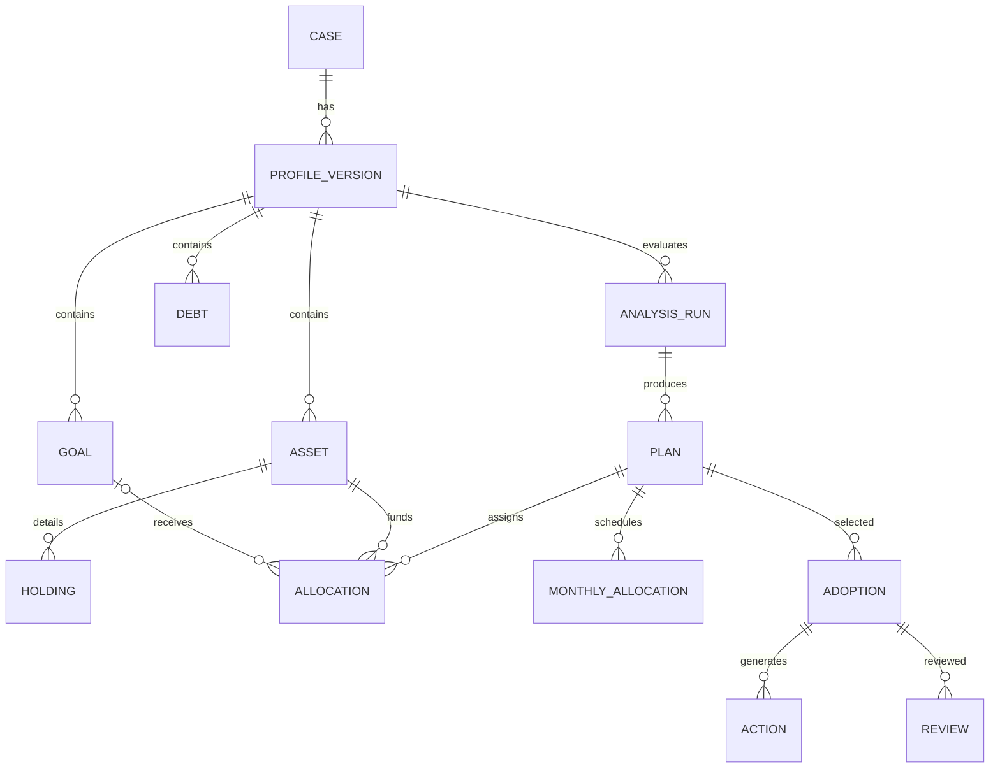

# dion 필요한 데이터·설계 구조·개발 인계 명세

## 현행 보완 v1.6 · 2026-11-04

제20절에 입력 → 계산식 → 출력 연결 명세 FIN-MAP-1.0을 통합했다. 제19절 FIN-DATA-1.0을 바탕으로 입력27묶음·계산/판단결과45개·질문 설계 라벨37개·수용 사례39개를 연결했다. 현행 원장 Q-ID와 최신 검토대기 질문안을 구분하고, 실제 전략 생성·투자 비중·세후 결과는 적용 정책과 자료를 충족한 범위에서 제공하도록 명시했다.

이번 검증은 문서 참조·의존 순서와34개 사례의 산술 부분 확인이다. 앱·원장 이관·운영 정책 승인·상품/세금/API 검증의 완료를 뜻하지 않는다. 기본 데이터 원칙은 제19절, 입력·산식·결과 연결의 최신 상세는 제20절을 따른다.

## 현행 보완 v1.5 · 2026-11-04

제19절에 재무엔진 기본 데이터 원칙 FIN-DATA-1.0을 통합했다. 같은 주제의 데이터 의미·정규화·반올림·누락·대사·버전 고정은 제19절을 적용한다. 2026-11-04 현행 포트폴리오 기준의 두 재무관리 방식(STABILITY_FIRST / INVESTMENT_CAPACITY)을 연결하고, 기존 PORT-01~03 명세·검산은 이력으로 보존한다. 기존 Q-ID·API 키를 일괄 교체하지 않는다.

이번 상태는 기본 데이터 설계 명세 작성과 문서 내 산술·형식 확인이다. 앱 반영·전체 질문 매핑·30개 수용 사례의 앱 실행, 실제 투자비중·상품·세금·LS 검증을 완료 처리하지 않는다. 이전 집계·검산의 기준일과 범위는 각각의 기록을 따른다.

## 기준 동기화 · 2026-11-03

이 보완은 문서·시트·개발 지침의 참조를 통일한다. 재무 산식·검산 기대값·질문 ID·답변 enum·투자 비중·세율을 새로 정하거나 앱 실행 상태를 변경하지 않는다.

| 항목 | 현행 기준 |
| --- | --- |
| 제품 문서 | 기획·구현 명세 v3.4 / MVP v1.1 / 포트폴리오 기준서 v1.3 |
| 재무·데이터 | 인계 v1.4 / POL-FIN-1.2(FIN-01~44) / 대표 검산 v1.1 |
| 투자·원천 | PREF-0.2 자기보고·score=null / ALLOC-0.2 실험용·미활성 / 공급원 검토 v1.2·LS 선정 |
| 질문 원장 | LP-DATA-4.1, 8개 탭·고유 Q-ID60개·고유 데이터 정의175개 |
| 기록 집계 | 시트 PASS 기록55건 / 앱 미실행89건 / 검증 개별상품0건 |
| 개발 실행 | [Codex 프롬프트 v2.0](https://chatgpt.com/library?file_id=libfile_85752932a0888191a64d1dd82744eec1&account_id=personal) |

질문 ID·선택지·활성 여부는 [현재 Google Sheets](https://docs.google.com/spreadsheets/d/10WBsawSs2kWrYKZS5lB6D7evH_pD_7-9uy_TFMBcM5g/edit)를 따른다. C01~C16/UI-ID와 구40문항 번호는 영속 Q-ID와 다르다. Q-032는 부채잔액, Q-120은 월 원리금이다. 실제 코드 필드 매핑은 Codex 0단계에서 확인하며 이번 동기화의 완료 범위에 포함하지 않는다.

원장 탭: `01_진행현황` / `02_고객질문` / `03_데이터명세` / `04_시나리오` / `05_계산·판단기준` / `06_화면·기능` / `07_실제상품조사` / `08_검증목록`.

과거 버전·검산·기존 사례는 이력으로 보존한다. LS 실연동·사용권한·비용, 실상품·세금·투자정책의 검증과 앱 실행·사용자/전문가 검토는 별도다. 이번 작업으로 완료 처리하지 않는다.

v1.0 · 2026-11-02 · 대상: 기획 담당자 / 재무모델 검토자 / Codex 개발 담당자

최신 보완 v1.1 · 2026-11-02 · AI 검토·개선 기록 기능 AIQC-01 추가, 상세는 제15절. 기존 재무·투자 정책의 미검증 상태는 유지한다.

현행 보완 v1.2 · 2026-11-02 · 제16절의 오류 수정·현행 문서 순서 적용. POL-FIN-1.1·PREF-0.2·ALLOC-0.2로 연결하며 이전 수치·검산은 이력으로만 사용한다.

현행 보완 v1.3 · 2026-11-02 · LS OPEN API 선정과 재무계산 전 전체 데이터 통합 기준은 제17절을 적용한다. 제3절의 필드와 현행 정책을 유지하며, 원천 실제 확보와 설계 완료를 구분한다.

현행 보완 v1.4 · 2026-11-02 · 제18절 예방 검사·대안·인계 계약 적용. 현행 재무정책은 POL-FIN-1.2이며 기초 산식과 이전 검산 결과는 유지한다.

## 0. 이 문서의 역할과 현재 완료 범위

승인한 포트폴리오 결과 화면을 유지하면서 **결과 → 계산·판단 → 필요한 데이터 → 기존 질문 → 추가 확인 → 실행·점검**을 연결한다. 고객이 자신의 돈을 이해하고 이번 달 행동을 결정할 수 있게 만드는 것이 1차 제품 목표다. 재무설계와 투자 포트폴리오 기능을 모두 유지한다.

이 문서는 앱 구현물이 아니라 개발에 사용할 데이터·업무 계약이다. 이번 작업에서 앱 코드, 저장소, API, 기존 설문 파일은 변경하지 않았다. 계산 예시는 독립 검산을 위한 기대값이며 앱 테스트 통과 기록이 아니다.

| 구분 | 이번 문서의 상태 |
| --- | --- |
| 결과 화면의 데이터 요구·누락 처리 | VIEW ID별로 구조화 완료 |
| 핵심 객체·관계·단위·시점·자금 원장 | 개발 계약 제안으로 구조화 완료 |
| 참고용 40문항의 내용·데이터 키 대조 | 원본 Excel을 읽고 40개 모두 이관 방향 정리 |
| 기존 통합 Q-ID 연결 | 현재 LP-DATA-4.1 원장의 고유 Q-ID60개·선택지·활성 목록을 확인. 실제 코드 필드·UI 카드 매핑은 Codex 0단계에서 대조 필요 |
| 신규 입력 요구·질문 흐름 | 필요한 데이터와 조건부 수집 경로 정리. 화면 문항 번호는 아직 부여하지 않음 |
| 결정론적 기초 계산·예외·검산 사례 | 명세 완료. 구현 시 재현 필요 |
| 세 계획 생성 | 현행 POL-FIN-1.2에 연결. 기본 순서·원장·필요 데이터는 제17절에서 통합. 실제 앱 실행과 금융 타당성 검증은 구분 |
| 투자선호·최종 비중·세법·상품 제공 범위 | 자기보고 선호는 PREF-0.2·score=null. 실제 비중·세율·적합성은 기존 검토 상태 유지 |
| AI 검토·개선 기록 AIQC-01 | 기능 요구·화면·데이터·이력·내보내기 명세 추가. 앱 구현·자동 검증 완료를 뜻하지 않음 |

표기: **[기존 합의]** 앞선 기준서의 합의 / **[이번 설계]** 여기서 제안하는 구현 계약 / **[검증 필요]** 근거·최신 규정·수치 정책 확인이 필요한 항목. 새 경로명은 개념상 표준 경로이며 기존 API 키의 강제 변경 지시가 아니다.

기준 자료:

- [데이터 공급원 검토안 — LS 선정·전체 원천 조사](https://chatgpt.com/library?file_id=libfile_fa7295a3785881918d6c79dd418017f2&account_id=personal)

- [포트폴리오 설계 기준서 v1.1, 내부 출력 보완 v1.2 포함](https://chatgpt.com/library?file_id=libfile_6d731bcc6a408191a3d00b0055255b0d&account_id=personal)
- [화면 영역별 설계 명세 v1.0](https://chatgpt.com/library?file_id=libfile_6ae9a34fbce08191bb945ea42039d7cd&account_id=personal)
- [참고 설문 40문항](https://chatgpt.com/library?file_id=libfile_6f18f099238c819190a0643e0f308457&account_id=personal)
- [산업선호 연결 시안](https://chatgpt.com/library?file_id=libfile_f139e0e414d08191be3bb76cc300b685&account_id=personal)
- [5가지 포트폴리오 초기 시안](https://chatgpt.com/library?file_id=libfile_2d2713e4ad04819193e23385ba20b57e&account_id=personal)

## 1. 제품 범위와 화면 구조

### 1.1 사용 흐름

| 단계 | 고객 행동 | 저장·계산되는 것 | 다음 화면 |
| --- | --- | --- | --- |
| 시작 | 개인/가구 범위·기준일 확인, 가상 체험 또는 내 정보 입력 선택 | case, scope, evaluation_date, demo 여부 | 진단 입력 |
| 현황 입력 | 자산·부채·수입·지출 입력 | 버전이 있는 profile, answers, 원천 기록 | 자산·현금흐름 현황 |
| 목표 연결 | 대표 목표의 금액·필요일·현재 준비금 확인 | goal, funding allocations, 납입 일정 | 목표 준비 현황 |
| 계획 비교 | 보호금과 조정 가능 범위 확인 | 동일 기준의 PORT-01~03 미리보기 | 세 계획 비교 |
| 투자 상세 | 선호·기간·제외조건·보유내역 확인 | 위험선호와 투자 여력, 적합성 판정 | 투자구성·산업 비교 |
| 명시적 채택 | 계획을 확인하고 채택 | adoption, 고정된 입력·정책·자료 버전 | 이번 달 할 일 |
| 점검 | 실제 금액·완료 여부·변경 사항 입력 | review, actuals, 새 수정안 | 원안/실적/수정안 비교 |

기본 진단은 외부 금융 연결과 LLM 없이 제공한다. 데이터가 필요한 결과를 열었을 때 추가 질문을 보여준다. 부분 입력을 저장하고 계산 가능한 영역부터 공개한다.

### 1.2 결과 화면과 책임

| 영역 | 고객이 알아야 할 것 | 원천 |
| --- | --- | --- |
| 공통 상단 | 누구의 어느 시점 자료인지, 현재/미리보기/채택 구분 | profile와 run 메타데이터 |
| A 내 자산 | 총자산·총부채·순자산·실제 사용 가능한 금액의 차이 | 자산·부채 원장 |
| B 내 금융자산 | A의 일부인 금융자산의 현재 구성 | 금융자산과 보유내역 대사 |
| C 내 목표 준비 | 현재 확보액·부족액·월 필요 적립액 | 목표·목적배정·실제 납입 일정 |
| D 세 실행계획 | 생활비·보호금·목표·투자·여유금의 차이 | 계획 생성과 공통 제약 검증 |
| P 선택 계획 상세 | 기존 잔액의 사용처, 매달 보낼 돈, 투자금 내부 구성 | 각각의 원장·분모 |
| I 투자·산업 상세 | 나의 선호와 적용 가능한 범위, 산업 근거·후보 비교 | 선호·적합성·외부 근거 |
| X 실행·점검 | 이번 달 행동과 실제 변화 | 채택된 계획·실행기록 |
| V 검토·개선 기록 | 팀원이 AI 초안·발견 사항·확인 근거·수정 전후를 추적 | 생성 원본·검토 기록·계산 실행·변경 이력 |

모바일은 A→B→C→D 순서다. 계획 상세는 선택 후 펼친다. 차트와 같은 금액·비중을 표로 제공한다. 세 카드의 핵심 지표와 단위를 같은 위치에 둔다.

### 1.3 개발 범위를 고정하는 제안

| 구간 | 내용 | 완료 조건 |
| --- | --- | --- |
| 1차 | 수동 입력, 대표 목표 1건, A~D 기본 현황, 자금 원장, 정책 부재 상태, 가상 고객, AIQC-01 수동 검토 기록·표 내보내기 | 고객 입력에서 모든 기본 출력과 사유를 추적하고 실제 수행한 검토의 근거를 기록 가능 |
| 2차 | 검토한 계획 정책, 명시 채택, 실행·점검, 위험선호·적합성 계약 | 동일 입력의 결과 재현, 계획별 자금 대사, 이력 보존 |
| 3차 | 검토한 투자배분 정책, 보유종목 상세·중복 노출, 산업·기업 자료 | 자료·정책·적합성·제공 범위 모두 확인한 결과만 제공 |
| 후속 | 복수목표 UI, 복잡한 세후 시나리오, 금융 연결 | 별도 범위·데이터·정책 검증 |

보유내역·복수목표는 기존 기준서에서 우선순위가 미결정이었다. **데이터 모델은 배열로 설계하되 1차 화면은 대표 목표 한 건과 합계 기반 현황으로 제한하는 제안**이다. 기존 시스템이 지원한다면 기능을 축소하지 않는다. 투자기능은 설계 범위에 계속 포함하되 미검증 결과를 완성된 추천으로 출력하지 않는다.

## 2. 데이터의 출처와 공통 계약

### 2.1 네 종류의 데이터를 섞지 않는다

| 종류 | 예시 | 관리 원칙 |
| --- | --- | --- |
| 고객 입력 | 자산잔액, 소득, 목표, 생활비 조정 한도 | 한 번 수집하고 여러 결과에 재사용 |
| 외부 자료 | 시세·공시·환율·ETF 구성·수수료 | 공급자·시점·권한·원본 단위 보존 |
| 계산 결과 | 순자산, 잉여금, 목표 부족액 | 고객에게 다시 묻지 않음. 계산과 입력의 버전 연결 |
| 서비스 정책 | 보호금 산정 규칙·성향 점수·배분 상한·세금 규칙 | 별도 표에서 검토·버전 관리. AI나 고객에게 정답을 만들게 하지 않음 |

현재 없는 자료를 고객에게 전부 입력시키지 않는다. 예를 들어 고객은 보유 종목과 계좌를 확인하고, 기업 공시·시세는 공급자에서 수집하며, PER 등의 비율은 검증한 원천으로 계산한다.

### 2.2 공통 형식

| 항목 | 계약 |
| --- | --- |
| 금액 | 서버 Decimal. API 십진 문자열. KRW 잔액은 원 단위 문자열, 예: `3000000` |
| 외화·수량 | 별도 통화와 십진 문자열. 외화 원금과 원화 환산액을 같은 필드에 넣지 않음 |
| 금리·비중 | 소수 문자열. 연 5%= `0.05`. 화면의 5와 API의 0.05를 구분 |
| 날짜·시각 | 지급·목표일은 현지 날짜, 관측·조회 시각은 시간대 포함 시각. 서비스 기본 시간대 Asia/Seoul |
| 기준 범위 | personal 또는 household. 사용자가 확인. 가구와 개인 금액 자동 혼합 금지 |
| 기준일 | run.evaluation_date로 집계 기준 고정. 각 자산의 실제 평가시점은 별도 보존 |
| 누락 | value=null + missing_status. KNOWN / UNKNOWN / NOT_ASKED / NOT_APPLICABLE |
| 확인된 0 | value=`0`, missing_status=KNOWN. 실제 없음과 미확인을 구분 |
| 완전성 | complete / partial / unknown과 포함 범위. 알려진 합계가 전체 합계인지는 별도 확인 |
| provenance | 고객 입력 / 업로드 / API / 계산, source_ref, 확인 시각 |
| enum·ID | 번역된 라벨 대신 안정된 코드. 기존 키·Q-ID는 어댑터로 연결 |
| 변경 | 입력 수정 시 새 profile_version. 과거 분석·채택 결과를 덮어쓰지 않음 |

자산·입력 금액은 원칙적으로 0 이상이다. 순자산·월 잉여금·실제 투자손익은 음수 가능하다. 분모가 0이거나 미정이면 비율은 null이다. 유한하지 않은 값, 잘못된 날짜, 중복 ID, 배열 크기·문자열 길이 초과는 입력 검증에서 거절한다. 구체적 기술 상한은 기존 API와 맞춰 확정한다.

정보가 알려졌다는 뜻의 KNOWN은 제3자 검증 완료를 의미하지 않는다. 고객 추정값이면 estimated 표시와 출처를 남긴다.

## 3. 필요한 고객 데이터 사전

아래 표의 `필수`는 모든 고객에게 처음부터 묻는다는 뜻이 아니다. **해당 결과를 확정하는 데 필요한 값**이라는 의미다. 표의 경로는 개념 표준이며 실제 코드의 기존 키를 대조한 뒤 매핑한다.

### 3.1 분석 범위·자산·부채

| 데이터 경로 | 의미·형식 | 필요한 때 | 입력·검증·누락 처리 |
| --- | --- | --- | --- |
| case.case_id | 사례 식별자 | 저장·이어하기 | 시스템 생성. 화면의 고객 실명으로 ID 생성하지 않음 |
| profile.version | 입력 버전 | 재현·수정·채택 | 시스템 증가. 분석과 1:1 연결 |
| profile.scope | 개인/가구 | A~X 전체 | 시작 시 확인. 가구면 포함 소유자 범위 확인 |
| profile.evaluation_date | 분석 기준일 | A~X 전체 | 기본 오늘, 고객 확인. 자료별 평가일 차이는 별도 표시 |
| profile.is_demo | 가상/실제 | 시연·통계·이력 | 가상 사례와 실제 고객의 데이터 분리 |
| assets[].asset_id | 자산 항목 ID | 중복·목적배정 | 시스템 생성, 항목 수정 때 유지 |
| assets[].asset_kind | 부동산/임차보증금/현금·예금/투자/기타/미확인 | A·B | 금액을 아는데 종류만 모르면 미확인 분류 |
| assets[].value_krw | 본인 또는 집계범위 소유 평가액 | A·B·P | 지분 반영액인지 확인. 총 시가와 지분률을 받으면 계산값으로 변환 |
| assets[].ownership_share | 소유지분 소수 | 공동소유 시 | 금액이 이미 본인 지분이면 재곱하지 않음 |
| assets[].valued_at | 평가 기준시점 | A·B 신뢰성 | 실제 평가일 보존. 오늘 가격으로 가장하지 않음 |
| assets[].account_id | 관련 계좌 | 금융자산 대사 | 같은 계좌 합계와 종목합계를 중복 합산하지 않음 |
| assets[].currency, original_amount | 원통화와 원금 | 외화자산 | 환율 출처·시점이 없으면 원화 집계 범위 제한 |
| assets[].accessible_amount_krw | 현시점 인출·현금화 가능한 금액 | A05·보호금·P | 평가액 이하. 시장가로 모두 즉시 사용할 수 있다고 가정하지 않음 |
| assets[].redeemable_at | 실제 사용할 수 있는 날짜 | C·D 지급검증 | 만기·결제·반환일. 미정이면 지급일 가용성 확인 필요 |
| assets[].restriction | 담보·출금 제한 종류와 금액 | D·투자여력 | accessible 금액에 이미 제외됐는지 함께 관리하여 이중 차감 금지 |
| assets[].coverage | 항목 입력 완전성 | A 총자산 이름·B 미확인액 | 기타자산 없음은 고객 확인 후 0. 미질문은 부분 집계 |
| debts[].debt_id | 부채 식별자 | 잔액·일정 연결 | 같은 채무의 잔액과 월상환은 다른 속성 |
| debts[].balance_krw | 미상환 원금·지원 범위의 채무 | A03·A04 | 잔액 전체를 현금에서 즉시 빼지 않음 |
| debts[].annual_rate | 연 금리 | 추가상환 비교 요청 시 | 금리가 없으면 순자산은 계산 가능, 금리 대안은 보류 |
| debts[].required_payments | 의무 원리금의 날짜·금액 | 월 잉여·날짜 검증 | 합계만 있으면 월 계산 가능. 날짜 미확인 시 지급일 안전 확정 금지 |
| debts[].maturity_date, method | 만기·일시/균등 등 | 상환 시나리오 | 만기 원금의 월상환 중복 여부 확인 |
| debts[].early_repayment_cost | 중도상환 비용 규칙 | 추가상환 제안 시 | 미확인인데 조기상환 효과를 확정하지 않음 |

부동산과 임차보증금은 상세에서 분리한다. 보증금을 자산에 총액으로 넣고 관련 대출은 부채에 별도 입력한다. 보증금에 대출을 이미 차감한 순액을 받은 경우 입력 기준을 수정하거나 명시적으로 정규화한다.

### 3.2 소득·지출·월 납입·보호자금

| 데이터 경로 | 의미·형식 | 필요한 때 | 입력·검증·누락 처리 |
| --- | --- | --- | --- |
| cashflow.monthly_net_income_krw | 세후 월 평균소득 | 월 잉여·D | 일시 수입과 반복 소득 분리. 무소득은 확인된 0 |
| cashflow.monthly_living_expenses_krw | 생활비·고정소비 | 월 잉여·D | 대출 원리금, 저축·투자 이체 제외 기준 |
| cashflow.essential_expenses_krw | 줄일 수 없는 필수생활비 | 보호금·지출조정 | 생활비 이하. 미입력 시 승인된 대용 규칙 없으면 보호금만 보류 |
| cashflow.monthly_required_debt_krw | 월 의무상환 합계 | 월 잉여·D | 부채가 없음을 확인했을 때만 0 자동 유도 가능 |
| cashflow.inclusion_flags | 지출에 원리금·저축 포함 여부 | 중복 방지 | 이미 포함됐으면 항목 분해 또는 재확인. 미확인인데 중복 차감 금지 |
| cashflow.recurring_contributions[] | 기존 적금·투자·연금 납입 | D 월 배분·유지 여부 | contribution_id, 금액·주기·목적·유지 의향. 자산취득 이체를 생활비로 다시 빼지 않음 |
| cashflow.income_stability | 고객이 아는 소득 변동 정도 | 보호금 정책·시나리오 | 미래소득 보장처럼 취급하지 않음 |
| cashflow.payment_calendar | 급여·월세·상환·납입일 | 날짜별 안전성 | 월 합계가 흑자여도 지급일 부족 가능 |
| events[] | 예정 목돈·일시수입·지출 | 목표·날짜 검증 | obligation_id로 목표와 연결. 같은 이사비 중복 차감 금지 |
| protection.assigned_asset_ids | 이미 비상용으로 확보한 재원 | 보호금 부족 | 목표 배정금과 중복 금지. 바로 사용할 수 있는 금액만 즉시 보호금 |
| protection.reserve_base | 보호금 월 기초의 항목 | 보호금 목표 | 필수생활비와 불가피한 의무상환의 포함 여부를 정책으로 명시 |
| protection.target_months | 목표개월 | 보호금 목표·배분 | 정책 검증 또는 고객의 명시 목표. 예시 6개월을 운영 기본값으로 사용하지 않음 |
| protection.funding_deadline | 부족 보호금을 확보할 시점 | 월 보호금 적립 제안 | 기한이 없으면 필요한 월 적립액을 임의 생성하지 않음 |

### 3.3 목표·배정·고객이 허용하는 변경

| 데이터 경로 | 의미·형식 | 필요한 때 | 입력·검증·누락 처리 |
| --- | --- | --- | --- |
| goals[].goal_id, name | 목표 식별·이름 | C·D | 대표 목표부터 수집. 이름만으로 금액 추정 금지 |
| goals[].target_amount_krw | 목표일에 필요한 본인 부담액 | C02~05 | 미정 허용. 0이면 비율은 null, 부족액은 0이며 목표 의미 확인 |
| goals[].due_date | 실제 필요일 | C04·지급검증 | ‘1~3년’만으로 확정 도달일·납입 횟수를 만들지 않음 |
| goals[].price_basis | 목표일 명목금액/현재가격 | 목표금 비교 | 현재가격이면 가격 기준일·물가 가정 필요. 이중 물가 조정 금지 |
| goals[].priority | 목표 간 우선순위 | 복수목표 단계 | 1차 한 건이면 유일 목표로 처리 |
| goals[].contribution_schedule | 첫 납입일·반복일·목표일 포함 규칙 | 월 필요 적립액 | 실제 납입 횟수를 생성. 월 차이만으로 나누지 않음 |
| allocations[].asset_id, purpose_type | 어떤 자산을 어느 목적으로 쓰는지 | 보호·목표·투자 중복 방지 | PROTECTION / GOAL / LONG_TERM_INVESTMENT / UNASSIGNED |
| allocations[].goal_id, amount_krw | 목표에 배정한 실제 원금 | C02·C03 | asset_id별 합계는 가용 보유액 이하. 미래 적립은 별도 monthly_allocations |
| allocations[].available_at | 배정 자금의 사용가능일 | 현재 확보액의 지급가능성 | 목표일 이후 사용 가능하면 기한 내 확보액에 포함하지 않음 |
| planning.adjustable_expenses[] | 줄일 수 있는 지출·최대 감축액 | PORT-03 | 필수지출 자동 감축 금지. 0 허용, 고객 허용 범위만 변경 |
| planning.monthly_buffer_krw | 배분하지 않고 남길 월 여유금 | 세 계획의 실행성 | 생활비에 이미 포함된 여유지출과 다른 개념. 고객 확인 |
| planning.goal_change_permission | 금액·기간 변경 허용과 한도 | 목표가 불가능할 때 대안 | 원래 목표와 수정 목표 동시 표시. 무단 연장 금지 |
| planning.existing_contribution_permission | 기존 납입 유지/중지 허용 | 세 계획 비교 | 강제 납입과 자율 납입 구분, 같은 목적은 한 번만 배정 |
| planning.sell_permission | 기존 자산 매도 허용 여부 | 투자 조정·현금화 | 미확인 시 매도 없는 경로 또는 해당 조정 보류 |
| planning.additional_repayment_preference | 추가상환 희망·월 한도 | 추가상환 대안 | 의무상환과 별도. 비용·효과 확인 전 확정 우선추천 금지 |

### 3.4 투자 선호·보유내역·제외조건

| 데이터 경로 | 의미 | 필요한 때 | 계약 |
| --- | --- | --- | --- |
| investment.priority | 보전/소득/균형/성장 등 선호 | 목적·자기보고 선호의 의미 확인 | 구 Q13, 통합 risk_preference와 의미 대조. 현행 PREF-0.2·score=null |
| investment.loss_response | 가상 하락 시 예상 행동 | 선호와 별도의 행동 확인 | 구 Q12 유지. 통합 loss_response의 선택지와 정확히 대조. 행동으로 선호 등급 무단 변경 없음 |
| investment.experience | 기간·경험 상품 | 적합성 | 경험이 길다는 이유로 여력을 자동 상향하지 않음 |
| investment.knowledge | 상품 구조 이해 여부 | 복잡한 상품 검토 | 경험·선호와 별도. 해당 상품을 제시할 때 수집 |
| investment.available_until | 자금 목적별 사용가능 기간 | 투자구성 | 고객의 일반 투자기간과 실제 목표일이 충돌하면 목표일 우선 |
| investment.loss_affects_essentials | 손실이 생활·상환·목표에 미치는 영향 | 실행 제약 | 기존 Q-122 유지. 구 Q33과 선택지 일치 전 통합 금지 |
| investment.income_need | 현금분배 필요·금액·시점 | 인컴 시나리오 | 배당을 보장소득으로 가정하지 않음 |
| investment.restrictions[] | 제외 상품·산업·국가·통화·구조 | 모든 후보 검증 | 선호와 별도. 기존 restricted_assets 보존 |
| investment.preferred_industries[] | 관심 산업 코드 0~3개 | 산업 분석 | 중복 금지. 0개·잘 모르겠음 허용. 선택만으로 비중 증가 금지 |
| holdings[].instrument_id | 표준 종목 식별자·거래소 | 종목 중복·상품 비교 | 이름만 같다고 같은 종목으로 합치지 않음 |
| holdings[].asset_id, account_id | 포함되는 자산·계좌 | B 집계·보유대사 | 합계의 세부항목. 총자산에 다시 더하지 않음 |
| holdings[].quantity, market_value | 수량·통화·평가액·평가시각 | 현재 구성·변화량 | 알지 못하는 수량을 가격으로 역산해 확정하지 않음 |
| holdings[].acquisition_cost | 취득가·취득일·방법 | 매도·세금 계산 | 단순 현황에서는 선택. 원가 없으면 세후 매도효과 제한 |
| holdings[].account_type | 일반/ISA/연금 등 계좌형태 | 과세·인출 제한 | 자산군과 다른 축 |
| holdings[].coverage | 확인된 내역/전체 합계의 범위 | 집중도·분산 판정 | 부분 보유내역으로 전체 분산 적정을 확정하지 않음 |

현재 자산군은 주식성/채권성/현금성/기타/미확인으로 집계한다. ETF는 상품 형태이고 ISA·연금은 계좌 형태다. 미확인 구조의 혼합형 ETF를 전부 주식 또는 채권으로 강제 분류하지 않는다.

### 3.5 세금·사후점검 데이터

| 데이터 묶음 | 필요한 값 | 언제 수집 |
| --- | --- | --- |
| 과세 범위 | 과세연도·거주자 여부·지원 국가·계좌유형 | 세후 결과를 요청할 때 |
| 과세 사건 | 매도/배당/분배/이자, 실현일·금액·취득가 | 해당 사건을 시뮬레이션할 때 |
| 세제 사용 현황 | 공제·손익통산·기납부 외국세액 등 적용 정보 | 검증된 계산이 지원하는 항목만 |
| 거래·상품 비용 | 매수·매도·환전 수수료, 스프레드, 보수 반영 여부 | 상품 금액·세후 결과를 확정할 때 |
| adoption | plan_id, run_id, 예상 버전, 동의 시각, 채택 범위 | 고객이 명시 채택할 때 |
| actions | 목적·금액·기한·선행조건·완료 상태 | 채택한 계획에서 생성 |
| reviews | 점검기간·실제 소득/지출/납입/잔액·변경 이유 | 사후 점검 때 |

실명·주민등록번호·계좌 비밀번호는 기본 재무계산에 필요하지 않다. 개인정보 수집·보존·삭제는 지원 기능에 필요한 범위로 설계한다.

## 4. 결과 → 데이터 → 질문 → 계산의 전체 매핑

아래 `구 Qxx`는 읽은 40문항 Excel의 ID다. `통합 Q-xxx`는 기준서에 인용된 별도 체계이며 해당 활성 원장 대조 전 확정 연결로 취급하지 않는다. 신규 요구는 GAP-ID로 관리하고 Q-ID를 선점하지 않는다. 계산 식별자는 이 문서의 DS-Cxx를 사용한다. 기존 CALC-ID의 재번호가 아니다.

### 4.1 A~C 현황·목표

| 출력 ID | 결과 | 필요한 입력·기존 단서 | 부족한 입력 | 계산·누락 처리 |
| --- | --- | --- | --- | --- |
| VIEW-A01 | 총자산 | assets.value, 범위·평가일 / 구 Q07·08·10 | 기타자산·완전성 GAP-01 | DS-C01. 누락 시 ‘확인된 자산 합계’ |
| VIEW-A02 | 종류별 구성 | 자산 종류·소유지분 / 구 Q26·31 | 분류축 정규화 GAP-02 | DS-C01·03. 금액을 아는 미분류분은 별도 조각 |
| VIEW-A03 | 총부채 | debts.balance / 구 Q15·36 / 통합 Q-032 인용 | 총액과 건별 대사 | DS-C02. 미확인은 0 처리 금지 |
| VIEW-A04 | 순자산 | A01·A03 | 자산·부채 범위 일치 | DS-C02. 부분 원장 기준이면 부분 결과 명시 |
| VIEW-A05 | 사용가능 자금 | 자산별 즉시 인출액·현금화일·제한·배정 / 구 Q29 | 자산별 제한 GAP-03 | DS-C04. 평가액·인출액·새 배정 후보 구분 |
| VIEW-B01 | 금융자산 합계 | 현금·금융투자 자산 / 구 Q08·10 | 계좌·내역 포함 범위 | DS-C01. A의 부분집합 |
| VIEW-B02 | 현재 자산군 구성 | 자산/보유의 실질 분류 / 구 Q31 | 계좌·상품·자산군 분리 GAP-02 | DS-C03. 미확인 금액 유지 |
| VIEW-B03 | 보유상품 상세 | holdings / 구 Q31은 총액 단서 | 종목·계좌·평가일 GAP-04 | DS-C12. 상세 미지원/미입력 구분 |
| VIEW-B04 | 중복·집중 노출 | 보유내역·ETF 구성자료 | ETF 구성 범위·기준일 | DS-C12. 자료가 충분할 때만 판정 |
| VIEW-C01 | 목표금·필요일 | goals / 구 Q17·18·19 | 실제 날짜·가격 기준 GAP-05 | 금액 미정 허용. 기간 구간을 정확한 날짜로 치환하지 않음 |
| VIEW-C02 | 현재 확보·부족·초과 | 목표별 자산 배정 | asset_id 연결 GAP-06 | DS-C07. 미래 납입·다른 목적자금 제외 |
| VIEW-C03 | 현재 충당률 | C01·C02 | 동일 가격 기준 | DS-C07. 분모 0이면 null. 막대만 100% 제한 |
| VIEW-C04 | 월 필요 적립액 | 목표 부족·실제 납입 일정 | 첫 납입일·주기 GAP-07 | DS-C08. 0% 기준, 0회면 즉시 부족액 |
| VIEW-C05 | 계획별 도달시점 | 선택 계획의 목표 월 배정·일정 | 계획 정책·가정 | DS-C09. 관측 현재액과 미래 가정 분리 |

### 4.2 D·P 계획과 투자구성

| 출력 ID | 결과 | 필요한 입력·기존 단서 | 정책·부족 데이터 | 누락·연결 |
| --- | --- | --- | --- | --- |
| VIEW-D01 | 계획명·차이·상태 | PORT-01~03, profile·run·plan | 계획 생성 규칙 | 같은 결과는 중복안 표시 |
| VIEW-D02 | 생활비·월 잉여금 | 구 Q03·04·16, 포함 기준 | 지출·이체 중복 GAP-08 | DS-C05. 상환액 누락이면 이 결과만 보류 |
| VIEW-D03 | 월 목적별 배분 | 잉여금·기존 납입·고객 여유금 | GAP-09·10, 배분 규칙 | DS-C11. 의무상환 다시 차감 금지 |
| VIEW-D04 | 보호금·목표 준비 | 구 Q25·29, 목표·배정 | 보호개월·기초·보충기한 GAP-11 | DS-C06~09. 미정 정책의 값만 보류 |
| VIEW-D05 | 투자 재원 | 자산/월 원장·목표·제한 | 기간·보호·가용성 | DS-C04·11. 일시금/월/기존 유지분 분리 |
| VIEW-D06 | 실행 부담·제약 | 허용 지출변경·목표변경·지급일 | GAP-10·12, 달력 | DS-C10. 부족일·금액을 출력 |
| VIEW-D07 | 비용·세금 | 계좌·상품·과세 사건·비용 | 구 Q20·39·40 보완, 규칙 | DS-C14. 미확인 세금은 null |
| VIEW-D08 | 미리보기·채택 | run·plan 버전·채택 범위 | 유효한 채택 조건 | DS-C15. 미리보기로 채택하지 않음 |
| VIEW-P01 | 잔액의 목적별 배정 | allocations, assets | 보호·목표·장기·미배정 | DS-C11. 분모=배정 대상 잔액 |
| VIEW-P02 | 매달 보내는 돈 | monthly_allocations | 고객 유지 의사·규칙 | DS-C11. 분모=월 배분 가능 재원 |
| VIEW-P03 | 투자금 내부 구성 | mandate·검증된 후보·정책 | 위험·배분·상품 상한 정책 | DS-C13. 비중 부재는 REVIEW_REQUIRED |
| VIEW-P04 | 현재·제안 변화 | holdings·매도 허용·비용·세금 | GAP-04·12 | 기존 종목을 모르면 정확한 매도·매수 변화량 보류 |

### 4.3 I·X 산업·실행

| 출력 ID | 결과 | 필요한 입력·기존 단서 | 판정·누락 처리 |
| --- | --- | --- | --- |
| VIEW-I01 | 투자 선호와 적용 범위 | 구 Q11·12·13·14·33, 통합 Q-042·044·045·105·117·122 인용 | DS-C13. P1~P5와 자금 제약 별도 필드 |
| VIEW-I02 | 관심 산업 분석 | 산업 파일 preferred_sectors·외부 근거 | 선택 0개 허용. 출처 부족은 분석 보류 |
| VIEW-I03 | 내 계획과 연결 | 기간·제외·생활 영향·노출·상품 구조 | 산업 긍정과 고객 적합성 별도 판정 |
| VIEW-I04 | 기업·상품 후보 | 원천자료·후보 universe·비교 기준 | 최대 2~3개 비교, 0개 가능. 자료 없음과 적합후보 없음 구분 |
| VIEW-I05 | 대체 산업 | 같은 필터의 대체 후보·근거 | 선호를 무시한 강제 편입 금지 |
| VIEW-X01 | 이번 달 할 일 | 채택 범위·월 배정·기한 | DS-C15. 이체·주문을 실행하지 않는 행동 목록 |
| VIEW-X02 | 계획과 실제 | adoption·동일 기간 actuals | 실제 미입력을 0으로 기록하지 않음 |
| VIEW-X03 | 수정안·다음 점검 | 변경된 profile·재계산·재채택 | 원안 이력 보존, 가상 점검 별도 표시 |

## 5. 질문 구조와 기존 40문항의 처리

### 5.1 질문을 만드는 순서

1. 출력에 필요한 데이터 중 시스템 계산·외부 수집·정책값을 제외한다.
2. 기존 응답의 같은 의미·같은 범위·유효한 시점 데이터를 재사용한다.
3. 누락된 값에 대해서만 해당 카드 안에서 후속 질문한다.
4. 원본 문구·enum·단위를 대조한 뒤 신규 영속 Q-ID를 부여한다.
5. 카드 수와 실제 입력 필드 수를 별도로 센다. ‘10개 질문만으로 완성’ 같은 문구를 먼저 정하지 않는다.

### 5.2 고객 입력 카드 제안

아래 CARD-ID는 화면 묶음이다. 기존 Q-ID가 아니다. 13개 묶음을 모든 고객에게 한꺼번에 제시하지 않는다.

| 카드 | 고객에게 확인할 내용·문구 방향 | 표시 조건·연결 |
| --- | --- | --- |
| CARD-01 기준 | ‘내 돈만 볼까요, 함께 관리하는 가구의 돈까지 볼까요?’ + 기준일 | 처음 한 번. 범위 변경 시 전 항목 대사 |
| CARD-02 자산 | ‘현재 가진 자산을 알려주세요.’ 종류별 금액, 없음/모름 | A·B. 상세는 금액이 있는 종류만 |
| CARD-03 부채 | ‘남은 부채와 매달 꼭 갚아야 할 금액은 얼마인가요?’ | 없음 확인 시 상세 생략, 잔액과 상환액 별도 |
| CARD-04 생활 흐름 | ‘한 달에 들어오는 돈과 생활에 쓰는 돈은 얼마인가요?’ | 대출·저축 이체 포함 여부를 가까운 위치에서 확인 |
| CARD-05 보호자금 | ‘갑자기 소득이 줄어도 지켜야 할 생활비와 준비한 돈을 확인할게요.’ | 보호금·실행계획을 볼 때. 능력 평가 표현 금지 |
| CARD-06 목표 | ‘언제까지 얼마가 필요하고, 지금 얼마를 준비했나요?’ | 대표 목표. 금액 미정 허용. 준비한 돈의 출처 연결 |
| CARD-07 돈을 쓸 날짜 | ‘급여·상환·목돈 지급일과, 돈을 꺼낼 수 있는 날짜를 알려주세요.’ | 지급일 검증을 요청할 때. 날짜 없으면 안전성 확인 전 |
| CARD-08 기존 납입 | ‘현재 이어가고 싶은 저축·투자 납입이 있나요?’ | 기존 납입 있음. 금액·목적·유지 의향 |
| CARD-09 조정 범위 | ‘목표를 위해 조정해도 괜찮은 지출이나 일정이 있나요?’ | PORT-03 비교. 조정 없음도 정상 응답 |
| CARD-10 투자 선호 | 투자목적·가상 손실 행동·경험·자금 사용기간 | 투자 상세. 점수정책 없으면 응답만 보존 |
| CARD-11 투자 조건 | ‘손실이 생기면 생활비·상환·예정한 목표에 영향이 있나요?’ + 피할 상품 | 모든 투자 적합성 검토. 기존 안전 질문 유지 |
| CARD-12 관심·보유 | 관심 산업 0~3개 / 보유 상세는 별도 펼침 | 산업 설명 또는 중복노출 검토를 요청했을 때 |
| CARD-13 세후·점검 | 계좌·과세정보 또는 해당 월 실적 | 각각 해당 기능 진입 시. 한 문항에 섞지 않음 |

모름은 선택지로 보존하고 다음에 확인할 항목을 보여준다. 기존 응답을 수정할 때는 바뀌는 결과를 설명한다. 누락 결과만 미리보기에서 보류하고 나머지 현황은 유지한다.

### 5.3 참고 40문항의 전수 이관 방향

원본 파일에서 질문·API key·선택지를 확인했다. 초기 파일의 계산 코드나 ‘필수’ 표시는 최신 기준서와 충돌할 경우 그대로 이식하지 않는다.

| 원본 ID·키 | 이번 구조의 사용처 | 처리 |
| --- | --- | --- |
| Q01 age | 적합성·생애단계·특정 계좌 자격 | 해당 결과에 필요할 때 수집. 기본 순자산 계산의 필수값으로 두지 않음 |
| Q02 dependents | 보호금·가구 맥락 | 구간형 `3_plus`를 정확히 3명으로 변환하지 않음 |
| Q03 monthly_income | cashflow.monthly_net_income_krw | 가구소득 문구와 profile.scope를 맞춤 |
| Q04 monthly_expenses | cashflow.monthly_living_expenses_krw | 원리금 제외 유지, 저축·투자 이체 포함 여부 보완 |
| Q05 income_stability | 소득 안정성 | 정책 입력으로 활용, 자동 보호개월 미확정 |
| Q06 housing_type | 자산·주거계획 분기 | 주거형태로 소유 자산 금액 추정 금지 |
| Q07 real_estate_value | 부동산·보증금 합계 | 상세에서 둘을 분리. 순액/총액·지분 확인 |
| Q08 cash_assets | 현금성 자산 | 즉시 사용가능액과 구분 |
| Q09 near_term_spending | 예정 의무지출 | 목표와 obligation_id 대사, 날짜·내역 추가 |
| Q10 investment_assets | 금융투자 평가합계 | 계좌·보유내역에 중복 가산 금지 |
| Q11 investment_experience | 경험 기간 | 통합 Q-042 인용과 enum 대조 |
| Q12 drawdown_reaction | 투자선호의 구성 응답 | 유지. sell_all/sell_some/hold/buy_more 보존. 통합 Q-045의 원문과 대조 |
| Q13 investment_priority | 투자목적·선호 | 통합 Q-044 risk_preference와 의미 대조. 직접 P1~P5 변환 금지 |
| Q14 investment_horizon | 투자자금 사용기간 | 통합 Q-117 인용과 대조, 목적별 실제 날짜 우선 |
| Q15 total_debt | 부채 원금 합계 | 통합 Q-032 debt_balance_krw는 보존 대상 |
| Q16 monthly_debt_payment | 의무 원리금 | Q04에 이미 포함됐는지 확인 |
| Q17 primary_goal | 대표 목표 유형 | 자유 이름·본인부담금·날짜 연결 |
| Q18 goal_horizon | 목표 기간 구간 | 정확한 납입 횟수에 부족. due_date 추가 |
| Q19 goal_amount | 목표금액 | null 허용. 이미 확보한 원금은 별도 |
| Q20 tax_account_interest | 절세계좌 보유·의향 | account_holdings와 account_interest로 분리 후 확인. 이전 다중응답에서 보유를 추정하지 않음 |
| Q21 household_profile | 가구 구조 | 범위 정합·선택적 맥락. 혼인정보를 모든 계산에 강제하지 않음 |
| Q22 family_changes | 예정 가족 변화 | 고객이 확인한 사건·목표로 연결. 금액 임의 생성 금지 |
| Q23 employment_status | 경제활동·소득 맥락 | 소득 안정성 응답과 불일치하면 확인. 일률 위험등급 금지 |
| Q24 income_outlook | 미래 소득 변화 가정 | 고객 예상 시나리오로만 사용, 현재소득 교체 금지 |
| Q25 essential_expenses | 필수생활비 | Q04 이하 대사, 보호기초의 의무상환 포함 규칙 명시 |
| Q26 property_holdings | 부동산 상세 | 보증금 별도. 합계와 Q07 대사 |
| Q27 property_plan_horizon | 주거거래 기간 구간 | 실제 날짜·의무 여부 추가 확인 |
| Q28 property_plan_cashflow | 주거 유입·유출 예상 | gross/net과 기존 보증금·매각액 이중 반영 확인 |
| Q29 immediately_available_cash | 즉시 인출금 합계 | 자산별 출처·목적배정 추가. 전액이 자유자금이라는 가정 금지 |
| Q30 planned_expenses | 예정지출 내역 | Q09·목표와 같은 의무인지 확인, months_until은 납입 달력과 구분 |
| Q31 investment_breakdown | 현재 구성 입력 단서 | 연금=계좌, ETF=상품형태, 주식·채권=자산군으로 분리하여 재설계 |
| Q32 max_loss_tolerance | 과거 응답 보존만 | 신규 설문 비활성 방향. 통합 Q-032와 다른 ID. 이 응답으로 손실보장 한도 생성 금지 |
| Q33 loss_capacity | 생활·상환 영향 | 통합 Q-122 loss_affects_essentials와 문구·선택지 대조 후 연결 |
| Q34 investment_income_need | 투자소득 수요 | 필요한 월 현금흐름·시점 연결. 투자수익 보장 금지 |
| Q35 product_preferences | 상품 선호·제외 | 산업 파일의 Q35와 별도. 통합 Q-123 restricted_assets 보존 |
| Q36 debt_details | 부채별 잔액·금리 | 부채 있음·추가분석 시 분기. 합계와 대사 |
| Q37 debt_terms | 만기·상환방법 | Q36 debt_id와 연결, 실제 일정 생성 |
| Q38 retirement_plan | 은퇴 목표 확장 | 은퇴 추정모델 지원 시 수집. 1차 대표 목표와 별도 |
| Q39 taxable_income_details | 세금 검토 단서 | 확정세액 입력으로 오해하지 않음. 과세연도·거주·계좌·실현사건 보완 |
| Q40 tax_account_details | 절세계좌 내역·납입 | Q10 잔액 중복 방지, 상품·계좌 분리 |

추가 원본: 산업선호 파일의 Q35 `preferred_sectors`는 투자·상품 선호 Q35와 다른 문항이다. 신규 개념 경로 `investment.preferred_industries`로 의미를 연결하되 기존 API 키는 어댑터에서 보존한다. EQ_TECH↔EQ_BIGTECH 등 별칭은 이름만 보고 자동 통합하지 않는다.

질문 이관 레코드 필수 열: source_schema_version / source_question_id / source_field / original_answer / target_field / option_mapping / transform_rule / mapping_status / unresolved_reason. 의미가 다르면 원응답을 보존하고 NEEDS_INPUT으로 확인한다.

### 5.4 실제로 부족한 입력 요구

| GAP ID | 추가로 필요한 정보 | 기존 자료로 부족한 이유 | 수집 시점 |
| --- | --- | --- | --- |
| GAP-01 | 개인/가구·평가일·기타자산 없음 확인·전체 포함 범위 | 현재 40문항에 일관된 집계 기준 없음 | 첫 진단·자산 수정 |
| GAP-02 | 계좌/상품/실질 자산군의 분리·미확인액 | Q31에 연금·ETF·자산군 혼재 | 금융 구성 상세 |
| GAP-03 | 자산별 인출가능액·제한·실제 현금화일 | Q29는 현금 합계만 있음 | 목표 배정·지급검증 |
| GAP-04 | 종목 ID·계좌·평가액·평가일·입력범위 | 합계 설문으로 종목 중복 확인 불가 | 보유노출 검토 요청 |
| GAP-05 | 목표 실제 날짜·현재가격/미래금액 기준 | 기간 구간만으로 정확한 계산 불가 | 목표 구체화 |
| GAP-06 | 확보액이 어느 자산의 얼마인지 | 총 현금과 목표 준비금이 중복될 수 있음 | 목표 준비금 입력 |
| GAP-07 | 첫 납입일·월 납입일·종료일 포함 규칙 | 달 수와 실제 납입 횟수가 다를 수 있음 | 월 필요 적립액 |
| GAP-08 | 원리금·저축·투자의 생활비 포함 여부 | 자금배분에서 이중 차감 가능 | 소득·지출 입력 |
| GAP-09 | 기존 납입의 목적·유지 의향·최소 월 여유금 | 현재 40문항에 충분한 분배 제약 없음 | 계획 비교 |
| GAP-10 | 감축 가능 항목·한도, 목표 변경 허용 범위 | 고객 허용 없이 PORT-03 생성 불가 | 목표 우선안 열기 |
| GAP-11 | 보호금 기초·확보 재원·선택한 보호기간·보충 기한 | 정책값·고객 목표·자산 배정이 분리되지 않음 | 보호금·계획 생성 |
| GAP-12 | 현금 입출금 날짜·매도 허용·결제/환전 소요일 | 월 흑자와 목표금 확보가 지급일 안전을 보장하지 않음 | 계획의 실행가능성 확인 |
| GAP-13 | 세후 계산에 필요한 사건·계좌·과세 범위 | Q39·40만으로 세액 확정 불가 | 지원 세후 계산 진입 |

GAP-11의 서비스 추천 보호기간은 정책 책임이다. 고객이 직접 목표개월을 정하는 경우에는 ‘고객 설정’으로 기록하고 서비스 검증 추천값으로 바꾸어 표현하지 않는다.

## 6. 계산 명세와 경계 처리

계산 원값과 화면 표시값을 분리한다. 금액 대사는 원 단위로 정확히 수행한다. 아래 DS-C ID는 이 문서 내부 연결용이다.

| 계산 ID | 계산·판정 | 필수 조건·예외 |
| --- | --- | --- |
| DS-C01 자산 집계 | 자산합계=집계범위 내 중복 제거 자산 평가액 합. 금융자산=그중 현금성·금융투자 | 계좌합계와 상세 보유합계를 동시에 더하지 않음. 미입력 종류 있으면 부분 집계 |
| DS-C02 부채·순자산 | 부채합계=미상환 원금 합. 순자산=자산합계−부채합계 | 완전한 부채 미입력 시 완전 순자산 확정 금지. 음수 순자산 유지 |
| DS-C03 구성비 | 해당 자산군 금액÷명시된 분모 | 0원 분모는 null. 현재 구성·목적배정·투자 내부 구성마다 분모 다름 |
| DS-C04 가용 자금 | 자산별 사용가능액·사용일·제한·기존 목적을 대사하여 새 배정 후보 산출 | 총자산−총부채−목표금액의 단순 식으로 대체하지 않음. 순자산은 현금 아님 |
| DS-C05 월 잉여 | 세후소득−원리금·저축이체 제외 생활비−의무 원리금 | 포함 기준 불명확하면 NEEDS_INPUT. 음수 원값 보존. 배분 가능 상한=max(0, 잉여) |
| DS-C06 보호금 | 목표=정의한 월 보호기초×목표개월. 부족=max(0, 목표−비상용으로 배정한 즉시 사용가능액) | 기초·개월 정책 또는 고객 설정 출처 필요. 목표자금을 다시 보호금으로 세지 않음 |
| DS-C07 목표 준비 | 확보액=목표일에 쓸 수 있는 현재 배정금. 부족=max(0, 목표−확보). 초과=max(0, 확보−목표). 충당률=확보÷목표 | 미래 납입은 현재 확보에서 제외. 초과도 실제 비율로 표시. 진행 막대만 최대 100% |
| DS-C08 월 필요 적립 | 수익 0%에서 목표 부족액÷남은 실제 납입 횟수. 표시 원 단위 올림 | 횟수=0·부족>0이면 즉시 부족, 나눗셈 금지. 남은 일정의 마지막 납입은 잔액으로 조정 |
| DS-C09 도달시점 | 실제 납입일마다 누적 자금 계산, 처음 목표를 충족한 날짜 | 목표 지급일 이전 현금화 조건 포함. 기한 내 미도달이면 미달 표시. 무한대 날짜 생성 금지 |
| DS-C10 날짜 현금흐름 | 현금(t)=기초 자유 현금+해당 시점까지 외부 유입−외부 유출 | 목적 바구니 사이의 내부 이체는 전체 현금 유출 아님. 사용가능일 전 자산은 현금 취급 금지 |
| DS-C11 원장 대사 | 자산별 목적배정≤사용 가능한 해당 자산. 월 배분합+미배정=월 신규 배분 재원 | 보호·목표·장기투자·미배정 모두 음수 금지. 기존 납입은 목적행에 한 번만 포함 |
| DS-C12 보유·노출 | 보유내역 합계와 금융자산 대사, 확인된 구성자료로 노출 합산 | 자료가 부분이면 unknown exposure 유지. 원본 보유+ETF 기초구성 금액을 자산합계에 다시 더하지 않음 |
| DS-C13 적합성·투자구성 | 입력→보호·목표 제약→가능 재원→선호분류→자금별 제한→후보구성→검증 | 위험 점수·배분·스트레스 정책 없으면 해당 결과 REVIEW_REQUIRED. 고객 동의로 차단 해제 금지 |
| DS-C14 세후·비용 | 기초+납입−인출+가격손익+분배−직접비용−과세사건별 세금 | 총수익 자료의 분배·내재 보수 중복 방지. 세금 불명은 세후액=null |
| DS-C15 채택·점검 | 고객의 명시 채택·버전 검증→실행기록→동일 기간 실적 비교→새 버전 수정안 | 이전 미리보기의 무단 최신 채택 금지. 입력 실적 누락을 0으로 간주하지 않음 |

### 6.1 납입 일정과 반올림

- 기본 목표 비교는 수익 0%·세전 기준이다. 이것이 현금성 상품의 실제 수익률 예측이라는 뜻은 아니다.
- 목표일까지 결제가 완료되는 납입만 횟수에 포함한다. 같은 날짜 납입·지급 순서를 확인하지 못하면 보수적인 순서 또는 확인 필요 상태를 적용한다.
- 예: 1,000,001원을 3회 적립하면 안내 월 기준액은 333,334원이며 마지막 회차는 333,333원이다. 세 번 모두 올림값을 강제하여 자금이 늘어난 것처럼 만들지 않는다.
- 목표금액이 미래 명목금액이면 추가 물가 조정을 하지 않는다. 현재 가격 입력을 미래 금액으로 바꾸려면 기준일·물가 가정·적용기간이 필요하다.
- 비중 표시의 반올림 오차는 표시 문제다. 실제 금액을 임의로 더하거나 빼서 차트 숫자를 맞추지 않는다. 자산군 금액 배분의 잔여 원은 미배정 현금으로 대사한다.

### 6.2 현금흐름의 단위와 중복

현재 보유액과 매달 새로 저축할 돈을 같은 시점의 원금으로 합치지 않는다. 월세·원리금은 소비·의무유출이며 목표 바구니 이체·투자 납입은 자산 이동이다. 목표의 실제 지급은 지출 사건으로 한 번 기록한다. 같은 예정지출을 Q09·Q30·목표·달력에서 받은 경우 obligation_id로 의미를 확인하여 한 건으로 연결한다.

## 7. 세 실행계획의 설계 구조

### 7.1 모든 계획이 공유하는 조건

같은 profile_version, 평가일, 원천자료 snapshot, 정책·세금·비용·수익 가정을 쓴다. 필수생활비·의무상환·확정 지급·제외조건·자금 사용기간은 공통 제약이다. 위험을 높여 목표 부족을 감추거나 미래 소득을 임의로 올리지 않는다.

계획의 자금 배정은 다음 두 원장에서 각각 계산한다.

| 원장 | 원천 | 배정 |
| --- | --- | --- |
| 기존 잔액 | 실제 보유·현금화 가능한 자산 | 보호 / 목표 / 장기투자 / 미배정 |
| 월 신규 재원 | 생활비·의무상환을 차감한 소득, 확인한 월 여유금·유지납입 반영 | 보호 적립 / 목표 적립 / 추가상환 / 투자 / 미배정 |

월 여유금은 배분하지 않은 재원으로 표시한다. 고객이 생활비 안에 이미 포함한 여유지출을 다시 차감하지 않는다. 고정 유지 납입은 목적별 월 배분에 포함해 한 번만 합산한다.

### 7.2 계획별 처리 순서 제안

새로운 상세 알고리즘은 기존 합의를 구체화한 **정책 초안**이다. 숫자 비율을 임의로 확정하지 않고 우선순위·조건·필요 파라미터를 정의한다.

| 계획 | 고정·조정하는 것 | 배정 절차 | 어려울 때의 결과 |
| --- | --- | --- | --- |
| PORT-01 안정 우선안 | 현재 생활비 유지. 고객이 선택·확인한 보호 목표·보충 기한 중시 | 공통 지급 검증→유지해야 하는 납입 대사→보호 부족 보충→기한 목표 배정→잔액을 장기투자 후보 또는 미배정으로 제시 | 보호와 목표를 함께 충족 못하면 충돌·부족을 보여줌. 목표를 몰래 미루지 않음 |
| PORT-02 현재 생활 유지안 | 현재 생활비·고객 여유금·기존 유지 납입 보존 | 공통 지급·보호 제약 검증→기존 납입 목적 연결→현재 예산에서 목표 필요액까지 추가배정 미리보기→나머지 미배정 | 현재 납입현황 BASELINE과 분리. 임의 투자비율·실제 이체·자동 채택 없음. POL-FIN-1.2 적용 |
| PORT-03 목표 달성 우선안 | 허용한 비필수지출 한도·목표 변경 범위만 사용 | 공통 제약 유지→기한 목표의 월 필요액 계산→현재 재원과 비교→허용 감축을 필요한 만큼만 적용→남은 금액을 후보·미배정 | 허용 한도 안에서 불가능하면 INFEASIBLE. 가능한 목표 규모·기간 수정안을 별도 미리보기로 제시 |

기존 투자 납입을 줄여 목표를 채우는 경우에도 고객의 중지·감액 허용이 있어야 한다. 보호 부족을 보충하기 전에 기존 투자를 계속할 수 있는지는 같은 보호 제약 정책으로 검증한다. 서로 모순되는 제약은 낮은 우선순위로 조용히 무시하지 않는다.

한 고객에게 세 결과가 같을 수 있다. 별도의 안전 보호기간을 선택하지 않았고 조정할 지출도 없다면 두 안 또는 세 안이 동일하다고 표시한다. 카드 차이를 만들기 위해 보호개월·수익률·위험비중을 바꾸지 않는다.

### 7.3 계획 생성에 필요한 파라미터

| 파라미터 | 소유·출처 | 없을 때 |
| --- | --- | --- |
| 보호금 기초·목표개월 | 검토한 정책 또는 고객 명시 설정 | 보호금·투자재원에 영향을 주는 결과 REVIEW_REQUIRED 또는 해당 설정 확인 |
| 보호 부족 보충 기한 | 고객 설정 / 검토한 규칙 | 부족액은 제시, 필요한 월 보충액은 미정 |
| 월 여유금 | 고객 허용 설정 | 입력 필요 여부를 명시. 서비스가 몰래 0으로 확정하지 않음 |
| 기존 납입 유지·감액 권한 | 고객 선택 | 현황 납입은 보존, 변경 제안 보류 |
| 목표일·납입일·금액 | 고객 확인 | 해당 목표 계산만 NEEDS_INPUT |
| 조정 가능 지출·한도 | 고객 선택 | 조정 없음과 미확인 구분, 임의 감축 금지 |
| 잔여재원 처리 | 정책·고객 선택 | 미배정. 잔여가 있다고 자동 투자하지 않음 |

재무계획만 완전하게 검증됐다면 그 범위의 채택은 투자 상세의 보류와 분리할 수 있다. adoption_scope를 FINANCIAL_PLAN_ONLY / INCLUDING_INVESTMENT로 기록하고 투자 비중·상품이 보류인 상태에서 ‘투자까지 채택 완료’라고 표시하지 않는다. 이는 신규 채택 계약 제안이며 기존 구현과 대조 후 적용한다.

## 8. 위험선호·투자구성·산업분석

### 8.1 서로 다른 세 결과

| 결과 | 담당 입력·규칙 | 출력 |
| --- | --- | --- |
| risk_preference | PREF-0.2 자기보고 응답 + 별도 하락행동·맥락 | P1~P5·SELF_REPORTED·PROVISIONAL·score=null, 사용 응답·정책 버전 |
| investment_capacity | 재원·보호금·부채 일정·자금 사용기간·생활 영향 | 일시/월 가능 범위·제약·이유 |
| suitability_decision | 고객·자금 목적·기간·후보 상품의 결합 | ALLOWED / CONDITIONAL / NEEDS_INPUT / REVIEW_REQUIRED / INFEASIBLE / NOT_SUPPORTED |

선호 P5를 보호금 사정 때문에 몰래 P2로 바꾸지 않는다. 고객에게는 ‘투자 여력 분석’, ‘우선 확보할 자금’, ‘적합한 투자 범위’를 사용한다. 기본 현황 계산이 가능하다고 투자상품 적합성까지 완료된 것은 아니다.

원본 P1~P5 비중과 코어/위성 고정비율은 legacy reference다. 최종 승인 정책이 아니며 산업 개수에 따른 균등배분은 적용하지 않는다.

### 8.2 포트폴리오 생성의 입력·출력

| 입력 | 내용 |
| --- | --- |
| funding mandate | 해당 자금의 원천·금액·필요일·유동성·목적·매도 허용 |
| risk policy | 선호 평가·자금별 위험 제약·스트레스 시나리오 |
| allocation policy | 자산군 구성 규칙·집중 상한·통화·상품 구조 제한·재조정 규칙 |
| candidate universe | 검토한 상품목록·가격·거래단위·수수료·자료 권한 |
| existing exposure | 확인한 보유종목·ETF 구성·미확인 금액 |

출력은 자산군별 목표금액·비중, 비교 후보, 미배정 현금, 제약·보류 이유, 사용 자료·정책 버전이다. 목표 비중과 현재 보유비중을 별도 보존한다. 수량은 거래단위·가격·비용을 확인한 경우에만 계산한다. 자동 주문은 이번 범위가 아니다.

### 8.3 산업평가와 고객 적합성

산업평가는 성장·실적·경기·정책·경쟁·밸류에이션·위험·자료 충분성을 다룬다. 고객 적합성은 기간·재원·기존 노출·제외조건·이해도를 다룬다. 같은 산업 자료라도 고객별 적합 결과가 다를 수 있고 긍정 산업이라도 편입액 0원이 가능하다.

기업 후보는 기본적으로 이름·지표·근거를 비교하는 데이터다. 고객에게 실제 매수 비중으로 제시하는 단계와 구분한다. 후보 없음은 적합 후보 0개인지, 원천자료가 없는지, 정책이 없는지 상태로 구분한다.

## 9. 외부 데이터와 서비스 정책 표

### 9.1 외부 데이터 사전

| 데이터셋 | 필요한 필드 | 후보 원천·확인할 사항 | 요청·캐시 원칙 |
| --- | --- | --- | --- |
| 종목 기본정보 | 표준 ID·거래소·통화·상품구조·매매단위 | LS OPEN API 선정. 시장 범위·재표시 권한·실제 응답 확인 | 기본 마스터 버전 관리 |
| 가격 | 관측가격·시장 시각·통화·조정 여부 | LS OPEN API 선정. 계약·지연 여부·사용 권한·실제 응답 별도 검증 | 상품 상세·시뮬레이션 요청 시. 임의 ‘실시간’ 표기 금지 |
| 기업 공시·재무 | corp_code·접수번호·보고서·기간·연결/별도·계정·금액·정정 여부 | OpenDART 우선 원천 설계. 재무제표 데이터와 시세 구분 | 공시별 snapshot, 정정 수집 시 새 버전 |
| 환율 | 통화쌍·기준 시각·매매기준/적용환율·스프레드 | ECOS 참고 환율 우선 검토·실제 환전조건 별도 | 평가환율과 실제 환전비용 구분 |
| ETF 실질구성 | 종목·비중·기준일·공개 범위·합성/재간접 표시 | LS 구성조회 우선 + 운용사 공식 자료. 실제 노출 범위 검증 | 원본 기준일 표시. stale 자료의 현재노출 확정 금지 |
| 비용·상품조건 | 수수료·보수·환전·결제·해지/인출제한 | 증권사·운용사·약관 | 적용일·요율표 버전·이미 반영된 비용 확인 |
| 산업 근거 | 통계·실적·산업보고서·발표일·대상 기간 | 공식 통계·공시·기관 자료 우선 | 근거 재사용. 고객별로 같은 자료를 반복 수집하지 않음 |
| 세금 규칙 | 국가·상품 과세분류·계좌·사건·유효기간·공식 출처 | 공식 세무자료 및 검토 | 검증한 규칙만 적용. 임의 세율 없음 |

OpenDART 단일회사 전체 재무제표 API는 사업연도·보고서 코드·연결/별도 등에 따른 공시 재무정보를 제공하는 기능이다. 주가 실시간 공급이나 모든 기업지표 자동 정답을 의미하지 않는다. 출처: [공식 개발가이드](https://opendart.fss.or.kr/guide/detail.do?apiGrpCd=DS003&apiId=2019020), 2026-11-02 검색 확인. 실제 API 호출·사용권·응답 검증은 아직 수행하지 않았다.

모든 snapshot 공통 필드: provider / dataset / endpoint / entity_id / observed_at / retrieved_at / period_start·end / filing_date / currency / unit / adjustment_basis / source_url / license_scope / expires_at / status / content_hash. 관측 시각·조회 시각·공시일·실적기간은 각각 다르다. 정정공시·단위·연결/별도를 섞지 않는다.

### 9.2 정책 등록부

| 정책 키 | 확정해야 하는 것 | 검증 책임·현재 상태 |
| --- | --- | --- |
| reserve_policy | 재무계획의 고객 선택 보호목표와 투자실행 필요 보호기준 분리 | 기본 산정은 POL-FIN-1.2. 투자 보호 적정 기준은 별도 검증 필요 |
| plan_allocation_policy | 3개 계획의 우선순위·잔액 처리·충돌 규칙 | 현행 POL-FIN-1.2 적용. BASELINE과 PORT-02 분리. 실제 앱 재현 필요 |
| preference_classifier | 자기보고 선호·행동·누락을 별도 저장 | PREF-0.2·score=null. 과거 합성점수·컷오프 비활성 |
| capacity_policy | 필수자금·기간·생활 영향·스트레스 제약 | 재무 검토. 숫자 상한 미확정 |
| period_policy | 자금 사용일·기간별 적용 범위·상한 | 미검증이면 PERIOD_POLICY_UNVALIDATED. 임의 5년 컷오프 없음 |
| expected_return_policy | 자료기간·비용/통화·가정·모델·검증 범위 | 기본 목표 비교는 수익 0%. 실제 투자 기대수익률 정책은 별도 검증 |
| allocation_policy | 자산군·상품·산업·통화 상한·기존 노출 처리 | 투자모델 검토. 초기 Excel 비중은 미승인 |
| stress_policy | 가격·금리·환율·유동성 충격·적용 범위 | 재무모델 검증. 최대 가능손실로 표현 금지 |
| tax_rule_set | 사건·계좌·상품별 과세·유효기간·공제 | 공식 규정·세무 검토. 현재 세율 공란 |
| data_freshness_policy | 자료별 용도·기한·휴장일·stale 허용 | 공급자 계약+모델 검토. 고정 TTL 임의 확정 금지 |
| product_scope_policy | 비교 후보·개인화 추천의 제공 범위 | 실제 운영형태에 대한 법무·제휴 검토 |

정책 레코드에는 policy_id, version, status(DRAFT/REVIEWED/ACTIVE/RETIRED), 근거, 검토자, 유효기간, 대상범위, 변경 이유를 기록한다. 개발용 fixture 정책은 fixture_only=true이고 운영 ACTIVE로 자동 승격되지 않는다. 문서의 설계 결정과 재무 검증 승인 이력을 구분한다.

개인화된 종목·수량·매매시기 판단이 들어간 포트폴리오의 제공 범위는 실제 영업형태 검토가 필요하다. 금융위원회의 2022년 회신은 유사투자자문업자가 개인별 조건에 맞춘 종목·수량·시기 판단을 제공하는 사례에 제약이 있음을 보여준다. 이 사례를 현재 서비스 전체의 확정 법률판정으로 일반화하지 않는다. [금융위원회 법령해석 원문](https://better.fsc.go.kr/fsc_new/replyCase/LawreqDetail.do?lawreqIdx=3560&muGpNo=147&muNo=193&stNo=11), 2026-11-02 확인. 이번 문서는 세율 확정이나 법률 자문을 수행한 결과가 아니다.

## 10. 시스템 모듈·저장 관계

### 10.1 책임 분리

| 모듈 | 책임 | 입력→출력 |
| --- | --- | --- |
| 입력·질문 라우터 | 필요한 질문·조건부 후속·이어하기 | 필요한 결과·기존 응답→누락 질문 |
| 정규화·대사 | 범위·단위·중복·원문 의미 확인 | answers·자산·부채→검증된 profile |
| 재무 원장·계산 | 잔액·현금흐름·목표·날짜·배정 | profile·일정→facts·원장·오류 사유 |
| 계획 생성·검증 | 세 계획과 충돌·가능성 판단 | 동일 baseline·policy→plans |
| 투자 적합성·구성 | 자금별 제한·후보·비중 검증 | mandate·노출·policy→구성 또는 보류 |
| 자료 수집·증거 | 가격·공시·산업·비용 snapshot | 요청·provider→검증상태·근거 |
| 설명 | 정적 템플릿, 선택적 LLM 해설 | facts·근거·사유→고객 설명 |
| 채택·실행·점검 | 버전 고정·행동·실적·수정 | plan·사용자 조작→adoption·review |
| AI 검토·개선 기록 | 생성·발견·확인·수정 주체와 근거, 전후 결과·처리 이력 보존 | AI 원본·계산·검토 메모→verification_records·내보내기 |

기존 아키텍처의 Next.js/React/TypeScript, FastAPI/Pydantic, Python Decimal은 호환 출발점이다. 이번 작업에서 저장소의 실제 코드·현재 API를 확인하지 않았으므로 이미 구현됐다고 가정하지 않는다. Codex는 실제 AGENTS.md·기존 계약·테스트를 읽고 기존 구조를 확장한다.

### 10.2 핵심 관계



보조 관계: profile_version→answers·cashflow_events·planning_preferences, run→policy_bundle·data_snapshot·facts·decisions, goal→contribution_schedule, snapshot→evidence, review→actuals. ALLOCATION은 한 계획 안에서만 대사한다. 서로 대안인 세 계획의 배정액을 서로 합쳐 자산 초과라고 판정하지 않는다.

### 10.3 저장 원칙

- 프로필은 불변 버전, 분석은 해당 프로필·정책·자료 snapshot에 고정한다.
- 자산·부채·목표·보유는 같은 프로필 버전에 속한다. 다른 버전의 asset_id를 계획 배정에 참조하지 않도록 검증한다.
- 배정 변경·계획 채택은 트랜잭션과 예상 버전 검사로 처리한다. 중복 채택은 idempotency로 방지한다.
- 행 수준 소유권·접근권한을 적용한다. 실제 재무 입력·API 비밀값은 일반 로그에 남기지 않는다.
- 보존·삭제와 삭제 후 재현가능 범위는 개인정보 정책에 맞춘다. ‘감사 로그’가 원본 개인정보 무기한 보관을 뜻하지 않는다.

## 11. 분석 응답·상태·AI 계약

### 11.1 분석 실행의 공통 필드

| 묶음 | 필드 |
| --- | --- |
| 식별 | case_id, profile_version, run_id, evaluation_date, scope, schema_version |
| 재현 | calculation_version, rule_version, policy_bundle_id, data_snapshot_id, input_hash |
| 사실 | facts[]: fact_id, value, unit, as_of, input_refs, calculation_ref |
| 화면 | outputs[]: view_id, fact_refs, denominator_ref, current/preview/actual, plan_id·goal_id |
| 상태 | 각 모듈의 calculation_status, decision, data_status, tax_status, cost_status |
| 사유 | reason_codes[], missing_fields[], missing_policy_keys[], evidence_refs[] |
| 계획 | plans[], risk_preference, investment_capacity, suitability, candidates[] |
| 가정 | assumptions[], omitted_components[], next_actions[] |
| 검토 연결 | verification_record_refs[], generation_ref, revision_refs[] — 검토한 주장·결과의 참조만 연결 |

금융 계산을 브라우저나 LLM이 다시 확정하지 않는다. 화면은 서버의 원값·상태·사유를 표시한다. 독립 검산은 검증 경로이며 운영상 두 계산기를 경쟁 진실원천으로 두지 않는다.

### 11.2 상태는 축별로 관리

| 축 | 값 예 | 고객 표현 |
| --- | --- | --- |
| calculation_status | complete / partial / insufficient_data | 확인한 범위·추가 입력 필요 |
| decision | ALLOWED / CONDITIONAL / NEEDS_INPUT / REVIEW_REQUIRED / INFEASIBLE / NOT_SUPPORTED | 적용 가능 / 추가 확인 / 기준 확인 / 조정 필요 |
| data_status | VERIFIED / STALE / UNAVAILABLE / NOT_REQUIRED | 자료 기준일 / 갱신 필요 / 조회 실패 |
| tax_status | APPLIED / PARTIAL / NEEDS_INPUT / REVIEW_REQUIRED / NOT_APPLICABLE | 세후 반영 범위 / 세전 표시 |
| cost_status | APPLIED / PARTIAL / UNKNOWN / NOT_APPLICABLE | 반영 비용·미반영 비용 |
| adoption_status | PREVIEW / ADOPTED / SUPERSEDED | 미리보기 / 채택 / 수정 이력 |

여기서 VERIFIED는 출처·형식·기준일 확인 범위를 뜻한다. 시장 전망이 사실로 입증됐다는 의미가 아니다. 같은 분석에서 A 현황 complete, 투자구성 REVIEW_REQUIRED, 산업자료 STALE가 동시에 가능하다. 합쳐서 모두 0원으로 초기화하지 않는다.

권장 사유 코드: MISSING_DEBT_PAYMENT / EXPENSE_INCLUSION_UNCLEAR / GOAL_DATE_REQUIRED / FUNDING_OVERALLOCATED / DUPLICATE_OBLIGATION_UNRESOLVED / CASH_SHORTFALL_ON_DATE / POLICY_MISSING / HOLDING_COVERAGE_PARTIAL / SOURCE_STALE / TAX_CONTEXT_MISSING / SCOPE_MISMATCH. 기존 enum이 있다면 새 코드 추가 전 호환 어댑터를 둔다.

### 11.3 API의 역할 제안

| 역할 | 동작·계약 |
| --- | --- |
| 프로필 저장 | 임시입력 저장, 예상 버전 검사, 원문·정규화 값 구분 |
| 진단 | 자산·현금흐름·목표의 계산 가능 결과 반환 |
| 계획 비교 | 같은 run 기준 PORT-01~03 생성, 누락 정책·조건 반환 |
| 투자 분석 | 검증한 자금 범위·후보·정책으로 구성 또는 보류 |
| 채택 | plan_version·profile_version·채택 범위 확인, 중복 요청 방지 |
| 점검 | 같은 기간 실제값·차이·수정안 생성 |

기존 /api/calculate와 현재 저장소의 endpoint를 먼저 대조한다. 새 URI는 기존 API를 파괴하지 않는 버전/어댑터 방식으로 정한다. 형식 오류는 422 등 기존 규약에 맞춰 반환한다. 유효한 입력의 데이터 부족·정책 미정은 모듈 상태로 정상 응답한다. 오래된 채택 요청은 충돌 응답과 최신 미리보기 경로를 제공한다.

### 11.4 AI와 비용

간편 진단·합계·목표 계산·정적 설명은 LLM 0회다. 심화 산업 설명·계획 해설을 요청할 때만 선택 호출한다. AI 키가 없어도 현황·목표 산술 계산은 동작해야 한다.

LLM 입력: 필요한 최소 맥락 + 검증한 facts + reason_codes + evidence_refs. 출력: narrative + used_fact_ids + used_evidence_refs + uncertainty. LLM은 금액·세율·투자비중·적합성·법적 제공 상태를 변경하지 못한다. 설명 숫자는 fact 참조로 표시하고 잘못된 설명은 정적 템플릿으로 대체한다. 외부 보고서의 명령문은 분석 자료로만 취급한다.

개인별 캐시와 공용 산업자료 캐시를 분리한다. 고객 입력이 다른데 다른 사람의 해설이 반환되지 않도록 검증한다. API key는 서버 보관, 호출·토큰·재시도·실패 대체 비용을 측정한다. 정확한 모델·요금은 구현 시 최신 공식 자료로 확인한다.

## 12. 가상 고객·독립 검산·수용 기준

### 12.1 기준 사례 FIX-01

앞선 기준서와 같은 검산 사례다. 화면 시안에 사용한 자산 7,000만원 사례와 별개 fixture이며 이를 실제 고객 데이터나 운영 기준으로 변경하지 않는다.

| 입력 | 값 |
| --- | --- |
| 범위·평가일 | 개인, 2026-11-02 |
| 현금·기타자산 | 현금 20,000,000원, 기타 종류는 확인된 0원 |
| 부채잔액 | 10,000,000원 |
| 월 세후소득·생활비·의무상환 | 3,000,000 / 1,800,000 / 300,000원 |
| 필수생활비 | 1,200,000원, 생활비에 포함 |
| 목표 | 2027-11-02에 6,000,000원, 현재 현금 중 6,000,000원 배정 |
| 가상 보호금 정책 | (필수생활비+의무상환)×6개월. fixture_only=true |
| 자금 가용성 | 목표·보호에 배정한 현금은 각 필요 시점에 사용 가능하다고 가정 |
| 투자배분 정책 | 없음 |

| 출력 | 독립 검산 기대값 |
| --- | --- |
| A01·A03·A04 | 자산 20,000,000 / 부채 10,000,000 / 순자산 10,000,000원 |
| B01·B02 | 금융자산 20,000,000원, 현금성 100% |
| C02·C03·C04 | 확보 6,000,000원, 부족 0원, 현재 충당률 100%, 월 추가 필요 0원 |
| D02 | 월 잉여 900,000원 |
| 보호 목표 | (1,200,000+300,000)×6=9,000,000원 |
| 가상 잔액배정 | 보호 9,000,000 + 목표 6,000,000 + 장기투자 후보 5,000,000 = 현금 20,000,000원 |
| 투자구성 | 5,000,000원은 후보 재원. 비중·상품은 REVIEW_REQUIRED |
| 세 계획 | 월 정책이 없으면 서로 다른 배정·도달일을 생성하지 않음 |

부채잔액 1,000만원을 현금에서 즉시 상환한다고 가정하여 다시 차감하면 안 된다. 실제 상환 일정이 확인된 범위에서 현금흐름으로 반영한다.

### 12.2 일정·현금·누락 사례

| 사례 | 입력·변경 | 기대 결과 |
| --- | --- | --- |
| FIX-02 미확인 상환 | FIX-01에서 월 의무상환=null, 부채잔액은 알려짐 | A·B 유지. 순자산 계산 가능. 월 잉여·상환을 포함하는 보호금·계획은 해당 값만 NEEDS_INPUT |
| FIX-03 목표 적립 | 목표 20,000,000원, 현재 배정 8,000,000원, 2026-11-30부터 2028-10-31까지 매월 말 24회, 2028-11-02 지급 | 확보 40%, 부족 12,000,000원, 수익 0% 필요 월 500,000원 |
| FIX-04 지급일 부족 | 기초 현금 200,000원, 11/05 의무지출 500,000원, 11/25 소득 3,000,000원 | 월 합계 흑자와 관계없이 11/05 부족 300,000원. 지급일 기준 INFEASIBLE |
| FIX-05 반올림 | 부족 1,000,001원, 3회 납입 | 333,334 / 333,334 / 333,333원. 합계 정확히 1,000,001원 |
| FIX-06 초과·0회 | 목표 6,000,000원, 확보 7,000,000원; 또는 부족>0·남은 납입 0회 | 초과 1,000,000원·실제 충당률 약 116.67%·막대 100%. 0회면 즉시 부족액, 나눗셈 없음 |
| FIX-07 중복 배정 | 현금 10,000,000원에서 보호 7,000,000원·목표 6,000,000원 배정 | 원장 초과 3,000,000원. 조용한 축소 대신 충돌 사유·재배정 필요 |
| FIX-08 지급일 이후 자산 | 목표일 2027-01-05, 배정 예금 사용가능일 2027-02-01 | 평가액은 현재 자산에 포함, 기한 내 목표 확보액에는 제외 |
| FIX-09 부분 보유 | 금융투자 합계 10,000,000원, 종목내역 6,000,000원만 입력 | 미확인 4,000,000원·확인범위 60%. 전체 분산 적정 확정 금지 |
| FIX-10 정책·자료 부재 | 성향 점수표 없음 또는 공시자료 stale | 기본 재무현황 유지. 해당 선호분류/산업·후보 결과만 REVIEW_REQUIRED/STALE |

### 12.3 개발 완료의 판정

1. VIEW-A01~X03의 모든 결과에서 사용 입력·단위·분모·계산·정책·시점·누락 사유를 확인할 수 있다.
2. 미입력·알려진 0·미지원·정책 미정·원천 장애가 서로 구분된다.
3. 자산합계·보유내역·기존잔액 배정·월배분을 각각 대사한다. 같은 돈을 두 번 계산하지 않는다.
4. 같은 입력·정책·자료 snapshot의 결정론적 결과가 같다. 설명 문구의 변화로 수치가 달라지지 않는다.
5. 실제 지급일과 현금화 제약을 확인한 계획만 그 범위에서 실행 가능으로 표시한다.
6. 세 계획의 생활비·목표 변경은 고객 허용 범위 안이고, 동일 결과·불가능한 결과를 숨기지 않는다.
7. 미리보기·채택·실행완료·목표달성을 별도 상태로 기록한다. 오래된 버전의 채택과 이중 채택을 방지한다.
8. 가상 사례·fixture 정책·계산 기대값이 운영 고객의 추천·실행 실적으로 섞이지 않는다.

위 항목은 수용 기준이며 아직 수행하지 않은 테스트를 통과로 표시하지 않는다.

## 13. 개발 전에 남은 의사결정과 전달 순서

### 13.1 설계를 더 진행할 항목

| 순서 | 결정·검증할 항목 | 산출물 | 완료 판단 |
| --- | --- | --- | --- |
| 1 | 최신 활성 질문·필드 원장과 이 문서의 매핑 대조 | 질문 이관표·신규 GAP의 영속 ID | 기존 ID 충돌·의미 손실 없음 |
| 2 | 고객 문구·선택지·모름 처리·조건부 분기 | 고객정보·질문 상세 명세 | 질문별 사용 출력이 존재, 계산값 재질문 없음 |
| 3 | 보호금·세 계획 순서·여유금·잔여재원 처리 | 재무계획 정책표 | 가상 사례로 자금 보존·충돌·달력 검산 |
| 4 | P1~P5 점수·투자 제약·자산배분·후보 universe | 투자정책표·검증사례 | 위험선호와 자금 제약이 분리되고 재현 가능 |
| 5 | 지원 상품·계좌의 세금·비용·자료 권한 | 지원범위표·공식 출처·정책 버전 | 지원/미지원·세전/세후의 경계 명확 |
| 6 | 실제 운영형태의 개인화 추천 제공 범위 | 서비스 기능 범위 검토 기록 | 공모전 시연과 실제 고객 제공 조건 구분 |

이후 구현은 A·B 집계와 C 대표 목표 → 원장·날짜 검증 → 세 계획 → 채택·점검 → 검증한 투자·산업·세후 모듈 순서로 이어간다. 앱 구현을 시작하기 전에 문서를 무한히 늘리는 대신 위 정책표와 질문 상세를 채워 검산한다.

### 13.2 Codex에 넘길 인계 지시

> 이 문서는 설계 계약이며 앱 코드 구현 완료 기록이 아니다. 먼저 현재 저장소의 AGENTS.md·디렉터리·기존 질문 원장·API·테스트를 읽고 본 문서의 경로·ID와 매핑하라. 기존 Q-ID를 문항 화면번호로 재생성하지 말라. 기준 화면의 A~D 구성과 투자 포트폴리오 기능을 보존하라. Decimal·단위·누락·원장·버전을 먼저 연결하고, 독립 검산 사례를 재현하라. 정책이 없는 성향·최종 배분·세율은 기존 Excel이나 LLM으로 채우지 말고 해당 결과의 보류 사유를 반환하라. 기본 진단은 LLM 호출 없이 동작하게 하라. 실제 코드 확인 결과와 설계의 차이는 호환 어댑터·이관표로 제시하라. 가상 정책을 운영 기본값으로 쓰지 말라. 저장소 변경·PR·배포는 해당 개발 대화의 사용자 요청 범위에 맞춰 진행하라.

## 14. 설계 완료 요약

필요 데이터는 고객 입력·외부 자료·계산값·정책으로 분류했고, 모든 기존 VIEW 결과를 데이터·질문·계산에 연결했다. 참고용 40문항은 전수 대조했고 실제 부족한 정보는 GAP-01~13으로 분리했다. 구현의 객체·원장·모듈·상태·채택·검산 구조도 정리했다.

다음 기획 작업은 **새 질문을 무작정 추가하는 것이 아니라, 활성 원장과 매핑을 대조하고 보호금·세 계획·투자정책의 빈칸을 검증 가능한 표로 채우는 것**이다. 이번 문서가 구조화한 계약과 아직 수치 검증을 마치지 않은 정책을 구분해 Codex에 전달한다.

## 15. AI 검토·개선 기록 기능 AIQC-01

### 15.1 목적·범위

[기존 합의/이번 설계] 고객 문제를 해결하는 과정에서 **AI 초안 → 문제 발견 → 근거·별도 계산 확인 → 수정 제안 → 재계산 → 결과 비교**를 기록하는 기능을 추가한다. 공모전 부록을 작성할 때 실제로 무엇을 검토했고 어떻게 바뀌었는지 제시할 수 있게 한다. 오류를 일부러 만들거나, 개선된 결과에 맞춰 과거 원문을 재작성하지 않는다.

기능명은 ‘검토·개선 기록’이다. 기본 위치는 팀원용 검토 공간이며, 결과 상세의 근거·변경 이력에서 연결한다. 고객의 기본 입력 과정에 검토 업무를 추가하지 않는다. AI가 확인한 기록도 저장할 수 있고, 사람·전문가가 직접 검토한 범위는 별도로 표시한다.

이 기능은 결과와 정책을 설명하는 증거 기록이다. 기록이 있다는 이유만으로 정책·투자 적합성·세금·실제 추천 가능 상태를 통과시키지 않는다. 재무계획 사후점검 reviews와 구분한 verification_records를 사용한다.

### 15.2 1차 구현과 후속 확장

| 구간 | 포함할 기능 | 완료 조건 |
| --- | --- | --- |
| 1차 | 검토 건 수동 등록, AI 초안·문서·계산 참조, 문제·근거·전후값·주체 입력, 상태 이력, 부록용 표·기록 내보내기 | 대표 사례의 실제 검토 과정을 원본과 함께 다시 확인 가능 |
| 후속 | 앱에서 발생한 AI 입출력·run·policy 버전 자동 연결, 전후 지표 차이 자동 표시 | 자동 수집이 지원되는 항목과 수동 항목 구분 |
| 후속 | 정해진 체크리스트의 단위·예산·중복·출처 오류 후보 탐지, 선택적인 AI 재검토 | 탐지 후보와 확정 오류를 구분하고 확인 근거 제공 |

기록 저장·전후값 표시·내보내기는 추가 LLM 호출 없이 동작한다. 1차에 범용 AI 평가엔진이나 자동 채점 시스템을 만들지 않는다. 기존 간편진단 LLM 0회 경로를 유지한다.

### 15.3 검토 흐름과 상태

| 순서 | 사용자·시스템 동작 | 보존할 내용 |
| --- | --- | --- |
| 1 원본 연결 | AI 초안 또는 실제 분석 결과에서 ‘검토 기록 남기기’ | 원본 입력·출력 또는 해당 자료 참조, 문구·수치·시점·버전 |
| 2 발견 사항 등록 | 무엇이 의심스럽고 어느 결과에 영향이 있는지 기록 | 유형·설명·발견 주체·영향 VIEW/계획/주장 |
| 3 확인 | 출처 조회·별도 계산·재실행·사용자 확인 등 수행 | 방법·수행 주체·근거·확인 범위·한계 |
| 4 수정 제안 | 바꿀 가정·정책·설명과 이유를 작성 | 수정 전후 정의·허용 범위·미확정 항목 |
| 5 적용·재계산 | 실제 변경이 적용되면 새 버전으로 실행 | 실제 적용자·변경 버전·실행 결과·실패 여부 |
| 6 비교·종결 | 결과와 남은 한계를 검토하고 상태 갱신 | 전후 지표·차이의 원인·재확인 주체·종결 범위 |

처리 상태는 OPEN / REVIEWING / CHANGE_PROPOSED / APPLIED / RECHECKED / CLOSED / REOPENED로 구분한다. CLOSED는 기록된 범위의 검토를 마쳤다는 뜻이며 앱 전체·상품·정책의 승인 상태가 아니다. 적용·재계산 전의 기대값을 실제 수정 후 실행 결과로 표시하지 않는다.

별도의 finding_status는 UNCONFIRMED / CONFIRMED / NOT_AN_ERROR / INCONCLUSIVE로 둔다. 오류가 아닌 것으로 확인된 의심도 삭제하지 않고 그 결론과 근거를 보존한다. 더 좋은 결과가 나오지 않았거나 판단이 불확실한 기록도 내보낼 수 있다.

검증 범위는 ARITHMETIC / BUDGET_AND_LEDGER / COMPARISON_FAIRNESS / SOURCE_AND_DATE / POLICY_VALIDITY / USER_UNDERSTANDING / RUNTIME_REPRODUCTION 등으로 나눈다. 산술만 확인했으면 금융정책 타당성·실행 앱 검증까지 통과했다고 표시하지 않는다.

### 15.4 화면 명세

VIEW-V ID는 이번 기능의 화면 참조 ID다. 기존 VIEW-A~X를 재번호화하지 않는다.

| 출력 ID | 화면·동작 | 표시 항목 |
| --- | --- | --- |
| VIEW-V01 | 검토 기록 목록 | 사례·문제명·유형·발견 주체·확인 범위·처리 상태·최근 변경시각 |
| VIEW-V02 | 원본·문제 확인 | 실제 AI 초안/자료 참조·해당 문장/지표·의심 내용·발견 과정 |
| VIEW-V03 | 근거·확인 결과 | 출처·적용기간·별도 계산·수행자·확인/미확인 범위 |
| VIEW-V04 | 수정 전후 비교 | 고정 입력·변경한 정책/가정·수정 전후 값·새 버전·실제 실행/기대값 구분 |
| VIEW-V05 | 부록 미리보기·내보내기 | 포함할 검토 건·전후 표·근거·기여 주체·미검증 사항·제외한 민감정보 확인 |

목록 필터는 사례, 유형, 처리 상태, 검토 주체, 검증 범위로 제공한다. ‘오류가 많을수록 우수’하거나 ‘AI끼리 일치하면 검증 완료’인 점수·배지를 만들지 않는다. 검토 건수가 없는 사례도 정상 상태다.

### 15.5 데이터 계약

아래는 신규 개념 경로이며 실제 기존 코드·ID를 확인한 후 어댑터로 연결한다.

| 데이터 묶음 | 필드·내용 | 규칙 |
| --- | --- | --- |
| 식별·연결 | record_id, case_id, profile_version, affected_view_ids, plan_id, claim_refs | 고객 실명으로 ID 생성하지 않음. 해당 결과·범위에 연결 |
| 원본 | origin_kind, generation_ref, document_ref, original_input_ref, original_output_ref, captured_at, content_hash | DESIGN_CHAT / APP_RUN / DOCUMENT 등 원천 구분. 원본은 보존 |
| AI 사용정보 | model, model_version, prompt_ref, prompt_version, generated_at | 실제 확인되는 정보만 저장. 수동 요약이면 그 상태 표시, 모르는 모델·정확한 프롬프트를 만들어 채우지 않음 |
| 발견 | finding_type, finding_description, discovered_by, discovered_at, finding_status | 계산 오류·입력 누락·단위·출처·비교 편향·설명·정책 가설 등을 구분 |
| 확인 | verification_checks[]: scope, method, performed_by, evidence_refs, result, limitations | 같은 AI의 재검토·별도 계산·사람 검토·전문가 검토를 구분 |
| 변경 | proposed_change, applied_change_ref, applied_by, before_policy_ref, after_policy_ref | 제안과 실제 적용 분리. 정책이 바뀌면 버전 보존 |
| 전후 결과 | before_run_ref, after_run_ref, compared_metrics[], result_basis | 각 지표의 value·unit·as_of·denominator_ref. EXPECTED / SEPARATE_CALC / APP_EXECUTED 구분 |
| 비교 조건 | fixed_input_refs, changed_input_refs, changed_assumption_refs, changed_policy_refs | 한 조건만 바꾼 검증인지, 고객 입력도 바뀐 별도 시나리오인지 표시 |
| 이력 | workflow_status, status_history[], record_revision, closed_scope, unresolved_items | 기존 기록 덮어쓰기 대신 정정·재개 이력 |
| 내보내기 | export_version, included_record_ids, generated_at, redactions, source_record_revisions | 파일 생성 당시 기록 버전·가림 처리·대상 범위 고정 |

ActorRef 공통값: actor_type=USER / TEAM_MEMBER / AI / SYSTEM / EXPERT, actor_ref 또는 화면 표시명, 실제 수행 역할. originator, discovered_by, performed_by, applied_by는 따로 기록한다. ‘전문가’는 실제 전문가가 수행한 검토에만 사용한다.

금액·상태·버전은 기존 Decimal·단위·누락 계약을 따른다. 상세 기록의 입력·출력이 없으면 불완전 원본 상태를 표시한다. 대화 요약만 저장한 경우 원문 전체를 수집한 것처럼 표시하지 않는다. 모델 내부 추론이 아니라 실제로 제공된 요청·응답·설정·자료를 기록 대상으로 삼는다.

### 15.6 검토 주체를 사실대로 표시

- 사용자가 AI에 검토를 요청한 것은 requested_by=USER다. 그것만으로 discovered_by 또는 performed_by를 USER로 기록하지 않는다.
- AI가 자신의 초안을 다시 검토하면 performed_by=AI, reviewer_relation=SAME_OR_RELATED_AI로 기록한다. 사람이나 독립 전문가가 검토한 것으로 바꾸지 않는다.
- AI가 작성한 별도 계산 루틴으로 숫자를 재확인하면 method=SEPARATE_CALCULATION, 계산 도구와 수행 주체를 남긴다. 다른 계산 경로라는 뜻이지 독립 전문가 검증이라는 뜻은 아니다.
- 다른 AI가 검토한 경우에도 해당 사실만 표시한다. 여러 모델의 동의가 공식 자료·검산·실제 고객 검증을 대체하지 않는다.
- 사람·전문가 검토가 실제로 수행됐을 때 그 사람의 확인 범위·근거·시점을 추가한다. 직함·자격·서명을 추정하거나 생성하지 않는다.

### 15.7 이번 대화의 기록 예시

이 예시는 실제 대화에서 지적한 **설계상의 비교 문제와 별도 산술 확인**을 요약한 것이다. 앱에 해당 기능을 구현하거나 계획 정책을 실제 수정·재실행했다는 기록이 아니다.

| 항목 | 기록할 내용 |
| --- | --- |
| 문제명 | ‘현재 생활 유지안’의 미배정 재원과 목표 부족액 비교 |
| 원천 | DESIGN_CHAT 및 기존 고객 질문·재무정책 문서의 가상 고객 사례 |
| 최초 초안 작성 | AI |
| 검토 요청 | 사용자 |
| 문제 발견·재검토 | AI가 사용자의 요청을 받아 재검토 |
| 별도 숫자 확인 | AI가 도구를 사용한 산술 재확인. 사람·전문가 독립 검증 아님 |
| 문제 유형 | COMPARISON_FAIRNESS. 기존 덧셈·뺄셈의 오류로 기록하지 않음 |
| 수정 전 조건 | 원래 목표 부족 840만원, 12회 납입, 기존 목표 적립 월20만원, 미배정 월35만원 |
| 수정 전 목표 부족 | 840−20×12=600만원 |
| 검토한 수정 제안 | 생활비를 유지하고 미배정 월35만원을 목표에 추가 배정하는 대안을 별도 미리보기로 비교 |
| 별도 계산 기대값 | 840−(20+35)×12=180만원. 미배정420만원을 같은 돈으로 중복 합산하지 않음 |
| 개선 의미 | 같은 생활비에서 가능한 배분 대안을 누락하지 않아 계획 비교를 더 공정하게 함 |
| 고정 조건 | 고객정보·생활비·의무상환·보호 적립·목표금·목표일·납입 횟수 |
| 바뀐 조건 | 미배정 월35만원을 목표에 배정하는 정책/시나리오만 변경 |
| 추가 판단 | 해당 대안의 자금 배정은 미리보기다. 고객의 실제 이체·계획 채택은 별도 |
| 현재 처리 상태 | 문서정책에 APPLIED. POL-FIN-1.0→1.1 변경 및 별도 산술 확인. 전후 결과 basis=SEPARATE_CALC/EXPECTED, after_run_ref는 실제 앱 실행 전 null, 런타임 재검증 전에는 CLOSED 아님 |
| 확인 범위 | 비교 방식 검토와 산술. 투자 적합성·정책 전체·실제 앱 검증은 미확인 |

계산 기대값이 개선됐다고 목표가 달성된 것은 아니다. 이 예시에서도 원목표 부족 180만원은 남는다. 남은 부족을 감추거나 420만원을 실제로 절약·수익 창출한 금액처럼 표현하지 않는다.

### 15.8 부록용 내보내기

1차 산출은 검토 기록의 Markdown과 CSV 표다. 최종 사례 보고서의 AI 활용 부록에 옮겨 편집할 수 있게 원본 참조·문제·근거·수정 전후·기여 주체·한계를 포함한다. 도구의 내보내기 파일 자체를 최종 제출 규격을 충족한 참가작으로 표시하지 않는다. Word/HWP 직접 편집·내보내기는 후속 지원 범위다.

기본 내보내기 순서: 사례·목표 → 실제 AI 사용과 초안 → 발견한 문제 → 확인 방법·근거 → 수정 제안/실제 적용 → 전후 표 → 검증 주체·범위 → 남은 한계. 정확한 원문이 없으면 ‘수동 요약’으로 표시하고 누락을 알린다.

사용자는 포함할 기록과 사례를 선택하고 내보내기 미리보기를 확인한다. 실제 고객 원문·계좌 식별정보·개인정보는 필요한 범위만 포함하고 가림처리 상태를 기록한다. API 비밀값은 기록·내보내기에 포함하지 않는다. 기록 저장·다운로드는 외부 제출·전송·공유와 다른 동작이다.

### 15.9 수용 기준

| 확인 항목 | 기대 결과 |
| --- | --- |
| 검토 건 등록 | 실제 원본 또는 명시된 수동 요약·원천을 연결, 없는 값을 생성하지 않음 |
| 주체 구분 | AI가 발견한 예시를 사람 발견·전문가 확인으로 내보내지 않음 |
| 원본 보존 | 수정 후에도 AI 최초 출력·당시 조건·버전을 확인 가능 |
| 비교 범위 | 고정 입력과 변경한 정책/가정을 구분하고 같은 단위·기간·분모로 비교 |
| 제안과 실행 | after_run이 없으면 실제 앱 재검산 완료로 표시하지 않음 |
| 검증 범위 | 산술 통과가 투자·세금·정책 타당성·사람 검증으로 확대되지 않음 |
| 오류 아님·미결 | NOT_AN_ERROR·INCONCLUSIVE도 사실대로 보존·내보내기 가능 |
| 상태 변경 | 누가 무엇을 바꾸고 재확인했는지 정정 이력 보존, 필요하면 재개 |
| 부록 출력 | 실제 기록 버전·기여 주체·한계·원본 참조를 포함, 민감정보·비밀값 점검 |
| 비용·기본 흐름 | 기록·표 비교·내보내기는 LLM 없이 동작하고 고객 기본 진단을 막지 않음 |

위 표는 구현 후 확인할 수용 기준이며 이번 문서 수정만으로 테스트 통과를 기록하지 않는다. Codex는 기존 AGENTS.md·저장 구조·API·권한과 대조하여 이 기능을 추가한다.

## 16. 오류 수정·현재 진행 위치 — 보완 v1.2

### 16.1 현재까지 완료한 설계

| 항목 | 현행 상태 | 실제 구현과의 구분 |
| --- | --- | --- |
| 결과 화면·데이터 연결 | A~D·P/I/X의 데이터·단위·상태·누락 처리 명세 | 앱 현재 상태는 이 작업에서 확인하지 않음 |
| 고객 질문·조건부 분기 | 질문·재무정책 문서의 v1.1 적용 | 실제 질문 Q-ID·API 매핑은 Codex에서 대조 |
| 재무계획 | POL-FIN-1.1: BASELINE과 생활비 유지 계획 구분, 목표 추가배정 비교 | 별도 계산 확인. 앱 수정·실행 기록 없음 |
| 투자선호 | PREF-0.2: P1~P5 자기보고·score=null, 행동은 별도 확인 | 실증적으로 검증된 진단점수 아님 |
| 투자기간·배분 | ALLOC-0.2: 검증한 기간정책 필요, 미정이면 보류 | 기간별 적정 비중·실제 상품 적합성은 미완료 |
| AIQC-01 | 원본·검토 주체·근거·전후·부록 내보내기 명세 | 기능 구현 전. 이번 수정을 문서단계 기록 예시로 연결 |

### 16.2 검토 사항과 수정 결과

| 검토 사항 | 수정 전 | 현행 처리·결과 |
| --- | --- | --- |
| 생활유지안 비교 | 월35만원을 미배정으로 둔 계획의 목표 부족600만원을 대표값으로 제시 | 원본 BASELINE 보존. 같은 생활비에서 목표 월55만원 추가배정 미리보기, 12회 후 부족180만원 |
| 투자선호 합성점수 | 근거 부족한 70:30 점수와 컷오프 | 합성점수 폐기. 자기보고 선호와 행동·재무 적합성 분리 |
| 기간 경계 | 5년 당일과 다음날에 0%→60% 주식 상한 급변 | 자동 컷오프 삭제. period_policy 미검증이면 양쪽 모두 보류, 새 임의 수치로 대체하지 않음 |
| 검증의 표현 | 수천 건 계산 통과가 추천 타당성으로 읽힐 위험 | 과거 버전 검산·현행 분기 검산·실제 앱·전문가·고객 검증을 분리 |

수정 검산 FIX-01~27을 확인했고, 포함 범위는 계획 3개×12회 월 대사36개, 자기보고 선호×행동20개 조합 및 누락·기간정책 분기다. 이 수량을 합쳐 모두 독립된 금융 타당성 검증이라고 표현하지 않는다. 확인 주체는 AI와 별도 계산 도구다. 실제 사람·전문가 검토와 실제 앱 재실행은 아직 기록되지 않았다.

### 16.3 현행 문서 적용 순서와 다음 작업

기본 데이터·API·원장·화면·AIQC는 이 인계서를 따른다. 질문·재무계획의 구체 규칙은 [질문·재무정책 문서의 현행 v1.2](https://chatgpt.com/library?file_id=libfile_42f10ca0ec308191a9499104cee36fa9&account_id=personal), 투자 분기·선호·기간은 [투자정책 문서의 현행 v0.2](https://chatgpt.com/library?file_id=libfile_19cbc6d37ffc8191a108e62d85f91da4&account_id=personal)를 우선한다. 파일명은 기존 이름을 유지하며 내용의 현행 보완 버전으로 판단한다. 이전 점수표·기간 컷오프·생활유지안 수치를 새 코드에 적용하지 않는다.

다음 기획 작업은 대표 고객 한 명의 사례를 고정하고 입력→진단→목표·투자 범위→세 계획→채택→이번 달 행동→가상 상황변화 점검을 연결한 시연·검산 명세를 만드는 것이다. 개발은 Codex에서 실제 저장소를 확인한 뒤 진행한다. 실상품·산업·세후 기능 확장은 이 핵심 사례의 필요에 맞춰 순차적으로 연결한다.


## 17. 재무계산 전 전체 데이터 통합 기준 — 현행 v1.3

2026-11-02 사용자 결정: **LS증권 신형 OPEN API를 1차 시세·ETF 구성조회 공급사로 사용한다.** 이 절은 현재 정의된 기능 범위의 데이터 전체를 정리하는 진입점이다. 상세 고객 필드는 제3절, 질문·조건부 분기는 현행 질문·재무정책 문서, 원천 조사 근거는 데이터 공급원 검토안과 연결한다.

**데이터 명세 정리와 실제 자료 확보·운영 준비 완료를 구분한다.** LS 선정은 완료했지만 인증·응답·지연·이용권한·비용을 시험한 상태는 아니다. 모든 외부 자료를 확보할 때까지 기본 재무계산을 일괄 보류하지 않는다. 필요한 입력·정책이 갖춰진 결과부터 계산하고 추가 자료가 필요한 결과만 조건부로 둔다.

### 17.1 이번에 정한 기준과 유지할 경계

| 구분 | 현행 결정·적용 |
| --- | --- |
| 고객·문제 | 가상 사회초년생의 주거자금 준비와 소득 변화. 고객이 이번 달 할 일을 판단하도록 설계 |
| 고객 경험 | 기본 결과부터 제공하고 투자·보유 상세·세금은 필요한 결과에 따라 심화 질문 |
| 금융시장 공급사 | LS 신형 OPEN API. REST·WebSocket 기준. 설치형 xingAPI 구현과 혼동하지 않음 |
| 국내 기업 공시·재무 | OpenDART 우선 원천으로 설계 |
| ETF 정보 | LS 구성조회 우선 검증 + 운용사 공식 상품구조·비용·분배 공시 |
| 금리·참고 환율·통계 | ECOS·KOSIS의 목적에 맞는 자료. 세부 항목 코드·단위·응답은 검증 후 등록 |
| 세금·비용·투자 제약 | 검증·버전 관리하는 규칙표. 원문 변경 탐지와 규칙 활성화를 구분 |
| 기본 계산 | 현행 POL-FIN-1.2에 따라 수익 0%·세전 기준의 적용 범위를 명시. AI 호출·실시간 시세가 필수는 아님 |
| 투자 분석 | PREF-0.2 자기보고·score=null 유지. 미검증 기간·배분·스트레스 정책은 기존 검토 상태 유지 |
| 구현 | 코딩·실제 API 접속·앱 시험은 Codex에서 수행. 이번 작업은 데이터·설계 통합 |

해외 개별기업·계좌 자동연동·전 금융상품 비교의 전체 지원을 이 결정으로 확정하지 않는다. 필요한 원천은 별도 범위로 등록한다. API 키는 서버의 비밀정보 저장 경로로 관리하고 이 문서·고객 입력·공개 저장소에 값을 적지 않는다.

### 17.2 전체 데이터 묶음과 관리 위치

N01~N14는 공급원 검토안의 묶음과 같은 참조다. 외부 원천, 고객 입력, 정책, 결과를 한 테이블의 같은 종류 값으로 취급하지 않는다.

| ID | 묶음·종류 | 핵심 내용 | 상세 기준·출처 |
| --- | --- | --- | --- |
| N01 | 고객 재무·목표 / 고객 입력 | 범위·기준일, 소득·생활비·의무상환, 자산·부채, 목표·보호, 일정·허용 조정 | 제3.1~3.3절 + 현행 C01~C10 질문 |
| N02 | 기존 보유·계좌 / 고객 입력·확인 | 종목·수량/평가액·통화, 계좌유형, 취득가, 가용성·제한, 내역 완전성 | 제3.4~3.5절. 고객 동의·권한이 확인된 연동은 후속 |
| N03 | 종목·기업 기준정보 / 외부 자료 | 종목·거래소·통화·상품유형·매매단위·상태, 발행사·DART 회사 연결 | LS 기준정보 + DART 고유번호 |
| N04 | 기업 공시·재무 / 외부 자료 | 접수번호·정정·회계기간·연결/별도·계정·금액·통화·단위 | OpenDART. 국내 기업 대상부터 검증 |
| N05 | ETF 구조 / 외부 자료 | 추종 대상·자산군·국가·통화, 환헤지·합성·재간접·레버리지 등 구조 | 운용사 공식 문서 + 검증한 상품 필드 |
| N06 | ETF 구성·노출 / 외부 자료 | 구성종목·비중·기준일·현금/파생·미확인분·공개 범위 | LS 구성조회와 운용사 자료를 대조 |
| N07 | 비용·상품조건·분배 / 외부 자료·고객 적용조건 | 상품 내부 비용, 직접 수수료·환전비용·적용 조건·시행일, 분배/권리/지급 일정 | 운용사 공시·적용 금융회사 수수료·약관 |
| N08 | 환율 / 외부 자료 | 통화쌍·표시 단위·관측일·환율 종류·실제 적용 스프레드 | ECOS 참고값과 실제 금융회사 환전조건 구분 |
| N09 | 금리·물가 / 외부 자료 | 정책·시장·통계 금리와 만기·주기, 물가지수·기준연도·개정 | ECOS·KOSIS. 실제 고객 계약금리와 분리 |
| N10 | 산업 근거 / 외부 자료 | 산업분류·생산/출하/재고 등 지표·사업부 실적·원문·기간 | KOSIS + DART + 기업 공식 IR |
| N11 | 과거 시계열·기업행동·영업일 / 외부 자료 | 가격·분배·권리·조정·상장/거래 상태·거래일·결제일·벤치마크 정의 | LS·공식 공시 등 검증 원천. 과거 범위·조정·권한은 미확인 |
| N12 | 세금·계좌 / 고객 맥락 + 검증 정책 | 과세연도·거주자·상품분류·계좌·사건·취득원가·공제/통산·효력일 | 제3.5절 + 국세청·현행 법령·상품/계좌 문서 |
| N13 | 서비스 정책·가정 / 검토·버전 데이터 | 재무계획·보호·기간·적합성·배분·스트레스·수익·최신성·제공 범위 | 제9.2절과 현행 정책 문서 |
| N14 | 채택·행동·점검·검증 / 생성·고객 확인·시스템 이력 | 채택한 범위/버전, 이번 달 행동, 실제 납입·잔액·변경, AIQC 근거·수정·주체 | 제3.5절·제11절·제15절 |

외부 데이터의 공통 조회 결과는 고객 간 재사용할 수 있는 조건을 확인해 공용 저장소로 관리하고, 고객 프로필·보유·설명 캐시는 고객별 접근 범위로 분리한다. 공급사 선택만으로 타 고객 계좌의 정보 수집 권한을 얻는 것은 아니다.

### 17.3 입력 필드·형식·조건의 통합 계약

**기존 필드 사전은 제3절을 유지한다.** 아래는 그 사전의 적용 방법과 필요한 보완 속성이다. 새 개념 경로는 실제 API·질문 원장과 매핑할 때 기존 키를 보존하며 강제 이름 변경을 하지 않는다.

| 형식 | 저장·API 계약 | 기본 검증 |
| --- | --- | --- |
| 식별자 | 문자열 | 안정된 ID와 참조 무결성. 종목 코드를 숫자로 변환해 선행 0을 잃지 않음 |
| KRW 금액 | 원 단위 Decimal·API 십진 문자열 | 입력 금액은 0 이상. 순자산·잉여·손익의 음수는 계산 결과에서 보존 |
| 외화·수량 | 원통화와 십진 문자열 | 통화·평가시점 분리. 확인되지 않은 수량을 평가액/가격으로 역산해 확정하지 않음 |
| 금리·비중 | 소수 문자열 | 화면 %와 저장 소수를 구분. 부채 원금·소득에 이율을 잘못 대입하지 않음 |
| 날짜 | 현지 날짜 | 목표·납입·지급·가용일의 의미 구분. 구간형 기간을 정확한 날짜로 추정하지 않음 |
| 시각 | 시간대가 있는 시각 | 관측·발표·수집·확인을 각각 저장. 원천이 날짜만 주면 시각을 지어내지 않고 정밀도를 표시 |
| 응답 코드 | 안정된 enum + 원문/버전 | 없음·모름·미응답·해당없음을 구분. 번역 라벨을 키로 사용하지 않음 |
| 반복 내역 | 고유 ID가 있는 배열 | 자산·부채·목표·보유·납입·사건·행동의 수정과 삭제 이력 연결 |
| 값의 상태 | missing_status + omission_reason + 추정 표시 | KNOWN/UNKNOWN/NOT_ASKED/NOT_APPLICABLE. 0은 확인된 없음, null은 미확인·미질문 등 |
| 범위·출처 | scope·coverage·source_ref·확인시점 | 알려진 일부를 전체로 표시하지 않음. 고객 추정은 제3자 검증값과 구분 |

#### 고객·계좌·현금흐름의 보완 속성

| 데이터 경로·묶음 | 내용·형식 | 필요한 때·누락 처리 |
| --- | --- | --- |
| profile.scope, evaluation_date, version, is_demo | 개인/가구·평가일·버전·가상 여부 | 모든 확정 결과의 공통 기준. 임시저장은 허용하되 기준 불명확 시 결과 확정 보류 |
| accounts[] | account_id·계좌유형·통화·소유 범위·합계 포함 관계 | 보유대사·가용성·과세. 실제 계좌번호·비밀번호는 기본 계산에 수집하지 않음 |
| assets[] / debts[] | 제3.1절의 금액·지분·시점·제한·원금·의무상환 | 부채 잔액은 순자산, 월상환은 현금흐름에 각각 사용. 한 값이 다른 값을 대신하지 않음 |
| cashflow.inclusion_flags | 생활비에 원리금·저축/투자가 포함됐는지 | 정규화 완료 전 중복 차감하지 않음 |
| recurring_contributions[] | 금액·주기·목적·유지/변경 의향 외에 첫/다음 납입일·종료일·최저 유지액·중단 가능·목표 충족 후 종료 규칙 | 계획 예산에 이미 존재하는 납입을 한 번 반영. 증가 제한·초과 납입도 기록 |
| payment_calendar | 항목·유입/유출·일자·금액·반복·계좌·순서 확인 | 월 계산과 날짜별 지급 검증을 구분. 미확인 날짜는 날짜 안전성만 보류 |
| events[] | event_id·obligation_id·종류·금액·날짜·반복/일시·계좌·확인상태 | 이사비·목돈·상환 등. 목표에 포함된 같은 의무를 다시 지출로 차감하지 않음 |
| protection.target_mode | MONTHS / AMOUNT | 보호목표를 개월로 정했는지 직접 금액으로 정했는지 구분 |
| protection.target_months / target_amount_krw | 고객 선택 개월 / 직접 목표금 | 선택한 방식의 값 필요. 6개월을 자동 운영 기본값으로 쓰지 않음 |
| protection.target_source | 고객 직접 선택 / 검토 정책 등 출처·버전 | 고객 목표 충족과 투자실행에 필요한 보호조건을 같은 것으로 표시하지 않음 |
| protection.funding_deadline + contribution_schedule | 부족 보호금을 보충할 날짜·실제 납입 일정 | 부족액 계산과 월 보충액 계산의 조건 구분 |
| goals[].price_basis, price_as_of, contribution_schedule | 미래 명목/현재가격·가격 기준일·첫 납입/반복일/목표일 포함 규칙 | 현재가격을 미래 금액으로 바꾸는 경우만 별도 검증 가정 연결 |
| allocations[] / monthly_allocations[] | 자산별 기존 원금 배정 / 월 신규 재원 배정 | 원천이 다른 두 원장을 구분. 같은 돈을 보호·목표·투자에 중복 배정하지 않음 |
| planning.* | 월 여유금·허용 감축·기존 납입/목표/매도/추가상환 변경 권한 | 미확인 허용 범위를 넓히거나 H를 0으로 자동 대입하지 않음 |
| holdings[] | 제3.4절의 종목·계좌·수량·평가/취득·통화·범위 | 부분 내역은 부분 집중도만. ETF 투시금액은 원래 자산에 다시 합산하지 않음 |
| investment.* | 자기보고 선호·하락행동·경험·이해·생활영향·기간·분배 필요·제외·관심 산업 | 미응답을 중립으로 채우지 않음. 관심 산업은 0~3개, 제외와 별도 |
| tax_context / tax_events | 제3.5절의 거주자·연도·계좌·상품·매도/이자/분배·원가·공제 맥락 | 실제 지원·검증한 과세 결과를 요청할 때 수집 |
| scenario_changes[] | 기준 profile_version·효력일·변경 필드·전후 값·일시/반복·출처·고객 확인 | 소득 변화·목표 변경을 원본 위에 덮어쓰지 않고 별도 시나리오로 저장 |

protection.target_amount_krw·target_mode·target_source, accounts, scenario_changes 등은 기존 문서의 의미를 명시한 보완 계약이다. 실제 구현에서 같은 의미의 필드가 있으면 연결하고 중복 입력을 만들지 않는다. Q12 하락행동, Q-032 대출잔액, Q-122 생활영향, Q-123 제외조건은 현행 이관 규칙을 유지한다. 구 Q32 최대손실률을 필수 데이터로 부활시키지 않는다.

### 17.4 LS와 외부 자료의 조회 계약

| 자료 | 원천·조회 단위 | 표준화·검증할 값 | 적용 준비 상태 |
| --- | --- | --- | --- |
| 종목 마스터·시세 | LS, 종목·거래소/시장·시각 | 종목코드·통화·가격·거래상태·관측시각·지연·단위. KRX/NXT/통합 구분 | 공급사 선정 완료, 실제 응답 검증 전 |
| ETF 현재가·NAV | LS의 해당 ETF 시세·실시간 항목 | NAV/iNAV 등 값의 종류·기준시각·통화. 실제 체결가격과 동일시하지 않음 | 공개 가이드 확인, 실제 제공 범위·응답 미검증 |
| ETF 구성 | LS t1904 우선 | 기준일·구성종목·비중·현금·기초 ETF·파생·설정 바스켓 여부·미확인분 | API 목록 확인, 실제 노출 범위 미검증 |
| 공시 목록·정정 | DART, 회사·조회기간·접수번호 | 보고서·공개일·원보고/정정·회사/종목 대응 | 설계 원천 정리, 실제 호출 미실시 |
| 기업 재무 | DART, 회사·연도·보고서·연결/별도·계정 | 대상기간·누적/단독 분기·통화·단위·정정 버전 | 계정 대응·원문 대조 필요 |
| ETF 문서·비용·분배 | 운용사, 상품·문서/적용일·권리/지급일 | 구조·실질 비용 범위·분배 금액·통화·미반영 항목 | 상품별 자료·자동수집·이용권한 확인 필요 |
| 참고 환율·금리 | ECOS, 시계열·항목·주기·기간 | 통화 표시 단위·종류·만기·관측시점·개정 | 공식 항목 코드·샘플 확인 필요 |
| 물가·산업 | KOSIS, 기관·통계표·항목·분류·기간 | 기준연도·원/계절조정·지수/증감률·단위·최근 관측기간 | 표·산업 연결 규칙과 샘플 확인 필요 |
| 과거 데이터·기업행동·거래/결제일 | LS 및 검증한 공식 원천 | 조정 방식·분배 포함 여부·휴장·현금화·당시 공개정보·벤치마크 정의 | 제공 범위·권한·기간·조정 방식 확인 필요 |
| 세금·계좌·비용 규칙 | 공식 규정·약관·적용 요율표 | 과세·청구 사건·적용 범위·공제·세율·유효기간·근거·검토 상태 | 필수 구조 정리, 모든 실제 수치가 검증된 상태는 아님 |

LS를 선택했다고 표의 나머지 기관 자료까지 LS 값으로 대체하지 않는다. 실제 데이터 수집에서는 요청별로 인증정보 참조·환경·엔드포인트/버전·조회 조건·응답 코드·수집 시점·누락·호출/구독 제한을 기록한다. 정확한 제한 값은 현행 문서·키 조건을 확인한 뒤 설정한다.

관련 공식 문서: [LS 소개](https://openapi.ls-sec.co.kr/intro), [LS 이용안내](https://openapi.ls-sec.co.kr/about-openapi), [LS API 가이드](https://openapi.ls-sec.co.kr/apiservice), [OpenDART 재무 API](https://opendart.fss.or.kr/guide/detail.do?apiGrpCd=DS003&apiId=2019020), [ECOS](https://ecos.bok.or.kr/api/), [KOSIS 개발가이드](https://kosis.kr/openapi/devGuide/devGuide_0201List.do). 공식 기능 목록 확인과 인증된 실제 시험을 구분한다.

### 17.5 정책 데이터와 계산 결과를 따로 둔다

| 묶음 | 데이터에 남길 것 | 현행 상태·적용 |
| --- | --- | --- |
| 재무계획 정책 | POL-FIN-1.2·소득/지출 포함기준·원장·납입·세 계획·미배정·변경 허용 | 현행 제품 계산 명세. 별도 산술 확인과 실제 앱 실행은 구분 |
| 보호 정책 | 고객 선택 방식/값과 투자실행의 필요 보호기준을 별도 저장 | 고객 목표 산정은 FIN 규칙. 투자용 보호 적정 기준은 검증 필요 |
| 선호 | PREF-0.2·SELF_REPORTED·PROVISIONAL·score=null·하락행동 | 점수 합성·중립 기본값·기분에 의한 제약 해제 없음 |
| 기간·적합성·배분 | 정책 버전·대상 자금·기간·상한·근거·검토자·유효기간 | 미검증이면 해당 투자 결과 REVIEW_REQUIRED |
| 스트레스·수익 가정 | 자료기간·충격/가정의 의미·비용·통화·검증 범위 | 최근 수익률·산업 뉴스로 임의 기대수익률 생성 금지 |
| 세금·비용 | 상품/계좌/사건·연도·효력일·검산 근거·미반영 항목 | 지원·검증한 범위만 계산. 단일 세율을 모든 상품에 적용하지 않음 |
| 최신성·제공 범위 | 자료 용도·정상 발표주기·지연 허용·재사용 권한·적용일 | 공급 조건과 검증 결과로 설정. 운영 검증 전 임의 무제한 사용 선언 없음 |

계산 결과는 고객 입력 칸으로 되돌리지 않는다.

| 결과 묶음 | 대표 산출값 | 반드시 연결할 근거 |
| --- | --- | --- |
| 현황 | 확인된 총자산·금융자산·부채·순자산·가용금·완전성 | profile/asset/debt 버전·범위·평가일·환율 |
| 현금흐름 | 정규화 생활비·월 의무상환·월 잉여·계획 예산 | 원본 응답·중복 포함기준·H·유지 납입 |
| 목표·보호 | 목표/보호 부족·남은 납입 횟수·월 필요액·지급일 부족 | 자산별 배정·기한·일정·FIN 정책 |
| 계획 | BASELINE·PORT-01~03별 기간 배분·감축·미배정·목표일 부족·동일안 여부 | 같은 입력·기준일·정책·비용/세금 범위 |
| 투자 | 재원 후보·자금별 제약·적합성·노출·후보 상품 또는 보류 | 고객·보유·상품·LS/DART snapshot·검증 정책 |
| 세후·비용 | 사건별 세금·비용·반영 범위·미확정 값 | 계좌/상품/원가·규칙 버전·적용일 |
| 실행·점검 | 채택 범위·행동·실제/계획 차이·수정안·AIQC 기록 | run/plan/profile 버전·기간·근거·검토 주체 |

고객별·회차별 결과를 재현하려면 제11절의 run_id·input_hash·policy_bundle_id·data_snapshot_id·calculation_version을 연결한다. 미래 결과가 아직 없다는 이유로 입력이 부족하다고 처리하지 않는다.

### 17.6 결과별 계산 시작 조건

| 결과 | 필요한 데이터·정책 | 아직 없어도 해당 범위는 진행 가능 | 부족할 때 |
| --- | --- | --- | --- |
| 임시저장 | 사례 ID·부분 응답·입력 버전 | LS 키·상품·세율·미응답 필드 | 저장만 하고 미확인 상태 보존 |
| 자산·부채 현황 | 같은 소유 범위의 평가액·잔액·기준일·포함 관계 | 산업·ETF·선호·미래 수익률 | 부분 집계 또는 해당 순자산만 보류 |
| 월 현금흐름 | 세후소득·생활비·월 의무상환·중복 포함 여부 | 부채 원금 상세·시세·성향·종목·세율 | 미확인 의무상환을 0으로 대입하지 않음 |
| 목표 부족액 | 목표금·가격기준·현재 목적배정·목표일까지의 가용성 | 투자수익률·산업 분석 | 기한/가용성 미확인이면 부족액 산정 범위 설명 |
| 월 필요 적립액 | 위 자료 + 정확한 목표일·납입 일정·FIN 규칙 | LS/DART·투자선호·상품추천 | 날짜가 없으면 임의 횟수로 나누지 않음 |
| 보호 목표·보충 | 선택한 방식/값·필요 기초·현재 보호배정·보충 일정 | 산업·시세. 직접 금액 방식은 목표 산정 자체에 개월이 불필요 | 부족액과 월 보충액을 구분해 제공 |
| 세 계획의 월 배분 | 월 흐름·목표/보호·H·유지 납입·허용 감축·현재 배정·FIN | 실시간 시세·미래 투자수익률·산업·미검증 세후 기능 | 확인된 범위 계산, 부족한 계획 조건만 표시 |
| 실제 날짜별 지급 검증 | 지급/입금·납입·만기/현금화·결제일·계좌별 가용현금·순서 | 산업·기업 전망 | 월 예산 기준 결과를 유지하고 지급일 안전 확정 보류 |
| 산업·기업 설명 | 기업/산업 대응·공시/통계·시점·검증 지표 | 개인의 세후 원가·다른 산업 전체 데이터 | 근거 확인 필요. 숫자를 AI가 보충하지 않음 |
| 투자구성·상품/수량 | 재원·사용기간·보유/제외·선호/생활영향·상품·가격/비용·필요 정책·제공 범위 | 무관한 산업 보고서·다른 국가 전체 데이터 | 영향받는 추천/비중/수량만 보류 |
| 세후·추가상환 비교 | 지원 범위의 계좌·상품·사건·원가·금리/비용·유효 규칙 | 해당 없는 국가·계좌의 규칙 | 세전·비용 반영 범위를 표시하고 미확정 값은 null |
| 채택·상황변화 점검 | 채택할 run/plan/profile·범위·실적기간·변경 항목 | 실제 투자까지 포함하지 않는 재무계획은 투자 상세와 분리 | 원본을 보존하고 새 미리보기·확인 필요 사유 생성 |

시세가 없는 현금흐름 계산을 실패 처리하거나, 재무계획이 계산됐다는 이유로 투자 적합성까지 ALLOWED로 올리지 않는다. 출처·최신성·누락·정책·계산 가능 여부는 제11.2절의 서로 다른 상태 축으로 반환한다.

### 17.7 계산 전에 검사할 데이터 품질

| 검사 | 통과 조건 | 실패·미확인 처리 |
| --- | --- | --- |
| 범위·평가일 | 개인/가구와 소유 지분·포함 범위가 일치 | 다른 범위를 합치지 않고 확인 요청 |
| 숫자·단위 | 유한한 Decimal·원/만원·비율/퍼센트·원통화 의미 일치 | 잘못된 형식 거절, 미확인은 null |
| 없음·모름 | 0·UNKNOWN·NOT_ASKED·NOT_APPLICABLE 분리 | 기본 0·중립·임의 평균값 금지 |
| 자산·계좌·보유 | 계좌 합계와 세부 보유·ETF 투시가 같은 자산임을 연결 | 중복 합산 금지, 차액은 미확인 범위로 표시 |
| 부채·현금흐름 | 잔액과 의무상환 구분, 원리금 포함 지출 정규화 | 이중 차감·상환 누락이 해소될 때만 해당 확정 결과 |
| 기존 잔액 배정 | 같은 asset_id의 보호+목표+투자+미배정이 사용가능 원천과 대사 | 초과 배정 거절, 목적 무단 재배정 금지 |
| 월 배분 | 같은 계획 안에서 기존 납입·신규 배정·H를 한 번씩 반영 | 세 대안의 금액을 합산하지 않음 |
| 날짜·순서 | 실제 납입 가능 횟수·사용가능일·목표일·당일 순서 반영 | 0회 나눗셈 금지, 날짜 안전성 확인 필요 |
| 변경 권한 | 감축·목표·기존 납입·매도 변경이 고객 허용 범위 내 | 미확인 권한 확대 금지 |
| 시세 | 시장·거래상태·통화·관측시점·지연·소스 일치 | 오래된 값을 현재 실시간으로 표시하지 않음 |
| 재무·통계 | 보고기간·정정·연결/별도·단위·기준연도·공개시점 일치 | 잘못된 성장률·평균·기간 비교 보류 |
| ETF | 구성 기준일·구성 유형·미확인분·파생/재간접 범위 설명 | 분산·중복 위험의 완전 검증으로 표현하지 않음 |
| 비용·분배·수익 | 이미 반영된 보수·분배와 직접 비용 구분 | 이중 차감·분배 이중 합산 방지 |
| 규칙 | 유효기간·검토상태·대상범위·계산 버전 일치 | DRAFT·퇴역 정책으로 운영 결과 확정 금지 |
| 변경·채택 | 원본/미리보기/실적 분리, 최신 버전·명시 범위 연결 | 무단 채택·과거 입력 덮어쓰기 금지 |
| 증거 | 고객 확인·공식 문서·AI 검산·실제 앱·사람 검토 구분 | 설계·문서 검사를 실사용 검증으로 홍보하지 않음 |

### 17.8 출처·시점·갱신·비밀정보

- 외부 자료는 원문·해시·공개/관측/수집/확인시점·단위·통화·정정·사용권한·원천 버전을 보관한다. 발표가 늦은 자료와 새 발표를 놓친 상태를 구분한다.
- 시세는 허용된 스트리밍·재연결·누락 검사를, 공시·통계·상품 문서는 허용 범위의 변경 확인과 분석 생성 전 최신성 재확인을 설계한다. 아직 정하지 않은 고정 TTL이나 무지연 보장을 적지 않는다.
- 과거 분석에는 당시 알 수 있었던 자료를 사용한다. 최신 정정 재무를 과거 시점에 이미 알았다고 취급하지 않는다.
- 새 자료·고객 입력·정책 변경이 영향을 주는 결과만 다시 계산하고 수정 이유를 남긴다. 기존 채택 계획을 무단 교체하지 않는다.
- LS/DART/ECOS/KOSIS의 키·토큰은 운영 설정의 credential_ref로만 참조한다. 보고서·샘플 데이터·고객 프로필에 실제 비밀값을 저장하지 않는다.
- 실제 API 신청·계약·결제·타 고객 정보 접근을 수행한 것으로 기록하지 않는다. 기본 계산은 AI 키가 없어도 가능하도록 유지한다.

### 17.9 다음 계산에 사용할 대표 입력 묶음

현행 질문·재무정책 문서 제5.2절의 **세 계획 비교용 가상 사례**를 DATA-CASE-PLAN-01이라는 설계 참조로 연결한다. 기존 제12절의 자산 2,000만원·부채 1,000만원 사례와 임의 혼합하지 않는다. 이 참조는 실제 고객·앱 실행 ID가 아니다.

| 입력 | 정규화 값·상태 |
| --- | --- |
| 범위·성격 | personal, 가상 사회초년생·주거목표 |
| 기준일 | 2026-11-02 |
| 세후 월소득 | 3,000,000원 |
| 월 생활비 / 그중 필수생활비 | 1,800,000원 / 1,200,000원 |
| 생활비 포함기준 | 정규화 E: 의무상환·저축/투자 이체 제외. H는 별도 여유금인 검산 가정 |
| 월 의무상환 | 300,000원 |
| 별도 월 여유금 H | 고객 확인값이라는 가정으로 100,000원 |
| 확인된 현금 재원 | 12,000,000원. 이를 전체 총자산으로 단정하지 않음 |
| 현재 목적 배정 | 보호 6,000,000원 + 목표 6,000,000원. 두 자금의 가용성은 검산 가정 |
| 보호 설정 | 고객이 6개월을 선택한 가정. 부족 보호금은 목표와 같은 12회 납입 일정으로 보충하는 검산 조건 |
| 주거 목표금액·기준 | 지급일 명목금액 14,400,000원 |
| 목표 납입·지급 | 2026-11-30~2027-10-31, 월말 12회 / 지급 2027-11-02 |
| 기존 목표 납입 | 매월 200,000원 유지. 목표 충족 시 종료 확인 가정 |
| 다른 유지 납입 | 확인된 0원 |
| 지출 조정 한도 | 비필수생활비에서 월 최대 200,000원 |
| 다른 변경 | 원래 목표금·기한을 유지하고 기존 목표 납입을 감액하지 않는 비교 조건. 이 조건을 실제 고객의 포괄적 변경 동의로 간주하지 않음 |
| 매도·추가상환 | 이 fixture에서는 없음 |
| 수익·세금·비용 | 기본 비교 수익 0%·세전. 상품 수익/수수료를 반영한 실제 투자 성과 사례가 아님 |
| 전체 자산·부채 원금·전체 보유 상세 | 이 fixture에 없는 값은 미확인. 다른 사례 숫자나 0을 가져와 채우지 않음 |
| 날짜별 현금 안전 | 월말 납입 재원이 있다는 가정. 급여·생활비·상환의 실제 일별 달력은 미확인 |
| 투자선호·상품·계좌·원가 | 기본 월 계획의 선행조건이 아님. 투자·세후 결과 요청 시 별도 데이터 필요 |

상황 변화 검증의 **추가 제안 입력**은 2027-02-01 효력으로 월 평균 세후소득을 3,000,000원에서 2,400,000원으로 바꾸는 가상 조건이다. 목표·생활비·의무상환·허용 조정은 먼저 그대로 둔다. 이는 테스트 설계용 설정이며 실제 소득 예측·고객 승인 값·완료된 계산 결과가 아니다. 원본과 변경 시나리오를 분리하고, 이미 납입한 실적은 확인된 값으로만 반영한다.

이 입력 묶음으로 다음 단계에서 월별 재원·납입 횟수·목표/보호 배분·미배정·소득 변화 이후 재계산을 확인한다. 기존 문서의 기대 결과는 현행 POL-FIN-1.1 범위에서 대조하며, 이번 데이터 정리를 새 재무계산·앱 시험 통과로 표시하지 않는다.

### 17.10 현재 준비 상태와 인계 순서

| 항목 | 이번 상태 |
| --- | --- |
| LS 공급사 선택 | 사용자 결정 반영 완료 |
| 전체 데이터 목록·고객/외부/정책/결과 구분 | 제3절·제9절·제17절로 통합 |
| 자료별 필요한 필드·단위·출처·누락·갱신 | 설계 계약 정리 완료. 공급사 실제 응답과의 대조는 남음 |
| 질문·필드 연결 | 현행 UI-ID·Q-ID 보존 규칙 연결. 실제 활성 질문 원장·코드 매핑은 Codex 확인 필요 |
| 대표 월 계획 입력 | 기존 검산 사례를 정규화해 연결. 전체 자산·일별 지급·투자 상세 미확인 범위 명시 |
| LS/DART/통계 실제 수집·상품 카탈로그 | 아직 접속·확보·품질 검증 완료 아님 |
| 세율·상품 비용·투자배분 정책 | 필요한 규칙·필드를 명시. 전체 수치와 적합성 검증 완료 아님 |
| 다음 작업 | 대표 사례 검산·예방 조건을 제18절과 검산 보고서에 반영. Codex에서 실제 계산·화면·채택 경로를 구현·재현 |

이후 개발 담당자는 **제17절 전체 기준 → 제3절 고객 필드 → 현행 질문·재무정책 → 해당 투자정책·원천 문서 → 실제 코드 매핑** 순서로 확인한다. 새 질문 번호·API 키 이름·세율·배분 숫자를 임의로 만들지 않는다.

관련 문서: [데이터 공급원 검토안 — LS 선정 반영](https://chatgpt.com/library?file_id=libfile_fa7295a3785881918d6c79dd418017f2&account_id=personal), [질문·재무계획 정책](https://chatgpt.com/library?file_id=libfile_42f10ca0ec308191a9499104cee36fa9&account_id=personal), [투자선호·배분 정책](https://chatgpt.com/library?file_id=libfile_19cbc6d37ffc8191a108e62d85f91da4&account_id=personal).

변경 기록 v1.3: LS 선정·자료 전체 목록·입력 보완·정책/산출 분리·결과별 시작 조건·품질 검증·대표 입력을 통합했다. POL-FIN-1.1의 산식, PREF-0.2의 score=null, 미검증 투자정책의 상태를 변경하지 않았다.


## 18. 예방 검사와 조정 후보의 필수 인계 — 현행 v1.4

2026-11-02 사용자 지시에 따라 ‘방지 방법’ 설명을 계산·화면·데이터·검증 계약에 적용했다. 정책의 현행 기준은 [질문·재무정책 제11절 POL-FIN-1.2](https://chatgpt.com/library?file_id=libfile_42f10ca0ec308191a9499104cee36fa9&account_id=personal)다. 기존 POL-FIN-1.1 기초 산식·세 계획 결과는 보존하고 FIN-31~44 예방 검사를 추가한다. 아래가 제17절 이후의 현행 적용 순서다.

### 18.1 계산 파이프라인

| 단계 | 반드시 적용할 동작 | 실패 시 |
| --- | --- | --- |
| 입력 정규화 | 소유 범위·금액/단위·미확인·지출/납입 원천 중복·영속 ID 검사 | 영향받는 계산 확정 보류. 미확인0 대입 금지 |
| 변경 기준 고정 | 원래 지출·총 감축한도·이미 적용한 감축·입력/정책/자료 버전 확인 | 기준 불명확 시 확인 필요. 감축 한도 재사용 금지 |
| 이력 분리 | 실제 확인 납입/잔액과 모의 경로 분리. 변경 전 이력 보존 | 모의/미확인을 실적으로 사용 금지 |
| 잔여 기간 계산 | 실제 변경 효력일 이후 남은 일정만 계산. 기본·상황 변화 결과 분리 | 과거 납입 재작성 금지 |
| 원장·제약 검사 | 기존 잔액과 월 재원 대사, 기존 납입1회, 감축·필수생활비·고정조건 검사 | 대사 실패 결과·해설·채택 차단 |
| 충당·날짜 검사 | 보호/목표 전체 기간 부족과 날짜별 최소 가용잔액을 각각 검사 | 해당 충당/안전 주장 차단. 부분 결과 제공 유지 |
| 대안 생성 | 고객 허용 범위의 금액·기한·유지 납입 변경. 미확인은 확인 필요 후보로 표시 | 원안 보존·자동 선택 없음. 거절한 변경을 포함한 개인화 후보 제외 |
| 채택 | 원안/후보 버전·변경 권한·자료·정책·범위 재검사 | 오래된 미리보기·미확인 권한·미충족 범위 채택 차단 |

소득 감소가 가상 조건이면 시나리오 결과로 남긴다. 실제/고객 확인 변화가 들어오면 새 현행 입력 버전으로 계산한다. 시나리오가 미설정이면 기본 진단을 막지 않고 변화 점검 미실시로 표시한다. 이번 사례의20% 감소를 검토 없이 전 고객 공통 스트레스로 고정하지 않는다.

### 18.2 추가할 개념 필드

| 묶음 | 필드·의미 |
| --- | --- |
| 지출 기준 | expense_reference_version, expense_reference_amount, authorized_total_cut, previously_applied_total_cut, proposed_total_cut, incremental_change |
| 이력·변화 | effective_date, history_basis, confirmed_balance_refs, actual_contribution_refs, scenario_id·scenario_source·duration |
| 목표 개정 | root_goal_id, goal_version, parent_goal_version, original_goal_ref, proposed_amount/date, active_revision_in_branch |
| 후보 | proposal_id, base_run_id, proposed_changes, required_permissions, permission_status, selected |
| 검증 결과 | guard_results[]: rule_id·scope·status·reason_code·fact/evidence_ref·검사 차이 |
| 상태 분리 | validation_status, deadline_status, cash_timing_status, stress_status. 기존 calculation_status·decision·tax/cost/adoption 축 유지 |
| 날짜별 현금 | account_id, unrestricted_opening_cash, posted_at, settled_at, flow_direction, event_id, verified_order_ref, daily_min_cash·shortfall_date |
| 채택 조건 | expected_profile/policy/source/plan/goal_version, adoption_scope, change_permission_refs |

이들은 개념 계약이며 기존 필드가 있으면 연결한다. 기존 API·질문 키를 강제 교체하지 않는다. NEEDS_PERMISSION은 후보 메타데이터로 저장하고 decision에는 기존 NEEDS_INPUT + CHANGE_PERMISSION_REQUIRED 사유 등 호환 가능한 매핑을 사용한다. 허용 미확인과 거절을 구분한다.

### 18.3 사용자에게 보이는 필수 상태

- 감축은 ‘기존15 + 총한도20 = 추가35’가 아니라 총20·추가5로 표시한다.
- 목표 총납입70에 기존20이 포함됨을 표시하고 추가 납입50과 구분한다.
- 현재 소득의 충당 결과와 가상 감소의 부족 결과를 나란히 표시한다. 시나리오를 실제 발생으로 바꾸지 않는다.
- 월 예산이 맞아도 기한 부족이면 부족액·원인을 표시한다. 날짜가 없으면 지급일 확인 필요로 둔다.
- 납입 유지와 보호 보충이 충돌하면 해당 조건을 안내하고 변경 후보를 제시한다.
- 원목표와 수정 목표를 비교하되 수정 목표를 채운 결과를 원목표 성공으로 표시하지 않는다.
- 후보 선택 시 실제로 바뀌는 금액·날짜·기존 납입·미반영 조건을 다시 보여준다.
- 입력 형식 오류, 계산기 내부 대사 실패, 유효 입력의 자금 부족을 서로 다른 사유로 안내한다. 내부 오류를 고객 입력 탓으로 처리하지 않는다.

### 18.4 대표 사례에 적용한 대안과 검증

소득 감소 후 목표 우선 원안의 보호45·주거450 부족을 유지한다. 참조 검산으로 다음 후보를 산출했다.

| 후보 | 월 계획·변경 조건 | 기한·결과 | 상태 |
| --- | --- | --- | --- |
| 목표금 조정 | 기존 목표 납입20→15, 보호25·주거15, 생활비 총20 감축 | 원래12회 일정에서 보호900·수정 주거목표945. 원목표1,440 대비495 부족 명시 | 변경 확인 필요·미선택 |
| 목표기한 연장 | 기존 목표 납입20→15, 보호는 원래 기한까지 보충. 주거 추가13회 | 보호900은2027-10-31, 주거1,440은2028-11-30 납입 후 충당. 사용일 예시2028-12-02 | 변경 확인 필요·미선택·실제 지급일 미검증 |

두 안은 소득240·기준생활비180·필수생활비120·의무상환30·H10·총감축상한20·수익0의 지속을 가정한 수학적 후보다. 실제 고객의 동의·향후 소득·비용·투자 결과를 대신하지 않는다.

참조 예방 검사 PV-01~30과 기존6개 경로 재현을 확인했다. 월별72행에는 공통 과거9행 재사용이 포함된다. 일별 현금 검사의 합성 예시는 11월5일 상환30·25일 급여300·기초 자유현금0일 때5일 부족30을 탐지했다. 이 예시를 대표 고객의 실제 급여일·상환일로 채워 넣지 않는다.

### 18.5 Codex 완료 기준

1. 저장소·AGENTS.md·기존 질문 원장·API를 확인해 호환 필드와 검사 위치를 연결한다.
2. FIN-31~44를 계산 전/후·변경·후보·채택 경로의 실제 조건으로 구현한다.
3. [검산 보고서 제11절의 PV 조건·기대값·후보](https://chatgpt.com/library?file_id=libfile_0644a958156c8191b82a32108ddf1782&account_id=personal)를 앱에서 재현한다. 참조 계산을 구현 완료 근거로 대체하지 않는다.
4. 감축 한도 초과·기존 납입 중복·목적 초과배정·과거 이력 변경·부족 목표 충당 주장·미확인 지급일 통과·미동의 변경·오래된 미리보기 채택을 차단한다.
5. 정상 입력의 기존 결과·기본 진단·임시저장·부분 결과 제공이 불필요하게 막히지 않는지도 확인한다.
6. 실제 UI 분기·동시성·자료 저장·날짜/결제·오류 처리의 실행 기록을 AIQC에 별도로 남긴다.

상태: 문서·정책·인계 계약 반영 및 참조 검산 완료. 실제 앱 코딩·배포·실계좌·실사용 검증 미실시. 이 변경은 LS 선정이나 미검증 투자배분·세율의 상태를 바꾸지 않는다.


## dion 브랜드와 개발 적용 기준
2026-11-04 서비스명 변경 확정
서비스명 dion(디온) · 로고 워드마크 dion. · 파일명 접두어 DION
돈을 넘어, 당신의 삶을 설계하다.
Define your value. Design your life.
고객이 원하는 삶과 가치관을 이해하고, 그에 맞는 재무적 선택을 돕는 AI 재무컨설팅 서비스다.
자기결정 My Own Values: AI는 단일 정답을 강요하지 않고 대안별 금액·근거·차이와 제약을 설명하여 고객의 선택을 돕는다.
자기극복 Self-Overcoming: 현재 상태를 정확히 진단하고 감당 가능한 조정과 실천을 제안한다. 수익률 극대화를 서비스 목표로 삼지 않는다.
삶의 긍정 Affirmation of Life: 현재 생활과 고객이 중요하게 여기는 지출을 고려한다. 감당하기 어려운 절약·투자를 기본안으로 제시하지 않는다.
지속적인 실천 Continuous Becoming: 이번 달 행동과 다음 점검을 연결하고, 소득·목표·실행 결과가 바뀌면 계획을 재설계한다.
Codex 적용: 고객 문구·문서·파일명·앱 표시명을 위 기준으로 통일한다. 기존 저장소 경로, Q-ID, 정책 ID, 데이터 계약과 검산 수치는 이름 변경만으로 바꾸지 않는다. 기존 참조 파일명은 변경된 이름에 맞춰 갱신한다.
브랜드 확정은 상표 등록·사업명 사용 가능성 검증을 뜻하지 않는다. 상표·도메인 확보 여부는 미확인이다.


## 19. 재무엔진 기본 데이터 원칙 — FIN-DATA-1.0 / 현행 인계 v1.5

작성일: 2026-11-04 · 시간대: Asia/Seoul
문서 ID: FIN-DATA-1.0
상태: 설계 명세 작성 완료. 앱 반영·운영 활성화·전체 검증 완료와는 구분한다.
대상: 기획·재무모델 검토·프런트엔드·백엔드 개발 담당자

### 19.1. 목적과 적용 범위

이 문서는 같은 고객 정보가 질문, 저장 데이터, 계산, 차트, 실행 기록에서 같은 뜻으로 사용되도록 기본 계약을 정한다. 새 엔진의 상세 설계와 구현은 이 원칙을 기준으로 진행한다.

기본 현황·현금흐름·대표 목표·두 재무관리 방식·투자 계산의 데이터 경계를 다룬다. 실제 투자 비중, 세율, 상품 조건, 보호자금 권장 개월 수를 이 문서에서 새로 승인하지 않는다.

| 구분 | 적용 |
| --- | --- |
| 서비스명 | dion(디온), 파일 접두어 DION |
| 현행 재무관리 방식 | 생활 안정 우선안 STABILITY_FIRST / 투자 여력 확대안 INVESTMENT_CAPACITY |
| 현재 상태 | 비교 기준. 세 번째 선택 전략으로 취급하지 않는다. |
| 투자선호·투자 구성 | P1~P5 자기보고 선호와 세 투자 구성안은 재무관리 방식과 별도 축이다. |
| 기존 식별자 | Q-ID, UI-ID, 정책 ID, 저장소 경로는 브랜드 변경으로 바꾸지 않는다. |
| 기존 PORT-01~03 | 과거 정책·검산의 식별자로 보존한다. 새 두 방식에 임의 재사용하지 않는다. |
| 1차 계산 범위 | 원화 기반 기본 현황·월 현금흐름·대표 목표. 데이터 모델은 복수 자산·부채·목표·이벤트를 담을 수 있게 한다. |
| 외화·세후·상품 추천 | 필요한 자료와 적용 정책이 갖춰진 결과부터 별도 제공한다. |

기존 문서에서 가져온 원칙은 유지하고, 정밀도·반올림·대사·버전 고정 등 구현에 필요한 상세를 이번 명세로 보강한다. 기존 API 키를 일괄 교체하지 않고 명시적인 어댑터로 연결한다.

### 19.2. 데이터의 역할을 분리한다

| 데이터 종류 | 예 | 저장·사용 원칙 |
| --- | --- | --- |
| 고객이 제공한 사실·추정 | 급여, 생활비, 자산잔액, 목표 | 원문 응답·단위·확인 여부를 보존한다. |
| 외부 자료 | 시세, 환율, 상품 조건, 공시 | 공급자·관측시점·수집시점·사용 범위를 보존한다. |
| 정책 | 보호금 산식, 배정 우선순위, 투자 상한, 과세 규칙 | 버전·검토상태·적용 기간·허용 용도를 관리한다. |
| 시나리오 가정 | 소득 감소, 수익률 0%, 고객이 허용한 생활비 조정 | 실제 사실과 분리하고 누가 정한 가정인지 남긴다. |
| 계산 결과 | 순자산, 월 잔여금, 목표 부족액 | 입력·정책·가정·계산 버전을 참조한다. 고객에게 다시 입력받지 않는다. |
| 실행 실적 | 실제 이체·상환·지출·확인 잔액 | 발생일과 확인 근거를 기록한다. 예측값을 실적으로 복사하지 않는다. |

LLM은 설명·추가 확인 요청에 사용한다. 금액 원장, 최종 산술, 정책 활성화, 실제 실행 여부는 결정론적 검증과 명시적 기록으로 관리한다.

### 19.3. 분석 범위·기준일·단위

#### 19.3.1. 누구의 어느 시점 돈인지 고정한다

- 모든 분석은 case_id, profile_version, scope, evaluation_date를 가진다.
- scope는 personal 또는 household다. 고객이 확인한 범위만 집계한다.
- 가구 범위는 포함 구성원의 별칭 ID를 기록한다. 집계 범위 안의 공동자산·공동채무를 사람 수만큼 중복 합산하지 않는다.
- 자산의 전체 시가와 본인 지분 평가액을 구분한다. 이미 지분을 반영한 금액에 지분율을 다시 곱하지 않는다.
- evaluation_date는 분석 기준일이다. 자산의 실제 평가일 valued_at, 자료 수집시점 collected_at과 같다고 간주하지 않는다.
- 결과를 열었다는 이유로 기준일을 오늘로 바꾸지 않는다. 기준일 변경은 새 입력 버전·계산 실행으로 남긴다.

#### 19.3.2. 금액과 비율

| 항목 | 표준 |
| --- | --- |
| 원화 입력·잔액·확정 이체액 | 원 단위 정수의 십진 문자열. 예: "3000000" |
| 서버 계산 | Decimal 사용. 자바스크립트 부동소수점·JSON number로 금액 산술을 확정하지 않는다. |
| 중간 이자·평가 계산 | Decimal 정밀도를 유지하고 지정된 반올림 시점에만 원 단위로 확정한다. |
| 연 금리·비중 | 십진 문자열. 연 5%는 "0.05", 40%는 "0.4" |
| 외화·수량 | 원통화·수량 단위와 십진 문자열을 보존한다. |
| 고객 화면 | 원·만원·억원을 명시한다. 계산 근거에서 정확한 원 단위를 확인할 수 있게 한다. |

만원 300은 원화 "3000000"으로 정규화한다. 원문 숫자·선택 단위·정규화 규칙을 함께 보존한다. 원/만원, 월/연, 세전/세후를 추측하여 변환하지 않는다.

월 세전 급여나 연봉을 12로 나눈 값은 세후 월 실수령액이 아니다. 검증된 변환 규칙이 없으면 세후액을 확인하거나 세전 참고 결과로 한정한다.

API 금액 문자열에는 쉼표·통화기호·지수 표기·NaN·Infinity를 허용하지 않는다. 화면의 표시 문자를 제거하는 정규화와 서버의 형식 검증을 구분한다. 음의 0은 "0"으로 정규화한다.

#### 19.3.3. 반올림과 배분 오차

- 기본 원화 산술의 최종 금액 확정은 원 단위 ROUND_HALF_UP을 사용한다. 계약·상품·세법에 별도 규칙이 있으면 그 규칙을 버전과 함께 우선 적용한다.
- 입금·출금이 발생하지 않은 중간 계산에서 매번 반올림하지 않는다. 반올림 기준을 알 수 없는 상품의 확정 이자·세후액은 보류한다.
- 확정된 원 단위 비음수 예산을 비중으로 나눌 때는 각 배분액을 내림한 뒤, 소수 잔여가 큰 항목부터 1원씩 배정한다. 동률이면 고정된 allocation_id 오름차순을 사용한다.
- 비중의 합은 완전 배분이면 Decimal 기준 정확히 1이어야 한다. 미분류 비중이 있으면 unknown 비중으로 따로 드러낸다.
- 원 단위 배분 합계는 원천 예산과 정확히 같아야 한다. 차트 표시용 퍼센트 반올림을 금액 계산에 역사용하지 않는다.
- 분모가 0이거나 미확인이면 비율은 null이다. 0%와 구분한다.

### 19.4. 없음·모름·미질문을 구분한다

| missing_status | value | 의미 | 계산 처리 |
| --- | --- | --- | --- |
| KNOWN | 값 또는 "0" | 값이 알려졌음 | 해당 값 사용. 검증 완료라는 뜻은 아니다. |
| UNKNOWN | null | 물었지만 모르거나 확인 필요 | 영향받는 결과만 보류한다. |
| NOT_ASKED | null | 아직 질문하지 않음 | 필요한 결과를 요청할 때 수집한다. |
| NOT_APPLICABLE | null | 현재 조건에 해당하지 않음 | 해당 분기 제외. 합산 제외 이유를 남긴다. |

- "없어요"는 확인된 0이다. 입력칸을 비웠다는 이유로 0을 만들지 않는다.
- "나중에 입력"과 응답 거절은 null을 유지하고 omission_reason을 각각 LATER, DECLINED로 기록한다.
- 고객 추정액은 KNOWN으로 저장할 수 있지만 basis=ESTIMATED와 출처를 남긴다.
- 빈 배열 []만으로 보유자산·부채가 없다고 단정하지 않는다. 없음 확인 또는 collection의 완전성 상태가 필요하다.
- 부채 없음이 확인되면 해당 범위의 부채잔액·의무상환을 0으로 유도할 수 있다. 원문 확인 참조를 기록한다.
- 목표가 없다고 확인하면 goal_selection=NONE, goals=[]로 저장한다. 금액 0원·기한 오늘인 가짜 목표를 만들지 않는다.
- 목표 여부를 모르는 상태는 목표 없음과 다르다. 현황 결과는 제공하되 목표 결과만 확인 필요로 둔다.
- 총소득을 아는 것과 모든 소득원을 입력한 것은 다르다. has_salary_income 같은 분기값을 미정 상태에서 false로 만들지 않는다.

#### 19.4.1. 상태를 한 값으로 합치지 않는다

다음 축은 독립적으로 관리한다.

| 상태 축 | 구분해야 하는 것 |
| --- | --- |
| 입력 존재 | KNOWN / UNKNOWN / NOT_ASKED / NOT_APPLICABLE |
| 포함 범위 | complete / partial / unknown |
| 값의 성격 | 고객 진술 / 추정 / 가정 / 확인된 실적 |
| 출처 확인 | 미확인 / 고객 확인 / 원천 대조 |
| 최신성 | 적용 가능한 최신성 기준과 그 충족 여부 / 기준 미정 |
| 계산 가능 | 어떤 결과까지 계산할 수 있는지 |
| 재무 결과 | 자금 충당·부족·기한 미달 등 |
| 투자 판단 | 자료·정책·개인별 제약을 충족하는지 |
| 채택 가능 | 최신 버전·권한·대사·적용 범위 충족 여부 |

출처를 대조했다고 수익·적합성이 보장되는 것은 아니다. 계산이 가능하다고 자금이 충분한 것도 아니다. 실제 API enum은 기존 계약과 매핑하되 이 의미 구분을 유지한다.

### 19.5. 자산·부채·보유내역을 중복 집계하지 않는다

#### 19.5.1. 집계 정의

- 총자산은 같은 범위·기준의 자산 평가액 합계다.
- 총부채는 같은 범위·기준의 미상환 채무 합계다.
- 순자산 = 총자산 - 총부채다.
- 금융자산은 현금·예금과 지원 범위의 금융투자자산이다. 부동산·임차보증금은 별도 분류한다.
- 현금성 자산의 세부 분류와 즉시 사용 가능 여부는 별도다. 특정 상품을 현금성으로 분류했다고 원금·유동성을 보장하지 않는다.

자산과 부채가 모두 완전 입력된 범위에서만 전체 순자산으로 표시한다. 일부만 입력했으면 확인된 자산·부채 합계를 따로 표시한다. 부분 금액의 차이를 전체 순자산이나 최소 순자산으로 부르지 않는다.

#### 19.5.2. 합계와 상세의 대사

계좌 합계 1,000만원과 그 안의 종목 800만원은 1,800만원이 아니다.

- 집계에 사용하는 합계 또는 상세의 범위를 명시한다. 부모 합계와 그 자식 상세를 동시에 더하지 않는다.
- 계좌 합계 1,000만원, 설명된 상세 800만원이면 차이 200만원을 미대사 금액으로 남긴다. 이를 현금으로 추정하지 않는다.
- ETF 보유가치와 ETF 내부 종목 노출액은 같은 자산을 다른 관점에서 본 것이다. 둘을 자산에 함께 더하지 않는다.
- 같은 항목이 수동 입력·업로드·API에 반복되어도 임의로 별도 자산으로 생성하지 않는다. 동일성 확인과 중복 처리 이력을 남긴다.
- 합계 대사는 원화 원 단위로 수행한다. 외부 반올림 차이는 차이·사유·적용 기준을 드러낸다.

#### 19.5.3. 보증금·대출·지분

보증금 2,000만원, 관련 대출 1,000만원이면 자산 2,000만원과 부채 1,000만원을 별도 기록한다. 보증금을 순액 1,000만원으로 넣고 대출을 다시 차감하지 않는다.

전체 집값 6억원의 본인 지분이 50%라면 본인 자산은 3억원이다. 이미 본인 지분 평가액 3억원을 입력했다면 추가 지분 계산을 하지 않는다.

부채잔액은 즉시 현금에서 빼는 지출이 아니다. 현재 순자산과 향후 상환 현금흐름에서 각각 역할이 다르다.

### 19.6. 자산 원장·목적 배정·월 배분을 분리한다

| 원장 | 기록 | 자산 총액에 미치는 영향 |
| --- | --- | --- |
| 자산·부채 원장 | 현재 평가액·채무잔액 | 잔액의 기준 |
| 기존 자금 목적 배정 | 보호·운영·목표·투자검토·미배정 | 목적을 붙이는 것만으로 자산이 늘지 않는다. |
| 월 예산·납입 배분 | 월 소득의 사용 계획 | 실제 이체와 구분한다. |
| 거래·실적 원장 | 실제 발생한 입출금·이체·상환·평가 | 사건의 성격에 따라 잔액을 바꾼다. |

#### 19.6.1. 기존 자금 배정

- 각 배정은 원천 asset_id와 목적 ID를 참조한다. 출처 없는 목표 준비금을 별도 자산처럼 추가하지 않는다.
- 원천별 배정 가능액은 물리적 출금 제한 등을 이미 반영한 금액이다. 같은 제한을 다시 차감하지 않는다.
- 같은 원천의 보호 + 운영 + 목표 + 투자검토 + 미배정 금액은 해당 원천의 배정 가능액과 대사한다.
- 일부만 배정했다면 나머지는 명시적인 미배정이다. 합계 초과는 검증 오류로 반환한다. MAX(0, ...)으로 오류를 숨기지 않는다.
- 지급일이 다른 목적은 사용 시점별 자금 잔액도 검사한다. 이미 쓴 돈을 미래 다른 목적에 다시 사용할 수 없다.
- 두 관리 방식과 투자 구성안은 대안이다. 서로 다른 안의 배정액을 합산하지 않는다.

#### 19.6.2. 실제 투자 가능액

총자산, 금융자산, 현재 현금, 보호자금 차감 후 금액, 신규 투자 가능액은 서로 다른 값이다.

신규 목돈 투자 가능액은 사용 시점의 가용 재원에서 중복 없는 보호·운영·목표·다른 확정 사용처를 반영해 산정한다. 현금화 가능일, 매도·재배정 허용, 비용까지 필요한 범위에서 확인한다.

기존 투자자산은 이미 보유한 자산이다. 고객이 매도·재배분을 허용하지 않았다면 신규 투자 재원으로 자동 전환하지 않는다.

### 19.7. 생활비·상환·저축 이체를 구분한다

#### 19.7.1. 정규화 기준

| 항목 | 정의 |
| --- | --- |
| 세후 반복 소득 | 분석 범위에 실제 들어오는 세후 반복 수입 |
| 생활비 | 소비 지출. 대출 원리금과 저축·투자 계좌 이체를 제외한 기준 |
| 필수생활비 | 생활비 중 당장 줄이기 어려운 부분. 전체 생활비 이하 |
| 의무상환 | 해당 기간에 납부할 대출 원금·이자·지원 범위 비용 |
| 기존 납입 | 이미 하고 있는 저축·투자·목표 납입. 목적과 유지 조건을 연결 |
| 신규 배정 | 계획에서 추가로 정한 목적별 납입 |
| 월 여유금 H | 생활비 밖에서 계획에 배정하지 않고 남겨둘 금액 |
| 일시 사건 | 특정 날짜의 일시 수입·지출·자산 취득·부채 변동 |

입력 생활비 210만원 안에 원리금 30만원이 포함됐다고 확인되면 생활비 180만원과 의무상환 30만원으로 분리한다. 생활비 210만원에서 원리금 30만원을 다시 빼지 않는다.

포함 여부 또는 포함액이 불명확하면 해당 잔여금·납입 가능액의 확정을 보류한다. 이미 알고 있는 자산 현황까지 막지 않는다.

#### 19.7.2. 월 배분 대사

정규화된 반복 월 예산의 기본 관계는 다음과 같다.

세후 반복 소득 - 생활비 - 의무상환 = 저축·투자 등에 배정하기 전 월 잔여금

월 잔여금 = 기존 유지 납입 + 신규 배정 + H + 명시적 미배정

일시 지출이나 비정기 수입은 해당 기간의 별도 사건으로 연결한다. 적자이면 부족액을 음수로 보존하거나 별도 자금조달 항목으로 드러낸다. 투자 가능액을 0으로 제한하더라도 원래의 현금 부족을 지우지 않는다.

목표 월 납입 총액 70만원에 기존 납입 20만원이 포함돼 있다면 신규 추가액은 50만원이다. 기존 20만원과 총액 70만원을 동시에 차감하지 않는다.

월상환액이 알려지지 않았는데 부채잔액만 있다는 이유로 월상환을 0으로 두지 않는다.

#### 19.7.3. 잔액 변화와 순자산 변화

- 같은 분석 범위 안에서 현금 100만원을 투자계좌로 옮기면 현금은 100만원 줄고 투자자산은 100만원 늘어난다. 비용이 없다면 총자산은 같다.
- 원금 15만원·이자 5만원을 상환하면 현금은 20만원 줄고 부채는 15만원 줄어든다. 다른 변화가 없다면 순자산은 5만원 줄어든다.
- 원리금 합계만 알면 월 현금흐름은 계산할 수 있다. 원금·이자 분해나 상환 일정이 없으면 미래 부채잔액·순자산을 확정하지 않는다.
- 목표자금 지급이 자산 취득인지 소비인지 구분한다. 주택 구입을 단순 소비와 동일하게 처리해 미래 총자산을 확정하지 않는다.
- H와 미배정 잔액을 미래 자산에 누적하려면 보유된다는 가정을 명시한다. 소진액 또는 보유액을 모르면 실제 저축으로 표시하지 않는다.
- 보호·목표 배정액은 자산의 일부다. 월말 금융자산에 다시 가산하지 않는다.

### 19.8. 사용 가능일·납입 일정·목표를 연결한다

#### 19.8.1. 날짜의 의미

| 필드 의미 | 사용 |
| --- | --- |
| 평가일 | 그 금액의 가치가 관측된 날짜 |
| 사용 가능일 | 출금·매도 결제·만기·반환 후 실제 쓸 수 있는 날짜 |
| 납입일 | 목표·보호·투자에 돈을 배정·납입하는 날짜 |
| 지급기한 | 의무 지급 또는 목표자금이 필요한 시점 |
| 효력일 | 소득·지출·정책·허용 변경이 적용되기 시작하는 시점 |
| 거래 확인시각 | 실제 사건을 확인한 시점. 발생일과 다를 수 있음 |

단순 목표일과 기준일의 월 차이 대신 실제 납입 일정을 만든 뒤 유효 납입 횟수를 센다. 목표일 이후 납입은 목표 충당에 포함하지 않는다.

매월 31일 납입처럼 해당 일이 없는 달은 그 달의 마지막 날로 처리하고 일정 규칙을 저장한다. 영업일 조정·결제일은 해당 규칙과 달력을 확인한 범위에서만 반영한다.

같은 날의 입금·출금 순서를 모르면 입금이 먼저라고 가정해 지급일 안전을 확정하지 않는다. 월 합계 기준 결과는 유지하고 날짜별 안전성만 확인 필요로 둔다.

월만 아는 목표일을 임의로 월말의 확정 지급일로 바꾸지 않는다. 참고 시나리오로 사용하면 가정임을 명시한다.

#### 19.8.2. 목표·보호자금

- 목표별 target_amount, 가격 기준, 지급일, 납입 일정, 준비금 원천을 연결한다.
- 현재 가격 기준 목표와 미래 명목금액 목표를 구분한다. 검증한 물가 가정 없이 미래 필요액을 확정하지 않는다.
- 보호자금 목표와 이미 확보한 보호자금은 다른 값이다. 부족액은 목적 간 중복을 제거한 후 계산한다.
- 보호자금 목표는 고객이 선택한 금액 또는 개월 기준을 저장한다. 6개월 등 특정 값을 모든 고객에게 기본 추천값으로 넣지 않는다.
- 고객의 보호목표를 충족했다는 사실만으로 투자 안전·적합성이 확정되지는 않는다.
- 목표 납입과 부채 상환·예정 지출이 같은 의무라면 obligation_id로 연결해 지급을 한 번만 반영한다.
- 남은 납입 횟수가 0이면 나누지 않는다. 현재 준비금의 충당 여부와 추가 확인·대안을 반환한다.

### 19.9. 질문·화면·계산의 연결

#### 19.9.1. 질문을 줄이는 원칙

고객이 직접 알아야 하는 원천 정보만 질문한다. 합계·부족액·비중·필요 납입액처럼 계산할 수 있는 값은 다시 묻지 않는다.

간편 10~20개, 정밀 약 30개라는 목표는 고객 한 명이 실제 보는 질문 흐름의 목표다. 원장 전체 Q-ID 수, 질문 카드 수, 반복 입력칸 수와 구분한다. 분기별 실제 질문 수를 따로 확인한다.

- 이미 답한 값은 재사용하고 수정 경로를 제공한다.
- 상세 보유내역·일별 일정·세금 정보는 해당 결과를 요청할 때 추가 수집한다.
- 모름을 허용하고 필요한 결과만 제한한다. 추측값으로 채우도록 유도하지 않는다.
- 내부 상태 코드를 고객에게 노출하지 않는다. “월 상환액을 확인하면 매달 투자할 수 있는 금액을 계산할 수 있어요”처럼 설명한다.

#### 19.9.2. 식별자와 어댑터

| 구분 | 규칙 |
| --- | --- |
| 영속 Q-ID | 기존 질문 원장의 ID를 보존한다. 새 ID는 이 문서에서 선점하지 않는다. |
| C01~C16·UI-ID | 화면 묶음·사양 참조. Q-ID나 API 필드명과 동일한 것으로 취급하지 않는다. |
| Q-032 | 부채잔액. 구 설문의 최대손실률 질문 번호와 혼동하지 않는다. |
| Q-120 | 월 원리금. 원금·이자 또는 합계의 입력 방식을 보존한다. |
| 소득 필드 | Q-005·Q-008·Q-116 등 소득원과 단위·세후 여부를 정규화해 합산한다. 한 질문을 전체 소득으로 무조건 대체하지 않는다. |
| Q-044·Q-045 | 기존 선호·매도 응답을 새 세분 선택지에 임의 배정하지 않는다. |

구체적인 구현 연결표에는 Q-ID, 현재 키, 정규화 경로, 변환 규칙, 표시 조건, 필요한 결과, 누락 처리, 검산 사례를 기록한다.

기존 키에 표현할 수 없는 월상환액·배정 원천·사용 가능일을 버리지 않는다. 새 버전 입력 모델로 확장하고 구버전 경로에는 가정과 지원 범위를 표시한다.

### 19.10. 개념 입력 객체와 결과 제공 조건

다음은 개념 경로다. 기존 API·DB에 같은 의미의 필드가 있으면 연결하며 이름만 다른 필드를 중복 생성하지 않는다.

| 객체 | 핵심 내용 |
| --- | --- |
| case / profile | 사례·가상 여부·범위·포함 소유자·기준일·입력 버전 |
| answers | 원문·Q-ID·답변 단위·상태·응답 시점 |
| assets / holdings | 평가액·통화·소유지분·평가시점·계좌/합계 관계 |
| debts | 잔액·상환 총액·원금/이자·금리·만기·일정 |
| cashflow | 소득원·정규화 생활비·필수생활비·포함기준·달력 |
| protection | 고객 설정 목표·기존 배정·부족·보충기한 |
| goals | 목표 상태·금액·가격 기준·기한·납입 일정·원천 |
| purpose_allocations | 기존 잔액의 목적별 배정과 미배정 |
| recurring_contributions / monthly_allocations | 기존 납입·새 계획 배정·H·유지 조건 |
| events | 일시 수입·지출·자산 취득·반환·소득 변화 |
| permissions | 생활비·기존 납입·목표·매도 변경의 허용 범위 |
| market / product / tax snapshots | 외부 자료와 적용 시점·정책 참조 |
| runs / plans / adoptions | 입력·정책·자료·계산 버전, 계획과 채택 범위 |
| actuals / reviews | 실제 발생·확인 근거·원안 대비 차이·재점검 |

| 결과 | 필요한 조건 | 부족할 때 |
| --- | --- | --- |
| 확인된 자산 현황 | 범위·기준일·알려진 자산 | 부분 합계와 미확인 범위 표시 |
| 전체 순자산 | 자산·부채 포함 범위 완전성 | 전체 순자산 확정 보류 |
| 월 현금흐름 | 세후 소득·생활비·상환·포함기준 | 누락 항목과 가능한 부분 결과 |
| 목표 준비 | 목표금액·기한·준비금·납입 일정 | 부족액만 또는 일정 참고 결과로 제한 |
| 두 관리 방식 비교 | 공통 원장·보호/목표·배정 규칙·변경 허용 | 가능한 방식·범위만 제공 |
| 날짜별 지급 안전 | 실제 사용 가능일·입출금 일정·당일 순서 | 월 예산 결과 유지, 지급일 판정 보류 |
| 투자 비중·상품 | 투자 재원·기간·보유/제외·선호·제약·유효 정책·상품 자료 | 미검증 추천 비활성 유지 |
| 세후 결과 | 지원 계좌·상품·과세 사건·원가·비용·유효 세금 규칙 | 세전/비용 반영 범위와 미반영 항목 표시 |
| 미래 순자산 | 미래 자산 변동·부채 원금 변동 등 | 금융자산 경로와 구분하여 보류 |
| 실행 성과 | 채택 계획과 확인된 실적 | 예상·입력 완료 상태만 표시 |

#### 19.10.1. 공통 값의 JSON 예시

다음은 형식을 설명하는 가상 입력 조각이다. 완전한 계산 요청이 아니며 기존 API를 그대로 대체하지 않는다.

```json
{
  "schema_version": "FIN-DATA-1.0",
  "case_id": "DEMO-DATA-01",
  "profile_version": "1",
  "is_demo": true,
  "scope": "personal",
  "evaluation_date": "2026-11-04",
  "timezone": "Asia/Seoul",
  "cashflow": {
    "monthly_net_income_krw": {
      "value": "3000000",
      "missing_status": "KNOWN",
      "basis": "SCENARIO",
      "source_ref": "fixture:DEMO-DATA-01/income"
    },
    "monthly_required_debt_krw": {
      "value": null,
      "missing_status": "UNKNOWN",
      "source_ref": "fixture:DEMO-DATA-01/debt"
    }
  },
  "goal_selection": "NONE",
  "goals": [],
  "coverage": {
    "assets": "partial",
    "debts": "unknown"
  }
}
```

이 예시의 월상환액은 0원이 아니다. 월 잔여금은 확정할 수 없으며 목표 없음은 유효한 선택이다.

#### 19.10.2. 결과의 추적 정보

결과는 값과 함께 run_id, 입력 버전·참조, 기준일·포함 범위, 정책·자료 버전, 가정, 계산 가능한 범위, 누락 필드, 사유 코드를 반환한다.

차트 비중은 분모가 전체 자산·금융자산·기존 투자자산·신규 투자금 중 무엇인지 명시한다. 신규 투자금 40:40:20을 전체 보유 포트폴리오의 비중으로 표시하지 않는다.

금융자산·순자산, 목표 지급 전·후, 세전·비용 반영·세후, 가정·실적을 별도 식별한다.

### 19.11. 원천·정책·계산 버전

#### 19.11.1. 출처와 시간

출처에는 source_kind, source_ref, 원문 단위·통화, 관측일, 수집일, 확인일, 정정 여부를 필요한 범위에서 기록한다.

외부 시세·상품 조건·세금 자료는 자료별 유효성·최신성 기준을 둔다. 기준이 미정인데 일괄 24시간 등 임의 TTL을 붙여 최신 검증 완료로 표시하지 않는다.

과거 분석에는 당시 사용한 자료를 참조한다. 나중에 정정된 정보를 과거에도 알고 있던 것처럼 적용하지 않는다. 재계산본은 새 실행으로 저장한다.

실제 계좌번호·인증키·토큰을 예시·보고서·일반 로그에 넣지 않는다. 비밀값은 별도 운영 설정의 참조로 연결한다.

#### 19.11.2. 재현성과 운영 상태

- run은 입력 스냅샷, schema_version, engine_version, policy_refs, source_snapshot_refs, scenario_refs, 일정·반올림 규칙을 고정한다.
- 실행시각이 달라도 같은 고정 입력·정책·자료·엔진이면 같은 산술 결과가 나와야 한다. run_id와 생성시각 같은 메타데이터는 제외한다.
- 계산 도중 최신 시세·정책을 몰래 다시 조회해 일부 결과에만 섞지 않는다.
- 원천 입력과 정책이 바뀌면 새 버전으로 재계산한다. 과거 채택 계획은 덮어쓰지 않는다.
- 투자선호의 자기보고와 검증된 점수·투자 비중을 구분한다. 기존 PREF-0.2의 score=null을 임의 점수로 채우지 않는다.
- ALLOC-0.2의 실험용·미활성 상태를 유지한다. 화면 예시와 개발용 고정 비중은 용도·승인·적용 범위가 연결되기 전 운영 추천값으로 자동 활성화하지 않는다.
- 수익률 0%는 명시적인 기본 시나리오일 수 있다. 미확인 수수료·세금이 실제 0이라는 뜻은 아니다.
- 양쪽 계획 비교에 공통으로 적용할 입력은 동일하게 유지한다. 고객이 허용한 차이만 변경하고 차이를 반환한다.

### 19.12. 변경 권한·실행·사후 점검

생활비 감축, 기존 납입 변경, 목표 변경, 자산 매도는 허용 여부·범위·확인 시점·입력 버전을 기록한다. 미확인 권한을 허용으로 처리하지 않는다.

기존 생활비 감축 15만원, 총 허용 감축 20만원이라면 추가 감축 가능액은 5만원이다. 재계산 때 감축 한도를 처음부터 다시 사용하지 않는다.

“할 일 완료”는 체크 상태다. 실제 이체액·발생일·거래 참조가 없으면 자산·부채 잔액을 바꾸지 않는다.

확인된 실제 이체도 사건이 이미 원장에 반영됐는지 검사한다. 같은 event_id·거래 참조가 재전송되면 한 번만 반영한다. 중복 방지 키가 같고 내용이 다르면 충돌로 처리한다.

실적 입력 → 원안 대비 차이 → 새 입력·가정의 재점검 → 수정안 미리보기 → 명시적 재채택을 구분한다. 수정안을 원래 계획의 성공 실적으로 바꾸지 않는다.

채택 직전 입력·정책·자료·계획 버전과 변경 권한을 확인한다. 오래된 미리보기는 재계산 후 확인하도록 한다.

가상 사례와 실제 고객 자료는 사례 공간·표시·집계를 구분한다. 삭제·보관·외부 전송은 실제 동작과 고객 안내가 일치하도록 별도 구현 명세에서 확인한다.

### 19.13. 입력 오류·계산 오류·자금 부족의 처리

| 상황 | 처리 |
| --- | --- |
| 잘못된 숫자·단위·날짜·enum, 중복 ID | 해당 입력 거절. 필드와 이유를 반환한다. |
| 자산 원천 초과배정·월 배분 대사 불일치 | 영향받는 계획 확정·채택 차단. 원천과 차이를 기록한다. |
| 올바른 입력이지만 자금 부족 | 유효한 재무 결과. 부족액·시점·가능한 대안 표시 |
| 데이터 미확인 | 필요한 값과 영향받는 결과만 확인 필요 |
| 내부 산술·대사 오류 | 내부 오류로 기록. 고객이 잘못 입력했다고 안내하지 않는다. |
| 외부 자료 지연·장애 | 해당 결과의 시점·제한을 표시. 기본 현황 계산은 가능한 범위에서 유지 |
| 유효한 정책 부재 | 관련 추천만 보류. 다른 계산과 임시저장을 유지 |

오류 응답의 기본 항목은 code, field_path 또는 result_scope, 사용자용 message, 세부 차이·필요 입력, 계산/채택에 미치는 영향이다.

숫자·누락·원장·일정·권한의 입력 검사 후 계산하고, 계산 후 대사와 제약을 다시 검사한다.

### 19.14. 인계용 검증 사례와 기대값

아래는 구현 시 재현할 데이터 계약 검증 사례다. 사례를 작성한 것과 앱 테스트가 통과한 것은 다르다.

| ID | 입력·상황 | 기대 처리 |
| --- | --- | --- |
| DP-01 | 만원 300 입력 | 원화 "3000000". 원문 단위 보존 |
| DP-02 | 부채 상환액 모름 | null·UNKNOWN. 월 잔여금 확정 보류 |
| DP-03 | 부채 없음 확인 | 해당 범위 잔액·월 의무상환 0, 확인 참조 보존 |
| DP-04 | 자산 1,000만원만 확인, 다른 자산·부채 미확인 | 확인 자산 1,000만원. 전체 순자산 확정 금지 |
| DP-05 | 계좌 1,000만원, 그 안의 상세 800만원 | 집계 1,000만원. 미대사 200만원. 현금으로 추정 금지 |
| DP-06 | 보증금 2,000만원·대출 1,000만원만 완전 보유 | 자산 2,000·부채 1,000·순자산 1,000만원 |
| DP-07 | 전체 집값 6억원·본인 지분 50% | 본인 자산 3억원. 이미 지분액이면 재곱 금지 |
| DP-08 | 생활비 210만원에 상환 30만원 포함 확인 | 생활비 180·상환 30. 총 유출 210만원 |
| DP-09 | 현금 100만원을 본인 투자계좌로 이체, 비용 없음 | 현금 -100·투자 +100·총자산 변화 0 |
| DP-10 | 원금 15만원·이자 5만원 상환 | 현금 -20·부채 -15·순자산 -5만원 |
| DP-11 | 현금 1,400만원에 보호 840·운영 160·목표 200·미배정 200 | 합계 1,400만원. 별도 자산 증가 없음 |
| DP-12 | 원천 1,400만원에 총 1,500만원 배정 | 초과 100만원 오류. 조용히 0·상한으로 보정 금지 |
| DP-13 | 소득 300·생활비 160·상환 20만원 | 배정 전 잔여금 120만원 |
| DP-14 | 목표 총 월납입 70·그중 기존 20만원 | 신규 추가 50만원 |
| DP-15 | 초기 목표금 200·월 34만원·24회·수익/비용 0 가정 | 지급 직전 1,016만원. 1,000만원 지출 후 16만원 |
| DP-16 | 준비금 반환이 목표 지급일 다음 날 | 기한 내 사용 재원에서 제외 |
| DP-17 | 같은 날 입금·상환, 처리 순서 미확인 | 지급일 안전 확정 보류. 월 합계 계산 유지 |
| DP-18 | 남은 납입 0회 | 0 나눗셈 금지. 현재 충당·부족 결과 반환 |
| DP-19 | 100원을 동일 비중 a·b·c에 배정 | a=34, b=33, c=33원. 합계 100원 |
| DP-20 | 금융자산 0원 또는 분모 미확인 | 구성비 null. 0%와 구분 |
| DP-21 | 목표 없음 확인 | goals=[]·목표 금액/날짜 생략. 현황 경로 유지 |
| DP-22 | 원리금 합계만 확인 | 월 유출 계산 가능. 미래 부채잔액·순자산 확정 보류 |
| DP-23 | 할 일 완료만 체크 | 원장 금액 변화 없음 |
| DP-24 | 같은 실제 이체 event_id 2회 입력 | 원장에 1회만 반영 |
| DP-25 | 입력 수정 후 이전 미리보기 채택 | 최신 버전 재검사·재계산 요구 |
| DP-26 | 기존 선호 3단계 응답을 새 5단계로 전달 | 임의 매핑 금지. 원문 유지·필요 시 확인 |
| DP-27 | 투자 수익률 0 가정, 세금·수수료 미확인 | 무수익 참고 경로와 미반영 항목 표시. 검증된 세후 결과로 표기 금지 |
| DP-28 | H의 보유·소진 처리 미확인 | 가정을 명시한 경로만 제공. 실제 누적 저축으로 확정 금지 |
| DP-29 | 서로 다른 개인/가구 범위 금액 혼합 | 범위 확인 전 합산 확정 금지 |
| DP-30 | 기존 코드에 월상환 필드를 전달할 수 없음 | 지원 불가 사유 또는 새 입력 모델 경로 사용. 0원으로 누락 금지 |

DP-19는 정확히 같은 비중의 배분을 설명하는 정수 배분 사례다. 계산에서는 동일 가중치 1:1:1로 정규화해 소수 비교하며, 유한 소수로 반올림한 세 비중의 합을 1로 오인하지 않는다.

#### 19.14.1. 최신 대표 사례와의 연결

FINAL-DEMO-01은 2026-11-04 가상 고객 실행 사례다. 이전 12개월 검산과 입력을 섞지 않는다.

- 초기 자산: 임차보증금 2,000만원 + 현금·예금 1,400만원 + 투자 600만원 = 4,000만원.
- 부채 1,000만원, 초기 순자산 3,000만원, 금융자산 2,000만원.
- 생활 안정안: 소득 300 - 생활비 160 - 상환 20 = 월 잔여금 120만원. 목표 34 + H 20 + 기타 현금 26 + 투자 40 = 120만원.
- 투자 여력 확대안: 소득 300 - 생활비 150 - 상환 20 = 월 잔여금 130만원. 목표 34 + H 20 + 투자 76 = 130만원. 생활비 10만원 감축은 고객 허용이라는 가정이다.
- 동일 사례의 정상 소득·수익/세금/비용 0·H 보유 가정에서 24개월 목표 지급 직전 금융자산은 각각 4,880만원, 5,120만원이다.
- 1,000만원 목표 지급 후 금융자산은 각각 3,880만원, 4,120만원이다.
- 기존 코드 입력에 월상환 20만원을 누락하면 24개월 금융자산이 480만원 크게 산출된다. 이는 데이터 계약 검증에서 반드시 탐지할 연결 차이다.
- 이 사례는 실제 상품·미래 순자산·일별 지급 안전·투자 적합성 검증의 대체물이 아니다.

원 사례의 실행 결과는 별도 검산 묶음에 있다. 이 문서의 숫자는 그 사례와 일치하도록 연결한 인계 기대값이며, 신규 엔진의 앱 실행 통과 기록으로 집계하지 않는다.

### 19.15. 이번 작성 범위와 다음 인계

| 구분 | 현재 상태 |
| --- | --- |
| 기본 데이터 의미·누락·범위·단위 | 본 문서로 설계 명세 작성 |
| 중복 방지·세 원장·일정·상환·실적 원칙 | 본 문서로 설계 명세 작성 |
| 반올림·배분 오차·출력 추적·예방 사례 | 이번 상세 보강 |
| 현재 질문·기존 API의 전체 실제 매핑 | 후속 연결표에서 확인 필요 |
| 새 엔진 코드·DB·화면 반영 | 본 문서 작성만으로 완료 처리하지 않음 |
| 실제 투자 배분·상품·세금·LS 연동 검증 | 기존 상태 유지, 별도 검증 |

다음 산출물은 재무엔진 입력·출력 연결 명세다. 결과 필드 → 원천 Q-ID/외부 자료 → 정규화 경로 → 계산식 → 단위·시점 → 누락·제약 → 정책 버전 → 검산 사례 순서로 작성한다.

그 뒤 자산·부채 집계, 현금흐름, 보호·목표 배정, 두 관리 방식 비교의 계산 명세를 작성하고 구현한다. 상품·시장·세후 모듈은 필요한 범위의 검증이 갖춰진 순서로 연결한다.

### 19.16. 기준 자료와 변경 이력

#### 기준 자료

- [현행 포트폴리오·고객 화면·실행 검산 기준서](https://docs.google.com/document/d/1QiXf1ejXS8qmMQd2EXIzQM9WluoMhHo8lDUtEYfWLHA/edit): 2026-11-04 내용 확인. 두 재무관리 방식과 비교 기준, 최신 대표 사례를 연결.
- [데이터·설계 인계서](https://chatgpt.com/library?file_id=libfile_86565dc77ae48191beb12fbb8026ee71&account_id=personal): 기존 데이터 원칙, 범위·단위·누락, 제17·18절 예방 계약을 연결.
- [질문·재무정책](https://chatgpt.com/library?file_id=libfile_42f10ca0ec308191a9499104cee36fa9&account_id=personal): 입력 카드, 원리금·생활비 포함기준, 목표 없음·보호 설정을 연결. 과거 세 전략은 최신 두 방식으로 자동 해석하지 않음.
- [현행 질문·데이터 원장](https://docs.google.com/spreadsheets/d/10WBsawSs2kWrYKZS5lB6D7evH_pD_7-9uy_TFMBcM5g/edit): 영속 Q-ID와 실제 활성 선택지의 기준.
- [FINAL-DEMO-01 실행 묶음](https://chatgpt.com/library?file_id=libfile_66cf705d10b08191ba0ecc924b475d29&account_id=personal): 최신 24개월 가상 사례의 입력·실행 결과.
- [현재 저장소의 기존 계산 코드](https://github.com/seungwooolee/finance-planner/blob/main/backend/app/engine.py): 기존 입력 범위와 새 계약의 차이 확인용. main 링크는 바뀔 수 있으므로 구현 시 실제 커밋을 고정한다.

#### 변경 이력

2026-11-04 · FIN-DATA-1.0 최초 작성. dion 현행 브랜드·두 관리 방식에 맞춰 기본 데이터 원칙을 구체화했다. 기존 식별자·과거 검산은 보존하고, 투자 비중·세율·상품 검증·운영 활성 상태를 새로 승인하지 않았다.


## 20. 입력 → 계산식 → 출력 연결 명세 — FIN-MAP-1.0 / 현행 인계 v1.6

작성일 2026-11-04 · 기본 계약 FIN-DATA-1.0(제19절) · 상태: 설계 명세. 앱 반영·운영 정책 활성·질문 이관 완료와는 구분한다.

### 20.1. 범위·식별자·완료 의미

이 절은 결과 45개를 입력 묶음 27개와 계산·조건·화면에 연결한다. 최신 질문안의 설계 라벨 37개를 현행 Q-ID와 대조했다. 현행 질문 원장 자체와 앱 코드는 이 작업에서 변경하지 않는다.

- IN-xx는 이 절의 개념 입력 참조이고 A-01~J-02는 계산 참조다. 영속 질문 ID나 기존 FIN-01~44를 대체하지 않는다.
- 1차 산술은 동일 범위의 원화 현황, 반복 월 현금흐름, 대표 일시 목표, 두 관리 방식의 후보 검증, 명시 가정의 월별 전망을 지원한다.
- 복수목표 최적화·반복 은퇴생활비·상품별 이자/채권 가격·새 대출 상환표·세후 최적화·종목 주문 수량은 별도 모듈의 적용 범위와 규칙이 필요하다. 기존 금리·상환 총액 입력만으로 이들을 완성하지 않는다.
- CALCULATED는 필요한 입력·가정 아래 산술이 정의됐다는 뜻이다. 투자 추천·원금 보장·목표 달성 확률·실제 지급 안전·앱 검증 통과를 뜻하지 않는다.
- 목적 배정·월 납입·실제 거래를 분리하며, 같은 돈·같은 의무·같은 사건을 한 번만 반영한다.

### 20.2. 논리 결과 계약과 공통 기호

기존 API 응답에 FIN-MAP 결과 영역을 추가하는 설계다. 실제 필드명·enum은 버전 어댑터로 연결하고, 기존 응답을 묵시적으로 교체하지 않는다.

| 상태 축 | 계약 |
| --- | --- |
| calc_state | CALCULATED / NEEDS_INPUT / NEEDS_POLICY / INVALID_INPUT / INTERNAL_ERROR / NOT_APPLICABLE. 이 절의 논리 코드이며 기존 앱 코드값과 명시 매핑 |
| basis | CURRENT / SCENARIO / ACTUAL. 추정·가정 출처는 별도 기록 |
| coverage | complete / partial / unknown, 집계 포함 범위 |
| value | 돈은 원 단위 십진 문자열, 비율은 0~1 소수 문자열(초과 준비율은 1 초과 가능), 미정은 null |
| trace | calc_id·input_refs·dependency_refs·policy_refs·source_refs·run/profile/schema/engine 버전 |
| time | evaluation_date·period_start/end 또는 event_at·목표 지급 전/후 |
| limits | missing_fields·reason_codes·assumptions·미반영 비용/세금·제공 가능한 범위 |
| feasibility | 재원 충당·목표 기한·날짜별 현금 안전·투자 판단·채택을 각각 반환 |

기호: I=세후 반복 소득, E=대출·저축 이체를 제외한 생활비, D=의무상환, S=I-E-D, C=유지하는 기존 납입, H=생활비 밖 월 여유금, T=목표일 명목 총액, F0=기한 내 적격 초기 목표재원, N=유효 납입 횟수다. t는 기간, k는 시간순 사건이다.

모든 연산은 Decimal이다. ceil은 '최소 필요 금액'을 충족하기 위한 원 단위 올림으로, 제19절 일반 반올림과 구분한다. 정액·무수익 목표 산식을 수익률이 있는 상품 계산으로 재사용하지 않는다. 표의 금액 경로는 원 단위이며 월·회·시점 단위는 단위 열로 구분한다.

표의 입력·선행 결과는 가능한 의존성 목록이다. 실행 시에는 선택한 분기의 필수조건만 적용한다. 예를 들어 A-01 신고총액 경로는 상세 보유정보를 요구하지 않고, C-02 직접금액 모드는 필수생활비를 요구하지 않는다. C-04·D-06은 부족액0이면 일정이 없어도 필요 추가액0을 반환한다. E-04의 지출 변경0 후보는 신규 감축 허용을 요구하지 않는다. 실제 분기 검증은 MX-37로 확인한다.

### 20.3. 입력 계약

| 참조 | 정규화 경로 | 필요한 원천·내용 | 질문·수집 경로 | 필요 결과 | 정규화·누락 |
| --- | --- | --- | --- | --- | --- |
| IN-01 | profile | 분석 범위·포함 소유자·기준일·가상 여부·입력 버전 | NEW-01/F01/F02/N02, Q-001/002/003/026, C01 | 전체 결과 | 범위·기준일 미확인 시 확정 결과 보류. 나이·직업은 산술 계수로 사용하지 않음 |
| IN-02 | coverage | 자산·부채·소득·지출별 포함 범위 complete/partial/unknown | C01/C02/C03, 데이터 확인 | 전체 합계 | 선택 화면 완료와 전체 범위 입력 완료를 분리 |
| IN-03 | assets[] | 원화 평가액·종류·소유지분·부모 합계·계좌·평가일 | F06/N01/F08/N03/NEW-09; Q-022/023/027/029/030 | A 계열 | 지분 반영 여부 확인, 보증금·대출 총액 분리, 합계와 상세 중복 금지 |
| IN-04 | reported_financial_total | 고객 신고 금융자산 합계와 평가 기준 | F06 확장 카드 | A-01 | 상세 합계에 더하지 않음. 신고 총액만 있으면 구성은 미확인 |
| IN-05 | debts[] | 미상환 잔액·종류·개별 금리·완전성·총액/개별 집계 관계 | NEW-04/F09+F10+D08; Q-031/032/071/119 | A-03/06 | Q-032 총잔액과 개별부채를 중복 합산하지 않음. 최고/개별 금리 구분. 해당 범위 부채 없음 확인만0 유도 |
| IN-06 | currency_conversions[] | 원통화·원금·환율 방향·환율시점·환산 근거 | 원천 자료/고객 확인 | 외화 포함 집계 | 미확인 외화 원화가치를 0으로 채우지 않음 |
| IN-07 | cashflow.income_sources | 월 세후 반복 소득과 기준기간·유효기간; 통합 신고액은 별도 보존 | F03/D01; Q-005/008/116 | B-01 | 세전/세후·월/연 확인. 통합 총액과 원천 목록을 한 번만 집계 |
| IN-08 | cashflow.living_input | 원 생활비·원리금/저축 포함 여부·포함 금액 | F04; Q-010/121 | B-02 | 포함 여부와 금액이 확인된 항목만 분리. 불명확하면 정규화 보류 |
| IN-09 | cashflow.essential_expenses_krw | 생활비 중 필수 부분, 월 원 | F04 확장; Q-011 | C-01/E-04 | 0 이상 정규화 생활비 이하. 대출을 이미 별도 반영했다면 중복 포함 금지 |
| IN-10 | debts.required_payments | 기간별 의무상환 합계·원금/이자·날짜·만기; known coverage | 대출 상세; Q-120/121, C03 | B-03/F-03 | 월 합계로 현금흐름 가능. 원금 내역 없으면 미래 부채잔액은 미확인 |
| IN-11 | cashflow.recurring_contributions[] | 납입 ID·금액·기간·목적·기존 목표 연결·유지 조건 | NEW-03, C08 | B-06/D-07/E 계열 | 원천 ID로 1회 반영. 현재와 제안·기존과 추가를 구분 |
| IN-12 | purpose_allocations[] | 원천 자산·보호/운영/목표/투자/미배정·금액·사용 조건 | NEW-06/C06/C07 | C/D/E 계열 | 원천 없는 준비금 생성·목적 초과배정 금지 |
| IN-13 | liquidity[] | 원천별 배정 가능액·즉시 가용액·가용일·제한·매도 허용 | F06 확장/F15/NEW-09, C06/C10 | D-02/E-01/F-01 | 제한을 이미 반영했는지 기록. 가용일 미확인과 지금 사용 가능을 구분 |
| IN-14 | protection | 고객 선택 AMOUNT/MONTHS·금액/개월·산정 기초·보충 일정·선택 월보충액과 기준 | NEW-06 하위, C07 | C 계열 | 선택하지 않은 개월·서비스 최소액을 자동 생성하지 않음. 최소 필요액과 실제 선택 납입액 구분 |
| IN-15 | goals[] | 대표 목표 상태·종류·금액·총액/추가필요·가격 기준·기한·의무 ID | F11/F12/F13; Q-113/114/115/038, C05 | D 계열 | NONE/UNDECIDED 분리. 일시 목표부터 지원, 반복 지출은 events로 확장 |
| IN-16 | goals.contribution_schedule | 첫 납입일·반복일·목표기한·순서·선택 납입액; MIN_REQUIRED/CUSTOMER_SELECTED/POLICY_SELECTED 기준 | F12 확장, C05/C08/C10 | D-05/06/08, E 계열 | 기간 구간만으로 횟수 추정 금지. 선택 납입액은 최소 필요액과 별도 |
| IN-17 | events[] | 날짜·유형·금액·원천·목적·obligation_id·기간 | NEW-05/NEW-02; Q-039/126~136/139/140/146 | B-07/F/H | 서로 다른 의무만 합산. 보증금 반환·내부 이체를 소득으로 취급하지 않음 |
| IN-18 | permissions | 생활비 감축 총한도·이미 반영액·기존 납입/목표/매도 변경 허용 | C09/C15, 계획 비교 시 확인 | E-04/05 | 허용 미확인과 명시적 거절 구분. 현재 질문안의 추가 확인 필드 |
| IN-19 | planning.monthly_buffer | 월 H·미배정 보유/소진 가정 | C08, 계획 상세 확인 | E/F 계열 | NEW-07의 희망 투자액과 다른 값. 미확인을 0으로 만들지 않음 |
| IN-20 | investment.intent | 원천 선택·신규 목돈 희망액·매월 추가 희망액 | NEW-07 | E-06 | 계산 결과·기존 납입액과 별도 저장 |
| IN-21 | investment.constraints | 최초 사용일·경험·선호·하락 행동·생활 영향·제외·산업·시장·이해 확인 | F15~18/F20/NEW-08/D14~19; Q-042/044/045/088/105/106/117/122/123/142 | G-03 | 원문·enum·문구 버전 보존. score=null 유지, 모름을 중간 선호로 대체하지 않음 |
| IN-22 | holdings[] | 기존 보유 수량·가치·자산군·계좌·기준일·미분류 | F06 확장/C13; Q-024는 여부만 | G-02 | 평가액·분류 합계 대사. 삭제된 holdings_detail 키를 신규 활성화하지 않음 |
| IN-23 | policy_registry | 두 방식의 배정 규칙·적용 대상·상태·버전; 투자 비중·기간 정책은 별도 | 서비스 정책, DEC-01~04/07 | E-05/G 계열 | 규칙의 숫자·우선순위 미정이면 관련 생성 결과 NEEDS_POLICY |
| IN-24 | market_product_snapshot | 가격·상품 구조·유동성·비용 원천·계좌 연결·관측시점 | LS/공식 상품 자료, D20-1 | G/F 확장 | 공급사 선정만으로 값·권한·표시 가능성 확인 처리하지 않음 |
| IN-25 | tax_cost_snapshot | 지원 계좌·과세 사건·원가·검증 비용·세금 규칙·유효 기간 | D20-1/D20-2, C14 | G-04 | 수익률 0 가정으로 세금/수수료를 실제 0으로 간주하지 않음 |
| IN-26 | scenario[] | 효력일·소득/지출 변화·변동 기간·수익률·물가·H 보유 가정 | NEW-02, 시나리오 설정, 고객 허용 변화 | F/H 계열 | 기본·가상·실제 변화를 분리. 입력에 없는 스트레스를 자동 적용하지 않음 |
| IN-27 | adoptions_actuals[] | 채택 run/plan·기간·실제 발생액·근거·중복키·수정 이력 | C15/C16, 실행·점검 | J 계열 | 완료 체크와 실제 이체 구분. 실제 미입력은 0이 아님 |

IN-01의 평가 기준일은 시스템 제안 후 고객 확인값으로 기록한다. IN-12의 보호·목표 배정은 고객 확인 현재 상태와 계획 제안을 분리한다. IN-18·19·납입 일정처럼 최신 37개 카드에 완전히 들어 있지 않은 필드는 계획 상세/C05~C10에서 필요한 하위항목으로 수집한다.

### 20.4. 설계 질문 37개 → 현행 Q-ID → 입력 연결

2026-11-04 질문 흐름 파일의 모든 질문은 검토대기다. 아래 '부분'은 재사용할 원천 응답이 있다는 뜻이며 문구·enum·실제 코드 이관 완료를 뜻하지 않는다. '확장'은 직접 대응하는 현행 활성 Q-ID가 없거나 의미가 달라 신규 하위필드 연결이 필요한 항목이다. Q-ID를 새로 발급하지 않는다.

| 설계 라벨 | 현행 Q-ID | 정규화 의미 | 입력 참조 | 연결 상태 | 주의 |
| --- | --- | --- | --- | --- | --- |
| NEW-01 | 직접 대응 없음 | profile.scope / included_owner_ids | IN-01 | 확장 | 가구 구성과 분석 범위는 다름. Q-002만으로 personal/household를 추정하지 않음 |
| F01 | Q-001 | profile.age_years / evaluation_date | IN-01 | 부분 | 나이는 연결 가능. 평가 기준일 확인은 별도. 나이를 배분 계수로 사용하지 않음 |
| F02 | Q-002, Q-003 | profile.household / dependents | IN-01 | 부분 | 동거 형태·부양 여부와 정확한 부양 인원은 다른 값 |
| D01 | Q-004 | income.activity_raw | IN-07 | 부분 | 현재 소득활동 enum 의미 대조. 직업으로 소득·여력을 추정하지 않음 |
| F03 | Q-005, Q-008, Q-116 | cashflow.income_sources / monthly_net_income_krw | IN-07 | 부분 | 통합 월 세후액과 개별 소득원은 대사 후 한 집계 경로만 사용 |
| NEW-02 | Q-118, Q-126, Q-127, Q-128, Q-138 | events.income_change | IN-26 | 부분 | 기존 월 단위 시나리오를 정확한 지급일로 자동 변환하지 않음 |
| F04 | Q-010, Q-011, Q-121 | cashflow.living_input / essential_expenses_krw | IN-08, IN-09 | 부분 | 대출 포함 확인만으로 저축 이체 포함 여부까지 안다고 보지 않음 |
| NEW-03 | 직접 대응 없음 | cashflow.recurring_contributions | IN-11 | 확장 | 기존 납입·목적·출처·유지 조건을 반복 구조로 연결 |
| F06 | Q-022, Q-023, Q-024 | assets / reported_financial_total / holdings | IN-03, IN-04, IN-22 | 부분 | 금융자산 총액은 현금 총액과 다름. Q-024는 보유 여부이며 상세 종목 목록이 아님 |
| N01 | 직접 대응 없음 | profile.has_owned_real_estate | IN-03 | 확장 | 보유 부동산 여부를 거주형태에서 추정하지 않음. 기존 시스템 분기값 has_owned_home과 범위 대조 |
| N02 | Q-026 | profile.housing_status | IN-01 | 부분 | 거주형태만 연결. 보유 부동산과 임차보증금은 별도 |
| F08 | Q-030 | assets[kind=REAL_ESTATE] | IN-03 | 부분 | Q-030은 주택. 토지·상가·지분·전체 입력 완전성은 조건부 확장 |
| NEW-09 | Q-027, Q-029, Q-135 | assets[kind=RENTAL_DEPOSIT] | IN-03, IN-13 | 부분 | 거주 형태별 질문과 연결. 반환 월만 있으면 정확한 사용 가능일은 미확인 |
| NEW-04 | Q-031 | debts.coverage / has_liabilities | IN-05 | 부분 | 기존 yes/no 외 모름·기타 채무 범위 확인 필요 |
| F09+F10+D08 | Q-032, Q-071, Q-119, Q-120, Q-121 | debts / required_payments | IN-05, IN-10 | 부분 | Q-119는 최고 금리. 개별 부채의 가중금리 입력으로 사용할 수 없음 |
| F11 | Q-113 | goals.selection / goals.type | IN-15 | 부분 | 새 목표 유형 enum 대조. 아직 미정은 목표 없음과 다름 |
| F12 | Q-115 | goals.due_date / horizon_band | IN-15, IN-16 | 부분 | 기간 구간은 날짜와 다름. 납입 횟수 산정 전 정확한 일정 확인 |
| F13 | Q-114, Q-038 | goals.target_amount / goal_basis / price_basis | IN-15 | 부분 | 총액/추가 필요액·가격 시점·일시/반복 지출 구분 |
| NEW-05 | Q-039, Q-139, Q-140, Q-146 | events / obligation_id | IN-17 | 부분 | 목표·의무상환과 중복 의무를 연결하고 실제 지급을 한 번만 반영 |
| NEW-06 | Q-022, Q-113, Q-114, Q-115 | purpose_allocations / protection | IN-12, IN-14 | 부분 | 기존 응답 재사용. 보호 목표·운영금·원천 배정은 추가 하위필드 필요 |
| NEW-07 | 직접 대응 없음 | investment.funding_sources / desired_monthly_investment_krw | IN-20 | 확장 | 희망액은 고객 의향. 산출된 투자 가능액을 덮어쓰지 않음 |
| F15 | Q-117, Q-088 | investment.funds.earliest_use_date / available_at | IN-13, IN-21 | 부분 | 구간형 기간·회복 대기와 개별 자금 최초 사용일의 의미가 다름 |
| NEW-08 | Q-122 | investment.loss_affects_essentials | IN-21 | 부분 | 응답 의미 대조. 영향받는 지출과 금액·시점은 필요시 추가 |
| F16 | Q-042, Q-105, Q-106 | investment.experience_raw | IN-21 | 부분 | 예적금 경험과 투자 경험 없음 선택의 배타·분류를 확인 |
| F17 | Q-044 | investment.preference_raw / question_version | IN-21 | 부분 | 기존 3단계에서 새 5단계로 자동 분류 금지 |
| F18 | Q-045 | investment.loss_response_raw / question_version | IN-21 | 부분 | 기존 sell을 전부/일부 매도로 임의 분리하지 않음 |
| D14 | Q-123 | investment.restrictions | IN-21 | 부분 | 기존 제외 태그와 새 조건을 대조. 없음/모름은 일반 선택과 배타 |
| D15 | 직접 대응 없음 | investment.preferred_underlying_market | IN-21 | 확장 | 상장시장·기초자산 시장·계좌를 구분. 지원 ETF 범위는 DEC-07 |
| D16-1 | 직접 대응 없음 | investment.preferred_strategies | IN-21 | 확장 | 선호 전략은 수익률·비중·허용 상품을 자동 결정하지 않음 |
| D16-2 | 직접 대응 없음 | investment.preferred_industries | IN-21 | 확장 | 산업 선호는 설명·후보 검토에 연결. 선호 수로 균등 비중 생성 금지 |
| N03 | 직접 대응 없음 | profile.home_count | IN-03, IN-25 | 확장 | 보유 수만으로 세액·투자 비중 확정 금지 |
| D17 | 직접 대응 없음 | investment.bond_preference | IN-21 | 확장 | 채권 선호 원문 보존. 듀레이션·신용위험 허용은 별도 정책 |
| D18 | 직접 대응 없음 | investment.fx_preference | IN-21 | 확장 | 통화 노출·환헤지 구조와 구분 |
| F20 | 직접 대응 없음 | investment.derivative_review_intent | IN-21 | 확장 | 희망만으로 편입하지 않음. DEC-04 확인 필요 |
| D19 | Q-142 | investment.understanding / knowledge_checks | IN-21 | 부분 | 이해했다는 자기보고와 객관적 구조 이해 확인을 구분 |
| D20-1 | Q-125 | accounts / account_type | IN-24, IN-25 | 부분 | 기존 연금 계좌 질문은 전체 계좌 목록과 다름 |
| D20-2 | 직접 대응 없음 | tax.review_interests | IN-25 | 확장 | 검토 의향은 과세 사실·세율 입력이 아님 |

부채 상세의 새 구조는 debts[].required_payments로 연결한다. 원장의 비활성 loan_each_schedule(Q-144)과 holdings_detail을 재활성화하지 않는다. 과거 감사 값은 보존하되 신규 질문·계산 원천으로 사용하지 않는다.

### 20.5. 계산·출력 사전

#### 20.5.A. 자산·부채·구성 — 평가 기준일, 현재 잔액

| 계산 ID · 출력 경로 | 입력·선행 결과 | 계산식·처리 | 적용·미확인 처리 | 단위 | 검산 |
| --- | --- | --- | --- | --- | --- |
| A-01 · overview.financial_assets_krw | IN-02, IN-03, IN-04, IN-06 | 집계 모드에 따라 신고총액 또는 대사된 상세 집계선 중 하나 사용 | 상세 부분입력은 신고총액·미분류 차액 보존. 완전 상세와 신고총액이 충돌하면 canonical value=null·NEEDS_INPUT, 양쪽 값·차이·시점 보존 | KRW | MX-01 |
| A-02 · overview.total_assets_krw | A-01, IN-02, IN-03, IN-06 | 금융자산 + 부동산 지분액 + 반환받을 보증금 + 지원 기타자산 | 종류별 범위 완전성 필요. 미완전이면 확인된 합계라는 제목으로 제공 | KRW | MX-02 |
| A-03 · overview.total_debt_krw | IN-02, IN-05 | 동일 범위의 부채 총액 또는 개별 잔액 집계선 중 하나 사용 | 총액+개별내역 중복 합산 금지. 미확인 잔액·총액 충돌 시 전체 부채 확정 보류. 임대인이 반환할 보증금은 해당 채무 | KRW | MX-02 |
| A-04 · overview.net_worth_krw | A-02, A-03 | 총자산 - 총부채 | 양쪽 완전성 필요. 음수 허용. 부분 차이를 전체/최소 순자산이라 부르지 않음 | KRW | MX-02 |
| A-05 · overview.asset_weights | A-01, A-02, IN-03 | 분류별 금액 / 명시한 집계 분모 | 분모 0/미확인은 null. 미분류가 있으면 함께 표시. 원화 자산과 월 지출을 섞지 않음 | decimal ratio | MX-03 |
| A-06 · debt.weighted_annual_rate | IN-05 | Σ(대출 원금_i × 연 금리_i) / Σ대출 원금_i | 대상 대출 전부의 금리 필요. Q-119 최고 금리로 대체 금지. 원금 0이면 null | annual ratio | MX-04 |

#### 20.5.B. 월 현금흐름 — 동일 범위·월 기준

| 계산 ID · 출력 경로 | 입력·선행 결과 | 계산식·처리 | 적용·미확인 처리 | 단위 | 검산 |
| --- | --- | --- | --- | --- | --- |
| B-01 · cashflow.monthly_net_income_krw | IN-01, IN-02, IN-07 | 기간이 유효한 고유 반복 세후 소득원의 월 기준 합 | 통합 신고액과 원천 목록은 대사해 하나만 사용. 세전 변환 미검증이면 보류 | KRW/month | MX-05 |
| B-02 · cashflow.normalized_living_expenses_krw | IN-08, IN-10, IN-11 | 입력 생활비 - 포함 확인된 상환액 - 포함 확인된 저축·투자 이체 | 정확히 포함된 하위액만 차감. 음수·포함액 불명확은 정규화 오류/확인 필요 | KRW/month | MX-06 |
| B-03 · cashflow.required_debt_payment_krw | IN-05, IN-10 | 기간 내 고유 의무상환액 합 = 확인 원금 + 이자 + 별도 비용 | 합계 입력이면 그 합계 사용. 없음 확인만 0 유도. 미확인을 0으로 채우지 않음 | KRW/month | MX-07 |
| B-04 · cashflow.before_debt_difference_krw | B-01, B-02 | 소득 - 정규화 생활비 | 빠른 요약용. 상환 미확인이면 '상환 전 차액'. 투자 가능액·최종 잔여금으로 표시 금지 | KRW/month | MX-07 |
| B-05 · cashflow.base_surplus_krw | B-01, B-02, B-03 | S = 소득 - 생활비 - 의무상환 | 음수 원값 유지. 기존 저축·투자와 신규 배정 전 금액 | KRW/month | MX-08 |
| B-06 · cashflow.kept_contributions_krw | IN-11, IN-18 | 해당 계획에서 유지할 고유 기존 납입의 합 C | 기존 목표·투자 납입은 한 번만 집계. 변경 불허·확인 필요를 별도 반환 | KRW/month | MX-09 |
| B-07 · cashflow.period_budget_krw | B-05, IN-17, IN-26 | M_t = S_t - 월소득 재원으로 직접 부담할 별도 일시지출_t | 생활비·상환에 이미 포함된 지급 제외. 기존 잔액·목표계좌로 충당할 지급은 M에서 재차감 금지. 일시 수입·차입·보증금 반환은 목돈 재원으로 분리 | KRW/period | MX-10 |

#### 20.5.C. 보호자금 — 고객 설정 기준, 추천 개월 수 아님

| 계산 ID · 출력 경로 | 입력·선행 결과 | 계산식·처리 | 적용·미확인 처리 | 단위 | 검산 |
| --- | --- | --- | --- | --- | --- |
| C-01 · protection.monthly_base_krw | IN-09, IN-10, IN-14 | 선택한 필수생활비 + 기초에 포함하도록 확인한 불가피한 의무상환 | 산정 기초의 항목을 명시. 필수생활비에 상환을 두 번 포함하지 않음 | KRW/month | MX-11 |
| C-02 · protection.target_krw | C-01, IN-14 | AMOUNT: 고객 설정액. MONTHS: ceil(월 기초 × 고객 선택 개월) | 금액과 개월 중 선택한 모드만 적용. 서비스 공통 권장 개월을 생성하지 않음 | KRW | MX-11 |
| C-03 · protection.shortfall_krw | C-02, IN-12, IN-13 | max(보호 목표 - 중복 없는 적격 보호 배정액, 0) | 배정액·가용성 불명확이면 부족액 확정 보류. 현금 부족과 구분 | KRW | MX-12 |
| C-04 · protection.required_monthly_topup_krw | C-03, IN-14, IN-16 | 보충 횟수 Np>0: ceil(보호 부족액 / Np) | 고객 보충기한·실제 일정 필요. Np=0 처리 규칙은 D-06과 같음 | KRW/contribution | MX-13 |

#### 20.5.D. 대표 목표 — 금액·가격 기준·일정 연결

| 계산 ID · 출력 경로 | 입력·선행 결과 | 계산식·처리 | 적용·미확인 처리 | 단위 | 검산 |
| --- | --- | --- | --- | --- | --- |
| D-01 · goals[id].target_nominal_krw | IN-12, IN-15, IN-23, IN-26 | 총액·미래명목: T=원금액. 추가필요: T=고객 확인 준비금 기준액+추가액. 현재가격: 검증 가격계수 적용 | 추가필요의 기준 준비금·가격 시점 확인. 물가 가정 없으면 현재가격 참고값과 명목 목표를 구분 | KRW | MX-14 |
| D-02 · goals[id].initial_funding_available_by_due_krw | IN-12, IN-13, IN-15 | F0 = 원천 중복 없는 목표 배정액 중 목표일에 사용 가능한 초기 재원 합 | 오늘 가용액과 다른 값. 목표 이후 가용분 제외. 미래 월 납입은 여기 합산하지 않음. 불확실 재원은 가정 구분 | KRW | MX-15 |
| D-03 · goals[id].shortfall_krw | D-01, D-02 | gap = max(T - F0, 0) | 목표 미정은 0원이 아님. 미래 명목금액으로 비교할 수 있는 기준인지 확인 | KRW | MX-16 |
| D-04 · goals[id].funding_ratio | D-01, D-02 | F0 / T | T>0일 때만. 실제 비율은 100% 초과 허용, 시각 링만 상한 처리. 달성 확률 아님 | decimal ratio | MX-16 |
| D-05 · goals[id].contribution_count | IN-15, IN-16 | 기준일 이후 유효한 납입 일정 중 목표일까지 사용할 수 있는 납입 건수 | 목표일 당일은 순서 확인. 기간 구간을 월 차이·중간값으로 바꾸지 않음 | count | MX-17 |
| D-06 · goals[id].required_total_contribution_krw | D-03, D-05, IN-26 | 무수익·정액 납입 가정에서 N>0: ceil(gap/N) | gap=0이면 0. gap>0,N=0이면 null·NO_CONTRIBUTION_SLOTS와 현재 부족액. 수익 있는 적립은 별도 모델 | KRW/contribution | MX-18 |
| D-07 · goals[id].required_additional_contribution_krw | D-06, IN-11, IN-16 | max(필요 총 납입액 - 같은 목표·같은 일정의 기존 유지 납입액, 0) | 기존 납입을 다시 더하지 않음. 주기·금액이 가변이면 각 일정 시뮬레이션 필요 | KRW/contribution | MX-09 |
| D-08 · goals[id].funds_path | D-02, IN-11, IN-12, IN-13, IN-16, IN-17, IN-26 | 목적 배정총액 = 초기 배정+누적 납입/수익-지급/배정해제. 시점별 가용액 = 원천별 해당 시점 사용 가능한 목표잔액 합 | earmarked_value와 available_value, 지급 전후를 각각 반환. F0는 기한 내 재원이지 오늘의 현금이 아님. 반환은 원천 상태 전환으로 반영해 재가산 금지 | KRW/timepoint | MX-19 |
| D-09 · goals[id].first_funded_at | D-01, D-08, IN-13, IN-16 | 재원 변동 직후·목표 지급 직전 시점 중 사용 가능 목표 잔액이 T 이상인 첫 시점 | 지급 후 잔액만 검사해 충당 시점을 놓치지 않음. 월 모델이면 해당 월/기준시점만 반환. 일별 달력 미확인 상태를 정확한 지급 안전일로 표시 금지 | date/month | MX-20 |

#### 20.5.E. 투자 재원·두 관리 방식 — 상한과 추천 구분

| 계산 ID · 출력 경로 | 입력·선행 결과 | 계산식·처리 | 적용·미확인 처리 | 단위 | 검산 |
| --- | --- | --- | --- | --- | --- |
| E-01 · investment.lump_sum_cash_cap_krw | IN-03, IN-12, IN-13, IN-18, IN-20 | 선택 원천의 적격 가용액 - 중복 없는 보호·운영·목표·다른 사용처 | 음수면 배정 오류와 초과액 반환. 실제 가능액은 하한 0과 원래 오류를 함께 표시. 매도 없는 현금 재원부터 | KRW | MX-21 |
| E-02 · investment.monthly_unallocated_raw_krw | B-06, B-07, C-04, D-07, IN-14, IN-16, IN-19 | W_t = M_t - C_t - 선택 추가보호_t - 선택 추가목표_t - H_t | 선택 총납입에서 기존분을 빼 추가액 사용. 선택이 없으면 최소필요 기준임을 표시. C와 외부지급의 중복 차감 금지 | KRW/month | MX-22 |
| E-03 · investment.monthly_budget_cap_krw | E-02, IN-21, IN-23 | 수학적 예산 상한 = max(W_t,0), 부족 = max(-W_t,0) | budget_basis=MIN_REQUIRED 또는 PLAN_SELECTED와 사용 납입액을 명시. 생활 영향·기한·정책 미확인 시 예산 상한만 제공. 추천·주문 가능액과 구분 | KRW/month | MX-22 |
| E-04 · plans[id].authorized_expense_change | B-02, IN-09, IN-18 | 총감축≤고객총한도, 총감축≤E0-E필수; 추가감축=새 총감축-이미 반영 감축 | 기준 E0 고정. 새로운 실행마다 감축 한도 초기화 금지. 음의 추가감축은 복원 변경으로 표시 | KRW/month | MX-23 |
| E-05 · plans[id].allocation_validation | B-06, B-07, E-04, IN-12, IN-18, IN-19, IN-23 | 기존 납입+추가보호+추가목표+신규투자+H+미배정 = M_t; 각 원천 배정≤재원 | 후보 검증은 가능. 후보 자동 생성은 활성·적용 가능 배정 규칙 필요. 자금 부족과 내부 대사 오류 구분 | validation object | MX-24 |
| E-06 · investment.intent_difference_krw | E-01, E-03, IN-20 | 신규 희망액 - 같은 단위의 예산 상한; 초과액=max(차이,0) | 목돈과 월 희망액을 각각 비교. 희망액을 엔진 산출값으로 덮어쓰기 금지 | KRW or KRW/month | MX-25 |

#### 20.5.F. 현금·금융자산·부채 전망 — 사건·기간 기준

| 계산 ID · 출력 경로 | 입력·선행 결과 | 계산식·처리 | 적용·미확인 처리 | 단위 | 검산 |
| --- | --- | --- | --- | --- | --- |
| F-01 · cash_timing.balance_path | IN-03, IN-13, IN-17, IN-27 | 가용현금_k = 기초 가용현금 + 누적 결제 유입 - 누적 결제 지급 | 날짜·계좌·순서 확인 필요. 음수는 미충당 필요액이지 자동 대출·확정 음수 자산이 아님 | KRW/event time | MX-26 |
| F-02 · projection.financial_assets_path | A-01, B-07, IN-17, IN-19, IN-24, IN-25, IN-26 | 전기 금융자산 + 고유 사건별 금융자산 순변동의 합 + 명시 평가변동 | B-07은 월 사건 생성의 근거이며 별도 가산하지 않음. 내부 이체 순변동0, 보증금 반환은 금융자산 증가·비금융자산 감소. 미충당 이후 실행 가능한 잔액으로 확정 금지 | KRW/period end | MX-27 |
| F-03 · projection.debt_balance_path | A-03, IN-05, IN-10, IN-17 | 전기 부채 + 실제/가정 신규 채무 - 원금 상환 ± 명시 채무 조정 | 합계 원리금만 있으면 원금으로 추정하지 않음. 대출 잔액 음수·원금 초과상환 검사 | KRW/period end | MX-28 |
| F-04 · projection.net_worth_path | F-02, F-03, IN-03, IN-17, IN-26 | 금융자산 + 해당 시점 비금융자산 - 부채 | 비금융자산 취득·처분·평가와 원금 경로 필요. 금융자산 전망을 순자산이라 부르지 않음 | KRW/period end | MX-28 |
| F-05 · comparison.plan_difference_krw | E-05, F-02, IN-01, IN-15, IN-26 | 같은 시점·지급 전후·수익/비용 범위의 투자여력안 - 생활안정안 | 허용된 차이만 변경. 목표금·기한·자료 기준이 다르면 변경조건을 명시 | KRW/timepoint | MX-29 |

#### 20.5.G. 투자 구성·제약·세후 사건 — 조건부 모듈

| 계산 ID · 출력 경로 | 입력·선행 결과 | 계산식·처리 | 적용·미확인 처리 | 단위 | 검산 |
| --- | --- | --- | --- | --- | --- |
| G-01 · investment.new_allocation_amounts | E-01, E-03, IN-21, IN-23 | 검증한 비중 w_i에 대해 배분예산×w_i를 제19절 잔여원 방식으로 배분 | 비중 생성 정책이 미활성이면 추천 생성 보류. 데모 벡터는 SCENARIO·추천 아님으로 분리 | KRW by asset class | MX-30 |
| G-02 · investment.aggregate_weights_after | IN-22, G-01, IN-24, IN-25 | 기존 보유 - 명시 매도 + 신규 매수·현금의 대사 후, 자산군별 금액/해당 분모 | 신규 자금 비중과 전체 구성 분리. 매매 비용·현금 위치·미분류를 한 번만 반영 | decimal ratio | MX-31 |
| G-03 · investment.constraint_result | IN-13, IN-18, IN-21, IN-23, IN-24 | 강제 제외·가용일·사용기한·생활 영향·상품 구조·적용 정책의 개별 검사 | 공통 최소 검사 결과만으로 최종 적합성 승인 금지. 자료·정책 미확인 이유별 반환 | decision object | MX-32 |
| G-04 · investment.net_cashflow_after_cost_tax_krw | IN-24, IN-25 | 사건별 총 현금 유입 - 검증 비용 - 검증 세금; 출금 사건은 방향을 별도 유지 | 과세표준·세율은 해당 사건 규칙에서 계산. 보수·분배·세금 이중반영 금지. 미확인은 null | KRW/event | MX-33 |

#### 20.5.H. 소득 변화 시나리오 — 효력일 이후 재계산

| 계산 ID · 출력 경로 | 입력·선행 결과 | 계산식·처리 | 적용·미확인 처리 | 단위 | 검산 |
| --- | --- | --- | --- | --- | --- |
| H-01 · scenario.income_path | B-01, IN-17, IN-26 | 효력 시점 이후만 새 소득/증감액 적용. 종료일 있으면 그 이후 규칙 적용 | 전액 대체와 증감 구분, 기존 income_source와 중복 이벤트 방지. 과거 실적 보존 | KRW/period | MX-34 |
| H-02 · scenario.difference_krw | H-01, F-02, IN-26 | 같은 방식·시점의 변화 시나리오 결과 - 기본 시나리오 결과 | 확인 전 가상 감소를 현재 고객 소득으로 덮어쓰지 않음 | KRW/timepoint | MX-34 |

#### 20.5.J. 실행·점검·채택 — 실제 기록과 고정 버전

| 계산 ID · 출력 경로 | 입력·선행 결과 | 계산식·처리 | 적용·미확인 처리 | 단위 | 검산 |
| --- | --- | --- | --- | --- | --- |
| J-01 · review.actual_variances | IN-27, IN-01 | 실제액 - 채택 계획의 같은 기간·분류·기준 예상액 | 생활비 +차이는 초과 지출, 납입 +차이는 추가 납입. 미입력 실적은 0 아님. 중복 거래 1회 | KRW/period by metric | MX-35 |
| J-02 · adoption.precheck_result | IN-01, IN-18, IN-23, IN-24, IN-27, E-05 | 입력·정책·자료·목표·계획 버전 일치 AND 허용 범위 AND 원장 대사 AND 채택 범위 검사 | 확정 범위만 채택. 새 실행·수정안은 명시 재채택. 오래된 미리보기·미확인 권한은 차단 | validation object | MX-36 |

결과 화면의 연결은 아래와 같다. 화면 번호는 포트폴리오 설계의 보고서 영역이며 실제 앱 컴포넌트 ID를 새로 발급한 것이 아니다.

| 계산 계열 | 결과 화면 | 표시 기준 |
| --- | --- | --- |
| A | 보고서1 자산 현황 | 전체/확인 범위, 평가 기준일, 금융자산·총자산·순자산 구분 |
| B/C/D | 보고서1 목표·계획, 보고서2 월 예산·자산 경로 | 상환 전 차액·최종 잔여금·필요 납입 구분, 목표 지급 전후 |
| E | 보고서1 두 관리 방식, 보고서3 투자 재원 | 예산상 상한·고객 희망·계획 배정액을 별도 표시 |
| F/H | 보고서2 월별 전망·변화 비교 | 같은 시점·가정·기본/변화·금융자산/순자산 구분 |
| G-01/02 | 보고서3 투자 구성 | 신규 자금 비중과 전체 구성, 미분류·분모 표시 |
| G-03/04 | 보고서4 후보 설명·세금 확인 | 제약·확인 필요·비용/세후 반영 범위 |
| J | 보고서5 실행·사후 점검 | 원안·실적·수정안, 차이의 의미·버전 표시 |

최소 필요 납입액은 정확한 원 단위를 전달한다. 약33.3만원처럼 축약 표시해도 실제 기준333,334원을 보존한다. 월34만원 등 편한 금액으로 올리면 새 배정액으로 예산·목표를 재검사한다.

### 20.6. 정규화·원장 대사의 구현 규칙

1. 집계선은 같은 자산·부채의 부모 합계 또는 그 상세 중 한 경로만 선택한다. 계좌 총액과 그 안의 ETF·내부 노출, Q-032 부채 총액과 개별 대출을 함께 더하지 않는다. 총액과 완전 상세가 충돌하면 정규 합계는 확인 필요다. 부분 상세는 알려진 총액의 설명 범위와 미분류 차액으로 표시한다.
2. 원화 환산액이 이미 고객 지분인지 기록한다. 전체 금액에만 소유지분을 곱한다. 미확인 외화는 범위 미완전으로 남긴다.
3. F03 통합 소득과 Q-005/008/116 상세 소득은 한 집계 경로만 사용한다. 일시 소득이 평균에 포함됐다면 이벤트와 다시 더하지 않는다.
4. 생활비 원문을 보존하고 포함 확인된 원리금·납입액만 분해한다. 생활비를 정상화한 후 B-05에서 의무상환을 한 번 반영한다.
5. 목표 추가 필요액은 확인된 기준 준비금과 연결한 뒤 총목표로 정규화한다. 기준 준비금을 알 수 없으면 추가 필요액 자체는 보존하되 총목표·준비율은 보류한다.
6. F11의 '아직 미정'은 UNDECIDED다. 목표 없음이 명시 확인된 경우에만 NONE·goals=[]로 처리한다. 목표 관련 결과는 NOT_APPLICABLE이어도 다른 현황을 제공한다.
7. 같은 목표 지급·이사비·원금 상환을 events와 goals/debts에 각각 넣었으면 obligation_id로 대사하고 지급은 한 번만 반영한다.
8. 원천별 '배정 가능액'과 '실제 지금 현금'을 분리한다. 이미 물리적 제한을 제외한 accessible_amount에서 같은 제한을 재차감하지 않는다.
9. E-02는 추가 목표·보호 납입만 차감한다. C에 포함된 기존 목표·보호 납입은 빼고 추가분을 계산한다. H는 생활비에 들어 있는 여유지출과 다르다.
10. 날짜별 최소현금은 일별/사건 모델로 검증한다. 월 예산 흑자만으로 cash_timing_status를 통과시키지 않는다.
11. 보증금 반환은 자산 종류 전환이고, 자기 계좌 간 이체·매수는 금융자산 내부 이동이다. 금융자산 합계의 변화와 전체 자산의 변화를 구분한다.
12. 재원 부족이면 미충당액·시점을 유지한다. 명시한 차입 없이 자동 대출을 만들거나, 지급하지 못한 돈을 실제로 지출한 자산 경로로 확정하지 않는다.
13. 일시 지급은 funding_ref로 기존 잔액·목표계좌·월소득 중 재원을 연결한다. 월소득에서 바로 부담할 별도 지출만 B-07에서 차감한다. 이미 적립한 목표계좌에서의 지급을 월소득 예산에서 다시 차감하지 않는다. 다만 실제 자산 잔액에는 지급 사건을 한 번 반영한다.
14. 일시 수입·신규 차입·보증금 반환으로 생긴 재원을 반복 월소득으로 승격하지 않는다. 들어온 시점의 목돈 재원과 사건에 반영하고 지속 월 투자 여력과 분리한다. B-07·계좌 사건·목적 배정이 같은 금액을 중복 반영하지 않도록 참조로 연결한다.
15. M이 음수이고 모든 배정은0이어도 해당 고객의 적자 결과로 처리한다. 유효한 입력의 자금 부족과 후보 배분 초과·내부 대사 불일치를 서로 다른 사유로 반환한다.

### 20.7. 두 관리 방식의 생성·검증 계약

| 항목 | 생활 안정 우선안 | 투자 여력 확대안 |
| --- | --- | --- |
| strategy_id | STABILITY_FIRST | INVESTMENT_CAPACITY |
| 공통 입력 | 동일 고객·기준일·보호·목표·기존 납입·자료·기간 | 동일 공통 입력 |
| 생활비 | 현재 생활비 유지가 기본. 다른 변경은 허용 범위를 명시 | 고객이 허용한 비필수생활비 감축만 반영. 미허용이면 동일 생활비 |
| 목표·보호 | 같은 원목표·보호 설정. 변경 후보는 원안과 분리 | 동일 원칙. 목표를 낮춰 성공률이 높아진 것처럼 표시 금지 |
| 기존 납입 | 유지 조건에 따라 C 반영 | 감액·중단은 허용·계약 조건 확인 후 반영 |
| 투자·현금 배정 | 고객/정책이 정한 현금 보유와 투자 배정 벡터 필요 | 적격 재원·기한·정책에 따른 확대 벡터 필요 |
| 수학적 상한 | E-03은 예산 상한. 이 안의 추천 투자액과 다를 수 있음 | 예산 상한과 기간·상품 제약을 모두 만족해야 함 |
| 미정 정책 | NEEDS_POLICY. 현금흐름·목표·후보 검증은 제공 | 동일 처리. 상한을 자동 추천액으로 바꾸지 않음 |
| 비교 | 채택할 수 있는 대안 한 개의 원장 | 다른 안과 자금을 합산하지 않음 |

후보 입력은 strategy_id, base_profile_version, expense_change, kept_contribution_ids, protection_topup, goal_topups, new_investment, H, unassigned_cash, permission_refs, policy_refs다. plan_id/plan_version을 붙이고 E-04/05 및 G-03을 검사한다.

생성 함수는 '활성·적용 가능한 전략 정책 + 고객 허용 범위 → 후보 벡터'를 반환한다. 후보 검증 함수는 주어진 벡터의 산술·재원·기한·허용 범위를 확인한다. 전략 정책이 미정이어도 데모 벡터의 산술 검산은 가능하지만, 실제 고객 추천과 구분한다.

최신 가상 사례의 생활 안정안 월 투자40만원은 S=120에서 자동으로 나오는 유일값이 아니다. 목표34·H20을 차감한 예산 상한은66이고, 투자40·나머지 현금26이라는 배정 선택이 추가돼 있다. 확대안은 허용 생활비 감축10으로 S=130, 같은 목표34·H20에서 예산 상한76이다. 이 배정 선택의 정책을 별도 확정해야 두 안을 자동 생성할 수 있다.

### 20.8. 필요한 결과에 따라 질문을 여는 기준

| 진입·화면 | 제공 가능한 결과 | 필요하면 추가 확인 | 보류하는 주장 |
| --- | --- | --- | --- |
| 빠른11개 카드 후 기초요약 | 신고 금융자산·입력 범위·소득/생활비. 가능한 경우 B-04 상환 전 차액 | 부채가 있으면 원리금, 포함 금액 불명확하면 F04 확장 | 전체 순자산·최종 월 잉여금·투자 추천을 11개만으로 일괄 생성하지 않음 |
| 자산 상세 | A 계열·금융자산 구성 | 부동산·보증금·기타 포함범위·지분·부채 잔액·상세 대사 | 전체 자산 미완전 시 전체 순자산 보류 |
| 목표 준비 | D 계열·부족액·필요 납입액 | 정확한 목표일·금액 기준·기존 준비금 원천·첫 납입 일정 | 기간 구간만으로 정밀 월 적립액·달성 확률 생성 금지 |
| 두 관리 방식 비교 | B/C/D/E 계열·후보 검증 | 기존 납입·H·보호 설정·기존 배정·변경 허용·정책 | 월 잔여금과 월 추천 투자액 혼동 금지 |
| 투자 제안 | E/G 계열의 조건을 충족한 범위 | 자금 가용일·최초 사용일·보유 상세·제외·생활 영향·유효 정책·상품 | 자료 없는 상품명·비중·수량·적합성 확정 금지 |
| 세금·비용 상세 | 검증된 사건에 한정한 G-04 | 계좌·원가·거주/과세 범위·사건·실제 비용 규칙 | 검증되지 않은 세후수익·절세액 보류 |
| 채택·점검 | J 계열·원안/실적/수정안 비교 | 최신 버전·실제 금액·발생일·원본 사건·중복키 | 완료 체크를 실제 거래로 취급하지 않음 |

목표 금액·채무 상세가 없어서 필요한 정밀 계산을 못 하더라도 가능한 기초요약은 유지한다. 진행률에는 카드 수와 추가 입력 부담을 함께 표시한다. 필수 검증을 생략해 입력 수가 줄었다고 표시하지 않는다.

### 20.9. 기존 계산 코드와의 연결 경계

대조 원천: 2026-11-04에 읽은 backend/app/engine.py, Git blob 8466d79e48639b9de9e2090be17b131251c0136c. 함수 입력 10개를 확인했으며 HTTP 요청 모델·DB·프런트엔드 이관을 검증한 것은 아니다.

| 현재 PlanInputs | 새 계약 의미 | 호환·확장 처리 |
| --- | --- | --- |
| monthly_net | B-01 월 세후 반복 소득 | 같은 범위·기준기간에서만 연결 |
| monthly_living | B-02 정규화 생활비 | 기존 엔진은 별도 상환을 계산하지 않음. 새 입력에서 상환을 누락해 전달 금지 |
| rental_deposit | 임차보증금 자산 | 가용일·목적 배정·전체 보증금/대출 기준 추가 |
| housing_savings | 주거목표에 배정된 원천 | 독립 자산인지 기존 현금 일부인지 확인하고 목적 배정으로 연결 |
| emergency_fund | 보호 목적에 배정된 원천 | 보호 배정과 자산을 다시 합산하지 않음 |
| long_term_investments | 기존 투자 평가액 | 보유 상세·현재 노출·매도 허용은 추가 필요 |
| current_balance | 부채잔액 | 은행 현재 잔액이 아님. debts[].balance로 연결 |
| target_amount | 총목표 금액 | goal_basis·price_basis 확인 |
| horizon_months | 구버전 모의 기간 | 정확한 첫 납입일·목표일로 자동 해석하지 않음 |
| deposit_returned_at_goal | 구버전 마지막 월 반환 가정 | 정확한 반환일·계좌 가용성·중복 지급을 표현하지 못함 |
| 현재 없는 입력 | 월상환·C·H·원천별 배정·두 방식·변화 효력일·실제 거래 | 새 버전 계약으로 추가. 구버전 기본0·무조건 주거 저축으로 축약 금지 |

기존 함수는 양수 잔여금을 전액 주거목적 저축에 넣고 부채잔액을 고정하는 별도 가정의 모델이다. 새 FIN-MAP 결과로 자동 승격하지 않는다. 구버전 회귀 경로를 보존하고 새 계약의 라우팅·어댑터를 추가한다.

### 20.10. 검산 사례·기대값

아래 39개는 이 연결 명세의 수용 조건이다. 문서 산술·구조 검사는 별도 기록하고, 실제 앱 통과 수로 합산하지 않는다. 금액 표기는 가독성을 위한 만원이며 계산은 원 단위다.

| 검산 ID | 입력·상황 | 기대값·처리 |
| --- | --- | --- |
| MX-01 | 금융자산 신고 2,000만원, 상세 현금 1,400·투자600 / 상세가 1,900인 경우 | 일치하면2,000. 상세가 부분이면 신고2,000·설명된1,900·미분류100. 완전 상세1,900이면 canonical value=null과 충돌100. 3,900/4,000 합산 금지 |
| MX-02 | 보증금2,000·현금1,400·투자600·부채1,000만원, 다른 항목 없음 확인 | 총자산4,000·금융자산2,000·부채1,000·순자산3,000만원. 기타자산 미확인으로 바꾸면 전체 순자산 보류 |
| MX-03 | 구성 분모0 / 일부만 분류 | 비율 null / 미분류를 명시하고 완전 구성으로 표시 금지 |
| MX-04 | 대출 원금100만원·연10%, 300만원·연2% | 원금가중 연4%. 한 대출 금리 미확인이면 전체 가중금리 null. Q-119 단일 최고10%로 대체 금지 |
| MX-05 | 통합 세후소득300만원, 상세 급여250+지원50 / 별도 연 세전금액 | 합계300. 통합액과 상세를 더한600 금지. 세전만 있으면 세후 확정 보류 |
| MX-06 | 총지출210만원에 상환30·저축20 포함 확인 | 정규화 생활비160. 확인된 두 포함액을 1회씩 차감. 포함 여부 미확인으로 바꾸면 보류 |
| MX-07 | 소득300·정규 생활비160만원, 부채 있음·상환 모름 | 상환 전 차액140만원만 표시. 최종 월 잔여금·월 투자 상한은 null |
| MX-08 | 소득300·생활비160·상환20 / 소득150·생활비160·상환20만원 | 월 잔여금120 / -30만원. 적자를 0으로 감추지 않음 |
| MX-09 | 목표 총 필요70만원/월, 같은 목표 기존20만원/월 | 추가50. 기존20+총필요70=90으로 배정 금지 |
| MX-10 | 기존 보증금500만원 반환 / 외부에서 자산 범위로 신규 일시 유입50만원 | 보증금 자산-500·현금+500, 총자산 변화0. 진짜 범위 밖 순유입50은 1회 반영 |
| MX-11 | 고객 선택 기초 필수120+불가피한 상환20만원·6개월 / 직접금액840만원 | 모두 보호목표840만원. 6개월은 이 사례의 고객 설정이며 보편 추천 아님 |
| MX-12 | 보호목표840·적격보호배정700만원 | 부족140만원. 보호배정을 목표자금에 중복 인정 금지 |
| MX-13 | 보호부족140만원, 보충7회 / 부족0·남은0회 / 부족140·0회 | 월20만원 / 월0 / 월필요액null과 부족140·남은 일정 없음 |
| MX-14 | 추가 필요800만원, 고객 확인 기준 준비금200만원 | 총목표1,000만원으로 정규화. 준비금200을 추가 필요액800에서 다시 차감 금지 |
| MX-15 | 목표기한11/30, 준비금200만원 가용일12/1 | 기한 내 초기 재원0. 총 보유자산200은 유지. 반환 지연이 자산 소멸은 아님 |
| MX-16 | 목표1,000·준비금200만원 / 목표0 | 부족800·준비율20% / 비율null, 부족0, 목표 의미 확인 |
| MX-17 | 첫 납입2026-12-31, 매월 말일, 기한2028-11-30. 마지막 납입이 지급 전이라는 가정 | 24회. 2027-02-28 포함. 같은 날 순서 미확인이면 날짜별 안전성 보류 |
| MX-18 | 부족800만원·24회 / 부족100원·3회 / 부족100·0회 | 회당333,334원 / 회당34원 / null·일정 없음. 0 나눗셈 금지 |
| MX-19 | 준비금200만원·월34만원·24회·명시 수익/비용0, 목표1,000만원 지급 | 지급 직전1,016만원, 지급 후16만원 |
| MX-20 | 직전 사례의 월말 시점 시뮬레이션 | 24번째 납입 시점에 첫 충당. 실제 지급일 안전 검증과 구분 |
| MX-21 | 현금1,400·보호840·운영160·목표200만원 / 총배정1,500만원 | 잔여 목돈200만원 / 초과100만원 오류. 현금화·매도 허용은 별도 |
| MX-22 | 월 잔여120·기존납입0·추가보호0·선택 목표34·H20만원 | PLAN_SELECTED 상한66만원. 최소필요333,334원을 쓰면 MIN_REQUIRED 상한666,666원. 정책상 투자40이면 선택 기준 미배정 현금26만원 |
| MX-23 | 원생활비180·필수120·총감축허용20·기적용15만원 | 새 총감축20이면 추가5만원, 최종생활비160. 추가20을 허용해 총35로 만들지 않음 |
| MX-24 | 안정안 월목표34·H20·투자40·미배정26, 월예산120만원 | 대사차이0. 투자50으로만 바꾸면 초과10만원. 자동 정상화 금지 |
| MX-25 | 추가 희망 투자80만원/월, 예산 상한66만원/월 | 초과희망14만원/월. 기존 희망80과 산출66을 각각 보존 |
| MX-26 | 기초 가용0, 11/5 상환30만원, 11/25 급여300만원 | 11/5 최소잔액-30만원·미충당30. 월 흑자여도 지급일 안전 확정 금지 |
| MX-27 | 기초 금융자산2,000만원; 정상 24개월; 모든 H·미배정 보유; 수익/세금/비용0 | 목표 지급 전 안정4,880·확대5,120만원. 지급 후3,880·4,120만원. 자산배정·내부 매수를 다시 가산하지 않음 |
| MX-28 | 현금100만원·부채80만원에서 원금15·이자5만원 상환 | 현금80·부채65·순자산15만원. 처음 순자산20에서5 감소. 합계상환20만 알면 미래 순자산 보류 |
| MX-29 | 동일24개월 시점 두 안 비교 | 정상 목표지급 후 확대4,120-안정3,880=240만원. 생활비10만원×24개월과 대사 |
| MX-30 | 원예산100원·동일 가중치1:1:1, 동률 ID a,b,c | a34·b33·c33원. 원예산과 합계 일치. 비중은 데모이며 운영 추천 아님 |
| MX-31 | 기존 주식400·채권200만원에 신규200만원을 예시40:40:20 배분 | 신규80·80·40. 전체800의 구성60:35:5. 신규40:40:20을 전체 구성으로 표시 금지 |
| MX-32 | 선호는 공격적, 제외 태그는 파생상품; 상품은 파생 구조 | 제외 조건 위반 표시. 선호로 제외를 무시하지 않음. 나머지 검사 통과만으로 적합성 확정 금지 |
| MX-33 | 명시 총현금 유입100만원·검증 비용1·세금2만원 / 세금 미확인 | 순현금97만원 / 세후 확정값null. 미확인을0으로 바꾸지 않음 |
| MX-34 | 월7부터소득300→240만원, 24회, 생활비·상환 유지, 0수익·비용, H보유 | 목표지급 후 안정2,800·확대3,040만원. 정상보다 각1,080만원 감소=60×18. 과거6회 유지 |
| MX-35 | 채택 월생활비160·실적170만원 / 미입력 / 같은 이체2회 | 초과지출+10만원 / 차이null / 같은 사건1회 반영 |
| MX-36 | 계획입력버전1, 현재입력버전2 / 완료 체크만 있음 | 오래된 계획 채택 차단. 완료 체크만으로 잔액 변경 없음 |
| MX-37 | 보호목표 직접금액840만원·필수생활비 미확인 / 목표 부족0·납입일 미확인 / 신고 금융자산 총액만 있음 | 선택한 분기만 검사: 보호목표840 계산 / 필요 추가 납입0 / 신고 금융자산 표시. 미선택 분기 입력을 강제하지 않음 |
| MX-38 | 목표계좌에서 1,000만원 지급. 해당 금액은 이미 초기200·월34×24회로 준비 | 목표계좌와 금융자산에서 지급1회. 월소득 배분재원 M에서 1,000만원을 다시 차감하지 않음. 지급 전후 결과 분리 |
| MX-39 | 초기 목표재원900만원은11/30 가용, 추가100만원은10/31 입금, 목표1,000만원·기한12/31 | 기한 내 초기재원900. 10/31 배정총액1,000이지만 가용100. 첫 충당은11/30. 기한 내 재원을 오늘의 현금으로 취급 금지 |

MX-17의 목표일 당일 순서는 명시한 데모 가정이다. 실제 일정 순서를 확인한 고객 자료를 대신하지 않는다. MX-30의 동일 가중치는 정수 1:1:1 비율로 정규화하며, 반올림된 세 소수 비중의 합을 1로 오인하지 않는다. MX-31의 40:40:20은 최신 화면 사례를 재현하는 데모 벡터이며 실제 추천 비중 승인이 아니다.

### 20.11. 개발 인계 함수 경계·수행 순서

| 순서·함수 | 입력 | 출력·책임 |
| --- | --- | --- |
| 1 normalize_inputs | 원문 답변·Q-ID·단위·상태·범위·버전 | IN 계약. 원문 보존·단위 변환·중복/포함기준 확인 |
| 2 reconcile_ledgers | 자산·부채·목적배정·기존 납입·사건 | 원천별 대사·초과·미확인 범위 |
| 3 calculate_overview_cashflow | IN 계약·원장 검사 | A/B 결과. 빠른 부분 결과 포함 |
| 4 calculate_protection_goals | 고객 설정·목표·준비금·정확한 일정 | C/D 결과. N=0·목표 없음·불확실 날짜 처리 |
| 5 calculate_funding_caps | 월 예산·기존 납입·H·목표/보호 추가분·가용 재원 | E-01~03/06. 추천과 구분 |
| 6 generate_and_validate_candidates | 유효 전략 정책·허용 범위·기본 결과 | 후보 벡터와 E-04/05. 정책 없으면 생성만 보류 |
| 7 simulate_events | 후보·이벤트·시나리오·일정·명시 수익/비용 | D-08/09, F/H. 월 모델과 사건 모델의 판정 범위 분리 |
| 8 evaluate_investment_modules | 재원·선호·제외·정책·보유/상품/계좌 | G 결과. 미검증 추천·세후 결과 게이트 |
| 9 assemble_result | 계산값·사유·추적 정보 | 화면·차트·표·내보내기의 공통 result_json |
| 10 precheck_adoption_and_review | 선택 계획·최신 버전·권한·실적 | J 결과·수정안 미리보기·재채택 기록 |

기본 엔진에서 외부 API를 동기 호출해 일부 결과의 기준시점을 바꾸지 않는다. 수집·검증된 스냅샷을 입력으로 받고 같은 입력·가정·버전에서 같은 수치 결과를 반환한다. LLM 설명은 이 result_json을 참조하고 산술을 다시 생성하지 않는다.

구현 완료는 요청 모델·실제 저장·화면 분기·원장·날짜·정책 게이트·채택/실적 경로에서 수용 사례를 재현한 뒤 기록한다. 이 절 작성만으로 전체 구현이 완료되는 것은 아니다.

### 20.12. 미정 정책과 해소할 연결 항목

| 참조 | 남은 결정·연결 | 현재 제공 범위 |
| --- | --- | --- |
| DEC-01 / PREF-0.2 | 기존 3단계·새 5단계 원문 연결과 최종 판단 정책 | 원문·문구 버전 표시. score=null, 비중 자동 생성 보류 |
| DEC-02 / 전략 생성 | 보호 최소 규칙·월 현금 유지·투자 배정 우선순위·고객 허용 | 고객 설정 기반 산술·자금 상한·명시 후보 검증 |
| DEC-03 | 최초 사용일·기간별 허용 자산 정책 | 기간 사실 보존. 기간별 배분 비중 생성 보류 |
| DEC-04 | 파생 구조별 지원·검사·상한과 분모 | 의향·이해 확인 보존. 실제 편입 보류 |
| DEC-05 / 세금·상품 | 지원 상품·계좌·사건·비용·세금 공식 근거 | 기본 무수익 참고 경로. 미반영 항목 표시 |
| DEC-06 | 37개 설계 라벨과 실제 Q-ID·enum·API 저장 경로 | 이 절의 대조표. 실제 이관·응답 보존 검증은 후속 |
| DEC-07 | 국내상장 ETF·기업 비교·기존 직접주식 보유의 지원 범위 | 기존 자산 조회와 신규 편입 범위를 분리 |
| DEC-08 | 빠른11개·추가 입력의 사용성·입력시간 검증 | 결과별 필수값·추가 질문 조건 명시 |
| 현재 질문안 보강 | 가격/총액 기준·납입 일정·원천 준비금·H·변경 허용·실적 | 해당 결과의 기존 카드 확장·계획 확인에서 필요한 필드만 수집 |
### 20.13. 기준 자료와 작성 기록

- 제19절 FIN-DATA-1.0: 금액·누락·원장·일정·이력·운영 상태의 기본 원칙.
- [현재 질문·데이터 원장 LP-DATA-4.1](https://docs.google.com/spreadsheets/d/10WBsawSs2kWrYKZS5lB6D7evH_pD_7-9uy_TFMBcM5g/edit): 2026-11-04 읽은 고객질문 60행·데이터 정의 175행. 명세 작성만으로 원장 변경·완료 건수 변경 없음.
- [질문 흐름 설계 2026-11-04](https://chatgpt.com/library?file_id=libfile_e8c7777856cc8191afc080452d8e9482&account_id=personal): 빠른11·해당추가7·투자전9·선택심화10, 총37개 설계 라벨 및 DEC-01~08. 검토대기 상태를 유지.
- [포트폴리오·고객 화면 기준서](https://docs.google.com/document/d/1QiXf1ejXS8qmMQd2EXIzQM9WluoMhHo8lDUtEYfWLHA/edit): 제19절에 연결한 두 관리 방식·최신 사례를 기준으로 사용.
- [FINAL-DEMO-01 검산 묶음](https://chatgpt.com/library?file_id=libfile_66cf705d10b08191ba0ecc924b475d29&account_id=personal): 정상·소득 감소, 목표 지급 전후의 가상 사례 연결.
- [기존 계산 함수](https://github.com/seungwooolee/finance-planner/blob/main/backend/app/engine.py): 이번 대조 blob과 함수 필드는 제20.9절 기록.

2026-11-04 · FIN-MAP-1.0 작성. 제19절 원칙을 입력·계산·출력·화면·검산에 연결했다. 신규 Q-ID·실제 투자 비중·세율을 정하지 않았으며 앱·원장·상품·API의 운영 상태는 별도 검증 대상으로 유지한다.

### 20.14. 결과 JSON 발췌 예시

가상 사례의 일부 결과만 표현한 예시다. 실고객 저장값·실제 run ID가 아니다. 공통 추적 메타데이터의 전체 구조는 제20.2절을 따른다.

```json
{
  "result_schema_version": "FIN-MAP-1.0",
  "input_schema_version": "FIN-DATA-1.0",
  "case_id": "DEMO-MAP-01",
  "profile_version": "demo-1",
  "evaluation_date": "2026-11-04",
  "basis": "SCENARIO",
  "goal_monthly_selected_krw": "340000",
  "assumptions": [
    "무수익·고정 소득 비교",
    "목표 총액 10000000원·초기 준비금 2000000원·납입24회",
    "세후소득3000000원·정규생활비1600000원·의무상환200000원",
    "H200000원·기존납입0원·추가보호0원은 이 가상 사례에서 확인된 설정"
  ],
  "results": {
    "B-05": {
      "output_path": "cashflow.base_surplus_krw",
      "calc_state": "CALCULATED",
      "value": "1200000",
      "unit": "KRW/month",
      "dependency_refs": [
        "B-01",
        "B-02",
        "B-03"
      ]
    },
    "D-06": {
      "output_path": "goals[demo-goal].required_total_contribution_krw",
      "calc_state": "CALCULATED",
      "value": "333334",
      "unit": "KRW/contribution",
      "dependency_refs": [
        "D-03",
        "D-05"
      ]
    },
    "E-03": {
      "output_path": "investment.monthly_budget_cap_krw",
      "calc_state": "CALCULATED",
      "value": "660000",
      "unit": "KRW/month",
      "budget_basis": "PLAN_SELECTED",
      "selected_goal_contribution_krw": "340000",
      "recommendation": false
    },
    "G-04": {
      "output_path": "investment.net_cashflow_after_cost_tax_krw",
      "calc_state": "NEEDS_INPUT",
      "value": null,
      "missing_fields": [
        "지원 상품·계좌·과세 사건·원가·검증 세금/비용 규칙"
      ],
      "reason_codes": [
        "ACTUAL_TAX_COST_DATA_UNVERIFIED"
      ]
    }
  },
  "plan_generation": {
    "calc_state": "NEEDS_POLICY",
    "value": null,
    "reason_codes": [
      "STRATEGY_CASH_RETENTION_AND_INVESTMENT_RULE_UNSET"
    ]
  }
}
```

D-06은 최소 납입333,334원이고, 이 사례에서 선택한 월 목표 납입은340,000원이다. E-03은 선택 납입액을 사용한 상한660,000원이다. 최소액 기준으로 다시 계산하면666,666원이며 budget_basis가 달라진다. 기본 무수익 비교와 실제 세후 계산의 데이터 충족 여부도 각각 반환한다.

### 20.15. 이번 작성의 검증 기록

- 계산·판단 결과 45개와 입력27묶음의 참조를 검사했다. 고유 ID·선행 결과 참조·순환 없는 의존 순서를 확인했다.
- 질문 흐름 파일의37개 설계 라벨을 빠짐없이 대조하고, 표에 사용한 현행 Q-ID가 이번에 읽은 원장에 존재하는지 확인했다. 문구·enum의 실제 이관은 별도다.
- 수용 사례39개 중 34개 사례의 수치·일정 산술 부분을 별도 계산으로 확인했다: MX-01, MX-02, MX-04, MX-05, MX-06, MX-08, MX-09, MX-10, MX-11, MX-12, MX-13, MX-14, MX-15, MX-16, MX-17, MX-18, MX-19, MX-20, MX-21, MX-22, MX-23, MX-24, MX-25, MX-26, MX-27, MX-28, MX-29, MX-30, MX-31, MX-33, MX-34, MX-35, MX-38, MX-39.
- 정상24개월·월7 소득감소 경로에서 자산 내부 이체를 분리하고 목표 지급 전후를 검산했다. 정상 지급 후 안정3,880·확대4,120만원, 감소 지급 후 안정2,800·확대3,040만원과 일치했다.
- 미입력·정책 게이트·선택 분기·권한·동시성·실제 저장·HTTP API·UI·실상품·세금의 앱 실행은 하지 않았다. 산술을 확인한 사례의 비수치 조건도 앱에서 별도 확인해야 한다.
- 이번 기록은 명세의 참조·산술 확인이다. 앱 실행 PASS 건수나 기존 원장 검증 건수에 합산하지 않는다.


## 2026-11-04 현행 소득과 투자 제안 흐름
사용자 확정: 소득은 전 구간에서 월평균 세후소득으로 통일한다. F03 고객 문구는 “월평균 세후소득은 얼마인가요?”다. 급여·사업/프리랜서·부업·임대·연금·이자/배당 등 선택 기간에 실제 받은 세후소득 합계를 개월 수로 나눈다. 최근 3/6/12개월 또는 다른 기간을 기록하고, 금액 상태와 일회성 소득 포함 여부를 구분한다. 사업 매출, 대출, 계좌이체, 자산매각대금을 소득으로 더하지 않는다.
화면은 만원, 내부 금액은 원이다. F03.amount는 monthly_net_income_krw로 연결하고 amountState·기준기간·일회성 포함 상태를 별도 보존한다. 총액과 소득원 세부는 한 경로로만 집계한다. 실제0·모름·미입력을 구분하며, 일회성 포함액을 미래 반복소득이나 별도 이벤트에 다시 더하지 않는다.
종전 monthly_take_home_pay_krw 등 월급 전용 답변은 원문·정의 버전을 보존하고 전체 세후소득인지 재확인한 뒤 사용한다. 값의 이름만 바꿔 총소득으로 자동 이관하지 않는다. Q-ID·기존 검산 값은 바꾸지 않는다.
빠른진단 질문은 11개를 유지한다. 결과는 FAST-FLOW → FAST-ASSETS → FAST-INVEST → FAST-NEXT의 4개 뷰로 구성한다. 정밀진단 기존 5개 뷰는 유지한다.
투자 제안은 두 수준이다. DIRECTION_PREVIEW는 안정 중심·균형·성장 중심의 구성 개념·차이·위험을 설명하는 일반 예시다. 고객 성향 판정·고객별 배정 금액/비중·실상품 추천·기대 수익을 생성하지 않는다.
개인화 제안은 고객 선택으로 시작한다. 기존 응답을 재사용하고 금융자산 상세·월 상환/기존 납입·목표/생활용 자금·투자 재원·가용일/사용일·생활 영향·경험/하락행동/선호·기존 노출·제외 조건을 필요한 범위에서 확인한다. 기존 INV-01~06과 관련 상세 화면을 연결하고, 정밀진단의 나머지 질문을 무조건 모두 요구하지 않는다.
개인화의 입력 충분성, 배분 정책 및 상품 검증을 별도 검사한다. 누락은 NEEDS_INPUT, 정책/상품 미검증은 NEEDS_POLICY 또는 REVIEW_REQUIRED로 남긴다. 모든 필수 검증을 통과한 범위에서만 구성·금액·비중·상품 후보를 제공한다. 현재 미리보기는 추천 엔진·실상품·정책 검증을 수행하지 않으므로 READY·채택·주문·송금 상태를 만들지 않는다.
빠른 결과의 300−160=140만원은 상환·보호·목표 배정 전의 기초 차액이다. 투자 가능액으로 바꾸지 않는다. 소득 기간/범위·생활비 포함 관계가 미확인이면 영향받는 차액·비율을 보류한다.

